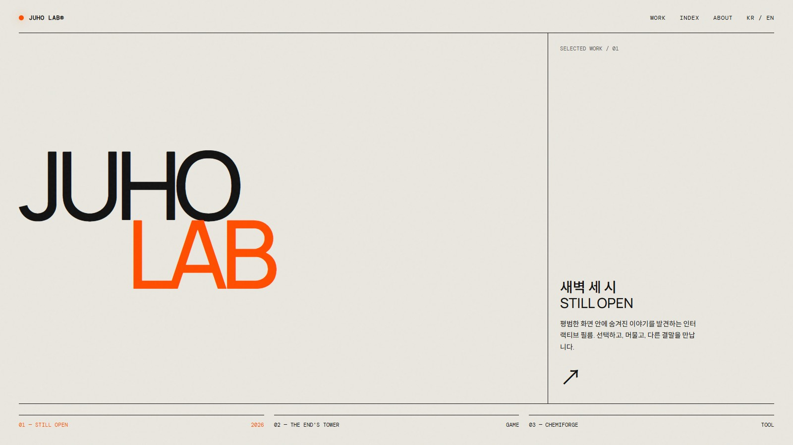
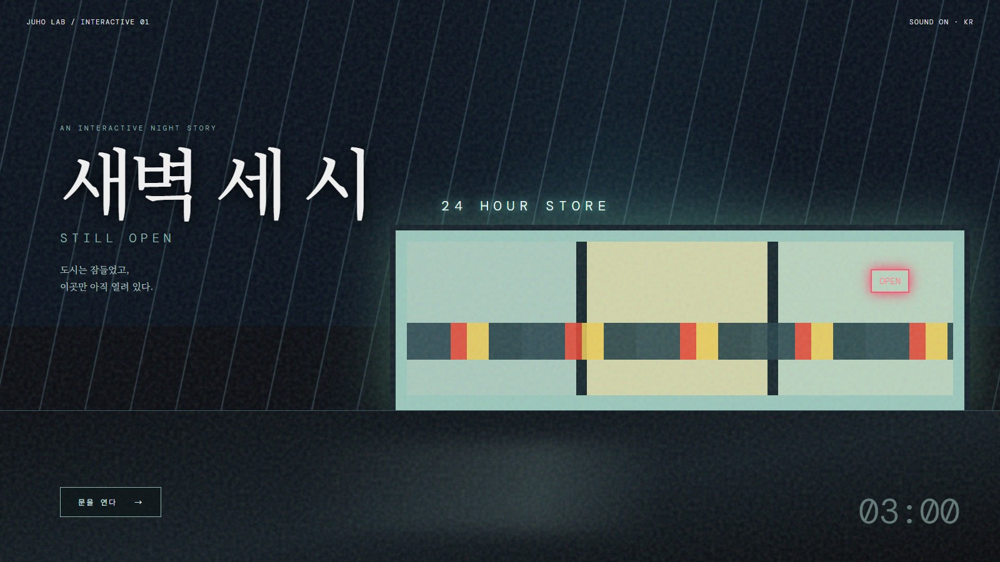

# 인터랙티브 웹

> 이야기와 선택을 데이터로 설계하고, 작품은 빠르게 반복 제작합니다.

영상·이미지·자막·선택지를 조합한 인터랙티브 웹 작품을 **복제 → 확장 → 배포** 방식으로
양산하기 위한 모노레포입니다. AI World 2026 김그륜 세션과 레퍼런스 사이트 5곳을 분석해,
작품마다 엔진을 다시 만드는 대신 스토리 데이터와 테마를 교체하는 제작 체계를 설계했습니다.

### Juho Lab

작품과 실험을 한곳에서 탐색하는 스튜디오 인덱스입니다.



[메인 페이지 소스 보기](docs/readme/juho-lab.html)

### 새벽 세 시 · Still Open

불이 켜진 편의점으로 관객을 초대하는 첫 인터랙티브 작품의 메인 페이지입니다.



[메인 페이지 소스 보기](docs/readme/still-open.html)

## 만들고 있는 경험

- 영상과 스틸 이미지가 자연스럽게 이어지는 풀스크린 장면
- 화면 속 사물에 붙는 투명 핫스팟과 방향 화살표
- 선택에 따라 달라지는 분기와 다시 합쳐지는 이야기
- 특정 시간에만 나타나는 히든 링크
- 긴 장면을 건너뛸 수 있는 챕터 타임라인
- 한국어·영어 전환, 음소거, 모바일 레이아웃
- 작품 데이터만 바꿔 재사용하는 공통 플레이어

## 첫 작품 — 새벽 세 시 · Still Open

새벽 세 시, 혼자 불이 켜진 편의점에 들어가 커피와 잡지, 출입구를 살펴보는 짧은 분기형
인터랙티브 작품입니다. 7개의 핵심 컷 안에서 보았던 장면에 따라 다음 글로우가 바뀌고,
특정 시간의 냉장고 반사를 누르면 숨겨진 장면으로 들어갑니다.

- 작품 스펙: [`projects/dawn-store/SPEC.md`](projects/dawn-store/SPEC.md)
- 스토리 데이터: [`projects/dawn-store/seed/story.json`](projects/dawn-store/seed/story.json)
- 테마 토큰: [`projects/dawn-store/seed/theme.json`](projects/dawn-store/seed/theme.json)
- 와이어프레임: [`projects/dawn-store/wireframes/index.html`](projects/dawn-store/wireframes/index.html)
- 이미지 제작 프롬프트: [`projects/dawn-store/assets/PROMPTS.md`](projects/dawn-store/assets/PROMPTS.md)

## 데이터 중심 설계

```text
story.json
├── nodes      장면, 길이, 미디어, 자막, 상태 변화
└── edges      선택지, 이동 대상, 화살표, 노출 조건

theme.json
├── color      글로우·텍스트·배경
├── timing     전환·메뉴·자막 타이밍
├── layout     데스크톱·모바일 치수
└── zIndex     핫스팟부터 엔딩까지 레이어 순서
```

플레이어는 장면을 하드코딩하지 않고 두 JSON을 해석합니다. 새 작품은 미디어와 스토리·테마
데이터를 추가해 만들고, 공통 상호작용과 반응형 규칙은 그대로 재사용합니다.

## 와이어프레임 확인

```bash
cd projects/dawn-store/wireframes
python -m http.server 8000
```

브라우저에서 [http://localhost:8000](http://localhost:8000)을 열면 데스크톱·모바일 화면,
핫스팟 좌표, 레이어 순서와 상태 변형을 한 문서에서 확인할 수 있습니다.

## 저장소 구조

```text
interactive-web/
├── docs/
│   ├── research/          # 레퍼런스 사이트 실측과 화면 캡처
│   └── transcripts/       # 세션·Q&A 전사
└── projects/
    └── dawn-store/
        ├── assets/        # 생성 자산 프롬프트
        ├── seed/          # story.json, theme.json
        ├── wireframes/    # 화면·상태 명세
        └── SPEC.md        # 작품 설계 계약
```

전체 연구·설계 문서의 시작점은 [`docs/00-README.md`](docs/00-README.md)입니다.
원본 영상·사진·음성처럼 큰 소스 파일은 저장소에 포함하지 않고 전사와 분석 결과만 관리합니다.
