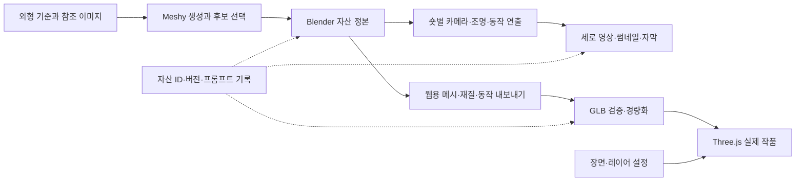

# 13. 3D 공통 제작 파이프라인 — Meshy → Blender → Three.js

작성: 2026-09-23 · 상태: **설계 완료, 제작·런타임 구현 전**.
2026-10-04 위치 변경: 인터랙티브 웹의 **기본** 비주얼은 [14번 3D 느낌 이미지 + CSS 깊이](14-2.5D-이미지-제작-방식.md)다. 이 문서는 뒷면·옆면 노출, 관절 동작, 공간 이동, 숏폼 재사용이 필요할 때 쓰는 예외 경로다([14번 §1](14-2.5D-이미지-제작-방식.md#1-언제-이-방식을-쓰고-언제-실제-3d13번로-가나)). 아래 POTATO 실제 3D 첫 검증을 계속할지는 사용자 결정 전이다.
사용자 결정: Meshy로 제작하고 Blender로 세부 연출·수정한 뒤 Three.js에서 웹 상호작용을 구현한다. 같은 자산을 숏폼에도 쓴다.
작업 플랜: [실행 계약](../.claude/plans/3d-production-pipeline-2026-09-23.plan.json) · [검토 기록](../.claude/plans/3d-production-pipeline-2026-09-23.md).

## 1. 목표와 현재 경계

**한 번 만든 캐릭터·소품의 외형과 동작을 재사용하고, 영상과 웹에 맞는 산출물을 따로 만든다.** 편집 가능한 정본은 Blender 프로젝트이며, 웹 GLB나 MP4를 다시 정본으로 삼지 않는다.

| 단계 | 담당 | 정본 또는 산출물 |
|---|---|---|
| 외형·자산 제작 | Meshy | 선택한 생성 모델, 텍스처, 요청 옵션·작업 ID·프롬프트 |
| 구조·재질·동작 정리 | Blender | 버전이 고정된 자산 master.blend 및 의존 텍스처 |
| 숏폼 연출 | Blender + 최종 영상 편집 | 숏별 .blend, 무자막 영상/이미지 시퀀스, 최종 MP4·자막·오디오 |
| 웹 연출 | Three.js + 기존 Scene Studio | 경량 GLB, 장면/에셋 참조, 레이어 값·입력 반응 |
| 재현과 재사용 | 자산 카탈로그 + prompts/ | 같은 assetId·revision으로 두 매체의 출처와 사용처 연결 |

현재 POTATO는 PNG와 CSS 모션, JOOHO LAB은 파노라마 평면을 사용한다. [POTATO README](../projects/potato-designer/README.md)와 [기존 QA](../projects/potato-designer/QA.md)의 DOM 619개 probe 통과는 실제 3D 검증이 아니다. 공용 [layer-kit](../packages/layer-kit/README.md)은 값 해석·CSS/text/attr 바인딩만 구현되어 있다. 11번 문서의 fn 바인딩, 캔버스 객체 선택, 3D probe는 추가 구현이 필요하다.

이번에 설치·구독·유료 생성·외부 배포를 실행하지 않았다. Node/pnpm은 PATH에서 확인했고 Blender 명령은 PATH에서 찾지 못했다. Blender 설치 여부 전체를 조사한 것은 아니므로 설치되지 않았다고 단정하지 않는다.

## 2. 참고한 원칙과 채택하지 않는 범위

| 자료 | 적용 | 이번에 적용하지 않는 부분과 이유 |
|---|---|---|
| [01 제작 철학](01-강연-핵심-정리.md), [04 제작 가이드](04-제작-가이드.md), [06 영상 분석](06-강연-영상-분석.md) | 핵심 조작 먼저, 캐릭터/소품 분리, 스타일 기준 보존, 반복 수정은 설정으로 이동 | 기존 Tripo 우선 제작 절차는 역사적 참고. 이번 사용자 선택은 Meshy |
| [03 모노레포](03-모노레포-설계.md), [05 패밀리](05-템플릿-카탈로그.md) | 정적 POTATO에 작은 3D 어댑터 추가, 두 번째 실제 소비자 뒤 three-kit 추출 | React/R3F 전면 이관, 얼굴 추적, 게임 물리, 가우시안 스플랫은 첫 전달 경로에 불필요 |
| [10 검수 교훈](10-인터랙티브-개발-참고원칙.md), [11 레이어 계약](11-레이어-설정-시스템-설계.md), [12 Scene Studio](12-Scene-Studio-관리자-설계.md) | 장면×화면 설정, 실제 런타임 미리보기, 정지 의도 보존, 초안/게시/복구 | 웹 안에 메시 편집·뼈대 제작·키프레임 편집기를 다시 만들지 않음. Blender가 담당 |
| [프롬프트 기록](../prompts/README.md) | 참조 이미지·원문·모델 버전·옵션·선택/폐기 이유와 결과 기록 | 설계 예시를 실제 생성 결과 카드로 등록하지 않음 |

공급자 지원 기능은 §12의 공식 출처를 기준으로 한다. 아래 성능 예산, 파일명, 상태·레이어·프로필은 **우리 프로젝트의 설계 결정**이며 도구가 보장하는 성능이나 이미 존재하는 API가 아니다.

## 3. 전체 흐름과 정본



- 자산 master.blend에는 모델·재질·뼈대·재사용 동작을 둔다. 숏별 파일은 그 자산의 **지정 revision**을 링크/라이브러리 오버라이드로 사용한다. 샷의 카메라·배경·조명은 샷 파일이 소유한다.
- 웹의 카메라·조명·입력 반응은 레이어 값이 소유한다. Blender 샷과 웹 장면을 양방향 동기화하지 않는다. 초기 프리셋을 가져올 경우 변환 기록을 남기고 이후 웹 값이 정본이다.
- Blender의 원본 컬렉션을 보존하고 WEB_EXPORT 컬렉션을 파생시킨다. 폴리곤·텍스처 축소를 영상 원본에 덮어쓰지 않는다.
- master revision 변경은 자동 전파하지 않는다. 샷과 앱이 버전을 명시하고, 검수 후 참조를 갱신한다. 복구는 이전 버전 재선택으로 한다.

## 4. 자산 제작 계약

### 4-1. Meshy 입력과 생성

1. 자산을 캐릭터/소품/구조물로 나누고 assetId를 부여한다. 한 배경 전체를 하나의 메시로 만들지 않는다.
2. 캐릭터는 얼굴·의상·색·비율을 고정한 참조와 팔·다리가 겹치지 않는 A/T 자세를 준비한다. 앞/옆/뒤 참조는 동일 디자인인지 먼저 확인한다.
3. 첫 검증 기본안은 POTATO 캐릭터 1개. 현재 날아차기 PNG는 외형 참고용이고, 중립 자세 참조를 새로 만든 뒤 동작으로 날아차기를 만든다. 가려진 등·손은 기존 그림에 정답이 없으므로 새로 정한 디자인으로 기록한다.
4. 첫 캐릭터는 standard 생성, 소품은 smart-topology도 비교 가능한 제작 프로필로 둔다. API 모델은 요청 당시 지원되는 **명시적 ID**를 고정하고 latest를 게시 이력에 쓰지 않는다.
5. 후보 검수: 정면/후면 실루엣, 손·팔·다리 분리, UV·텍스처, 부품 분리 가능성. 선택 후보에만 본격적인 재질·뼈대·동작 작업을 진행한다.

공식 Image to 3D API는 현재 standard/Smart Topology, pose_mode와 텍스처 옵션을 구분한다. 예전 파라미터 이름을 기억으로 재사용하지 않고 구현 시 스키마를 다시 확인한다. [Meshy 생성 API](https://docs.meshy.ai/en/api/image-to-3d)

### 4-2. Blender 정리와 동작

- 기본 흐름: Meshy 모델 → Blender 구조/재질 정리 → 뼈대/스키닝 → 동작 정리 → 두 매체 출력.
- Meshy 자동 뼈대/동작을 쓸 때는 정리한 모델을 선택적으로 다시 보내고, 결과를 Blender에 가져와 최종 보정한다. 토폴로지 수정은 가급적 뼈대 전에 끝낸다. 이미 스키닝한 모델의 토폴로지를 바꾸면 웨이트 전송·관절 변형을 다시 검수한다.
- 자동 API 리깅의 기본 지원 계약은 팔다리가 명확한 텍스처 포함 인간형이다. 웹 제품의 더 넓은 홍보 범위를 API 보장으로 해석하지 않는다. 비인간형·표정·입모양·특수 동작은 Blender 수동 보정 경로로 둔다. [Meshy Rigging API](https://docs.meshy.ai/en/api/rigging)
- 자산 단위는 미터. Blender 내부 Z-up과 웹/glTF Y-up을 내보내기에서 한 번만 변환한다. 배포 GLB의 캐릭터 전방은 +Z, 발바닥 기준점은 원점으로 검증한다. 이 전방은 우리 자산 규약이며 카메라의 시선 축과 구분한다.
- 부품/재질/클립은 안정된 이름을 쓴다. 예: body, hair, glasses, outfit / idle, greet, kick. 이름은 asset.json의 허용 목록에 저장한다.
- 모델 전체 배치는 Three.js의 바깥 instanceRoot, 포인터 반응은 motionRoot, 본 애니메이션은 그 안 importedRig가 맡는다. 같은 transform을 애니메이션과 입력 코드가 동시에 쓰지 않는다.
- 웹용 클립은 기본적으로 제자리 동작. 이동량이 있는 동작은 root-motion 여부·시작/끝 이동을 기록하고 명시적으로 처리한다. idle 반복과 kick 1회 재생 후 idle 복귀를 구분한다.
- Blender exporter는 사용 버전을 고정한다. 키프레임/스키닝/모프 타깃 지원 범위 안에서 Action을 내보내고, 제약·시뮬레이션은 필요한 변형 키에 bake한다. 실제 GLB의 클립명/길이/뼈대/변형을 재수입해 확인한다. [Blender 4.5 glTF 매뉴얼](https://docs.blender.org/manual/en/4.5/addons/import_export/scene_gltf2.html)

### 4-3. 영상 출력

아래는 첫 검증의 제작 프리셋이며 각 숏에서 변경할 수 있다.

| 항목 | 기본안 |
|---|---|
| 화면·길이 | 세로 1080×1920, 30fps, 6~10초 검증 컷 |
| 구성 | 캐릭터 등장 → 대표 동작 → 짧은 정지/로고 영역 |
| 출력 | 중간본 PNG/EXR 시퀀스 또는 편집용 영상, 배포본 H.264 MP4 |
| 분리 보관 | 무자막 마스터, 최종 자막 포함본, 자막 텍스트/시간, 오디오 |
| 썸네일 | 같은 revision의 승인 프레임을 별도 PNG/WebP로 출력 |
| 재사용 | 1:1·16:9 카메라 프리셋 별도. 세로 영상을 단순 잘라 쓰는 것을 기본으로 삼지 않음 |

표정·립싱크가 필요한 숏은 대본·음성·얼굴 리그 작업을 별도 샷 범위로 추가한다. Meshy 기본 동작만으로 대사 연기가 완료된다고 가정하지 않는다. 플랫폼 버튼/자막이 가릴 영역은 플랫폼별 가이드 오버레이로 검수하고 수치를 고정된 플랫폼 규칙처럼 기록하지 않는다.

### 4-4. 웹 출력과 성능 목표

| 항목 | 첫 캐릭터/모바일 기준 목표 |
|---|---|
| 캐릭터 GLB | 전송 크기 5MB 이하, 모바일 변형은 가능하면 3MB 이하 |
| 메시 | 캐릭터 20k~50k 삼각형, 소품 1k~10k부터 조절 |
| 텍스처 | 기본 1K, 주연 부위만 2K. 영상용 고해상도는 원본에 보존 |
| 첫 장면 자산 | 합계 10MB 이하 목표, 나머지는 지연 로드 |
| 렌더링 | 실제 기준 모바일에서 30fps 이상 목표. 측정 기기·브라우저·해상도·DPR 기록 |
| 정적 대기 | 모션/입력/전환이 없으면 지속 렌더링 중단 |
| 품질 조절 | DPR 상한·그림자 해상도·환경맵 크기·애니메이션 상태를 제작 설정으로 관리 |

목표값은 QA 측정으로 조정한다. 파일 용량만으로 GPU 메모리나 프레임 속도를 판단하지 않는다. export 후 삼각형/재질/텍스처 수·해상도·draw calls·프레임 시간을 함께 기록한다. 얼굴·손·관절 실루엣은 단순 Decimate로 품질을 보장할 수 없다.

첫 연결은 비압축 GLB로 검사하고, 같은 revision에서 Meshopt + KTX2 파생본을 만든다. 이에 맞는 decoder/transcoder를 번들에 포함하고 경로·버전을 고정한다. 압축만 하고 로더를 빠뜨리지 않는다. GLTFLoader, AnimationMixer 및 필요한 로더 부품은 **동일한 Three.js 릴리스**를 사용한다. [GLTFLoader 공식 문서](https://threejs.org/docs/pages/GLTFLoader.html)

공통 재질은 metal/rough PBR 또는 명시적 unlit을 기본으로 한다. Blender 전용 노드·털·볼륨·합성 효과는 웹용 텍스처/메시로 bake하거나 영상 전용으로 표시한다. 색공간·노출·톤매핑·조명 차이 때문에 두 렌더러의 픽셀 일치를 보장하지 않으며, 기준 렌더와 웹 캡처로 외형을 비교한다.

## 5. 파일·버전·데이터 구조

다음은 **후속 구현 시 생성할 구조**다. 현재 없는 파일을 구현 완료로 간주하지 않는다.

```text
assets/3d/<asset-id>/r001/
  asset.json                    # 출처·버전·산출물 해시·측정값·사용처
  preview.webp                  # 저장소/보관함용 경량 이미지
.asset-work/<asset-id>/r001/      # 로컬 비공개 작업, 구현 시 gitignore
  source/                       # Meshy 원본·응답·참조·텍스처
  blender/master.blend
  shots/<shot-id>.blend
  exports/web/                  # 원본/경량/모바일 GLB
  exports/video/                # 프레임·중간본·최종 영상
projects/potato-designer/
  dist/assets/models/<asset-id>/r001/<hash>.glb
  dist/scene-assets.json         # 앱이 쓰는 버전·인스턴스·부품→layerId
  dist/three-view.js             # 작품별 Three.js 렌더러 (계획)
  dist/three-layer-adapter.js    # 작품별 객체/레이어 연결 (계획)
  scripts/3d/                   # 생성·보관·Blender export·검사 도구 (계획)
prompts/potato-designer.md        # 실제 생성 프롬프트 카드의 정본
```

- 작은 카탈로그/프리뷰/설정만 Git으로 관리한다. 원본 .blend, 대용량 GLB·영상은 .asset-work 작업본과 지정 백업 디렉터리에 버전·체크섬으로 보관한다. **백업이 없는 자산은 준비 완료가 아니다.** 저장 위치는 구현 착수 때 확정한다.
- 배포용 작은 GLB는 앱에 복사하는 경로를 우선 지원한다. 필요하면 기존 R2에 전용 자산 경로와 GLB 검증/업로드 경로를 만든다. 현재 허브의 이미지 전용 5MB 업로더를 그대로 GLB에 사용하지 않는다.
- 카탈로그에 API 키·만료 URL·계정 식별자·자격증명은 넣지 않는다. 공급자 응답은 비공개 작업 이력에 보관하고 공유 가능한 정보만 카드로 옮긴다.
- 자산 ID는 정체성, revision은 불변 파일 묶음이다. 파일을 교체하면 revision과 해시를 바꾼다. 표시 이름 변경으로 ID를 바꾸지 않는다.
- scene-assets.json은 인스턴스→자산/버전→부품/재질/클립 목록을 소유한다. 위치·회전·재질 조절·모션 속도는 layers.values.json만 소유한다. 같은 값을 두 파일에 중복 저장하지 않는다.
- 카탈로그의 자산 목록과 이야기/작업 목록은 콘텐츠다. 화면에 배치된 캐릭터/소품의 시각 인스턴스와 부품 그룹만 레이어로 매핑한다.

### 데이터 계약 (개념 스키마)

| 데이터 | 필수 내용 |
|---|---|
| asset.json | schemaVersion, assetId, revision, status, source(tool/modelId/taskIds/input hashes/promptRef), provenanceRef, toolchain(Blender/exporter/Three.js/압축기 버전), artifacts, parts, materials, clips, metrics, consumers, backupVerified |
| artifacts | 역할(master/web/mobile/video/poster), 경로 또는 저장키, bytes, sha256, 부모 원본 revision/hash. Blender 외부 의존 파일도 목록에 포함 |
| clips | name, durationSeconds, loop, rootMotion, skeletonId. 누락된 클립은 등록 실패 |
| consumer | app/shot ID, sceneId, instanceId, layerId, 사용하는 revision. 콘텐츠 ID와 layerId는 별개 |
| job.json (비공개) | localJobId, 요청 해시·옵션, providerTaskId, 예산 예약/실제 차감, 상태, 다운로드/검사 결과, 오류 |
| 제작 프리셋 | 포즈·모델 ID·품질·텍스처·최대 후보 수·maxCredits, 샷 fps/화면/길이, 웹 성능 목표 |

schemaVersion은 데이터 형식, revision은 자산 파일 버전이다. 값 파일의 manifestVersion도 별개로 관리한다. 초기 스키마 예시는 실제 생성에서 검증한 뒤 고정한다.

## 6. Three.js 런타임과 상호작용

### 책임 분리

- POTATO의 정적 ESM 구조를 유지한다. Three.js와 addons를 고정 버전으로 묶어 로컬 vendor 또는 재현 가능한 번들로 생성하고 체크섬으로 검증한다. 기존 허브의 벤더 파일에 다른 릴리스 addon을 붙이지 않는다.
- 앱 어댑터는 load, applyResolvedValues, pick, bounds, setMotionState, seek, inspect, dispose 역할을 갖는다. 이는 **새로 만들 계약 이름**이며 layer-kit 현재 API라고 주장하지 않는다.
- host.subscribe/get으로 장면·화면별 해석값을 받고, Three.js에 바인딩한다. 매 프레임 JSON 전체를 저장하지 않는다. 영구 설정, 관람자 입력, 재생 시간, 로딩 상태를 분리한다.
- 선택은 raycast → 가장 가까운 등록된 부품/조상 layerId 순서. 투명도 0/숨김 객체는 선택에서 제외한다. 미등록 내부 노드가 화면에 그려지면 검사 오류다.
- 객체 교체 시 새 모델의 로드·검사를 완료한 뒤 전환한다. 늦게 끝난 이전 요청은 revision token으로 무시한다. 공유 재질은 인스턴스별 clone 또는 참조 카운트로 관리한다.
- 해제 시 mixer action/cache, 이벤트, GPU geometry/material/texture, decoder 자원과 소유한 이미지 리소스를 정리한다. 공유 중인 자원을 먼저 dispose하지 않는다. [Three.js Texture.dispose](https://threejs.org/docs/pages/Texture.html)

### 관람자 입력 → 상태 → 피드백 → 복구

| 입력 | 상태/피드백 | 복구 |
|---|---|---|
| 포인터 이동 | 설정된 범위 안 시선/상체 또는 전체 기울기 | 이탈하면 중립 |
| 가로 드래그 / 키보드 회전 버튼 | instanceRoot의 관람자 회전. 모바일 세로 스크롤 유지 | 초기화로 현재 장면의 제작 기본값 복귀 |
| 동작 버튼 | idle → greet/kick → idle, 버튼에 현재 상태 | 정지/처음부터, 클립 누락 시 버튼 비활성+이유 |
| 분야 변경 | 기존 Brand/Digital/Character 유지, 해당 카메라/포즈·색 프리셋 적용 | 다른 분야 선택, 되돌리기(관리자) |
| 모션 정지 | 선택 장면·회전·자세를 보존하고 시간만 멈춤 | 사용자 재생 |
| 설정 수정 | 실제 작품 iframe에 즉시 적용 | 기존 undo/redo·범위 초기화·초안 복구 |

스크롤 진행을 사용하는 작품은 scrollProgress 입력을 별도 선언한다. 첫 POTATO에서는 임의 스크롤 스크러빙을 추가하지 않고, 관리자 시점 이동과 버튼 동작부터 구현한다.

정지 이유는 userPaused / reducedMotion / documentHidden / modalOpen으로 구분한다. 어느 하나가 활성화되면 자동 재생과 관성 모션을 멈춘다. 탭 복귀로 사용자의 정지를 취소하지 않는다. reducedMotion에서는 포인터 추종·자동 회전·자동 클립을 끄고 버튼으로 각도·정지 포즈를 즉시 바꿀 수 있게 한다. 시간 이동은 CSS와 AnimationMixer가 같은 기준 시점을 받도록 확장한다.

로딩 상태는 poster → loading → ready 또는 failed이다. 실패하면 포스터와 기존 작업 탐색을 유지하고 재시도 버튼을 제공한다. 저장소 실패는 메모리 편집을 유지하며 내보내기를 제공한다. WebGL 미지원/context loss·GLB 404·decoder 실패를 이 경로로 검사한다.

## 7. 레이어 계약과 Scene Studio 확장

기존 20개 DOM 레이어를 유지하고 character의 표현을 3D로 확장한다. 구체적 신규 레이어 ID는 첫 모델의 부품 매핑 후 확정하며, 아래 필수 영역이 빠지면 완료가 아니다.

| 레이어 | 편집 파라미터 | 바인딩·검수 |
|---|---|---|
| character (확장) | visible, opacity, render-mode(image/three), 승인 assetId/revision 선택, position.xyz, rotation.xyz, scale, clip, playback-speed, blend-ms, pointer 강도, drag 회전 한계 | 모델/클립/transform. 기존 CSS x/y/rotate 값과 새 미터·각도 값을 혼용하지 않음 |
| character-body / outfit / hair / glasses | 각 visible/opacity, 로컬 위치·회전·크기, material color/roughness/metalness/emission, 승인 텍스처 선택 | 실제 부품 또는 재질 그룹. 하나로 붙은 메시를 제어해야 하면 Blender에서 먼저 분리 |
| three-stage | visible/opacity, viewport 위치·크기·클리핑, 품질 프로필/DPR 상한 | 실제 canvas 영역과 해상도 |
| camera-rig | visible(연출 사용), opacity(연출 혼합 강도), 기준 position/target/FOV/zoom, 장면 전환 시간, pointer/orbit 강도 | 기준 카메라에 연출 변위를 혼합. visible=false여도 렌더에 필수인 기준 카메라는 유지. 라벨에 의미 명시 |
| light-key / light-fill / light-rim | 각 visible/opacity, 종류·위치·방향·색·강도, shadow 설정 | light intensity × opacity, 그림자와 조명 영역에서 관찰 |
| environment | visible/opacity, 배경 색/등록 이미지, 환경맵 선택·회전·강도 | 배경과 IBL의 영향 분리. opacity는 각 기여도에 반영 |
| ground-shadow | visible/opacity, 바닥 크기·위치·색, shadow 강도·blur/해상도 프리셋 | 기존 2D shadow와 배타적으로 사용 |
| load-status / model-controls | 각 visible/opacity, 위치·크기·색·문구·이미지·간격·모션 | DOM. 로딩/실패/클립 빈 목록 조건도 probe |
| 기존 DOM 장식·패널 | 기존 문구·이미지·색·모션·배치 파라미터 | 기존 검사 유지 |

- 모든 수치·색·문구는 manifest 기본값 또는 값 파일에서 읽는다. position은 m, rotation/FOV는 degree, 재생 시간은 s, UI 지연은 ms로 정의하고 adapter에서 변환한다. vector는 기존 숫자 컨트롤에 맞춰 xyz 스칼라로 선언한다.
- 새로운 모델/텍스처 업로드는 콘텐츠 자산 등록이 맡고, 레이어 패널은 검증된 ID를 선택한다. 임의 URL을 image 파라미터에 넣어 GLB 로더로 우회시키지 않는다.
- 소유 범위: root 이동→부품 이동은 transform 계층으로 합성, opacity는 부모×자식, 숨김은 부모가 우선한다. 본에 붙은 부품의 조정은 attachment offset으로 적용하여 animation track과 충돌하지 않는다.
- scene은 기존 brand/digital/character, previewScreens는 기존 wide/desktop/tablet/mobile을 유지한다. 게시값 파일 버전을 올릴 때 이미지 모드 기본값을 보존하는 일방향 migration과 이전 파일 백업이 필요하다.
- 라이팅/카메라 등의 visible/opacity는 의미를 UI에 표시한다. 구조상 필수인 기준 시점, 좌표 변환, object ID/해시, 접근성 포커스, 리소스 수명, 상태 우선순위는 manifest.fixed에 이유를 기록한다. 카메라의 기준 위치·화각 자체는 편집 가능하게 둔다.

### layer-kit에 실제로 필요한 변경

1. DOM 전용 el 가정 제거: kind=three 등 비DOM 레이어가 querySelectorAll에 전달되지 않도록 분기한다.
2. JSON으로 표현되는 fn 바인딩의 식별자와 앱 함수 등록부를 연결한다. 브라우저에서 문자열 코드를 실행하지 않는다. 함수명·파라미터·layerId 누락은 오류.
3. lint는 CSS뿐 아니라 등록된 함수 바인딩도 검증한다. CSS 변수를 읽지 않으면서 더미 var를 넣어 통과시키지 않는다.
4. probe는 DOM 경로를 유지하고 3D adapter inspect/렌더 관찰 경로를 추가한다. 파라미터별 활성 장면/화면/입력/시간 fixture에서 전후 **실제 적용값 + 렌더 결과**를 확인한다.
5. 카메라·조명처럼 픽셀에 드러나야 하는 값은 controlled fixture 캡처/픽셀 차이를, 품질 상한은 drawing buffer·renderer 측정치를, 모델/클립 교체는 해시·클립 목록·관절 변형과 렌더를 관찰한다. 설정값 객체만 달라진 것을 성공으로 세지 않는다.
6. Scene Studio bridge에 raycast/bounds, 3D 드래그/회전 gizmo, AnimationMixer seek를 추가한다. gizmo는 admin에서만 로드하고 수치 입력을 키보드 대안으로 둔다. 한 제스처는 undo 한 단계.
7. 기존 초안/게시 저장 경로를 확장하되 asset revision까지 검증한 뒤 함께 갱신한다. 이미지 전용 검사/업로더와 분리하고 기존 save 실패·409 충돌·내보내기 동작을 유지한다.

**현재 lint/probe 결과:** 이번 작업은 문서만 변경하므로 3D lint/probe **미실행**. 구현 완료 시 기존 DOM와 새 3D 전 파라미터가 함께 통과해야 한다. 조건부 미실행 항목을 통과 수에 넣지 않는다. 검사 뒤 설정·선택·카메라·클립/시간·정지 이유를 원래 상태로 복구한다.

## 8. 제작 자동화·비용·보관 경계

초기에는 Meshy 웹에서 생성한 파일을 수동 수집해도 동일한 asset.json을 작성한다. API/MCP 자동화는 같은 제작 기록을 쓰며, **관람자 사이트가 Meshy API를 직접 호출하지 않는다.** 제작용 로컬 Node 작업기 또는 인증된 제작 서버가 호출하고 API 키는 환경변수로만 읽는다. iframe·정적 번들·프롬프트 카드·로그에 키를 넣지 않는다.

제안 job 상태: draft → submitted → running → downloaded → validated → selected/rejected. 시간 초과/실패에는 unknown / failed / download-failed를 구분한다.
- create 응답을 받으면 taskId를 즉시 영속화하고, 재시작 시 그 ID로 조회한다.
- create 중 네트워크가 끊기면 작업 생성 여부가 불명확하다. 자동 POST 재시도 대신 unknown으로 두고 작업 목록/이력으로 확인한다. 공급자 멱등성을 확인하지 않은 채 있다고 가정하지 않는다.
- GET 조회/다운로드만 지수 backoff와 제한 횟수로 재시도한다. 429는 지연하고, 크레딧 부족은 대기 상태로 둔다.
- 실패와 마음에 안 드는 성공 결과를 구분한다. 새 후보 생성은 새로운 유료 작업이다. 무제한 재생성 루프는 두지 않는다.
- 프로젝트별 maxCredits, maxCandidates, 동시 작업 수를 제작 설정으로 둔다. 처음은 예산 미설정 상태로 유료 제출을 막고, 사용자가 정한 범위 안에서 예약 비용 + 실제 차감량을 관리한다. 예상 요율 확인일과 실제 consumed_credits를 함께 기록한다.
- 완료 직후 원본 GLB·텍스처·동작·프리뷰를 다운로드하고 크기/해시/내용을 검증한다. 공급자의 임시 링크를 앱에 연결하지 않는다. 공식 API 보관 문서가 짧은 보관 기한을 명시하므로 이를 영구 저장소로 쓰지 않는다. [Meshy 자산 보관](https://docs.meshy.ai/en/api/asset-retention)
- 다운로드 실패는 모델 재생성으로 해결하지 않고 기존 task를 다시 조회해 파일 수집부터 재개한다.
- GLB는 헤더/크기/확장/내부 URI를 검증하며 처음에는 자기완결 GLB만 허용한다. 외부 텍스처/버퍼 임의 요청, 경로 탈출, 미등록 확장을 거부하고 별도 정리 단계로 돌린다. 서버 다운로드는 공급자 허용 호스트·리다이렉트 제한·크기/시간 제한을 적용한다.
- 로컬 게시 전 asset revision과 layers.values를 검증해 새 묶음을 임시 위치에 준비하고 교체한다. 실패하면 이전 묶음과 초안을 유지한다. 외부 배포는 기존 앱의 배포 경로를 따른다.

이는 제작 요청을 실행할 때의 계약이며, 이 설계 작업에서 사용자에게 결제나 API 키 입력을 요구하지 않는다.

## 9. 프롬프트·제작 이력과 보관함

실제 생성마다 [prompts 카드 양식](../prompts/README.md)을 사용한다. 원문은 prompts/<최초 제작 앱>.md에 **한 번만** 보관하고, 공통 자산의 다른 소비자는 같은 카드 anchor와 assetId/revision을 참조한다.

카드에는 기존 필수 항목에 더해 assetId/revision, 공급자 모델/작업 ID, 생성 옵션·실제 크레딧, 참조 이미지 해시, Blender/exporter 버전·수정 내용, 영상·웹 산출물 경로·용량·해시, 선택/폐기 이유, 검사 범위를 기록한다. 값이 없으면 미기록으로 쓰고 추측하지 않는다. 같은 프롬프트/시드가 항상 같은 결과를 준다고 보장하지 않는다.

현재 보관함이 GLB 3D 미리보기를 지원한다고 가정하지 않는다. 1차는 회전 프리뷰 이미지/영상과 산출물 링크로 기록하고, 경량 이미지 카드부터 기존 빌더 호환을 확인한다. .blend 원본은 공개 보관함에 올리지 않는다.

새 에셋 카드 작성 시 prompts/README 표 → pnpm prompts:build → 로컬 보관함 확인 → 기존 claude.ai 보관함 주소 갱신 순서를 따른다. 이번에는 에셋을 생성하지 않았고 prompts 파일을 수정하지 않았으므로 보관함 생성/재게시 대상이 없다.

## 10. 첫 검증 범위와 후속 구현 순서

첫 검증의 제안 범위는 **POTATO 캐릭터 1개, 동작 3개(idle/greet/kick), 세로 영상 1개, 웹 장면 3개**다. kick은 직접 보정할 수 있고 기존 PNG는 실패 시 포스터로 재사용한다. 일반 마을 전체 3D 전환은 이 검증 이후 판단한다.

| 단계 | 선행 조건 | 산출물과 종료 기준 |
|---|---|---|
| P0 제작 환경 | 후속 구현 착수 | Meshy 계정/연동·사용 예산, Blender 실행 경로/버전, 원본/백업 위치, 기준 모바일 확정 |
| P1 참조·후보 | P0 | 중립 자세 참조, 생성 후보, 선택 이유·프롬프트 카드·원본 백업 |
| P2 Blender 정본 | P1 | 부품/재질/뼈대 정리, 세 클립, export/import 검사, revision 고정 |
| P3 두 출력 | P2 | 6~10초 세로 영상과 검증된 GLB/모바일 변형·포스터, 용량/클립 보고서 |
| P4 레이어 기반 웹 | P2의 검증 GLB | layer-kit fn/lint/probe·POTATO adapter, 실제 화면과 설정 패널 연결 |
| P5 통합 검수·기록 | P3·P4 | 아래 QA 전 범위, 사용처/버전 연결, prompts 보관함 갱신, 회귀 결과 |
| P6 두 번째 작품 | P5와 실제 두 번째 소비자 | 공통분모 확인 후 three-kit/제작 CLI 공용 추출 |

P3 영상과 P4 웹은 같은 revision에 대해 병행 가능한 작업 단위다. 일정·가격·성능은 실제 첫 자산 측정 전까지 확정 수치로 약속하지 않는다. @iw/layer-kit은 이미 공용 패키지이므로 그 확장은 바로 공용에 반영하고, 새 three-kit만 추출 조건을 기다린다.

## 11. 검수와 완료 정의

| 범위 | 검사와 완료 기준 |
|---|---|
| 자산 | 앞/옆/뒤 외형, 손·관절 변형, 중립 자세, 원점·높이·방향, 실제 삼각형/텍스처/클립·hash |
| 영상 | 첫/중간/마지막·루프 경계 프레임, 9:16 출력, 조명/접지/관통, 오디오·자막 타이밍, 썸네일 일관성 |
| 전달 | Blender 재수입 + 실제 Three.js에서 같은 revision/클립 확인. 웹 전용 단순화로 외형이 크게 달라지지 않는지 비교 |
| 관람자 | 드래그/키보드→회전, 동작→피드백, 정지→상태 보존, 초기화, 분야/모달/탭 이동 |
| 관리자 | layer 선택·gizmo·수치 입력→같은 화면 변경→undo/redo→저장/재시작→게시/이전 버전 복구 |
| 실패·빈 결과 | 생성 실패/unknown·크레딧 부족·다운로드 실패, 빈 자산/클립 목록, GLB 손상/404/decoder 실패, WebGL 미지원/context loss |
| 편집 저장 | 저장 차단/409/에셋 누락 때 메모리 초안 보존·게시 차단·내보내기. 잘못된 revision은 부분 적용하지 않음 |
| 화면·접근성 | 320/390/768/1440/1920px, 키보드 동등 조작·포커스 복귀, 모바일 스크롤·회전 분리, reducedMotion |
| 성능·수명 | 기준 실제 모바일, 반복 모델/장면 교체 후 메모리 수렴, 정적 대기 rAF 중단, 배경 탭/해제 시 정리 |
| 레이어 게이트 | lint 0, 전 파라미터 probe 통과, 전후 렌더 증거·조건 fixture·복구 결과. 기존 DOM 회귀 포함 |
| 재사용·보관 | 영상과 웹이 동일 asset revision 참조, master 의존 파일/백업 hash 일치, 프롬프트 원문·선택/폐기·검수 이력 연결 |

초기 자산은 화면에서 검증하기 전 selected로만 두며, 위 전달·보관·레이어 검사가 끝난 뒤 ready로 승격한다. 공급자 생성 성공 상태를 배포 준비 완료로 취급하지 않는다.

**이번에 확인한 것:** 저장소 현재 구현과 레이어 킷 제약, 공식 기능/API/내보내기 문서, 설계 문서 간 연결.
**아직 확인하지 않은 것:** 실제 Meshy 모델 품질·소모 크레딧, Blender 실행/렌더/export, GLB 실로딩, 3D probe, 실제 모바일 성능, 외부 게시. 기존 앱의 통과 수를 여기에 전용하지 않는다.

## 12. 확인한 공식 자료

2026-09-23 조회. 공급자 문서의 버전/파라미터는 후속 구현 직전에 다시 확인한다.

- [Meshy Image to 3D](https://docs.meshy.ai/en/api/image-to-3d): 생성 입력·모델·포즈·텍스처 옵션.
- [Meshy Rigging](https://docs.meshy.ai/en/api/rigging), [Animation](https://docs.meshy.ai/en/api/animation): API 입력 제한과 작업 연결. 비인간형 웹 기능과 API 지원을 구분.
- [Meshy Authentication](https://docs.meshy.ai/en/api/authentication), [Asset Retention](https://docs.meshy.ai/en/api/asset-retention): 서버 자격증명·완료 파일 조기 수집.
- [Meshy API Pricing](https://docs.meshy.ai/en/api/pricing): 실행 전 비용 견적에 사용. 가격을 제작 스키마 상수로 고정하지 않음.
- [Blender 4.5 glTF 매뉴얼](https://docs.blender.org/manual/en/4.5/addons/import_export/scene_gltf2.html): 브라우저로 본문 확인. +Y up, Action·스키닝·모프 타깃·PBR 내보내기. 특정 설치 버전이 4.5임을 뜻하지 않음.
- [Khronos glTF Blender exporter](https://github.com/KhronosGroup/glTF-Blender-IO): 버전별 exporter와 검증 경로.
- [Three.js GLTFLoader](https://threejs.org/docs/pages/GLTFLoader.html), [Texture](https://threejs.org/docs/pages/Texture.html): 압축 확장 로더·자원 수명.
