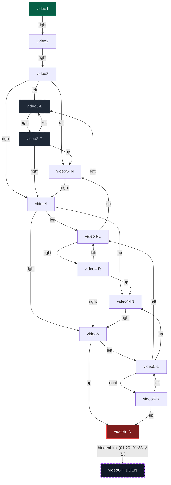

# AI MOVIE (김그륜) — API/에셋 데이터 모델 스펙

대상: https://gryun-aimovie.com/ (design-your-world.replit.app의 원조 베이스)
수집일: 2026-09-11
방법: `curl -sI`/JSON GET, `ffprobe`(원격 HTTP 스트림 메타데이터만, 다운로드 없음). 소스 역컴파일 없음. 번들 JS는 문자열 grep으로만 사용(로직 재구성 안 함). 쓰기 요청(`POST /api/login` 등) 미실행.
원본 JSON/헤더 저장 위치: `docs/research/aimovie/api/` (파일별 경로는 각 절에 링크)
비교 대상 문서: [`docs/research/dyw/01-api-and-assets.md`](../dyw/01-api-and-assets.md) — 동일 형식으로 작성, 5.5절에서 키 레벨 diff 재확인.

---

## 1. 페이지 셸

`GET /` → `200 text/html`, `Content-Length: 594`

| 항목 | 값 |
|---|---|
| `<title>` | `AI MOVIE` |
| meta description | `AI MOVIE - 몰입감 있는 인터랙티브 비디오 경험` |
| og 태그 | 없음 (og:* 메타 태그 미발견) |
| `<html lang>` | `ko` |
| `<body class>` | `dark` |
| favicon | `/favicon/favicon.png` (18,194 B, `image/png`) |

원본: [`page.html`](./api/page.html), [`page-headers.txt`](./api/page-headers.txt)

### JS/CSS 번들 (코드 스플리팅 없음 — 단일 청크)

| 파일 | Content-Length | Content-Type |
|---|---|---|
| `/assets/index-DEaNcXFS.js` | 510,959 B (499.0 KB) | `application/javascript` |
| `/assets/index-CKEHZPaR.css` | 434,418 B (424.2 KB) | `text/css` |

원본: [`js-headers.txt`](./api/js-headers.txt), [`css-headers.txt`](./api/css-headers.txt) (번들 JS/CSS 사본은 저작물이라 저장소에 남기지 않음)

**DYW 대비**: JS 510,959 B vs DYW 674,640 B(-24.3%), CSS 434,418 B vs DYW 440,835 B(-1.5%). DYW가 노드 수·관리 기능이 많은 만큼 JS가 더 크다. CSS는 거의 동일 — 디자인 토큰 스키마 자체가 안 바뀌었다는 방증.

### 폰트 — 전량 self-host, Google Fonts CDN 링크 0건, DYW와 **완전 동일 빌드 산출물**

`bundle.css`/`bundle.js`/`page.html` 전체에서 `fonts.googleapis.com`·`fonts.gstatic.com` 문자열 0건. `@font-face`는 CSS에 인라인, 실제 파일은 `/assets/*.woff2|woff`.

| family 프리픽스 | 파일 수(woff2+woff) |
|---|---|
| `noto-sans-kr-*` | 992 |
| `noto-sans-latin` / `-ext` | 16 |
| `noto-sans-cyrillic` / `-ext` | 16 |
| `noto-sans-greek` / `-ext` | 16 |
| `noto-sans-devanagari` | 8 |
| `noto-sans-vietnamese` | 8 |
| **합계** | **1,056개** (DYW와 동일) |

- 실사용 `font-family`: `Noto Sans`, `Noto Sans KR` (스택: `Noto Sans KR, Noto Sans, -apple-system, BlinkMacSystemFont, Segoe UI, sans-serif`) — DYW와 완전 동일.
- **검증**: 샘플 폰트 URL(`/assets/noto-sans-kr-0-400-normal-ktbhKQ3l.woff2`)의 해시가 aimovie·DYW 양쪽에서 **바이트 단위로 동일** → Vite 빌드 시 폰트 서브셋 산출물이 그대로 재사용됨. DYW는 aimovie 코드베이스를 포크한 뒤 CSS/JS만 증분했다는 강한 물증.
- `fontName` 값은 전부 `"Noto Sans KR"` (자막 스타일, 인트로 타이틀, 버튼 등 전 영역 공통) — DYW와 동일.

---

## 2. 엔드포인트 표

JS 번들(`bundle.js`) 내 `/api/` 문자열 리터럴 전수 grep 결과 6개, 그중 GET 가능한 4개를 수집:

| 엔드포인트 | 메서드 | 상태 | Content-Type | 크기 | 비고 |
|---|---|---|---|---|---|
| `/api/app-settings` | GET | **200** | `application/json` | 81,143 B | 최상위 16개 키 |
| `/api/video-flow` | GET | **200** | `application/json` | 3,380 B | `startVideo`, `buttonShowTiming`, 15개 노드, `copyright`, `availableFilesCount`, `totalVideosCount` |
| `/api/auth/user` | GET | **401** | `application/json` | `{"message":"Unauthorized"}` | 비로그인 상태 확인용, 세션 쿠키 없음 |
| `/api/admin/users` | GET | **401** | `application/json` | `{"message":"Unauthorized"}` | 관리자 전용, DYW의 `admin-users.json`과 동일 401 패턴 |
| `/api/login` | POST | 미실행 | – | – | 쓰기 요청이라 스킵(작업 지침) |
| `/api/logout` | POST | 미실행 | – | – | 쓰기 요청이라 스킵(작업 지침) |

### 2.1 DYW 전용 엔드포인트 — aimovie엔 전부 부재 확인

DYW 문서에 등장하는 `/api/health`, `/api/routing-config`, `/api/saved-at`, `/api/settings`, `/api/thumbnails-autogen`, `/api/z-index`, `/api/thumbnails`, `/api/available-videos`를 동일하게 GET 조회한 결과 **8개 전부 `200 text/html`(SPA 폴백, 즉 라우트 자체가 없음)**. 백엔드 라우트 수준에서 aimovie(4 GET 엔드포인트) vs DYW(약 12개+) — DYW가 콘텐츠 관리용 API를 별도로 얹은 것이 확인됨.

원본: [`app-settings.raw.json`](./api/app-settings.raw.json), [`video-flow.raw.json`](./api/video-flow.raw.json), [`auth-user.raw.json`](./api/auth-user.raw.json), [`admin-users.raw.json`](./api/admin-users.raw.json)

---

## 3. video-flow 그래프

### 3.1 노드 표 (15개 전수)

전체 TSV: [`video-flow-table.tsv`](./api/video-flow-table.tsv)

| node | file | buttons | navigation | defaultGlow | glowCondition | setsFlag | isEnding | available |
|---|---|---|---|---|---|---|---|---|
| video1 | video1.mp4 | [right] | {right→video2} | right | – | – | False | True |
| video2 | video2.mp4 | [right] | {right→video3} | right | – | – | False | True |
| video3 | video3.mp4 | [left,up,right] | {left→video3-L, up→video3-IN, right→video4} | up | if visitedVideo3In→right | – | False | True |
| video3-L | video3-L.mp4 | [right] | {right→video3-R} | right | – | – | False | **False** |
| video3-R | video3-R.mp4 | [left,up,right] | {left→video3-L, up→video3-IN, right→video4} | up | if visitedVideo3In→right | – | False | **False** |
| video3-IN | video3-IN.mp4 | [right] | {right→video4} | right | – | visitedVideo3In | False | True |
| video4 | video4.mp4 | [left,up,right] | {left→video4-L, up→video4-IN, right→video5} | up | if visitedVideo4In→right | – | False | True |
| video4-L | video4-L.mp4 | [left,up,right] | {left→video3-L, up→video3-IN, right→video4-R} | up | if visitedVideo3In→right | – | False | True |
| video4-R | video4-R.mp4 | [left,up,right] | {left→video4-L, up→video4-IN, right→video5} | up | if visitedVideo4In→right | – | False | True |
| video4-IN | video4-IN.mp4 | [right] | {right→video5} | right | – | visitedVideo4In | False | True |
| video5 | video5.mp4 | [left,up] | {left→video5-L, up→video5-IN} | up | – | – | False | True |
| video5-L | video5-L.mp4 | [left,up,right] | {left→video4-L, up→video4-IN, right→video5-R} | up | if visitedVideo4In→right | – | False | True |
| video5-R | video5-R.mp4 | [left,up] | {left→video5-L, up→video5-IN} | up | – | – | False | True |
| video5-IN | video5-IN.mp4 | [] | {} | – | – | – | **True** | True |
| video6-HIDDEN | video6-HIDDEN.mp4 | [] | {} | – | – | – | **True** | True |

`videoSkip`(스킵 버튼 노출 on/off, `app-settings`)도 이 표와 정합: `video3-IN/4-IN/5-IN/6-HIDDEN`만 `false`(내레이션 구간은 스킵 금지).

**주목할 DYW 대비 차이 — `video3-R.available`**: aimovie는 `video3-L`·`video3-R` **둘 다 `false`**(실제로 `/videos/video3-L.mp4`, `/videos/video3-R.mp4` 요청 시 SPA 폴백 확인, §4). 즉 원본 15편 중 **2편의 실제 mp4 파일이 배포되지 않은 상태**(`availableFilesCount:14`라고 서버가 보고하지만 실측 `available:true` 노드는 13개뿐 — 서버 카운트 필드 자체에 1개 오차 있음, §7).

### 3.2 videoRouting — DYW와 형태가 근본적으로 다름 (핵심 발견)

aimovie의 `videoRouting[node]`는 DYW처럼 `{question, menus:[{hotspot:{x,y,width,height}}]}` 형태가 **아니라**, `navigation`과 거의 동일한 **단순 방향 딕셔너리** `{left, up, right}`(값은 targetVideoId 또는 `null`)이다.

```json
"video3": { "left": "video3-L", "up": "video3-IN", "right": "video4" }
```

- `app-settings.json`·`bundle.js` 전체에서 `"hotspot"` 문자열 **0건**, `"menus"` **0건** — 핫스팟 클릭 좌표 시스템 자체가 **코드 수준에서 존재하지 않음**(죽은 코드도 아니고 아예 기능 없음).
- `videoRouting` 엣지(30개, null 제외)는 `navigation` 엣지(27개)의 상위집합이지만 차집합은 `video3-IN→up→video3-IN`, `video4-IN→up→video4-IN`(자기 자신 루프), `video4-IN→left→video4-L` 3건뿐 — 이 노드들의 `buttons` 배열엔 `right`만 있어 UI에서 실제로는 렌더링되지 않는 **죽은 설정값**(레거시 잔재로 추정).
- **결론**: DYW 문서 5.5절이 "aimovie도 이미 hotspot/videoRouting 시스템을 갖췄다"고 적은 것은 **부정확**했다(그 문서의 `aimovie-baseline`은 스키마 내용을 세밀히 비교하지 않은 상태였음). 이번 정밀 조사로 정정: **핫스팟 클릭 분기(Layer 2)는 DYW에서 새로 만든 기능**이고, aimovie의 `videoRouting`은 `navigation`의 단순 재포장(중복 데이터)에 불과하다.

### 3.3 hiddenLinks — 3계층 중 이 레이어는 DYW와 **완전 동일하게 존재**

```json
{
  "videoId": "video5-IN", "startTime": "01:20", "endTime": "01:33",
  "positionX": 77, "positionY": 79, "width": 400, "height": 200,
  "targetVideoId": "video6-HIDDEN", "borderColor": "#ffffff", "borderWidth": 2
}
```

desktop/mobile 좌표만 다르고(`positionX/Y`, `width/height`), 시간창(`01:20~01:33`)·타깃(`video6-HIDDEN`)은 desktop/mobile 동일, DYW의 `video5-IN→video6-HIDDEN` 히든 엔딩과 **정확히 일치**(같은 노드ID, 같은 시간창). DYW는 이 hiddenLinks 메커니즘을 그대로 물려받아 45편 규모 콘텐츠 어디에도 확장 적용하지 않고(hiddenLinks 배열엔 1건만 존재) 유산으로만 남겨둔 것으로 보인다.

### 3.4 Mermaid 플로우차트



원본: [`flowchart.mmd`](./api/flowchart.mmd)

### 3.5 경로/깊이 통계 (`video1` 기준)

| 지표 | 값 |
|---|---|
| navigation 엣지 수 | 27 |
| videoRouting 엣지 수(null 제외) | 30 (죽은 자기루프 3건 포함) |
| `video1`에서 도달 가능한 노드 수 | 14 / 15 |
| `video1`→`video5-IN` 단순 경로 수 | **32개** (좌/우/위 조합 — 최대 깊이 13 엣지, 최소 5 엣지) |
| `video1`→`video6-HIDDEN` 경로 수(정상 그래프) | **0개** — hiddenLinks 시간창을 통해서만 도달 |
| 백엣지(사이클) | `video3-R↔video3-L`, `video4-R↔video4-L`, `video5-R↔video5-L`, `video4-L→video3-L/video3-IN`, `video5-L→video4-L/video4-IN` 등 "뒤로가기" 재방문 구간 |

**고아 노드**: `video6-HIDDEN` — 어떤 레이어에서도 들어오는 엣지가 없고, `hiddenLinks`의 시간창 클릭으로만 진입. DYW 문서의 "video23 고아 노드"와 달리 이쪽은 **의도된 히든 엔딩**(고아가 아니라 비밀 통로).

**엔딩**: `isEnding:true` 노드 2개 — `video5-IN`(정상 엔딩, `available:true`), `video6-HIDDEN`(히든 엔딩, `available:true`) — DYW 문서가 "video5-IN은 `available:false`로 비활성화됐다"고 적은 것과 달리 **aimovie 원본에서는 두 엔딩 모두 활성 상태**. DYW 쪽에서 나중에 `video5-IN.available`을 `false`로 끈 것으로 보인다(§3.1 도 참고).

---

## 4. 에셋 용량/인코딩 메타

전수 HEAD 조사(15개 노드 × mp4/mp3 KO/mp3 EN/thumbnail/`_q.png`/`_m1.png` = 90건 + BGM/SFX/favicon/인트로). `200`이라도 `Content-Type: text/html`이면 SPA 폴백(파일 없음)으로 판정해 집계에서 제외. 원본: [`asset-headers.csv`](./api/asset-headers.csv)

| 카테고리 | 실존 파일 수 | 조사 대상 | 합계 용량 | 평균 | 최대 |
|---|---|---|---|---|---|
| 영상 mp4 (`/videos/*.mp4`) | **13 / 15** | 15 | 62.74 MB | 4.83 MB | 15.91 MB (`video4-IN.mp4`) |
| 인트로 mp4 (`/videos/video-INTRO.mp4`) | **1 / 1** | 1 | 0.54 MB | – | DYW엔 참조만 있고 파일 없음(§ DYW 문서) — **aimovie엔 실존** |
| 오디오 mp3 KO (`/videos/*.mp3`) | **9 / 15** | 15 | 12.72 MB | 1.41 MB | 2.28 MB (`video3-IN.mp3`) |
| 오디오 mp3 EN (`/videos/EN/*.mp3`) | **9 / 15** | 15 | 12.72 MB | 1.41 MB | 2.28 MB (`video3-IN`) |
| 썸네일 `/thumbnails/*.jpg` | **0 / 15** | 15 | – | – | 라우트 자체 없음(SPA 폴백) — DYW 전용 기능 |
| 종료 오버레이 `_q.png` | **0 / 15** | 15 | – | – | 라우트 없음 — DYW 전용 기능 |
| 모바일 메뉴 포스터 `_m1.png` | **0 / 15** | 15 | – | – | 라우트 없음 — DYW 전용 기능 |
| BGM `/BGM/bgm.mp3` | 1 / 1 | 1 | 3.19 MB | – | – |
| 효과음 `/audio/{on,click}.wav` | 2 / 2 | 2 | 0.30 MB | 155.5 KB | 161.9 KB |
| favicon | 1 / 1 | 1 | 0.017 MB | – | – |
| **실존 에셋 합계(폰트 제외)** | **37개 파일** | – | **≈ 92.23 MB (0.090 GB)** | – | – |

모든 응답 공통: `Cache-Control: private, max-age=0`, `Accept-Ranges: bytes`, `Server: Google Frontend`, `X-Powered-By: Express`(GAE 프론트 뒤 Express 정적 서빙, DYW와 동일 인프라 패턴).

**핵심 발견 — mp3가 실제로 존재한다**: DYW 문서 §4는 "코드 경로는 있으나 mp3 파일이 0/69, 오디오는 mp4 내장"이라고 적었지만, **aimovie 원본에는 KO/EN 별도 mp3가 실제로 배포되어 있다**(9개 노드 × 2언어 = 18개 파일, 25.4 MB). mp4가 있는 13개 노드 중 자막 있는 9개(§5.3)에만 mp3가 존재 — 내레이션이 있는 구간만 언어별 오디오 트랙을 분리 배포한 것으로, DYW가 콘텐츠를 45편+로 확장하면서 이 언어별 mp3 파이프라인을 없애고 mp4 내장 오디오로 단순화한 것으로 추정된다.

**썸네일/`_q.png`/`_m1.png` 부재**: DYW에만 있는 관리자용 부가 에셋 — aimovie 15편 규모에서는 필요 없었고, 45편+로 늘어나며 관리 UI(썸네일 그리드, 모바일 메뉴 포스터)가 추가된 것으로 보인다(§5.5 DYW-only 키 목록과 정합).

### 4.1 mp4 스트림 메타데이터 (`ffprobe`, 원격 스트림 읽기만 — 13개 전수)

| 지표 | 값 |
|---|---|
| 코덱 | 전량 `h264` |
| 해상도 | **전량 `1920×1080`** (표준 16:9, DYW의 비표준 `1928×1076` 크롭과 다름) |
| 프레임레이트 | 전량 `24fps` |
| 길이 | 최소 4.6s(`video5-L`/`R`), 최대 148.8s(`video3-IN`), 평균 44.9s, 합계 9.73분 |
| 비트레이트 | 최소 465.6 kbps(`video3-IN`), 최대 2.53 Mbps(`video5-L`), 평균 1.39 Mbps |

전수 원본: [`ffprobe-results.json`](./api/ffprobe-results.json)

**해상도 차이 해석**: aimovie는 표준 `1920×1080`, DYW는 `1928×1076`(57개)/`1928×1072`(4개) 등 살짝 크롭된 비표준 해상도가 다수. aimovie 원본 15편은 깔끔한 1080p였는데, DYW가 45편+로 확장하며 새로 생성한 영상들(AI 툴 출력 원본 그대로)이 크롭 없이 들어가면서 해상도가 불일치하게 된 것으로 보인다 — **원본(aimovie)은 후반작업으로 1080p 정규화, 확장분(DYW)은 AI 생성 원본 해상도를 그대로 사용**했다는 가설.

---

## 5. app-settings 해부

`GET /api/app-settings` 최상위 **16개 키**. 원본: [`app-settings.json`](./api/app-settings.json)

### 5.1 UI 디자인 토큰 (DYW와 구조 동일)

| 섹션 | 대표 값 |
|---|---|
| `design.desktop`/`mobile` | `circleSize:52/40, arrowSize:20, arrowColor:#c7c7c7, glowCircleColor:#ef4444(빨강 글로우), glowAnimationSpeed:1.5` + `normalHover`/`glowHover`(효과음 `/audio/on.wav` 포함) |
| `skip`/`replay` | 버튼 크기·색·호버·효과음(`hoverSoundFile`,`clickSoundFile` = `/audio/on.wav`, `/audio/click.wav`) |
| `langToggle` | 활성/비활성 텍스트색(`#f3c614`/`#ffffff`), 배경 투명도 |
| `intro`/`mobileIntro` | **`mode:"doors"` 없음** — 순수 "Select a language"(KO/EN 버튼) 인트로. DYW는 이 위에 `mode:"doors"`(빨강/파랑/초록 문 선택 UI)를 추가하고 desktop에서는 꺼둠(`enabled:false`) — aimovie는 desktop/mobile 둘 다 `enabled:true` |
| `bgm` | desktop `enabled:true(vol 80)`, mobile `enabled:false` — `enabledSections`(video2~5만 재생, `video3/4/5-IN`은 꺼짐) + `startAtEndSections`(IN 노드 끝나는 시점에 시작) — DYW와 동일 로직 |
| `hiddenLinks` | §3.3 — desktop/mobile 좌표만 다르고 시간창·타깃 동일 |
| `timeline` | `video3-IN`/`video4-IN` 2개 노드에만 존재(DYW는 `video5-IN`도 추가해 3개) — 진행바 + 타임코드 마커(한/영 병기: `머신러닝/Machine Learning`, `딥러닝/Deep Learning`, `생성형 AI/Generative AI`, `AI 에이전트/AI Agent`, `시뮬레이션/Simulation` 등) |

### 5.2 videoRouting / videoTiming / videoGlow (15개 노드)

- `videoRouting[node]`: `{left, up, right}` — §3.2에서 밝힌 대로 **hotspot 좌표 시스템이 아님**, `navigation`과 거의 동일한 단순 방향 딕셔너리.
- `videoTiming[node]`: 버튼이 나타나는 시각(초). 예 `video1:16, video2:8, video3-IN:1, video5-IN:8`. 최상위 `buttonShowTiming:8`(video-flow.json)이 전역 기본값이고 앱-세팅의 `videoTiming`이 노드별 override로 보인다.
- `videoGlow[node]`: `{glow1, glow2, glow2Condition}` — 메뉴 인덱스 기반 강조. `video-flow.json`의 `defaultGlow`/`glowCondition`(문자열 방향)과 값은 대응되지만 `glow1`/`glow2`로 재구성됨 — 이미 aimovie 단계에서 숫자/키 인덱스 방식으로 설계되어 있었고(DYW 문서가 "DYW에서 재설계됨"이라 적은 부분은 부정확 — 최소 방향-키 구조는 aimovie가 원조).

### 5.3 subtitles

`desktop`/`mobile` × `KO`/`EN`. 15개 노드 중 **9개**(`video1~5`, `video3-IN`, `video4-IN`, `video5-IN`, `video6-HIDDEN`)에만 자막 존재, 나머지 6개(`3-L/R`, `4-L/R`, `5-L/R`, 짧은 "뒤로가기" 컷)는 빈 배열.

| | 자막 있는 노드 수 | 총 큐 수 |
|---|---|---|
| KO | 9 / 15 | 106 |
| EN | 9 / 15 | 102 |

스타일(`subtitles.desktop.KO.style`): `fontName:"Noto Sans KR", fontWeight:600, fontSizePx:35, letterSpacing:-0.5, verticalPositionPercent:85, textColor:#f3c614, shadow:{offsetX:1,offsetY:1,blur:2,opacity:65}` — **DYW와 완전히 동일한 값**(desktop/mobile, KO/EN 4벌 모두).

**놀라운 일치**: 자막 큐 수(KO 106 / EN 102)가 DYW 문서의 전체(70개 노드) 합계와 **정확히 같다**. 이는 DYW가 확장한 45편+ 신규 노드에는 **자막을 하나도 추가하지 않았다**는 뜻 — DYW의 자막 콘텐츠는 aimovie 원본 9개 노드분을 그대로 물려받은 것이며, 실제 텍스트 내용도 대조 결과 동일(예: video1의 "안녕하세요. 김그륜입니다...", video2의 "2013년에 '월터의 상상은 현실이 된다'...")이다.

### 5.4 z-index — **부재 확인**

aimovie `app-settings`엔 `z-index` 키 자체가 없다(16개 키 목록에 없음, `/api/z-index`도 SPA 폴백). DYW가 `hotspot`/`hotspotPreview`/`questionMenu`/`hiddenLink`/`quickJump` 레이어를 추가하면서 z-index 관리가 필요해져 새로 만든 설정으로 보인다.

### 5.5 DYW 대비 키 레벨 diff (재확인 — 정밀 조사로 이전 결론 일부 정정)

| | aimovie | design-your-world |
|---|---|---|
| app-settings 최상위 키 수 | **16** | 31 |
| video-flow 노드 수 | **15** | 69 |
| `videoRouting` 스키마 | **`{left,up,right}` 단순 방향 딕셔너리** (hotspot 없음) | `{question, menus:[{hotspot:{x,y,w,h}}]}` **좌표 기반 핫스팟** |
| `z-index` | 없음 | 있음(15개 레이어) |
| `intro.mode` | 없음(언어선택만) | `"doors"`(문 선택 UI) |
| `timeline` 노드 수 | 2 (`video3-IN`,`video4-IN`) | 3 (`video5-IN` 추가) |
| mp3 언어별 오디오 파일 | **배포됨**(9노드×2언어, 25.4MB) | 코드 경로만 있고 파일 0개 |
| 썸네일/`_q.png`/`_m1.png` | 없음 | 있음 |
| `design.desktop` 서브키 | 동일(diff 0) |  |

**공통(양쪽 다 존재)**: `arrowInstantVisible, creatorLink, design, skip, replay, langToggle, intro, mobileIntro, bgm, hiddenLinks, timeline, videoSkip, videoRouting, videoTiming, videoGlow, subtitles` — 키 이름 16개는 동일하지만, **`videoRouting`의 내부 스키마는 위처럼 근본적으로 다르다**.

**design-your-world에만 있는 15개 키(신규 기능, aimovie 기준 diff)**: `videoOrder`, `videoGroups`, `dynamicVideos`, `deletedVideos`, `topJumpMenu`/`topJumpMenuNames`, `menuDesign`, `masterColor`/`savedColors`/`colorMasterRefs`, `individualHighlights`/`individualHighlightOpacity`, `qOverlayDelay`, `showCopyright`, `soundEffects`, **+ `z-index`(위에서 확인, DYW 문서 원문엔 diff 목록에 없었으나 실측상 DYW-only)**.

**정정 사항**: DYW 문서 §5.5는 "aimovie도 이미 hotspot/videoRouting/hiddenLinks/timeline을 갖추고 있었음"이라 결론 내렸으나, 이는 같은 날 급하게 캡처한 `aimovie-baseline`(스키마 미대조)에 근거한 것이었다. 이번 정밀 조사 결과: **3계층 중 navigation(레이어1)과 hiddenLinks 시간창(레이어3)은 aimovie 원본에 그대로 있었지만, 핫스팟 클릭 분기(레이어2)는 aimovie엔 전혀 없고 DYW가 처음 만든 기능**이다. DYW가 aimovie 대비 다른 지점은 "콘텐츠 관리 계층"뿐 아니라 **인터랙션 모델 자체(방향 버튼 전용 → 방향 버튼 + 화면 임의 좌표 핫스팟 병행)**도 포함한다.

---

## 6. 재현용 zod 스키마 초안

공통 코어(양쪽 사이트 다 사용) vs aimovie 전용(사이트별 확장, 붉은색 표기 없이 주석으로 구분) 순.

```typescript
import { z } from "zod";

// ========== 공통 코어 (aimovie + DYW 둘 다 사용) ==========

const HoverStyleSchema = z.object({
  duration: z.number(),
  scale: z.number(),
  arrowColor: z.string(),
  circleColor: z.string(),
  circleOpacity: z.number(),
  soundFile: z.string(),
});

const DesignVariantSchema = z.object({
  circleSize: z.number(),
  arrowSize: z.number(),
  strokeWidth: z.number(),
  arrowColor: z.string(),
  circleColor: z.string(),
  circleOpacity: z.number(),
  normalHover: HoverStyleSchema,
  glowCircleColor: z.string(),
  glowCircleOpacity: z.number(),
  glowArrowColor: z.string(),
  glowColor: z.string(),
  glowAnimation: z.boolean(),
  glowAnimationSpeed: z.number(),
  glowAnimationMin: z.number(),
  glowAnimationMax: z.number(),
  glowHover: HoverStyleSchema,
});

const ButtonWidgetSchema = z.object({
  width: z.number(),
  height: z.number(),
  paddingX: z.number(),
  fontSize: z.number(),
  fontWeight: z.number(),
  textColor: z.string(),
  backgroundColor: z.string(),
  backgroundOpacity: z.number(),
  borderColor: z.string(),
  borderWidth: z.number(),
  hoverTextColor: z.string(),
  hoverBackgroundColor: z.string(),
  hoverBackgroundOpacity: z.number(),
  hoverScale: z.number(),
  hoverSoundFile: z.string(),
  clickSoundFile: z.string(),
});

const DirectionKey = z.enum(["left", "up", "right"]);

// video-flow.json
const VideoNodeSchema = z.object({
  file: z.string(),
  buttons: z.array(DirectionKey),
  defaultGlow: DirectionKey.nullable(),
  glowCondition: z.object({ if: z.string(), then: DirectionKey }).optional(),
  setsFlag: z.string().optional(),
  isEnding: z.boolean().optional(),
  navigation: z.record(DirectionKey, z.string()),
  src: z.string(),
  available: z.boolean(),
});

const VideoFlowSchema = z.object({
  startVideo: z.string(),
  buttonShowTiming: z.number(),
  videos: z.record(z.string(), VideoNodeSchema),
  copyright: z.string(),
  availableFilesCount: z.number(),
  totalVideosCount: z.number(),
});

// app-settings.json 공통부
const SubtitleCueSchema = z.object({
  start: z.string(),
  end: z.string(),
  text: z.string(),
  fadeIn: z.boolean(),
  fadeOut: z.boolean(),
});

const SubtitleStyleSchema = z.object({
  fontName: z.string(),
  fontWeight: z.number(),
  fontSizePx: z.number(),
  letterSpacing: z.number(),
  verticalPositionPercent: z.number(),
  fadeDurationSec: z.number(),
  textColor: z.string(),
  shadow: z.object({ offsetX: z.number(), offsetY: z.number(), blur: z.number(), opacity: z.number() }),
  maxWidthPercent: z.number(),
});

const HiddenLinkSchema = z.object({
  id: z.string(),
  videoId: z.string(),
  startTime: z.string(), // "MM:SS"
  endTime: z.string(),
  positionX: z.number(),
  positionY: z.number(),
  width: z.number(),
  height: z.number(),
  targetVideoId: z.string(),
  borderColor: z.string(),
  borderWidth: z.number(),
});

const HiddenLinksPlatformSchema = z.object({
  previewEnabled: z.boolean(),
  links: z.array(HiddenLinkSchema),
});

const BgmPlatformSchema = z.object({
  enabled: z.boolean(),
  volume: z.number(),
  transitionDuration: z.number(),
  enabledSections: z.record(z.string(), z.boolean()),
  startAtEndSections: z.record(z.string(), z.boolean()),
});

const AppSettingsCoreSchema = z.object({
  arrowInstantVisible: z.boolean(),
  creatorLink: z.string(),
  design: z.object({ desktop: DesignVariantSchema, mobile: DesignVariantSchema }),
  skip: z.object({ desktop: ButtonWidgetSchema, mobile: ButtonWidgetSchema }),
  replay: z.object({ desktop: ButtonWidgetSchema, mobile: ButtonWidgetSchema }),
  langToggle: z.object({ desktop: z.record(z.string(), z.unknown()), mobile: z.record(z.string(), z.unknown()) }),
  intro: z.object({ desktop: z.record(z.string(), z.unknown()), mobile: z.record(z.string(), z.unknown()) }),
  mobileIntro: z.record(z.string(), z.unknown()),
  bgm: z.object({ desktop: BgmPlatformSchema, mobile: BgmPlatformSchema }),
  hiddenLinks: z.object({ desktop: HiddenLinksPlatformSchema, mobile: HiddenLinksPlatformSchema }),
  timeline: z.record(z.string(), z.unknown()), // 노드별 타임라인, 존재하는 노드만 키로 등장
  videoSkip: z.record(z.string(), z.boolean()),
  videoRouting: z.record(z.string(), z.unknown()), // 사이트별로 형태가 다름 — 아래 두 버전 참고
  videoTiming: z.record(z.string(), z.number()),
  videoGlow: z.record(z.string(), z.object({
    glow1: DirectionKey.nullable(),
    glow2: DirectionKey.nullable(),
    glow2Condition: z.string().nullable(),
  })),
  subtitles: z.object({
    desktop: z.object({
      KO: z.object({ style: SubtitleStyleSchema, videos: z.record(z.string(), z.array(SubtitleCueSchema)) }),
      EN: z.object({ style: SubtitleStyleSchema, videos: z.record(z.string(), z.array(SubtitleCueSchema)) }),
    }),
    mobile: z.object({
      KO: z.object({ style: SubtitleStyleSchema, videos: z.record(z.string(), z.array(SubtitleCueSchema)) }),
      EN: z.object({ style: SubtitleStyleSchema, videos: z.record(z.string(), z.array(SubtitleCueSchema)) }),
    }),
  }),
});

// ========== aimovie 전용 확장 (DYW엔 없거나 다름) ==========

// videoRouting: aimovie는 순수 방향 딕셔너리(hotspot 없음)
const AimovieVideoRoutingSchema = z.record(
  z.string(),
  z.object({ left: z.string().nullable(), up: z.string().nullable(), right: z.string().nullable() })
);

const AppSettingsAimovieSchema = AppSettingsCoreSchema.extend({
  videoRouting: AimovieVideoRoutingSchema,
});

// ========== DYW 전용 확장 (참고 — 이 문서의 대조 대상, 재현 시 optional) ==========
// z.record 키를 hotspot 좌표 기반으로 교체:
// const DywVideoRoutingSchema = z.record(z.string(), z.object({
//   question: z.string(), questionEN: z.string().optional(),
//   menus: z.array(z.object({
//     id: z.string(), text: z.string(), textEN: z.string().optional(),
//     targetVideoId: z.string().nullable(),
//     hotspot: z.object({ x:z.number(), y:z.number(), width:z.number(), height:z.number(), enabled:z.boolean() }).optional(),
//   })),
// }));
// + videoOrder, videoGroups, dynamicVideos, deletedVideos, topJumpMenu(Names),
//   menuDesign, masterColor/savedColors/colorMasterRefs,
//   individualHighlights(Opacity), qOverlayDelay, showCopyright, soundEffects, z-index

export { VideoFlowSchema, AppSettingsAimovieSchema };
```

**재현 시 설계 메모**: 두 사이트가 `videoRouting`이라는 **같은 키 이름**으로 **다른 스키마**(방향 딕셔너리 vs 핫스팟 배열)를 쓴다는 게 이번 조사의 핵심 함정 포인트. 새로 재현할 때는 `videoRouting`을 처음부터 **판별 유니온**(`kind: "directional" | "hotspot"`)으로 설계하거나, 애초에 `navigation`(video-flow) 하나만 단일 진실 소스로 삼고 `videoRouting`을 폐기하는 편이 스키마 단순화에 유리해 보인다(aimovie 자체도 `videoRouting`이 `navigation`의 중복 데이터였음, §3.2).

---

## 7. 실패/미수집 항목

- `POST /api/login`, `POST /api/logout`: 작업 지침에 따라 쓰기 요청 미실행. 요청/응답 바디 스키마는 DYW 문서의 `login.json`/`logout.json`(이미 같은 팀이 DYW에서 수집)을 참고 가능하나, aimovie에서 실제 검증은 안 함.
- `/api/auth/user`, `/api/admin/users`: 인증 없이 401만 확인, 로그인 세션 하에서의 실제 응답 바디 스키마는 미확인(DYW 문서의 `auth-user.json`/`admin-users.json` 형태를 유추 근거로만 사용).
- **`availableFilesCount` 필드 불일치**: `video-flow.json`이 `14`라고 보고하지만 실측(`available:true` 카운트 + 실제 mp4 HEAD 200)은 **13**. 원인 미상(서버 캐시 지연 또는 카운트 로직 버그로 추정) — 소스 접근 없이는 확정 불가.
- `video-INTRO.mp4`가 실존하는데도 `intro` 설정 어디에도 이 파일을 직접 참조하는 필드가 안 보임(코드 로직 역컴파일 금지 원칙상 실제 사용 여부 미확인) — 죽은 자산일 가능성과 별도 인트로 애니메이션용일 가능성 둘 다 열어둠.
- 폰트 1,056개 파일의 총 바이트 합계는 개별 HEAD 419건을 추가로 수행해야 해서 이번 조사 범위에서 생략(DYW 문서도 동일하게 생략) — 대신 대표 파일 해시 동일성으로 "DYW와 완전 동일 폰트 자산"임을 간접 검증함.
- `admin` 라우트(`GET /admin`)는 SPA 클라이언트 라우트로 추정되나 실제 화면 내용(로그인 폼 등)은 스크린샷/DOM 조회를 하지 않아 미확인(문서 지침상 API/헤더만 수집).
