# Design Your World — API/에셋 데이터 모델 스펙

대상: https://design-your-world.replit.app/
수집일: 2026-09-11
방법: `curl -sI`/JSON GET, `ffprobe`(원격 HTTP 스트림 메타데이터만, 다운로드 없음). 소스 역컴파일 없음. 번들 JS는 문자열 grep으로만 사용(로직 재구성 안 함).
원본 JSON 저장 위치: `docs/research/dyw/api/` (파일별 경로는 각 절에 링크)

---

## 1. 페이지 셸

`GET /` → `200 text/html`, `Content-Length: 612`

| 항목 | 값 |
|---|---|
| `<title>` | `Design Your World` |
| meta description | `Design Your World - 몰입감 있는 인터랙티브 비디오 경험` |
| og 태그 | 없음 (og:* 메타 태그 미발견) |
| `<html lang>` | `ko` |
| `<body class>` | `dark` |
| favicon | `/favicon/favicon.png` |

### JS/CSS 번들 (코드 스플리팅 없음 — 단일 청크)

| 파일 | Content-Length | Content-Type |
|---|---|---|
| `/assets/index-DYNvF_Kc.js` | 674,640 B (658.8 KB) | `application/javascript` |
| `/assets/index-Be7MhzN-.css` | 440,835 B (430.5 KB) | `text/css` |

원본: [`page.html`](./api/page.html), [`page-headers.txt`](./api/page-headers.txt) (번들 JS/CSS 사본은 저작물이라 저장소에 남기지 않음)

### 폰트 — 전량 self-host, Google Fonts CDN 링크 0건

`bundle.css`/`bundle.js`/`page.html` 전체에서 `fonts.googleapis.com`·`fonts.gstatic.com` 문자열 0건. `@font-face`는 CSS에 인라인, 실제 파일은 `/assets/*.woff2|woff`로 Vite가 빌드 시 번들링한 것 (`@fontsource/noto-sans-kr` 계열 패턴 — CJK 유니코드 레인지별로 잘게 분할).

| family 프리픽스 | 파일 수(woff2+woff) |
|---|---|
| `noto-sans-kr-*` (한글, ~118개 유니코드 서브셋 × 4 weight × 2 포맷) | 992 |
| `noto-sans-latin` / `-ext` | 16 |
| `noto-sans-cyrillic` / `-ext` | 16 |
| `noto-sans-greek` / `-ext` | 16 |
| `noto-sans-devanagari` | 8 |
| `noto-sans-vietnamese` | 8 |
| **합계** | **1,056개** (woff2 528 + woff 528) |

- CSS에 선언된 실사용 `font-family`: `Noto Sans`, `Noto Sans KR` (전체 스택: `Noto Sans KR, Noto Sans, -apple-system, BlinkMacSystemFont, Segoe UI, sans-serif`).
- 실제 UI/자막에서 지정하는 `fontName`은 전부 `"Noto Sans KR"` (자막 style, 인트로 타이틀, 메뉴, 타임라인 등 app-settings 전 영역 공통).
- **표본 실측 크기** (전수 1,056개 대신 랜덤 샘플링, curl -sI): KR woff2 12개 샘플 = 9.2~26.2 KB(평균 ~15.6 KB), 기타 스크립트(cyrillic 등) woff2 8개 샘플 = 7.1~22.9 KB(평균 ~14.8 KB). 전수 실측은 시간상 생략 — 표본 평균(~15 KB/파일) × 1,056 ≈ **약 15.8 MB 추정** (실측 아님, 방법론 한계로 §7에 기재).
- **재현 시 권고**: 이 사이트가 실제 쓰는 문자는 한국어+영어뿐인데 @fontsource 풀팩(그리스어·베트남어·데바나가리 등)을 통째로 번들링해 1,056개 파일을 만들어낸 것으로 보임 — 재현 시 `subset: ["korean","latin"]`만 선택하면 리소스 수를 10분의 1 이하로 줄일 수 있음.

원본 목록: [`font-urls-all.txt`](./api/font-urls-all.txt)

---

## 2. 엔드포인트 표

번들(`bundle.js`)에서 `"/api/`로 시작하는 문자열을 전수 grep한 결과 + 02 문서 기재 엔드포인트를 모두 GET으로 호출.

| 엔드포인트 | 상태 | Content-Type | 크기 | 용도 |
|---|---|---|---|---|
| `GET /api/video-flow` | 200 | JSON | 20,416 B | 영상 그래프(레거시 버튼 레이어) |
| `GET /api/app-settings` | 200 | JSON | 112,127 B | 전체 디자인/라우팅/자막 설정 |
| `GET /api/z-index` | 200 | JSON | 250 B | 레이어 순서 설정 |
| `GET /api/thumbnails` | 200 | JSON | 2,553 B | 노드별 썸네일 jpg 경로 |
| `GET /api/available-videos` | 200 | JSON | 1,831 B | 전체/등록/모바일 비디오 목록 3종 |
| `GET /api/auth/user` | **401** | JSON | 26 B | `{"message":"Unauthorized"}` — 관리자 세션 확인 |
| `GET /api/admin/users` | **401** | JSON | 26 B | 관리자 목록(권한 필요) |
| `GET /api/login` | **302** | — | 0 B | Replit OIDC 로그인 리다이렉트 |
| `GET /api/logout` | **302** | — | 172 B | `https://replit.com/oidc/session/end?...` 리다이렉트 |
| `GET /api/saved-at` | 200\* | `text/html` | 612 B | **SPA 폴백** — 실제 엔드포인트 아님(이 배포엔 없음) |
| `GET /api/health` | 200\* | `text/html` | 612 B | **SPA 폴백** |
| `GET /api/settings` | 200\* | `text/html` | 612 B | **SPA 폴백** |
| `GET /api/thumbnails/auto-generate` | 200\* | `text/html` | 612 B | **SPA 폴백** (관리자 액션용 경로로 추정, GET으론 미노출) |
| `GET /routing-config.json` | 200\* | `text/html` | 612 B | **SPA 폴백** — 02 문서 추정대로 static 라우팅 미사용 확인 |

\* `200`이지만 응답이 `index.html` 그대로(612 B, `text/html`) — Express 서버가 미매칭 경로를 SPA 폴백으로 처리하기 때문에 "200 = 존재"로 오판하면 안 됨. Content-Type을 함께 봐야 진짜 API인지 구분 가능.

원본: [`video-flow.json`](./api/video-flow.json) · [`app-settings.json`](./api/app-settings.json) · [`z-index.json`](./api/z-index.json) · [`thumbnails.json`](./api/thumbnails.json) · [`available-videos.json`](./api/available-videos.json) · [`auth-user.json`](./api/auth-user.json) · [`admin-users.json`](./api/admin-users.json) · [`logout.json`](./api/logout.json) · SPA 폴백 증빙: [`saved-at.html`](./api/saved-at.html) [`health.html`](./api/health.html) [`settings.html`](./api/settings.html) [`thumbnails-autogen.html`](./api/thumbnails-autogen.html) [`routing-config.html`](./api/routing-config.html)

---

## 3. video-flow 그래프

### 3.1 핵심 발견 — 그래프가 **두 겹**으로 존재한다

- **레이어 A (`/api/video-flow`의 `navigation` 필드)**: 좌/상/우 화살표 버튼 기반. aimovie(B)에서 물려받은 원래 구조. `video1`~`video6-HIDDEN` 구간(재방문 허브, 18개 노드)만 실질적으로 연결되어 있고, `video28`~`video42`·`video43-1~4` 등 확장 스토리 노드는 `navigation:{}`(빈 값)로 **끊겨 있음**.
- **레이어 B (`/api/app-settings`의 `videoRouting`)**: 영상 프레임 위 클릭형 핫스팟 + 질문/메뉴 UI. `video1`부터 `video45`까지 전체 45편 분기 스토리를 실제로 연결하는 것은 **이 레이어**. `video-flow.navigation`엔 없는 엣지가 44개 존재(`merged_edges.tsv` 참고).
- **레이어 C (`hiddenLinks`)**: 시간 구간(`startTime`~`endTime`)에만 활성화되는 비가시 히든 영역. `video6-HIDDEN`은 이 레이어를 통해서만 도달 가능 — `video5-IN` 재생 중 01:20~01:33 구간에만 화면 우하단(desktop 기준 x77%,y79%, 400×200)에 숨겨진 클릭 영역이 열리고 `video6-HIDDEN`으로 분기. `video-flow`/`videoRouting` 어느 쪽에도 이 노드로의 정상 엣지가 없다(경로 수 0으로 확인, §3.3).
- **레이어 D (`intro.doors`)**: 진입 시 "문 선택"(빨강/파랑/초록) UI — 3개 옵션 모두 `startVideoId:"video1"`로 동일(색상 선택은 현재 시각 효과만, 분기에는 영향 없음). `intro.desktop.enabled:false`(언어선택 인트로 비활성) + `intro.mode:"doors"`가 실제 진입 화면.

**재현 시 필수 설계 포인트**: 단일 `navigation` 필드로는 이 사이트를 재현할 수 없다. (1) 버튼형 방향 그래프, (2) 좌표 핫스팟 + 질문/메뉴 그래프, (3) 시간 구간 히든 링크, 3개의 독립된 분기 자료구조를 각 노드에 병행 저장해야 한다.

### 3.2 video-flow 노드 표 (69개 전수, `/api/video-flow` 원본 필드 그대로)

| node | file | buttons | navigation | defaultGlow | glowCondition | setsFlag | isEnding | available |
|---|---|---|---|---|---|---|---|---|
| video_intro_loop | video_intro_loop.mp4 | [] | {} | – | – | – | False | True |
| video1 | video1.mp4 | [right] | {right→video2} | right | – | – | False | True |
| video2 | video2.mp4 | [right] | {right→video3} | right | – | – | False | True |
| video2-G | video2-G.mp4 | [menu1,2,3] | {→video3,4,5} | – | – | – | False | True |
| video2-R | video2-R.mp4 | [menu1,2,3] | {→video3,4,5} | – | – | – | False | True |
| video3 | video3.mp4 | [left,up,right] | {left→video3-L, up→video3-IN, right→video4} | up | if visitedVideo3In→right | – | False | True |
| video3-L | video3-L.mp4 | [right] | {right→video3-R} | right | – | – | False | **False** |
| video3-R | video3-R.mp4 | [left,up,right] | {left→video3-L, up→video3-IN, right→video4} | up | if visitedVideo3In→right | – | False | True |
| video3-IN | video3-IN.mp4 | [right] | {right→video4} | right | – | visitedVideo3In | False | **False** |
| video3_IN | video3_IN.mp4 | [menu1] | {menu1→video3-R} | – | – | – | False | True |
| video4 | video4.mp4 | [left,up,right] | {left→video4-L, up→video4-IN, right→video5} | up | if visitedVideo4In→right | – | False | True |
| video4-L | video4-L.mp4 | [left,up,right] | {left→video3-L, up→video3-IN, right→video4-R} | up | if visitedVideo3In→right | – | False | **False** |
| video4-R | video4-R.mp4 | [left,up,right] | {left→video4-L, up→video4-IN, right→video5} | up | if visitedVideo4In→right | – | False | True |
| video4-IN | video4-IN.mp4 | [right] | {right→video5} | right | – | visitedVideo4In | False | **False** |
| video5 | video5.mp4 | [left,up] | {left→video5-L, up→video5-IN} | up | – | – | False | True |
| video5-L | video5-L.mp4 | [left,up,right] | {left→video4-L, up→video4-IN, right→video5-R} | up | if visitedVideo4In→right | – | False | **False** |
| video5-R | video5-R.mp4 | [left,up] | {left→video5-L, up→video5-IN} | up | – | – | False | True |
| video5-IN | video5-IN.mp4 | [] | {} | – | – | – | **True** | **False** |
| video6-HIDDEN | video6-HIDDEN.mp4 | [] | {} | – | – | – | **True** | True |
| video6 | video6.mp4 | [menu1] | {menu1→video7} | – | – | – | False | True |
| video6_NO | video6_NO.mp4 | [menu1] | {menu1→video7_NO} | – | – | – | False | True |
| video7 | video7.mp4 | [menu1] | {menu1→video8} | – | – | – | False | True |
| video7_NO | video7_NO.mp4 | [menu1,2] | {→video9} | – | – | – | False | True |
| video8 | video8.mp4 | [menu1,2] | {→video9} | – | – | – | False | True |
| video9 | video9.mp4 | [menu1] | {menu1→video10} | – | – | – | False | True |
| video10 | video10.mp4 | [menu1,2] | {→video11} | – | – | – | False | True |
| video11 | video11.mp4 | [menu1] | {menu1→video12} | – | – | – | False | True |
| video12 | video12.mp4 | [menu1] | {menu1→video13} | – | – | – | False | True |
| video13 | video13.mp4 | [menu1,x2,x3] | {→video14} | – | – | – | False | True |
| video14 | video14.mp4 | [menu1] | {menu1→video15} | – | – | – | False | True |
| video15 | video15.mp4 | [menu1] | {menu1→video16} | – | – | – | False | True |
| video16 | video16.mp4 | [menu1] | {menu1→video17} | – | – | – | False | True |
| video17 | video17.mp4 | [menu1] | {menu1→video18} | – | – | – | False | True |
| video18 | video18.mp4 | [menu1,2] | {menu1→video29, menu2→video19} | – | – | – | False | True |
| video19 | video19.mp4 | [menu1] | {menu1→video20} | – | – | – | False | True |
| video20 | video20.mp4 | [menu1] | {menu1→video20_IN} | – | – | – | False | True |
| video20_IN | video20_IN.mp4 | [menu1] | {menu1→video21} | – | – | – | False | True |
| video21 | video21.mp4 | [menu1,2] | {→video22} | – | – | – | False | True |
| video22 | video22.mp4 | [menu1] | {menu1→video22_IN} | – | – | – | False | True |
| video22_IN | video22_IN.mp4 | [menu1] | {menu1→video22_IN_END} | – | – | – | False | True |
| video22_IN_END | video22_IN_END.mp4 | [menu1] | {menu1→video24} | – | – | – | False | True |
| video23 | video23.mp4 | [menu1] | {menu1→video24} | – | – | – | False | True |
| video24 | video24.mp4 | [menu1] | {menu1→video25} | – | – | – | False | True |
| video25 | video25.mp4 | [menu1,x2] | {→video26} | – | – | – | False | True |
| video26 | video26.mp4 | [menu1] | {menu1→video27} | – | – | – | False | True |
| video27 | video27.mp4 | [menu1] | {menu1→video28} | – | – | – | False | True |
| video28~video42 (15개) | videoNN.mp4 | **[]** | **{}** | – | – | – | False | True |
| video43 | video43.mp4 | [menu1] | {menu1→video43-1} | – | – | – | False | True |
| video43-1~video43-4 (4개) | videoNN.mp4 | **[]** | **{}** | – | – | – | False | True |
| video43-5 | video43-5.mp4 | [] | {} | – | – | – | False | True |
| video44 | video44.mp4 | [menu1] | {menu1→video45} | – | – | – | False | True |
| video45 | video45.mp4 | [menuXXXXX] | {→video1} | – | – | – | False | True |

전체 69행 TSV(그대로 절삭 없이): [`video-flow-table.tsv`](./api/video-flow-table.tsv)
`videoRouting` 원본 병합 엣지(레이어 A+B 합집합, 소스 태그 포함): [`merged_edges.tsv`](./api/merged_edges.tsv)

### 3.3 Mermaid 플로우차트 (레이어 A ∪ B 병합, 실선=video-flow.navigation, 점선=videoRouting 전용)

```mermaid
flowchart TD
  classDef ending fill:#7f1d1d,stroke:#ef4444,color:#fff,stroke-width:2px;
  classDef hidden fill:#111827,stroke:#a855f7,color:#fff,stroke-dasharray:4 2;
  classDef unavailable fill:#1f2937,stroke:#6b7280,color:#9ca3af,stroke-dasharray:2 2;
  classDef startNode fill:#065f46,stroke:#10b981,color:#fff,stroke-width:2px;
  classDef orphan fill:#78350f,stroke:#f59e0b,color:#fff;
  subgraph HUB["허브: 레거시 화살표 재방문 구간 (video1~6, aimovie 유산)"]
    video1["video1"]
    video2["video2"]
    video2G["video2-G"]
    video2R["video2-R"]
    video2R2["video2_R"]
    video3["video3"]
    video3DIN["video3-IN"]
    video3L["video3-L"]
    video3R["video3-R"]
    video3UIN["video3_IN"]
    video4["video4"]
    video4DIN["video4-IN"]
    video4L["video4-L"]
    video4R["video4-R"]
    video5["video5"]
    video5DIN["video5-IN"]
    video5L["video5-L"]
    video5R["video5-R"]
    video6H["video6-HIDDEN"]
    videoIntro["video_intro_loop"]
  end
  subgraph ACT1["Act1: video6~video27 (핫스팟 전용 확장 스토리)"]
    v10["video10"]
    v11["video11"]
    v12["video12"]
    v13["video13"]
    v14["video14"]
    v15["video15"]
    v16["video16"]
    v17["video17"]
    v18["video18"]
    v19["video19"]
    v20["video20"]
    v20IN["video20_IN"]
    v21["video21"]
    v22["video22"]
    v22IN["video22_IN"]
    v22IE["video22_IN_END"]
    v23["video23 (고아 노드)"]
    v24["video24"]
    v25["video25"]
    v26["video26"]
    v27["video27"]
    v6["video6"]
    v6NO["video6_NO"]
    v7["video7"]
    v7NO["video7_NO"]
    v8["video8"]
    v9["video9"]
  end
  subgraph ACT2["Act2: video28~video45 (video45→video1 루프백)"]
    v28["video28"]
    v29["video29"]
    v30["video30"]
    v31["video31"]
    v32["video32"]
    v33["video33"]
    v34["video34"]
    v35["video35"]
    v36["video36"]
    v37["video37"]
    v38["video38"]
    v39["video39"]
    v40["video40"]
    v41["video41"]
    v42["video42"]
    v43["video43"]
    v431["video43-1"]
    v432["video43-2"]
    v433["video43-3"]
    v434["video43-4"]
    v435["video43-5"]
    v44["video44"]
    v45["video45"]
  end
  START(("start")) --> videoIntro
  videoIntro -.->|Start| video1
  video1 -->|right| video2
  video1 -.->|Red Door| video2R
  video1 -.->|Green Door| video2G
  video2 -->|right| video3
  video2 -.->|Trophy| video4
  video2 -.->|Notebook| video5
  video2G -->|menu| video3 & video4 & video5
  video2R -->|menu| video3 & video4 & video5
  video2R2 -.->|menu| video3 & video4 & video5
  video3 -->|left| video3L
  video3 -->|up| video3DIN
  video3 -->|right| video4
  video3 -.->|Watch Showreel| video3UIN
  video3 -.->|Go Back| video3R
  video3L -->|right| video3R
  video3R -->|left| video3L
  video3R -->|up| video3DIN
  video3R -->|right| video4
  video3R -.->|Monitor/Notebook| video3 & video5
  video3DIN -->|right| video4
  video3UIN -->|menu1| video3R
  video4 -->|left| video4L
  video4 -->|up| video4DIN
  video4 -->|right| video5
  video4 -.->|Go Back| video4R
  video4L -->|up| video3DIN
  video4L -->|left| video3L
  video4L -->|right| video4R
  video4R -->|left| video4L
  video4R -->|up| video4DIN
  video4R -->|right| video5
  video4R -.->|Monitor/Trophy| video3 & video4
  video4DIN -->|right| video5
  video5 -->|left| video5L
  video5 -->|up| video5DIN
  video5 -.->|Turn on the lamp| v6
  video5 -.->|Examine the notebook| v6NO
  video5 -.->|Go Back| video5R
  video5L -->|left| video4L
  video5L -->|up| video4DIN
  video5L -->|right| video5R
  video5R -->|left| video5L
  video5R -->|up| video5DIN
  video5R -.->|Monitor/Trophy/Notebook| video3 & video4 & video5
  v6 -->|menu1| v7
  v6NO -->|menu1| v7NO
  v7 -->|menu1| v8
  v7NO -->|menu| v9
  v8 -->|menu| v9
  v9 -->|menu1| v10
  v10 -->|menu| v11
  v11 -->|menu1| v12
  v12 -->|menu1| v13
  v13 -->|menu| v14
  v14 -->|menu1| v15
  v15 -->|menu1| v16
  v16 -->|menu1| v17
  v17 -->|menu1| v18
  v18 -->|menu1| v29
  v18 -->|menu2| v19
  v19 -->|menu1| v20
  v20 -->|menu1| v20IN
  v20IN -->|menu1| v21
  v21 -->|menu| v22
  v22 -->|menu1| v22IN
  v22IN -->|menu1| v22IE
  v22IE -->|menu1| v24
  v23 -->|menu1| v24
  v24 -->|menu1| v25
  v25 -->|menu| v26
  v26 -->|menu1| v27
  v27 -->|menu1| v28
  v28 -.->|Insert red disc| v29
  v29 -.->|Look around| v30
  v30 -.->|Open attachment| v31
  v31 -.->|Join project| v32
  v32 -.->|Watch Doom Patrol| v33
  v33 -.->|Look around| v34
  v34 -.->|Send reply| v35
  v35 -.->|Main title| v36
  v36 -.->|Look around| v37
  v37 -.->|Next challenge| v38
  v38 -.->|Episode| v39
  v39 -.->|Work method| v40
  v40 -.->|Create lecture| v41
  v41 -.->|Walk forward| v42
  v42 -.->|Watch making| v43
  v43 -->|menu1| v431
  v431 -.->|menu| v432
  v432 -.->|menu| v433
  v433 -.->|menu| v434
  v434 -.->|menu| v435
  v435 -.->|Watch making video| v44
  v44 -->|menu1| v45
  v45 -->|Return to beginning| video1
  video5DIN -.->|"hiddenLink (01:20~01:33 구간)"| video6H
  class video5DIN,video6H ending
  class video6H hidden
  class video3L,video3DIN,video4L,video4DIN,video5L,video5DIN unavailable
  class video1 startNode
  class v23 orphan
```



전체 노드/엣지 무삭제 원본(Mermaid 소스, 위 다이어그램의 생성 근거): [`flowchart.mmd`](./api/flowchart.mmd)

### 3.4 경로/깊이 통계 (병합 그래프, `video1` 기준)

| 지표 | 값 |
|---|---|
| video-flow.navigation 엣지 수 | 72 |
| videoRouting 엣지 수(타깃 有) | 102 |
| 병합(중복 제거) 엣지 수 | 106 |
| `video1`에서 도달 가능한 노드 수 | 66 / 69 |
| `video1`→`video5-IN` 단순 경로(사이클 없는) 수 | **630개** (허브 구간의 좌/우/위 조합 폭발 — 최대 깊이 13 엣지) |
| `video1`→`video6-HIDDEN` 경로 수(정상 그래프 기준) | **0개** — hiddenLinks 시간창을 통해서만 도달 (§3.1) |
| `video1` 기준 전체 최장 단순 경로 | 57 엣지 (Act2 전체 관통 후 `video45`→`video1` 루프 직전까지) |
| 백엣지(사이클) | 14개 — 대부분 허브의 "뒤로가기"(R↔L/Monitor/Trophy/Notebook 재방문), `video45→video1`(스토리 전체 루프백) |

**발견 — 고아 노드**: `video23`은 `video24`로 나가는 엣지는 있지만, 어떤 레이어에서도 `video23`으로 들어오는 엣지가 없음(도달 불가). 레거시 콘텐츠이거나 관리자 UI에서만 수동 점프하는 노드로 추정.

**발견 — 공식 엔딩은 2개뿐, 그마저 레거시**: `isEnding:true`인 노드는 `video5-IN`(허브의 짧은 엔딩, `available:false`로 비활성)과 `video6-HIDDEN`(히든) 둘뿐. 45편 규모의 메인 스토리(Act1+Act2)는 `isEnding` 플래그 없이 `video45→video1`로 **루프백**되어 종료 없이 처음으로 되돌아가는 구조 — 발표용 프레젠테이션(무한 반복 데모)이라는 용도에 맞는 설계로 보임.

---

## 4. 에셋 용량/인코딩 메타

전수 HEAD 조사(418건, mp4/mp3/poster/thumbnail/BGM/SFX). `200`이라도 `Content-Type: text/html`이면 SPA 폴백(파일 없음)으로 판정해 집계에서 제외. 원본: [`asset-headers.csv`](./api/asset-headers.csv)

| 카테고리 | 실존 파일 수 | 조사 대상 | 합계 용량 | 평균 | 최대 |
|---|---|---|---|---|---|
| 영상 mp4 (`/videos/*.mp4`) | **63 / 69** | 69 | 426.62 MB | 7.10 MB | 26.97 MB (`video25.mp4`) |
| 인트로 mp4 (`video-INTRO.mp4`) | 0 / 1 | 1 | – | – | 번들 코드엔 참조 있으나 파일 없음(인트로 비활성 상태) |
| 오디오 mp3 KO (`/videos/*.mp3`) | **0 / 69** | 69 | – | – | 코드 경로는 존재(`.mp4→.mp3` 치환)하나 실제 파일 미배포 — 오디오는 mp4 내장 |
| 오디오 mp3 EN (`/videos/EN/*.mp3`) | **0 / 69** | 69 | – | – | 상동 |
| 종료 오버레이 `_q.png` | **1 / 69** | 69 | 2.03 MB | 2.03 MB | `video10_q.png` 1건만 실존 |
| 모바일 메뉴 포스터 `_m1.png` | **18 / 70** | 70(질문 有 노드) | 2.52 MB | 146.8 KB | `video8_m1.png`/`video7_NO_m1.png` 177 KB |
| 썸네일 `/thumbnails/*.jpg` | **68 / 68** | 68 | 0.54 MB | 8.35 KB | 14.3 KB |
| BGM `/BGM/bgm.mp3` | 1 / 1 | 1 | 3.19 MB | – | – |
| 효과음 `/audio/{on,click}.wav` | 2 / 2 | 0.30 MB | 159.1 KB | 165.8 KB |
| **실존 에셋 합계** | **153개 파일** | – | **≈ 435.2 MB (0.425 GB)** | – | – |

모든 응답 공통: `Cache-Control: private, max-age=0`, `Accept-Ranges: bytes` (스트리밍/시킹 지원, 단 캐시 비활성 — CDN 프론트가 아니라 Express 정적 서빙 그대로 노출).

### 4.1 mp4 스트림 메타데이터 (`ffprobe`, 원격 스트림 읽기만, 다운로드 없음 — 63개 전수)

| 지표 | 값 |
|---|---|
| 코덱 | 전량 `h264` |
| 해상도 | `1928×1076`(57개, 대부분) / `1928×1072`(4개) / `1920×1080`(2개) |
| 프레임레이트 | `24fps`(53개) / `23.976fps`(9개) / `29.97fps`(1개) |
| 길이 | 최소 2.1s, 최대 191.3s(`video25`), 평균 22.3s, 합계 23.4분 |
| 비트레이트 | 최소 564 kbps, 최대 18.6 Mbps, 평균 5.67 Mbps |

전수 원본: [`ffprobe-results.json`](./api/ffprobe-results.json), 요약 표: [`mp4-metadata-table.tsv`](./api/mp4-metadata-table.tsv)

`1928×1076`(16:9가 아닌 살짝 크롭된 비표준 해상도)이 압도적 다수 — AI 영상 생성 툴(런웨이/클링 등) 출력 해상도를 그대로 쓴 흔적으로 추정.

---

## 5. app-settings 해부

`GET /api/app-settings` 최상위 31개 키. 원본: [`app-settings.json`](./api/app-settings.json)

### 5.1 desktop/mobile 두 벌 공통 패턴 (aimovie와 동일한 설계 원칙 유지)

| 섹션 | 대표 값 |
|---|---|
| `design.desktop` | `circleSize:52, arrowSize:20, arrowColor:#c7c7c7, glowCircleColor:#ef4444(빨강 글로우), glowAnimationSpeed:1.5` + `normalHover`/`glowHover` 서브객체(효과음 파일 포함) |
| `skip` / `replay` | 버튼 크기·색·호버·효과음(`hoverSoundFile`,`clickSoundFile`) |
| `langToggle` | 활성/비활성 텍스트색, 배경 투명도 |
| `intro` | `mode:"doors"` — 빨강/파랑/초록 문 선택 UI(3개 옵션 모두 `video1`행). `desktop.enabled:false`(언어선택 인트로는 현재 꺼짐), `mobile.enabled:true` |
| `mobileIntro` | 모바일 전용 언어선택 오버레이(제목/버튼 텍스트, 폰트) |
| `bgm` | `desktop.enabled:true(vol 80)`, `mobile.enabled:false` — 노드별 `enabledSections`(video2~5만 재생) + `startAtEndSections` |
| `hiddenLinks` | §3.1 참고, 노드/시간창/좌표/타깃 배열 |
| `timeline` | 노드별(`video3-IN`,`video4-IN`,`video5-IN`) 진행 바 + 타임코드 마커(제목+포인트 배열, 한/영 병기) |

### 5.2 videoRouting / videoTiming / videoGlow (70개 노드 각각)

- `videoRouting[node]`: `{question, questionEN, menus:[{id, text, textEN, targetVideoId, hotspot:{x,y,width,height,enabled}}]}` — 핫스팟 좌표 기반 클릭 분기. §3 그래프의 실제 소스.
- `videoTiming[node]`: 버튼/메뉴가 나타나는 시각(초). 예 `video_intro_loop:20, video1:1, video3-L:8`.
- `videoGlow[node]`: `{glow1, glow2, glow2Condition}` — 메뉴 인덱스 기반 추천 경로 강조(레거시 `defaultGlow` 문자열 대신 숫자 인덱스로 재설계됨).

### 5.3 subtitles

`desktop`/`mobile` × `KO`/`EN`. 스타일(`subtitles.desktop.KO.style`): `fontName:"Noto Sans KR", fontWeight:600, fontSizePx:35, letterSpacing:-0.5, verticalPositionPercent:85, textColor:#f3c614, shadow:{offsetX:1,offsetY:1,blur:2,opacity:65}`.

| | 자막 있는 노드 수 | 총 큐 수 |
|---|---|---|
| KO | 70 | 106 |
| EN | 70 | 102 |

### 5.4 z-index — 기능 목록으로 해석

```
videoLayerInactive:0, videoLayerActive:1, video:10, subtitle:20, footer:30,
hotspot:35, hotspotPreview:37, questionMenu:40, menuButton:50, hiddenLink:55,
skipButton:60, controlIcons:70, quickJump:72, overlayFade:75, settingsPanel:80
```
→ `hotspot`/`hotspotPreview`/`questionMenu`/`hiddenLink`/`quickJump`가 곧 이 사이트에만 있는 기능 목록(핫스팟 클릭 분기, 질문 메뉴 UI, 히든 링크, 챕터 점프).

### 5.5 aimovie 대비 키 레벨 diff

02 문서 표기는 발췌본이었으므로, 정확한 비교를 위해 `gryun-aimovie.com`의 `/api/app-settings`·`/api/video-flow`를 동일 시점에 재수집해 diff. 원본: `../aimovie/api/` (정밀 재조사본으로 대체. 이 절의 "aimovie도 hotspot 보유" 결론은 `../aimovie/01-api-and-assets.md` §3.2에서 정정됨)

| | aimovie | design-your-world |
|---|---|---|
| app-settings 최상위 키 수 | 16 | 31 |
| video-flow 노드 수 | **15** | **69** |
| `design.desktop` 서브키 | 동일(diff 0) — UI 디자인 스키마 자체는 안 바뀜 | |

**design-your-world에만 있는 15개 키(신규 기능)**:

| 키 | 의미 |
|---|---|
| `videoOrder` | 관리자 UI에서의 노드 정렬 순서(58개) |
| `videoGroups` | 노드→색상그룹 태그(`saved-1`~`saved-4`) — 대량 콘텐츠 관리용 그루핑 |
| `dynamicVideos` | 동적 추가된 노드 목록(38개) — 레거시 15개 이후 나중에 얹은 콘텐츠 추적 |
| `deletedVideos` | 소프트 삭제 표시 목록(11개, 그러나 여전히 그래프엔 연결되어 있음 — §3.1 관찰) |
| `topJumpMenu` / `topJumpMenuNames` | Quick Jump 드롭다운(챕터 이동) — 02 문서가 예견한 기능 |
| `menuDesign` | 질문/메뉴 UI 전용 디자인 토큰(hotspot 분기 시스템의 UI 스타일) |
| `masterColor` / `savedColors` / `colorMasterRefs` | 컬러 팔레트 중앙관리(4개 저장색 + 참조 경로로 다른 설정에 주입) — 대규모 콘텐츠에서 일관된 배색 유지용 |
| `individualHighlights` / `individualHighlightOpacity` | 노드별 메뉴 강조색 개별 오버라이드 |
| `qOverlayDelay` | `_q.png` 오버레이 등장 딜레이(ms) |
| `showCopyright` | 저작권 표기 노출 토글(현재 `false`) |
| `soundEffects` | 호버/클릭 효과음 전역 on/off (개별 파일 지정과 별개의 마스터 스위치) |

**공통(양쪽 다 존재)**: `arrowInstantVisible, creatorLink, design, skip, replay, langToggle, intro, mobileIntro, bgm, hiddenLinks, timeline, videoSkip, videoRouting, videoTiming, videoGlow, subtitles` — 즉 aimovie도 이미 hotspot/videoRouting/hiddenLinks/timeline을 갖추고 있었음. 02 문서의 "B는 단순 화살표만" 서술은 발췌 시점(부분 캡처) 기준이며, 최신 aimovie는 이미 DYW와 같은 핫스팟 시스템을 쓰고 있는 것으로 재확인됨. **DYW가 aimovie와 실질적으로 다른 지점은 스키마가 아니라 콘텐츠 관리 계층(정렬·그룹·색상마스터·Quick Jump·소프트삭제)** — 15편짜리 콘텐츠를 45편+로 확장 운영하면서 필요해진 "관리자용 메타데이터"가 diff의 정체.

---

## 6. 재현용 zod 스키마 초안

```typescript
import { z } from "zod";

// ---------- video-flow ----------
const HotspotSchema = z.object({
  x: z.number(),
  y: z.number(),
  width: z.number(),
  height: z.number(),
  enabled: z.boolean(),
  debugVisible: z.boolean().optional(),
});

const RoutingMenuSchema = z.object({
  id: z.string(),
  text: z.string(),
  textEN: z.string().optional(),
  targetVideoId: z.string().nullable(),
  hotspot: HotspotSchema.optional(),
});

const RoutingEntrySchema = z.object({
  question: z.string(),
  questionEN: z.string().optional(),
  menus: z.array(RoutingMenuSchema),
});

const GlowConditionSchema = z.object({
  if: z.string(),   // 방문 플래그 이름, 예: "visitedVideo3In"
  then: z.string(),  // 조건 충족 시 defaultGlow로 바뀔 버튼 id
});

const VideoNodeSchema = z.object({
  file: z.string(),
  src: z.string(),                       // "/videos/{file}?v={timestamp}"
  buttons: z.array(z.string()),          // ["left","up","right"] 또는 ["menu1","menu2",...]
  navigation: z.record(z.string(), z.string()), // buttonId -> targetNodeId
  defaultGlow: z.string().nullable(),
  glowCondition: GlowConditionSchema.optional(),
  setsFlag: z.string().optional(),       // 이 노드 재생 시 세팅되는 플래그
  isEnding: z.boolean().optional().default(false),
  isLooping: z.boolean().optional(),
  available: z.boolean(),
  routing: RoutingEntrySchema.optional(), // videoRouting과 동기화된 사본(있을 때만)
});

const VideoFlowSchema = z.object({
  startVideo: z.string(),
  buttonShowTiming: z.number(),
  videos: z.record(z.string(), VideoNodeSchema),
  copyright: z.string(),
  availableFilesCount: z.number(),
  totalVideosCount: z.number(),
});

// ---------- app-settings: 공용 UI 토큰 ----------
const HoverEffectSchema = z.object({
  duration: z.number(),
  scale: z.number(),
  arrowColor: z.string().optional(),
  circleColor: z.string().optional(),
  circleOpacity: z.number().optional(),
  soundFile: z.string().optional(),
});

const ButtonDesignSchema = z.object({
  circleSize: z.number(),
  arrowSize: z.number(),
  strokeWidth: z.number(),
  arrowColor: z.string(),
  circleColor: z.string(),
  circleOpacity: z.number(),
  normalHover: HoverEffectSchema,
  glowCircleColor: z.string(),
  glowCircleOpacity: z.number(),
  glowArrowColor: z.string(),
  glowColor: z.string(),
  glowAnimation: z.boolean(),
  glowAnimationSpeed: z.number(),
  glowAnimationMin: z.number(),
  glowAnimationMax: z.number(),
  glowHover: HoverEffectSchema,
});

const DualPlatform = <T extends z.ZodTypeAny>(schema: T) =>
  z.object({ desktop: schema, mobile: schema });

const HiddenLinkSchema = z.object({
  id: z.string(),
  videoId: z.string(),
  startTime: z.string(),   // "MM:SS"
  endTime: z.string(),
  targetVideoId: z.string(),
  positionX: z.number(),   // % 좌표
  positionY: z.number(),
  width: z.number(),
  height: z.number(),
  borderColor: z.string(),
  borderWidth: z.number(),
});

const TimelinePointSchema = z.object({
  time: z.string(),
  title: z.string(),
  titleEN: z.string().optional(),
  fontSize: z.number(),
  fontFamily: z.string(),
  fontWeight: z.number(),
  letterSpacing: z.number(),
  enableHoverPreview: z.boolean(),
});

const TimelineEntrySchema = z.object({
  enabled: z.boolean(),
  width: z.number(),
  height: z.number(),
  backgroundColor: z.string(),
  progressColor: z.string(),
  startTime: z.string(),
  endTime: z.string(),
  pointSize: z.number(),
  pointDelaySeconds: z.number(),
  title: z.object({
    text: z.string(),
    fontFamily: z.string(),
    fontWeight: z.number(),
    fontSize: z.number(),
    color: z.string(),
    marginBottom: z.number(),
  }),
  points: z.array(TimelinePointSchema),
});

const SubtitleCueSchema = z.object({
  start: z.string(),  // "MM:SS"
  end: z.string(),
  text: z.string(),
  fadeIn: z.boolean(),
  fadeOut: z.boolean(),
});

const SubtitleStyleSchema = z.object({
  fontName: z.string(),
  fontWeight: z.number(),
  fontSizePx: z.number(),
  letterSpacing: z.number(),
  verticalPositionPercent: z.number(),
  fadeDurationSec: z.number(),
  textColor: z.string(),
  shadow: z.object({ offsetX: z.number(), offsetY: z.number(), blur: z.number(), opacity: z.number() }),
  maxWidthPercent: z.number(),
});

const SubtitleLangSchema = z.object({
  style: SubtitleStyleSchema,
  videos: z.record(z.string(), z.array(SubtitleCueSchema)),
});

const VideoGlowEntrySchema = z.object({
  glow1: z.number().nullable(),
  glow2: z.number().nullable(),
  glow2Condition: z.string().nullable(),
});

const SavedColorSchema = z.object({ id: z.string(), color: z.string() });

const IndividualHighlightMenuSchema = z.object({
  menuId: z.string(),
  enabled: z.boolean(),
  backgroundColor: z.string(),
  backgroundOpacity: z.number().optional(),
  glowColor: z.string(),
  useSavedBg: z.string(),
  useSavedGlow: z.string(),
  useSavedLine: z.string(),
  lineColor: z.string(),
});

const AppSettingsSchema = z.object({
  arrowInstantVisible: z.boolean(),
  creatorLink: z.string().url(),
  showCopyright: z.boolean(),
  qOverlayDelay: z.number(),

  design: DualPlatform(ButtonDesignSchema),
  skip: DualPlatform(z.record(z.string(), z.unknown())),   // 버튼 디자인 토큰(§5.1)
  replay: DualPlatform(z.record(z.string(), z.unknown())),
  langToggle: DualPlatform(z.record(z.string(), z.unknown())),
  intro: z.object({
    mode: z.enum(["doors", "language"]),
    doors: z.object({
      titleText: z.string(),
      subtitleText: z.string(),
      options: z.array(z.object({
        id: z.string(), label: z.string(), labelEN: z.string(),
        color: z.string(), hoverColor: z.string(), startVideoId: z.string(),
      })),
    }),
    desktop: z.record(z.string(), z.unknown()),
    mobile: z.record(z.string(), z.unknown()),
  }),
  mobileIntro: z.record(z.string(), z.unknown()),

  videoSkip: z.record(z.string(), z.boolean()),
  videoRouting: z.record(z.string(), RoutingEntrySchema),
  videoTiming: z.record(z.string(), z.number()),
  videoGlow: z.record(z.string(), VideoGlowEntrySchema),

  subtitles: DualPlatform(z.object({ KO: SubtitleLangSchema, EN: SubtitleLangSchema })),
  timeline: DualPlatform(z.record(z.string(), TimelineEntrySchema)),
  hiddenLinks: DualPlatform(z.object({
    previewEnabled: z.boolean(),
    links: z.array(HiddenLinkSchema),
  })),
  bgm: DualPlatform(z.object({
    enabled: z.boolean(),
    volume: z.number(),
    transitionDuration: z.number(),
    enabledSections: z.record(z.string(), z.boolean()),
    startAtEndSections: z.record(z.string(), z.boolean()),
  })),
  soundEffects: z.object({ hoverEnabled: z.boolean(), clickEnabled: z.boolean() }),

  menuDesign: DualPlatform(z.record(z.string(), z.unknown())),
  masterColor: z.object({ defaultColor: z.string(), pointColor: z.string(), greyColor: z.string() }),
  savedColors: z.array(SavedColorSchema),
  colorMasterRefs: z.record(z.string(), z.string()),   // "menuDesign.desktop.glow.backgroundColor" -> savedColor id
  individualHighlights: z.array(z.object({
    videoId: z.string(),
    menus: z.array(IndividualHighlightMenuSchema),
  })),
  individualHighlightOpacity: z.object({ glow: z.number(), hover: z.number(), backgroundColor: z.string() }),

  dynamicVideos: z.array(z.string()),
  deletedVideos: z.array(z.string()),
  videoGroups: z.record(z.string(), z.string()),   // nodeId -> "saved-N"
  videoOrder: z.array(z.string()),
  topJumpMenuNames: z.record(z.string(), z.string()),
  topJumpMenu: DualPlatform(z.record(z.string(), z.unknown())).partial(),
});

// ---------- 부가 엔드포인트 ----------
const ZIndexSchema = z.object({
  videoLayerInactive: z.number(), videoLayerActive: z.number(), video: z.number(),
  subtitle: z.number(), footer: z.number(), hotspot: z.number(), hotspotPreview: z.number(),
  questionMenu: z.number(), menuButton: z.number(), hiddenLink: z.number(),
  skipButton: z.number(), controlIcons: z.number(), quickJump: z.number(),
  overlayFade: z.number(), settingsPanel: z.number(),
});

const ThumbnailsSchema = z.record(z.string(), z.string()); // nodeId -> "/thumbnails/{id}.jpg"

const AvailableVideosSchema = z.object({
  allVideos: z.array(z.string()),
  registeredVideos: z.array(z.string()),
  mobileVideos: z.array(z.string()),
});
```

---

## 7. 수집 실패/한계 항목

| 항목 | 사유 |
|---|---|
| `/api/saved-at`, `/api/health`, `/api/settings`, `/api/thumbnails/auto-generate`, `/routing-config.json` | 이 배포에서 실제 라우트가 아님 — Express SPA 폴백(`index.html`, 200/`text/html`)이 응답. 관리자 인증 뒤에 숨어있거나 다른 배포에만 존재할 가능성 있음(코드에서 문자열 자체는 확인됨). |
| `/api/auth/user`, `/api/admin/users` | 401 — 관리자 세션 쿠키 없이는 스키마 확인 불가(응답 바디는 `{"message":"Unauthorized"}` 고정 포맷만 확인). |
| 폰트 1,056개 전수 실측 | 개별 curl -sI를 1,056회 실행하는 대신 24개 표본 샘플링으로 대체(평균 크기 추정치만 제공, §1). 시간/요청수 제약. |
| `_q.png`(68/69), `_m1.png`(52/70), mp3(138/138), `video-INTRO.mp4` | 코드 경로/스키마상 존재해야 하나 이 배포엔 파일 미업로드 — "존재하지 않음"으로 확정 판정(SPA 폴백 Content-Type 확인 완료, 다운로드 재시도 불필요). |
| `video6-HIDDEN` 정상 경로 | video-flow/videoRouting 어느 그래프로도 도달 불가 확인 — `hiddenLinks`의 시간창 오버레이가 유일한 진입점(§3.1). 실제 브라우저 조작 없이 API만으로는 이 이상 검증 불가(오버레이가 프론트에서 렌더링/클릭까지 되는지는 API 데이터로 간접 추정만 가능). |
| `intro.doors` 옵션별 실제 분기 차이 | 3개 문 옵션이 API상 전부 `startVideoId:"video1"`로 동일 — 색상 선택이 UI 연출 이상의 로직(예: `masterColor`/`videoGroups`와 연동해 이후 화면 배색을 바꾸는지)을 갖는지는 번들 로직 분석 없이는 확인 불가(스코프 밖: 역컴파일 금지 조건). |
| ffprobe 컨테이너 레벨 오디오 트랙 정보 | `-show_entries`를 비디오 스트림 위주로 지정해 오디오 코덱/비트레이트는 별도 수집하지 않음(요청 항목에 없었음, 필요시 `stream=codec_type,codec_name`으로 재수집 가능). |
