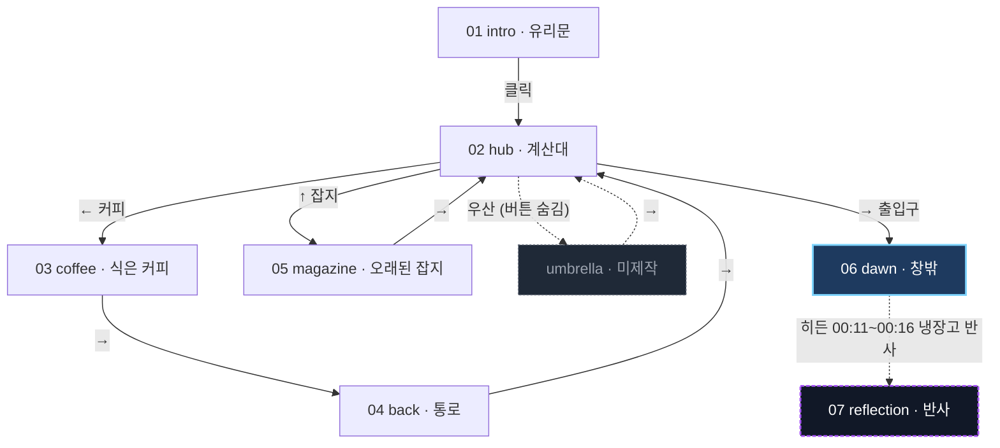

# 새벽 세 시 · Still Open — 설계 스펙

작성일: 2026-09-11
프로젝트 ID: `dawn-store`
패밀리: B (분기형 비디오) 미니 버전
근거 문서: [`docs/08-레퍼런스-심층분석-aimovie-dyw.md`](../../docs/08-레퍼런스-심층분석-aimovie-dyw.md) (재현 스펙) · [`docs/03-모노레포-설계.md`](../../docs/03-모노레포-설계.md) (스택) · [`docs/07-양산-전략-딥리서치.md`](../../docs/07-양산-전략-딥리서치.md) (툴)

## 역할 분담

| 담당 | 범위 |
|---|---|
| Claude | 기획, 스토리, 그래프 설계, 데이터 스키마, 와이어프레임, 이미지 프롬프트. **코드는 쓰지 않는다** |
| Codex | 구현 전부(스캐폴딩·플레이어·UI·린트), GPT Image 2.5로 이미지 생성 |

이 문서가 계약이다. 구현 중 이 문서와 다른 결정이 필요하면 **문서를 먼저 고치고** 진행한다.

---

## 1. 무엇을 만드는가

새벽 세 시 편의점을 둘러보는 분기형 인터랙티브 웹. 컷 7개, 총 재생 2분 내외. 관객은 물건 두 개를 살펴보고, 다 보면 창밖이 밝아오며 끝난다. 숨겨진 여덟 번째 화면이 하나 있다.

목적은 작품 자체보다 **패밀리 B 플레이어의 최소 완전판을 검증하는 것**이다. 7컷 안에 레퍼런스 두 사이트의 핵심 기능을 전부 넣었다. 검증되면 `templates/branching-movie`로 승격한다.

### 왜 7컷인가

| 검증 항목 | 담당 컷 |
|---|---|
| 화살표 방향 분기 | hub (좌·상·우) |
| 좌표 핫스팟 메뉴 | hub (물건 위 클릭 영역) |
| 방문 플래그 → 글로우 전환 | coffee·magazine이 플래그를 세우면 hub 글로우가 출입구로 이동 |
| 연결샷(공간 연속성) | back |
| 타임라인 챕터 점프 | magazine |
| 시간창 히든 링크 | dawn 00:11~00:16 |
| 엔드 프레임 = 스타트 프레임 | dawn 마지막 = reflection 첫 프레임 |
| 미완성 노드 방어 | umbrella (`available:false`, 버튼 자체를 렌더링하지 않음) |
| 엔딩 + 리플레이 | dawn, reflection |
| 다국어 | 전 컷 KO/EN |

컷을 더 늘려도 새로 검증되는 것이 없다. 줄이면 위 항목 중 하나가 빠진다.

---

## 2. 스토리

**로그라인**: 새벽 세 시, 아무도 없는 편의점. 남겨진 물건들에 각자의 시간이 붙어 있다. 다 들여다보고 나면 밤이 끝난다.

**톤**: 조용하고 관조적. 공포가 아니다. 쓸쓸하지만 차갑지 않다. 설명하지 않고 관찰만 한다.

**시점**: 2인칭. 플레이어가 "당신"이다. 얼굴은 유리 반사에만 잠깐 비친다.

**룩**: 천장 형광등의 청백색 광원 하나. 창밖은 남색. 그림자는 짙은 청록. 채도가 낮고 하이라이트만 희다. 사람은 없다.

### 컷별 시놉시스

| # | 노드 ID | 제목 | 길이 | 장면 |
|---|---|---|---|---|
| 01 | `intro` | 유리문 | 8s (루프) | 편의점 외경. 밤. 여기만 환하다. 유리문에 실루엣이 비친다 |
| 02 | `hub` | 계산대 | 6s (루프) | 내부 전경. 계산대에 아무도 없다. 온장고·잡지 매대·창가·출입구가 한 프레임에 |
| 03 | `coffee` | 식은 커피 | 14s | 온장고 위에 캔커피 하나가 나와 있다. 김이 안 난다. 옆에 영수증 |
| 04 | `back` | 통로 | 4s | 진열대 사이를 걸어 돌아간다. 대사 없음 |
| 05 | `magazine` | 오래된 잡지 | 42s | 잡지 한 권만 자리가 틀어져 있다. 표지가 바랬고 가운데가 접혔다 |
| 06 | `dawn` | 창밖 | 20s | 출입구 너머 하늘이 남색에서 푸르게 바뀐다. 형광등이 상대적으로 약해진다 |
| 07 | `reflection` | 반사 | 16s | dawn의 마지막 구도. 냉장고 유리에 비친 계산대에 누군가 서 있다 |
| — | `umbrella` | 창가의 우산 | 12s | 접힌 우산 하나. 밖은 비가 안 온다. **에셋 미제작** |

`umbrella`는 그래프에 정의만 하고 이미지를 만들지 않는다. AI Movie가 실제로 쓰는 미완성 방어 패턴을 검증하기 위한 것이며, 나중에 이미지 한 장만 추가하면 완성된다.

### 자막 전문

시간은 각 컷 내부 기준. `back`은 연결샷이라 자막이 없다.

**intro** (8s)
| 구간 | KO | EN |
|---|---|---|
| 00:01–00:05 | 새벽 세 시. 여기만 켜져 있다. | Three in the morning. Only this place is lit. |

**hub** (6s) — 질문: 「무엇을 살펴볼까」 / "What will you look at?"
| 구간 | KO | EN |
|---|---|---|
| 00:01–00:04 | 아무도 없다. | No one is here. |

**coffee** (14s)
| 구간 | KO | EN |
|---|---|---|
| 00:01–00:04 | 누군가 사놓고 마시지 않았다. | Someone bought it and never drank it. |
| 00:04–00:07 | 영수증의 시각은 밤 열한 시. | The receipt says eleven at night. |
| 00:07–00:10 | 네 시간째 식어가는 중이다. | It has been cooling for four hours. |
| 00:10–00:13 | 무엇을 기다렸을까. | What were they waiting for? |

**magazine** (42s) — 타임라인 3챕터: 00:04 「표지」/"The Cover", 00:16 「접힌 자국」/"The Fold", 00:30 「마지막 장」/"The Last Page"
| 구간 | KO | EN |
|---|---|---|
| 00:02–00:06 | 한 권만 자리가 틀어져 있다. | Only one is out of place. |
| 00:07–00:11 | 표지가 바랬다. 삼 년 전 호다. | The cover has faded. It is three years old. |
| 00:14–00:19 | 가운데가 접혀 있다. 여러 번 펼친 자국. | The middle is creased. Opened many times. |
| 00:20–00:25 | 누가 같은 페이지를 계속 봤다. | Someone kept returning to the same page. |
| 00:31–00:36 | 마지막 장에 전화번호가 적혀 있다. | A phone number is written on the last page. |
| 00:37–00:41 | 지워졌다가, 다시 쓰였다. | Erased, then written again. |

**dawn** (20s)
| 구간 | KO | EN |
|---|---|---|
| 00:02–00:06 | 창밖이 파래진다. | The window turns blue. |
| 00:07–00:11 | 형광등이 조금 약해진다. | The fluorescent light dims a little. |
| 00:13–00:17 | 밤이 끝났다. | The night is over. |

**reflection** (16s)
| 구간 | KO | EN |
|---|---|---|
| 00:02–00:06 | 냉장고 유리에 계산대가 비친다. | The cooler glass reflects the counter. |
| 00:07–00:11 | 누군가 서 있다. | Someone is standing there. |
| 00:12–00:15 | 아까는 없었다. | They were not there before. |

---

## 3. 그래프



**플래그**: `coffee`는 `seenCoffee`를, `magazine`은 `seenMagazine`을 세운다. `hub`의 글로우는 기본이 커피 쪽이고, 두 플래그가 다 서면 출입구로 옮겨간다. 관객이 안 본 것을 먼저 권하고, 다 봤으면 나가라고 알려주는 단일 지시등이다.

**경로 수**: `intro`에서 `dawn`까지 단순 경로는 4개(커피만, 잡지만, 커피→잡지, 잡지→커피, 그리고 바로 나가기). `reflection`으로 가는 정상 경로는 0개이며 히든 히트박스로만 도달한다.

**린트 규칙** (`scripts/lint-graph.ts`가 검사하고 실패 시 빌드를 막는다)
1. `start`에서 모든 `available: true` 노드에 도달 가능
2. 들어오는 엣지가 없는 노드는 `start`뿐
3. 모든 엣지의 `to`가 실존하는 노드 ID
4. `available: false` 노드를 가리키는 엣지는 경고로 남기고 통과 (의도된 미완성)
5. 자막 큐의 `end`가 `media.duration`을 넘지 않음
6. 히든 엣지의 `until`이 호스트 노드의 `duration`을 넘지 않음
7. 타임라인 챕터의 `at`이 `duration` 안에 있음
8. 같은 노드로 가는 엣지가 둘 이상이면 경고 (가짜 분기 표시)
9. `type: "ending"` 노드에는 나가는 일반 엣지가 없음

5번과 6번은 Design Your World에 실제로 있는 버그다. 자막 타임코드가 영상 길이를 넘어서 자막이 뜨지 않는다.

---

## 4. 데이터 모델

설정 파일은 둘뿐이다. **노드에 딸린 것은 전부 `story.json`, 전역 디자인 토큰은 전부 `theme.json`.**

레퍼런스 두 사이트는 노드별 데이터(라우팅·타이밍·글로우·자막)를 전역 설정에 흩어 놓아서 `app-settings`가 112KB까지 부풀었고, `navigation`과 `videoRouting`이라는 두 필드가 같은 분기를 중복 표현했다. 그 결과 두 사이트가 같은 키에 다른 스키마를 쓴다. 여기서는 **분기를 `edges` 배열 하나로 통합**한다.

### story.json

```ts
type I18n = { ko: string; en: string };
type Timecode = string;              // "MM:SS" 또는 "MM:SS.s"

type Media =
  | { kind: "still"; src: string; duration: number;
      kenBurns?: { from: Transform; to: Transform } }
  | { kind: "video"; src: string; duration: number; poster?: string };

type Transform = { scale: number; x: number; y: number };   // x·y는 % 단위 이동

type Edge =
  | { id: string; kind: "arrow";  arrow: "left"|"up"|"right"; to: string }
  | { id: string; kind: "menu";   text: I18n; to: string;
      arrow?: "left"|"up"|"right";                          // 있으면 화살표로도 표시
      hotspot?: { x: number; y: number; w: number; h: number } }   // 전부 % 단위
  | { id: string; kind: "hidden"; from: Timecode; until: Timecode; to: string;
      box: { desktop: Box; mobile: Box }; previewEnabled?: boolean };

type Node = {
  id: string;
  type: "intro" | "hub" | "branch" | "link" | "ending";
  title: I18n;
  media: Media;
  available: boolean;
  loop?: boolean;                    // hub·intro처럼 선택 대기 화면
  skippable: boolean;
  buttonShowBeforeEnd: number;       // 끝나기 N초 전에 UI 등장
  setsFlag?: string;
  question?: I18n;                   // 메뉴 위 헤딩
  edges: Edge[];
  glow?: { primary: string | null; secondary?: string | null; switchWhen?: string[] };
  timeline?: { chapters: { at: Timecode; title: I18n }[] };
  subtitles?: { ko: Cue[]; en: Cue[] };
  audio?: { bgm: "on" | "off" | "resumeAtEnd" };
};

type Cue = { start: Timecode; end: Timecode; text: string; fadeIn?: boolean; fadeOut?: boolean };
```

`glow.switchWhen`은 플래그 이름 배열이고 **전부 세워졌을 때** `secondary`로 옮겨간다. 표현식 파서를 만들지 않는다.

`edge.kind: "menu"`에 `arrow`를 같이 주면 화살표와 핫스팟이 같은 분기를 가리킨다. AI Movie의 화살표 방식과 Design Your World의 핫스팟 방식이 하나의 자료구조로 합쳐진다.

핫스팟과 히든 박스의 좌표는 **화면 비율 기준 퍼센트**다. 이미지가 `object-fit: cover`로 잘려도 이미지 기준으로 붙어 있어야 하므로, 좌표계는 화면이 아니라 **미디어 요소의 실제 렌더 박스**를 기준으로 계산한다. 레퍼런스 사이트들이 `position: fixed`에 화면 퍼센트를 쓴 탓에 모바일에서 히트존이 어긋난다.

### theme.json

전역 디자인 토큰. 값은 두 레퍼런스 사이트의 실측치를 시드로 쓴다. `desktop`과 `mobile` 두 벌이 기본이며, 한 벌만 있는 UI 설정은 반려 대상이다.

빌드 시 이 JSON을 CSS 변수로 주입한다. **컴포넌트에 색·크기 리터럴을 쓰지 않는다.** 나중에 관리자를 붙일 때 이 파일만 바꾸면 되도록.

---

## 5. 플레이어 요구사항

08 문서 §4의 15개 항목 중 7컷에 필요한 것만 추렸다.

1. **듀얼 레이어 크로스페이드**. 미디어 요소 두 장을 겹쳐 두고 전환한다. 나가는 쪽은 마지막 프레임을 유지한 채 페이드아웃한다. 암전 프레임이 보이면 실패다.
2. **미디어 타입 추상화**. `still`은 `` + CSS transform Ken Burns + `requestAnimationFrame` 타이머, `video`는 `<video>` + `timeupdate`. 바깥에서 보면 `{ currentTime, duration, ended }` 인터페이스가 같아야 한다. 컷 하나를 영상으로 바꿀 때 노드 JSON만 고치면 되도록.
3. **프리로드**. 현재 노드에 도착하면 나가는 엣지의 목적지 이미지를 즉시 백그라운드로 받는다. `available: false`인 목적지는 받지 않는다.
4. **UI 등장 타이밍**. `duration - buttonShowBeforeEnd` 시점에 페이드 인. 재생 시작 기준이 아니다. `loop: true` 노드는 첫 바퀴 끝에 띄우고 계속 유지한다. `type: "ending"` 노드는 이 값을 무시하고 분기 UI를 띄우지 않는다.
5. **글로우 상태기계**. `primary` 하나만 펄스한다. `switchWhen` 플래그가 전부 세워지면 `secondary`로 옮긴다. 둘이 동시에 빛나지 않는다.
6. **미완성 방어**. `to`가 가리키는 노드가 `available: false`면 그 엣지의 화살표와 메뉴 항목을 **DOM에서 제외**한다. 숨김 처리가 아니다.
7. **자막**. 큐 배열을 시간으로 매칭하고 fadeIn/fadeOut을 적용한다. 데스크톱과 모바일 스타일 두 벌.
8. **타임라인**. 진행 바와 챕터 점 배열. 클릭하면 해당 초로 이동한다. `still` 노드에서도 동작해야 한다(타이머 시각을 옮긴다).
9. **히든 링크**. `from`부터 `until` 사이에만 DOM에 마운트되는 투명 히트박스. `previewEnabled`가 참이면 점선 테두리를 보여준다(개발용).
10. **엔딩**. `type: "ending"` 노드가 끝나면 검은 화면에 「다시 보기」 버튼과 제작자 링크만 남는다.
11. **스킵**. `skippable`이 참인 노드에만 표시한다. 누르면 현재 노드를 즉시 끝낸다.
12. **언어 토글**. 자막·메뉴·질문·버튼 라벨이 전부 바뀐다. 선택은 `localStorage`에 남긴다.
13. **BGM**. 단일 루프 트랙. 노드의 `audio.bgm` 값에 따라 켜고 끈다. 전환 시 크로스페이드 1.5초. 첫 사용자 제스처 전에는 재생하지 않는다. 좌상단 언어 토글 옆에 **음소거 버튼**을 두고 그 상태를 `localStorage`에 남긴다. 소리를 끌 방법이 없으면 안 된다.
14. **효과음**. 호버와 클릭. **기본값은 켬**이다. 레퍼런스 사이트는 꺼두어서 설계한 피드백이 체감되지 않는다.
15. **AI 표시**. 인트로 화면 하단에 생성형 AI 사용 고지를 노출한다. 2026년 1월 시행 AI기본법 제31조 대응이며 문구는 `story.json`의 `meta.aiDisclosure`에서 온다.

---

## 6. 화면과 UI

와이어프레임은 [`wireframes/index.html`](wireframes/index.html)에 있다. 브라우저로 열면 화면 6종과 모바일 대응, 상태 변형(기본·호버·글로우)이 실측 픽셀 크기로 나온다. 각 요소에 토큰 이름을 주석으로 달아 두었다.

레이어 순서는 아래로 고정한다.

| z | 레이어 |
|---|---|
| 0 | 이전 미디어 (페이드아웃 중) |
| 1 | 현재 미디어 |
| 10 | 핫스팟 히트존 |
| 12 | 핫스팟 호버 아웃라인 |
| 20 | 자막 |
| 30 | 푸터·크레딧 |
| 40 | 질문 헤딩과 메뉴 |
| 50 | 화살표 |
| 55 | 히든 히트박스 |
| 60 | 스킵 |
| 70 | 타임라인 |
| 75 | 언어 토글·음소거 |
| 80 | 전환 오버레이 |
| 90 | 엔딩 화면 |

---

## 7. 에셋

### 이미지

컷당 한 장. 형식은 WebP, 긴 변 1920px, 품질 80. 컷당 400KB 이하, 전체 3MB 이하.

작업 순서는 스타일 프레임을 먼저 확정하고 나머지를 파생시킨다.

1. `hub`를 먼저 만든다. 이것이 공간과 룩의 기준이다.
2. 나머지 컷은 `hub` 이미지를 참조로 넣고 "같은 편의점, 다른 앵글"로 생성한다. GPT Image 2.5의 참조 편집을 쓴다.
3. `dawn`의 마지막 구도로 `reflection`을 만든다. 두 이미지의 구도가 같아야 하고 계산대에 사람이 있는지만 달라야 한다. 이것이 엔드 프레임 연속성이다.

컷별 프롬프트 전문은 [`assets/PROMPTS.md`](assets/PROMPTS.md)에 있다.

### 오디오

| 파일 | 내용 | 길이 |
|---|---|---|
| `/audio/bgm.mp3` | 편의점 앰비언스. 냉장고 모터, 형광등 험, 아주 낮은 패드. 멜로디 없음 | 60s 심리스 루프, 128kbps |
| `/audio/hover.wav` | 아주 짧은 클릭 틱 | 60ms |
| `/audio/click.wav` | 낮은 탁 | 120ms |

BGM은 이 단계에서 무음 플레이스홀더로 두어도 된다. 없으면 오디오 경로를 요청하지 않는다.

### 폰트

Noto Sans KR, 굵기 400/500/600, 서브셋은 `korean`과 `latin`만. **파일 6개를 넘기지 않는다.** 레퍼런스 두 사이트는 풀팩을 번들해 1,056개 파일을 배포한다.

---

## 8. 기술 스택과 구조

| 영역 | 결정 | 이유 |
|---|---|---|
| 빌드 | Vite | 03 문서 결정. 레퍼런스 두 사이트도 동일 |
| 프레임워크 | React + TypeScript | 같음 |
| 상태 | `useReducer` + Context | 7컷에 상태 라이브러리는 과하다. 관리자를 붙일 때 다시 판단한다 |
| 스타일 | CSS 변수 + 순수 CSS | 토큰이 JSON이고 나중에 관리자에서 바뀌어야 한다. 유틸리티 클래스로는 그게 안 된다 |
| 스키마 | zod | `story.json`과 `theme.json`을 런타임에 검증한다. 린트 스크립트도 같은 스키마를 쓴다 |
| 백엔드 | 없음 | 1단계는 정적 파일 fetch. 관리자를 붙일 때 Express 추가 |
| 배포 | 정적 호스팅 | 1단계는 `dist/`만 있으면 된다 |

```
projects/dawn-store/
├── SPEC.md                  이 문서
├── AGENTS.md                Codex 작업 규약
├── seed/
│   ├── story.json           7컷 그래프·자막·타임라인
│   └── theme.json           디자인 토큰
├── wireframes/index.html    화면 6종 + 모바일
├── assets/PROMPTS.md        이미지 생성 프롬프트
└── app/                     ← Codex가 만든다
    ├── package.json, vite.config.ts, tsconfig.json, index.html
    ├── public/
    │   ├── story.json, theme.json     (seed/에서 복사)
    │   ├── media/*.webp
    │   └── audio/*
    ├── src/
    │   ├── main.tsx, App.tsx
    │   ├── schema/          zod 정의, story·theme 타입
    │   ├── player/          미디어 추상화, 크로스페이드, 프리로드, 타이머
    │   ├── graph/           노드 이동, 플래그, 글로우 상태기계
    │   ├── ui/              Arrow, Menu, Hotspot, Subtitle, Skip, Timeline,
    │   │                    HiddenLink, LangToggle, EndScreen, Footer
    │   └── theme/           JSON을 CSS 변수로 주입
    └── scripts/lint-graph.ts
```

---

## 9. 성능 예산

머지 기준이다. 초과하면 통과시키지 않는다.

| 항목 | 한도 |
|---|---|
| 초기 JS | 150 KB gzip |
| 초기 CSS | 20 KB gzip |
| 이미지 총합 | 3 MB |
| 컷당 이미지 | 400 KB |
| 폰트 파일 수 | 6 |
| 첫 인터랙션까지 | 1.5초 (4G) |
| 노드 전환 암전 프레임 | 0 |
| 콘솔 에러 | 0 |

---

## 10. 수용 기준

Codex는 아래 열한 가지를 전부 만족할 때 완료를 선언한다.

1. 7컷이 전부 재생되고 전환에 암전이 없다
2. `hub`의 화살표는 두 개만 보인다. 우산 메뉴는 DOM에 없다
3. 커피와 잡지를 다 본 뒤 `hub`로 돌아오면 글로우가 출입구로 옮겨가 있다
4. `magazine`의 챕터 점 세 개를 클릭하면 각각 4초·16초·30초 지점으로 이동한다
5. `dawn` 재생 중 00:11부터 00:16 사이에만 히든 히트박스가 DOM에 존재하고, 클릭하면 `reflection`으로 간다
6. 엔딩이 끝나면 「다시 보기」가 나오고 누르면 `intro`로 돌아간다
7. 언어 토글로 자막·질문·메뉴·버튼 라벨이 전부 바뀐다
8. `pnpm run lint:graph`가 통과한다
9. 390×844 모바일에서 `theme.json`의 `mobile` 값이 실제로 적용된다. 데스크톱 값이 그대로 쓰이면 실패다
10. 성능 예산을 전부 충족한다
11. 자막이 메뉴·스킵·타임라인 어느 것과도 겹치지 않는다. 데스크톱과 모바일 둘 다에서 확인한다

9번과 11번은 레퍼런스 두 사이트가 실제로 실패한 지점이다. 11번은 와이어프레임 작업 중에도 한 번 재발했다. 메뉴가 질문까지 네 줄이 되면 자막 영역까지 내려온다. 지금 값(메뉴 하단 30%, 자막 하단 15%)은 데스크톱에서 74px, 모바일에서 61px 여유가 있다. 값을 바꾸면 다시 재어야 한다.

---

## 11. 하지 말 것

08 문서 §6의 결함 목록에서 직접 나온 금지 사항이다.

1. **분기를 두 곳에 저장하지 않는다.** `edges` 하나뿐이다. `navigation`이나 `videoRouting` 같은 필드를 만들지 않는다
2. **색·크기를 코드에 쓰지 않는다.** 전부 `theme.json`에서 CSS 변수로 온다
3. **자막을 이미지에 굽지 않는다.** 웹 압축에서 뭉개진다
4. **`available: false` 노드로 가는 버튼을 렌더링하지 않는다.** 숨김이 아니라 제외다
5. **폰트 풀팩을 번들하지 않는다.** 한국어와 라틴 서브셋만
6. **상태 라이브러리·UI 프레임워크·애니메이션 라이브러리를 추가하지 않는다.** 필요해지면 문서를 먼저 고친다
7. **정적 에셋에 `Cache-Control: private, max-age=0`을 쓰지 않는다.** 파일명 해시와 `immutable`을 쓴다
8. **관리자 화면을 만들지 않는다.** 1단계 범위 밖이다. 다만 2단계 편집 툴바(03 §3-3)가 들어갈 자리를 막지 않는다 — 편집 대상이 될 요소에는 **`data-eid` 안정 ID만 지금 붙여 둔다**(예: `data-eid="subtitle"`, `data-eid="question"`, `data-eid="node-media"`). 툴바 코드는 넣지 않는다. ID가 없으면 나중에 구조 셀렉터로 잡아야 하고, 그건 리팩터링마다 깨진다
9. **효과음과 자막을 기본 꺼짐으로 두지 않는다.** 레퍼런스 사이트가 그렇게 해서 손해를 봤다

---

## 12. 범위 밖 (다음 단계)

| 단계 | 내용 |
|---|---|
| 2 | 관리자 화면. 엣지 편집, 핫스팟 좌표 드래그, 자막 편집, 히든 링크 시간창 편집. Express 백엔드 추가 |
| 2 | **편집 툴바** (03 §3-3). 화면 위 요소를 직접 클릭해 텍스트(`ko`/`en`)·폰트·색·이미지 교체. `theme.json`·`story.json`이 이미 전부 데이터라 툴바는 이 두 파일을 쓰는 폼이면 된다. 저장에 Express + `packages/storage`가 필요하므로 위 항목과 같은 단계 |
| 3 | `dawn` 컷 영상화. `media.kind`를 `video`로 바꾸고 mp4를 넣는다. 나머지 컷은 스틸 유지 |
| 4 | `umbrella` 컷 추가 |
| 5 | `templates/branching-movie`로 승격. 그때 모노레포에 편입한다 |

---

## 13. 열린 항목

| 항목 | 처리 |
|---|---|
| 제작자 이름과 링크 | `story.json`의 `meta.creator`가 비어 있다. 사용자가 채운다 |
| BGM 소스 | 생성할지 무음으로 둘지 미정. 1단계는 무음 허용 |
| 도메인 | 미정. 1단계는 로컬과 정적 프리뷰만 |

## 14. 관람 설정·검증 자동화 (2026-09-12 확장)

사용자의 후속 요청에 따라 관람 설정을 추가한다. 관리자/콘텐츠 편집 기능은 별도 단계로 유지한다.

- 언어, 전체 음소거, BGM/효과음 음량, 자막 표시·크기, 움직임 감소(시스템/켬/끔)를 즉시 적용한다.
- 기본·읽기 편하게·조용히 프리셋과 초기화를 제공한다. 기본은 자막·효과음 켬이다.
- 버전이 있는 설정을 자동 저장하고 기존 언어·음소거를 이전한다. 저장 실패 시 현재 세션은 정상 동작하며 상태를 알린다.
- 설정 JSON 내보내기/가져오기는 스키마와 용량을 검사한 후에만 적용한다.
- 설정 대화상자와 숨겨진 탭에서는 재생·배경음을 자동 일시정지한다. 닫거나 복귀하면 같은 시각부터 재개한다. Escape, 초점 제한·복귀, 모바일 스크롤을 지원한다.
- 움직임 감소는 Ken Burns와 UI 애니메이션에 적용한다. 자막 크기는 모바일·데스크톱 모두 반영한다.
- `pnpm run check`로 설정 회귀 테스트와 프로덕션 빌드를 수행한다. 빌드는 그래프·테마·로컬 에셋 검사와 압축 크기 예산 검사 실패 시 중단한다.
- 검증 결과는 별도 QA 문서에 기록하며 기존 전체 수용 기준을 재검증한 것으로 간주하지 않는다.

## 2026-10-02 · Blender 렌더 후보 시험
사용자 요청으로 같은 공간의 계산대/커피를 렌더해 기존 컷과 비교한다. 비교에서 더 사실적이지 않으면 기본 컷을 교체하지 않는다. 기존 분기·시간 유지. 현 v2를 참고한 물방울·작은 따뜻한 실내등은 초기 비 없음/단일 광원과 차이가 있으며 사람은 만들지 않는다. 정지 컷 두 장, 영상 아님. [계획](../../docs/01-plan/features/blender-realism-2026-10-02.plan.md).
