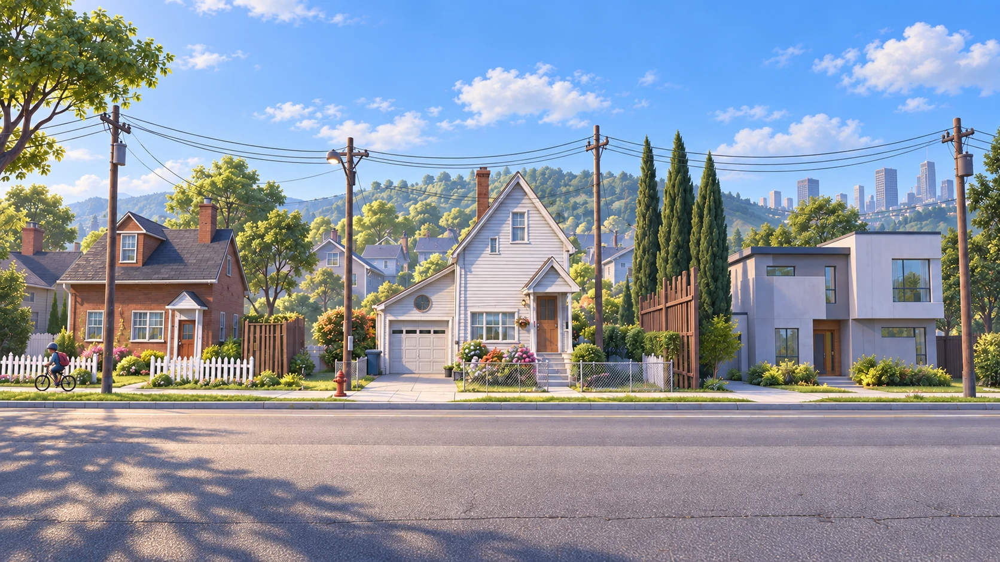
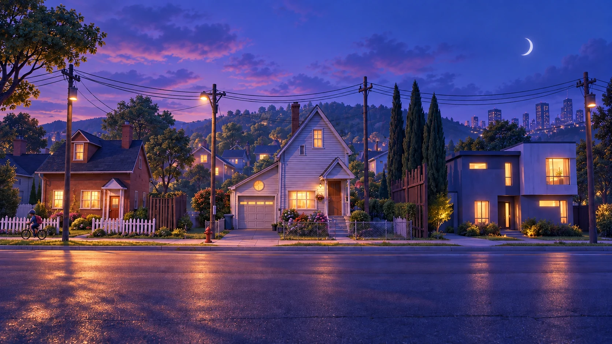
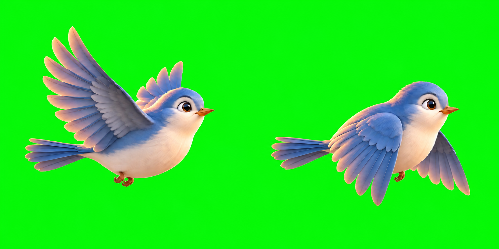
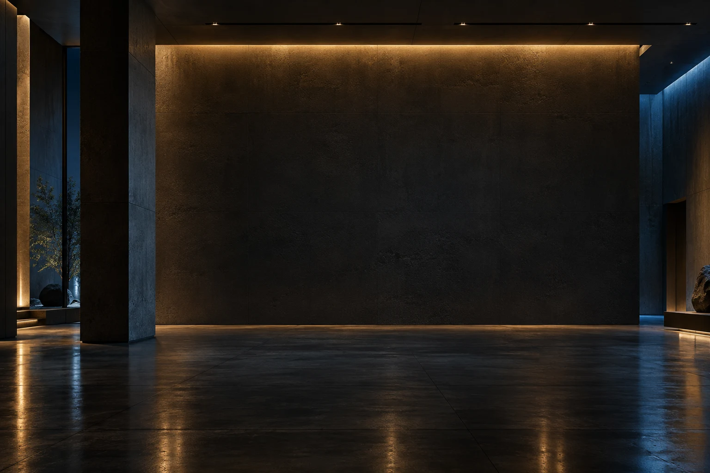

# 에셋 프롬프트 모음

인터랙티브 작품에 쓴 **이미지·영상·3D·소리**를 무엇으로, 어떤 프롬프트로 만들었는지 한곳에 모았습니다.

## 보는 법

| 어디서 | 방법 |
|---|---|
| **웹 보관함** (추천) | [`gallery.html`](gallery.html)을 브라우저로 연다. 큰 썸네일(누르면 전체 화면, 영상은 재생), 프롬프트 **복사 버튼**, 공통 블록까지 합쳐 복사, 작품·상태 필터, 검색 |
| 어느 기기에서나 | [claude.ai 보관함 페이지](https://claude.ai/artifact/HHxwUY317MGsbJkbDuwNPB) (비공개 — 본인만 열림, 공유는 페이지의 Share 메뉴) |
| 마크다운 | 이 폴더의 `.md` 파일. VS Code 미리보기(`Ctrl+Shift+V`)나 GitHub에서 썸네일이 같이 나온다 |

**원본은 마크다운**이고 `gallery.html`·`catalog.json`은 [`build.mjs`](build.mjs)가 만든 생성물이다. `.md`를 고친 뒤 `pnpm prompts:build`를 실행한다. 루트 `pnpm check`가 생성물이 최신인지 검사한다. 공통 블록은 코드 펜스에 `id=이름`, 그 뒤에 붙여 보내는 프롬프트는 `with=이름`으로 표시한다(예: ```` ```text with=dawn-style ````).

| 파일 | 내용 |
|---|---|
| [dawn-store.md](dawn-store.md) | 새벽 세 시 · Still Open — 편의점 컷 7장 + v2 교체본 + 도입 영상 + 소리 |
| [day-walk.md](day-walk.md) | 하루 산책 — 주택가 배경 4장(원본·아침·오후·저녁), 새, 걷는 캐릭터 |
| [potato-designer.md](potato-designer.md) | POTATO — 날아차기 캐릭터 |
| [jooho-lab.md](jooho-lab.md) | JOOHO LAB 허브 — 마을 파노라마, 배낭 로봇, 전시실 배경, 작품 표지 |
| [templates.md](templates.md) | **다시 쓸 수 있는 프롬프트 틀** — 스타일 프레임, 프랍 시트, UI 킷, 조명만 바꾸기, 스프라이트, 영상 체인, 3D 변환 |

표시: ✅ 프롬프트 원문 있음 · ❌ 기록 없음(다시 만들 수 없음) · ⏸ 프롬프트만 있고 아직 안 만듦

---

## 한눈에 보기

### 이미지

| | 작품 | 에셋 | 도구 | 프롬프트 |
|---|---|---|---|---|
|  | 새벽 세 시 | [계산대 `hub`](dawn-store.md#01--hub--계산대) ⭐ 기준 컷 | GPT Image 2.5 | ✅ |
|  | 새벽 세 시 | [유리문 `intro`](dawn-store.md#02--intro--유리문) | GPT Image 2.5 | ✅ |
|  | 새벽 세 시 | [식은 커피 `coffee`](dawn-store.md#03--coffee--식은-커피) | GPT Image 2.5 | ✅ |
|  | 새벽 세 시 | [통로 `back`](dawn-store.md#04--back--통로) | GPT Image 2.5 | ✅ |
|  | 새벽 세 시 | [오래된 잡지 `magazine`](dawn-store.md#05--magazine--오래된-잡지) | GPT Image 2.5 | ✅ |
|  | 새벽 세 시 | [창밖 `dawn`](dawn-store.md#06--dawn--창밖-엔딩) | GPT Image 2.5 | ✅ |
|  | 새벽 세 시 | [반사 `reflection`](dawn-store.md#07--reflection--반사-히든-엔딩) | GPT Image 2.5 (편집) | ✅ |
| — | 새벽 세 시 | [창가의 우산 `umbrella`](dawn-store.md#08--umbrella--창가의-우산-보류) | — | ⏸ |
|  | 새벽 세 시 | [계산대 v2 (현재 사용)](dawn-store.md#09--계산대-v2-counter-generated-v2) | 기록 없음 | ❌ |
|  | 하루 산책 | [주택가 원본 v2](day-walk.md#01--주택가-원본-v2) | 기록 없음 | ❌ |
|  | 하루 산책 | [아침 배경](day-walk.md#02--아침-맑은-낮-daylight-v3) | image_gen (편집) | ✅ |
|  | 하루 산책 | [오후 노을 배경](day-walk.md#03--오후-노을-afternoon-v4) | image_gen (편집) | ✅ |
|  | 하루 산책 | [저녁 배경](day-walk.md#04--저녁-초저녁-evening-v3) | image_gen (편집) | ✅ |
|  | 하루 산책 | [안내 새 (2프레임)](day-walk.md#05--안내-새-2프레임-bird-v3) | image_gen | ✅ |
|  | 하루 산책 | [걷는 캐릭터](day-walk.md#06--걷는-캐릭터-walker-v2) | 기록 없음 | ❌ |
|  | POTATO | [날아차기 캐릭터](potato-designer.md#01--날아차기-캐릭터-characterpng) | image_gen (gpt-image) | ✅ |
|  | JOOHO LAB | [마을 파노라마 (집 6채)](jooho-lab.md#01--마을-파노라마-project-village) | 기록 없음 | ❌ |
|  | JOOHO LAB | [배낭 로봇 산책자](jooho-lab.md#02--배낭-로봇-산책자-village-walker) | gpt-image 2.0 | ❌ |
|  | JOOHO LAB | [어두운 전시실 (지금 안 씀)](jooho-lab.md#03--어두운-전시실-atelier-지금-안-씀) | 기록 없음 | ❌ |

### 영상 · 소리 · 3D

| | 작품 | 에셋 | 프롬프트 |
|---|---|---|---|
|  | 새벽 세 시 | [도입 화면 영상 8초](dawn-store.md#10--도입-화면-영상-gate-generated-v2) | ❌ |
| 🔊 | 새벽 세 시 | [배경음·효과음 3개](dawn-store.md#11--소리-bgm--hover--click) | ❌ (제작 요청서만 있음) |
| 🔊 | 하루 산책 | 효과음 — 코드로 합성(`src/audio/sfx.ts`), 파일·프롬프트 없음 | — |
| 🧊 | — | **3D 모델(GLB)은 아직 없습니다.** POTATO 캐릭터는 2D 그림에 CSS 원근을 준 것이고, JOOHO LAB 마을은 2D 파노라마를 three.js에 붙인 것입니다. 3D 만드는 틀은 [templates.md §7](templates.md#7-3d로-바꾸기) | — |

---

## 빠진 기록 — 다시 만들 수 없는 것

프롬프트 원문이 없으면 비슷하게는 만들 수 있어도 **같은 것을 다시 만들 수는 없습니다.**

| 에셋 | 지금 쓰는 곳 | 알 수 있는 것 |
|---|---|---|
| 새벽 세 시 계산대 v2, 도입 영상 v2 | 계산대 장면, 언어·소리 선택 화면 | 2026-09-15 추가. 원래 규칙("사람 없음, 비 없음")과 달리 사람과 비가 들어 있어 **방향이 바뀌었지만 이유가 기록되지 않음** |
| 새벽 세 시 소리 3개 | 배경음·효과음 | ffmpeg로 저장됨. 내용 요청서만 있음 |
| 하루 산책 주택가 원본 v2 | 조명 변형 3장의 원본 | 사용자가 준 이미지일 가능성 있음 |
| 하루 산책 걷는 캐릭터 | 산책 캐릭터 | v1은 저장소에 없음 |
| JOOHO LAB 마을 파노라마, 배낭 로봇, 전시실 | 허브 3D 마을 | 파일 메타데이터(C2PA)로 OpenAI gpt-image임만 확인 |

작품 표지 3장(`chemiforge`, `spire`, `sasu`)은 각 프로젝트 자료를 가져온 것으로 보이며, 이 저장소에서 생성한 기록이 없습니다([jooho-lab.md](jooho-lab.md#04--작품-표지)).

---

## 만들면서 확인된 것

| 교훈 | 어디서 | 틀 |
|---|---|---|
| **기준 컷을 먼저** 만들고 나머지는 그 그림을 참조로 붙인다. 안 그러면 공간 구조가 컷마다 달라진다 | 새벽 세 시 `hub` | [templates §1](templates.md#1-스타일-프레임-기준-컷-먼저) |
| 조명만 바꿀 때는 "구도·건물·창문 위치 그대로, 다시 그리지 말고 조명만"을 **길게 못 박아야** 겹쳐 바꾸기(크로스페이드)가 된다 | 하루 산책 배경 | [templates §4](templates.md#4-조명시간대만-바꾸기-같은-구도) |
| 한 곳만 바꾸는 편집은 "나머지는 픽셀 그대로"를 명시하고, 결과를 원본과 겹쳐서 확인한다 | 새벽 세 시 `reflection` | [templates §5](templates.md#5-한-곳만-바꾸기-편집) |
| "투명 배경"을 요청해도 **체커보드 무늬를 그려 버린다.** 순수 초록(#00FF00) 배경으로 받고 화면에서 빼는 게 확실하다 | 하루 산책 새 | [templates §6](templates.md#6-스프라이트-시트-투명-배경) |
| 이미지 안에 글자를 넣지 않는다. 문구는 레이어 파라미터로 따로 둔다 | 전체 | [docs/11](../docs/11-레이어-설정-시스템-설계.md) |

---

## 새 에셋을 만들면

이 폴더가 **정본**입니다. 앱 안에 있던 기존 기록(`projects/dawn-store/assets/PROMPTS.md`, day-walk `.claude/plans/*-prompts.md`, potato README)은 원본 이력으로 두고, 새 기록은 여기에 남깁니다. 규칙은 [AGENTS.md](../AGENTS.md)에 있습니다.

해당 앱 파일에 아래 카드를 추가하고, 이 README 표에 한 줄 넣습니다.

````markdown
### NN · 이름 — 한국어 이름

/<경로>" width="360">

| 항목 | 내용 |
|---|---|
| 파일 | `경로` · 가로×세로(영상은 길이) · 용량 |
| 쓰이는 곳 | 화면·장면, 레이어 id(docs/11) |
| 도구 | 모델·모드(생성/편집) · 날짜 |
| 참조 이미지 | 붙인 그림, 없으면 "없음" |
| 설정 | 비율·후보 수·시드·후처리 명령 |

**무엇을 그리나** — 한두 줄 한국어 요약

```text
프롬프트 원문 그대로 (요약하거나 번역하지 않음)
```

**생성 후 확인** — 합격 기준, 고른 이유, 버린 후보가 있으면 그 이유
````
