# 새벽 세 시 · Still Open — 에셋 프롬프트

[← 전체 목록](README.md)

새벽 세 시, 불 켜진 편의점을 둘러보는 분기형 작품입니다. 컷은 이야기 노드의 미디어이고, 노드 id가 곧 파일 이름입니다(`hub` → `hub.webp`).

| 항목 | 내용 |
|---|---|
| 도구 | **GPT Image 2.5** (Codex가 생성) — `SPEC.md` §0·§7 |
| 공통 조건 | 16:9, **사람 없음**, 광원은 천장 형광등 하나 |
| 후보 | `hub`는 4장 뽑아 1장 선택. 어떤 후보를 골랐는지는 기록 없음 |
| 만든 날 | 2026-09-11 (컷 7장), 2026-09-15 (v2 교체본·도입 영상) |
| 원본 기록 | [`projects/dawn-store/assets/PROMPTS.md`](../projects/dawn-store/assets/PROMPTS.md) |
| 작품 안 고지 | "이 작품의 이미지는 생성형 AI로 제작되었습니다." (`story.json`) |

## 만드는 순서 (중요)

1. **`hub`를 먼저** 만든다. 4장 뽑아 하나를 고른다. 이 그림이 공간과 분위기의 기준이다.
2. 나머지 컷은 `hub`를 **참조 이미지로 붙이고** "같은 편의점, 다른 앵글"로 만든다.
3. `reflection`은 마지막이다. `dawn`을 참조로 넣고 **반사 부분만** 바꾼다.
4. 다 나오면 WebP로 바꾸고(아래 명령), `story.json`의 핫스팟 좌표를 실제 물건 위치에 맞춘다.

`hub`를 건너뛰고 컷마다 따로 만들면 매장 구조가 컷마다 달라진다. 이 작품의 유일한 기술적 실패 지점이다.

## 공통 스타일 블록 — 모든 컷 프롬프트 **앞에** 붙인다

> 새벽 3시 작은 한국 편의점, 사람 없음, 차가운 형광등 하나, 창밖은 짙은 남색 밤. 청록·청백 저채도, 조용하고 살짝 쓸쓸하게(공포 아님). 필름 그레인, 얕은 심도, 글자·로고 없음.

```text id=dawn-style
Cinematic still frame, 16:9, photographic realism.
A small Korean convenience store at 3 AM. Absolutely no people in frame.
Single light source: cool white ceiling fluorescent tubes, around 5000K.
Beyond the windows: deep navy night, no visible streetlights or signage.
Palette: cyan-white highlights, desaturated mid-tones, dark teal shadows. Low overall saturation.
Mood: quiet, still, faintly melancholic. Not horror. Nothing threatening.
Fine film grain. Shallow depth of field.
No text, no captions, no watermarks, no brand logos.
```

**실제로 보낸 글 = 위 블록 + 아래 각 컷 프롬프트.**

---

### 01 · hub — 계산대

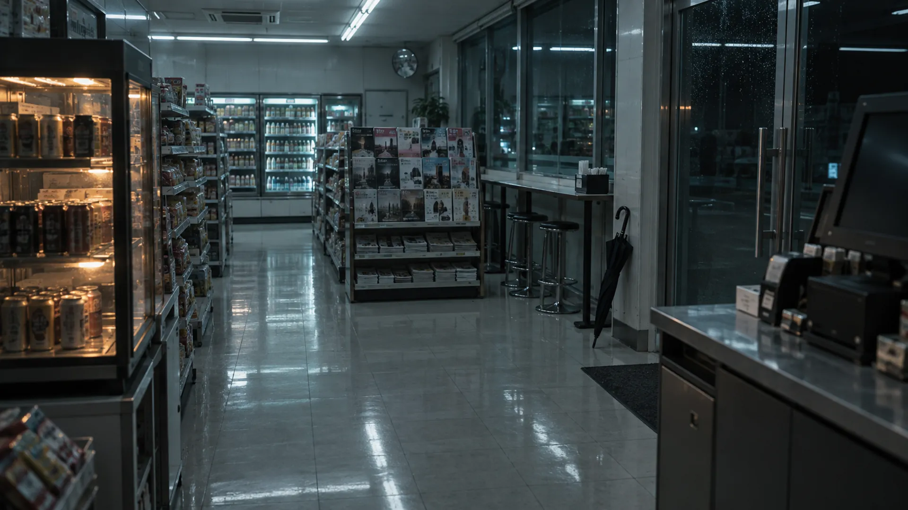

| 항목 | 내용 |
|---|---|
| 파일 | `app/public/media/hub.webp` · 1920×1080 · 122KB |
| 쓰이는 곳 | 처음 `hub`(계산대) 노드. **지금 앱은 [v2](#09--계산대-v2-counter-generated-v2)로 교체되어 이 파일을 쓰지 않음.** 같은 파일이 허브의 작품 표지(`jooho-lab/public/assets/dawn.webp`)로 쓰임 |
| 참조 이미지 | 없음 — 이 그림이 다른 컷의 참조 ⭐ |
| 후보 | 4장 → 1장 |

**무엇을 그리나** — 입구에서 본 매장 전체. 오른쪽 빈 계산대, 왼쪽 온장고(캔커피), 가운데 잡지 매대, 오른쪽 창가에 우산이 기댄 스탠딩 테이블, 맨 오른쪽 유리문. 네 곳이 서로 겹치지 않게.

```text with=dawn-style
Wide interior shot taken from just inside the entrance, at standing eye level.
On the right: an empty checkout counter, no clerk, register screen dark.
On the left: a hot-drink warmer cabinet holding canned coffee, its interior glowing faint amber.
Middle distance: a magazine rack against the wall.
Far right by the window: a narrow standing counter with a folded umbrella leaning against its leg.
The glass entrance door is at the far right edge of frame.
All four of these are visible in this single frame and clearly separated from each other.
Ceiling fluorescents reflect in long streaks on the polished floor.
```

**생성 후 확인** — 온장고, 잡지 매대, 우산, 출입구 네 곳이 화면 안에서 서로 떨어져 있는가. 겹치면 핫스팟(누르는 영역)을 만들 수 없다.

---

### 02 · intro — 유리문

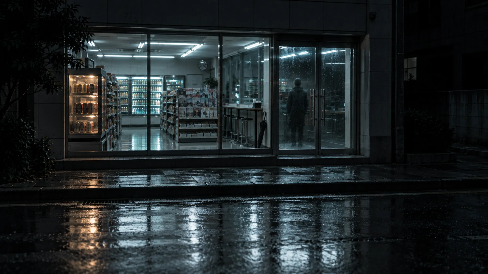

| 항목 | 내용 |
|---|---|
| 파일 | `app/public/media/intro.webp` · 1920×1080 · 147KB |
| 쓰이는 곳 | `intro` 노드, 8초 정지 컷 |
| 참조 이미지 | `hub` |

**무엇을 그리나** — 길 건너편에서 본 편의점 외관. 가게만 환하고 거리는 캄캄함. 유리문에 뒷모습 한 사람이 희미하게 비침. 젖은 아스팔트.

```text with=dawn-style
Exterior night shot, looking at the same convenience store from across an empty street.
The store windows glow bright white against a completely dark street; the store is the only lit thing in frame.
A faint silhouette of one person is reflected in the glass door, seen from behind, barely readable.
Damp asphalt in the foreground catching the store's light.
Camera at eye level, very slightly low angle.
```

---

### 03 · coffee — 식은 커피

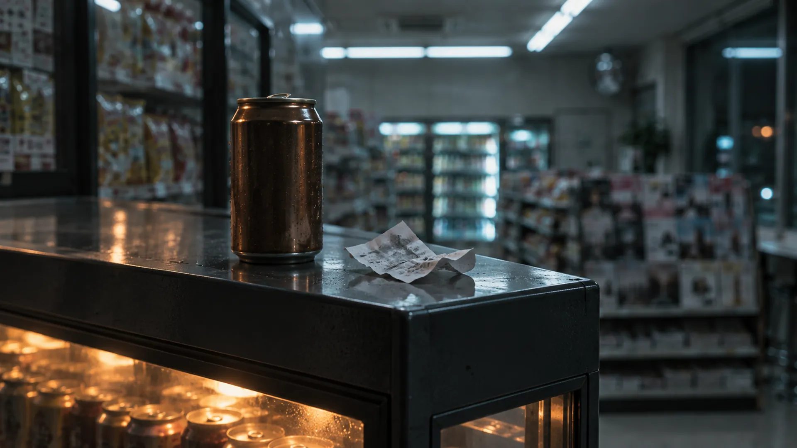

| 항목 | 내용 |
|---|---|
| 파일 | `app/public/media/coffee.webp` · 1920×1080 · 80KB |
| 쓰이는 곳 | `coffee` 노드, 14초 |
| 참조 이미지 | `hub` |

**무엇을 그리나** — 온장고 위 클로즈업. 온장고 **밖에** 놓인 캔커피 하나(김 없음 = 식음), 옆에 구겨진 영수증.

```text with=dawn-style
Close-up of the top of the hot-drink warmer cabinet.
A single can of coffee sits on top of the cabinet, outside the warmer. No steam.
Beside it, a small crumpled paper receipt.
Focus on the can; the warmer's amber interior glows out of focus behind it.
```

---

### 04 · back — 통로

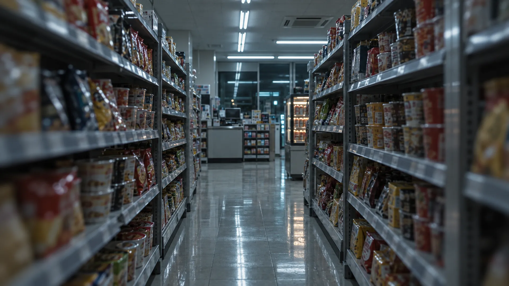

| 항목 | 내용 |
|---|---|
| 파일 | `app/public/media/back.webp` · 1920×1080 · 135KB |
| 쓰이는 곳 | `back` 노드, 4초 연결 컷 |
| 참조 이미지 | `hub` |

**무엇을 그리나** — 과자·라면 진열대 사이 좁은 통로를 걸어가는 시점. 끝에 계산대가 작게 보임. 형광등이 한 점으로 모이는 원근, 가장자리에 약한 움직임 흐림.

```text with=dawn-style
Point of view walking down a narrow aisle between two shelving units of snacks and instant noodles.
The aisle leads back toward the checkout counter, visible small at the far end.
Ceiling fluorescents receding in one-point perspective.
Very slight motion blur at the frame edges.
```

---

### 05 · magazine — 오래된 잡지

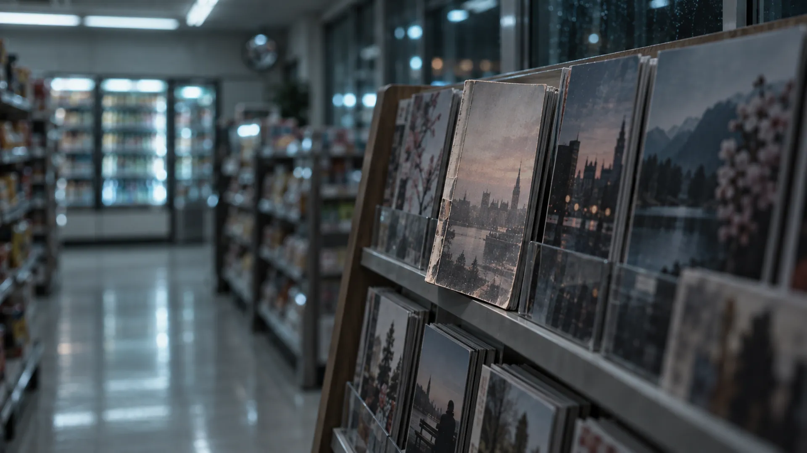

| 항목 | 내용 |
|---|---|
| 파일 | `app/public/media/magazine.webp` · 1920×1080 · 83KB |
| 쓰이는 곳 | `magazine` 노드, 42초 |
| 참조 이미지 | `hub` |

**무엇을 그리나** — 잡지 매대 클로즈업. 한 권만 살짝 앞으로 삐져나와 있고, 표지는 햇빛에 바랬고, 등은 여러 번 펼쳐 접힌 자국.

```text with=dawn-style
Close-up of the magazine rack.
One magazine is pulled slightly forward, out of alignment with the neat row beside it.
Its cover is sun-faded and washed out; the spine is visibly creased from being opened many times.
Focus on the misaligned one, the rest falling out of focus.
```

---

### 06 · dawn — 창밖 (엔딩)

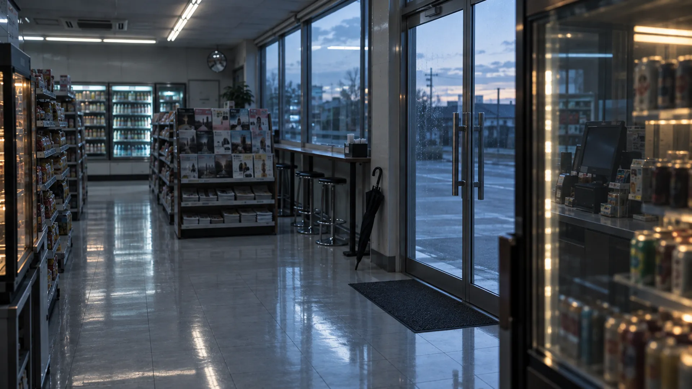

| 항목 | 내용 |
|---|---|
| 파일 | `app/public/media/dawn.webp` · 1920×1080 · 126KB |
| 쓰이는 곳 | `dawn` 노드, 20초. 00:11~00:16에 냉장고 반사를 누르면 히든 엔딩으로 감 |
| 참조 이미지 | `hub` — **다음 컷(reflection)의 기준이 되므로 구도를 잘 잡는다** |

**무엇을 그리나** — 안에서 유리문 쪽을 봄. 하늘이 남색에서 푸른 회색(해뜨기 직전)으로 바뀜. 오른쪽 냉장고 유리에 뒤쪽 빈 계산대가 또렷하게 비침, 아무도 없음.

```text with=dawn-style
Looking toward the glass entrance door from inside the store.
Through the glass the sky has shifted from navy to a pale blue-grey: the first light before sunrise.
The interior fluorescent light now reads weaker by comparison.
On the right side of frame stands a glass-door refrigerator cabinet.
Its glass clearly reflects part of the empty checkout counter behind the camera.
The reflection is legible, and no one is in it.
```

**생성 후 확인** — 냉장고 유리의 반사가 또렷하게 읽히는가. 여기가 히든 링크 자리다. 흐리면 다시 뽑는다.

---

### 07 · reflection — 반사 (히든 엔딩)

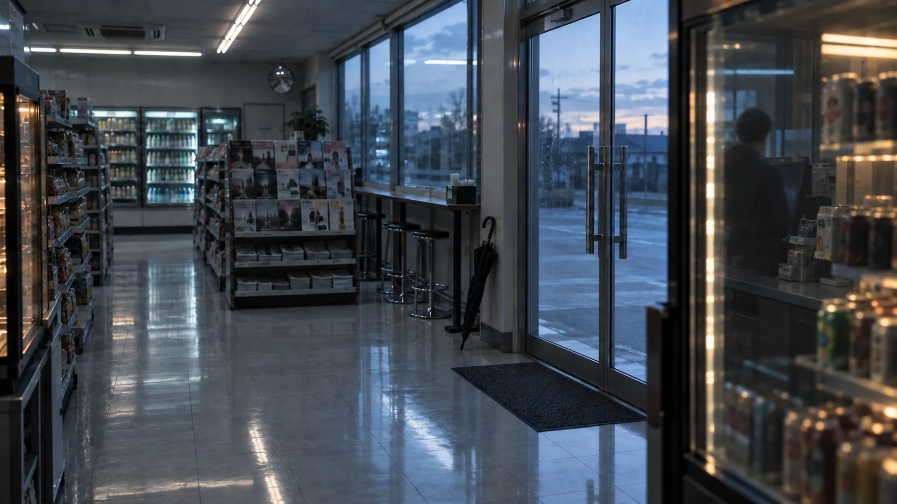

| 항목 | 내용 |
|---|---|
| 파일 | `app/public/media/reflection.webp` · 1920×1080 · 114KB |
| 쓰이는 곳 | `reflection` 노드, 16초 히든 엔딩 |
| 참조 이미지 | `dawn` — **편집 모드**로 생성 |

**무엇을 그리나** — `dawn`과 완전히 같은 그림에서 **한 가지만** 바꿈: 냉장고 유리 반사 속 계산대에 흐릿한 뒷모습 한 사람이 서 있음.

```text with=dawn-style
Use the attached image. Keep the composition, framing, lens, and lighting IDENTICAL.
Change exactly one thing: in the reflection on the refrigerator's glass door, a person now stands
at the checkout counter, seen from behind, out of focus and indistinct.
Everything else in the frame must remain pixel-identical.
```

**생성 후 확인** — 성패는 앞 컷과 얼마나 같은가에 달렸다. 두 그림을 겹쳐 보고 구도가 어긋나면 다시 만든다.

---

### 08 · umbrella — 창가의 우산 (보류)

⏸ **아직 만들지 않음.** `story.json`에 `available: false`로만 있고, 미완성 노드를 막는지 검증하는 용도다. 필요해지면 아래로 만든다(파일 이름 `umbrella.webp`, 참조 `hub`).

**무엇을 그리나** — 창가 스탠딩 테이블 다리에 기댄 접힌 우산. 우산도 창밖 거리도 완전히 말라 있음(비가 안 왔다는 단서).

```text with=dawn-style
Close-up of a folded umbrella leaning against the leg of the narrow standing counter by the window.
The umbrella is completely dry. Through the window, the night street is dry as well. No rain anywhere.
```

---

### 09 · 계산대 v2 (counter-generated-v2)

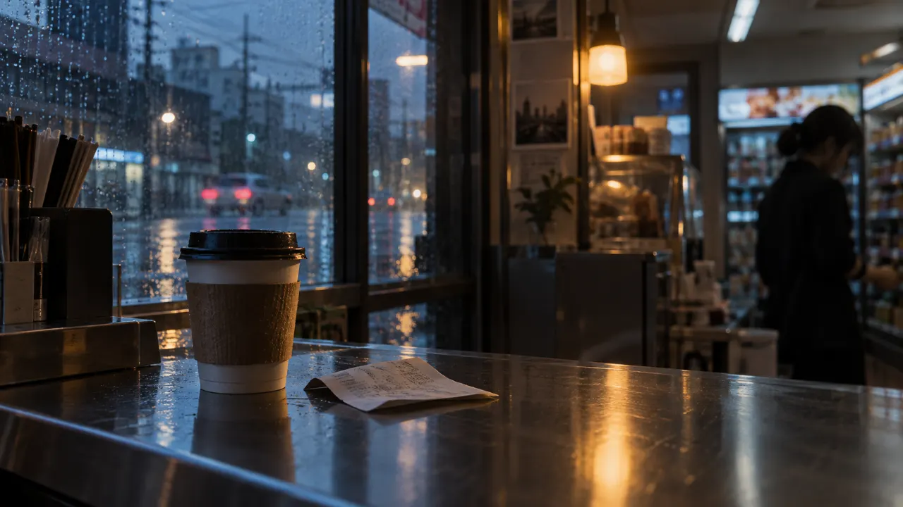

| 항목 | 내용 |
|---|---|
| 파일 | `app/public/media/counter-generated-v2.webp` · 1280×720 · 58KB |
| 쓰이는 곳 | **현재** `hub`(계산대) 노드 |
| 도구 | ❌ 기록 없음 |
| 만든 날 | 2026-09-15 (커밋 "새벽 편의점 시네마틱 인트로 추가 … v2 생성 미디어로 교체") |

**그림 내용** — 비 내리는 저녁 창가의 금속 카운터, 종이컵 커피와 영수증, 뒤쪽 진열대 앞에 여자 한 사람.

❌ **프롬프트 기록 없음.** 원래 규칙(사람 없음, 비 없음, 새벽 3시)과 다르게 만들어졌는데 그 방향 전환도 기록되지 않았다.

---

### 10 · 도입 화면 영상 (gate-generated-v2)

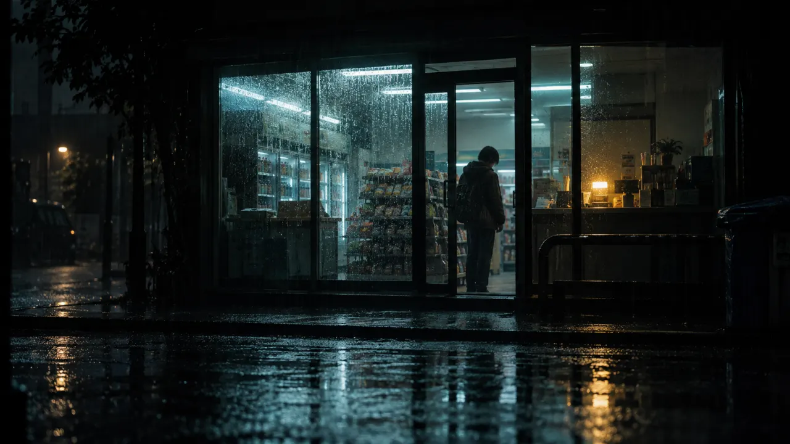

| 항목 | 내용 |
|---|---|
| 파일 | [`gate-generated-v2.webm`](../projects/dawn-store/app/public/media/gate-generated-v2.webm) 1280×720 · **8초** · 1.7MB (VP9) + 포스터 `gate-generated-v2.webp` 73KB |
| 쓰이는 곳 | 언어·소리를 고르는 도입 화면(`CinematicPrelude`)의 배경 — 레이어 `prelude`(docs/11 §9-3) |
| 도구 | ❌ 기록 없음. 영상 파일은 브라우저 녹화(MediaRecorder)로 저장된 흔적이 있음 |
| 만든 날 | 2026-09-15 |

**그림 내용** — 비 오는 밤 편의점 외관, 환한 출입문에 후드와 배낭 차림의 사람 한 명.

❌ **프롬프트 기록 없음.**

---

### 11 · 소리 (bgm · hover · click)

| 파일 | 길이 | 요청 내용 (`SPEC.md` §7) |
|---|---|---|
| `app/public/audio/bgm.mp3` · 938KB | 60초 루프, 128kbps | 편의점 앰비언스. 냉장고 모터, 형광등 험, 아주 낮은 패드. 멜로디 없음 |
| `app/public/audio/hover.wav` · 5KB | 0.06초 | 아주 짧은 클릭 틱 |
| `app/public/audio/click.wav` · 10KB | 0.12초 | 낮은 탁 |

❌ 생성 도구·프롬프트 기록 없음(ffmpeg로 저장된 흔적만 있음). 위 표는 프롬프트가 아니라 **제작 요청서**다.

---

## 계획만 있고 프롬프트가 없는 것
- `dawn` 컷 영상화 (`SPEC.md` 로드맵 3단계) — 영상 프롬프트 없음. 만들 때 [templates §8](templates.md#8-영상-스타트엔드-프레임-체인)의 스타트/엔드 체인을 쓴다.

## WebP 변환

```bash
ffmpeg -i in.png -vf "scale=1920:-2" -c:v libwebp -quality 80 -compression_level 6 out.webp
```

한도는 컷당 400KB, 전체 3MB다. 넘으면 quality를 70으로 낮추고, 그래도 넘으면 긴 변을 1600으로 줄인다.

### 12 · blender-night-store — 계산대·커피 렌더 시험

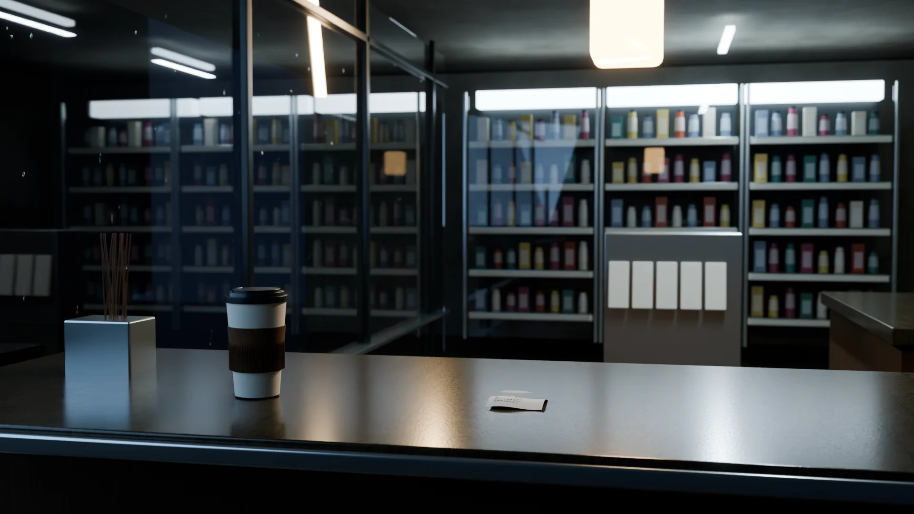
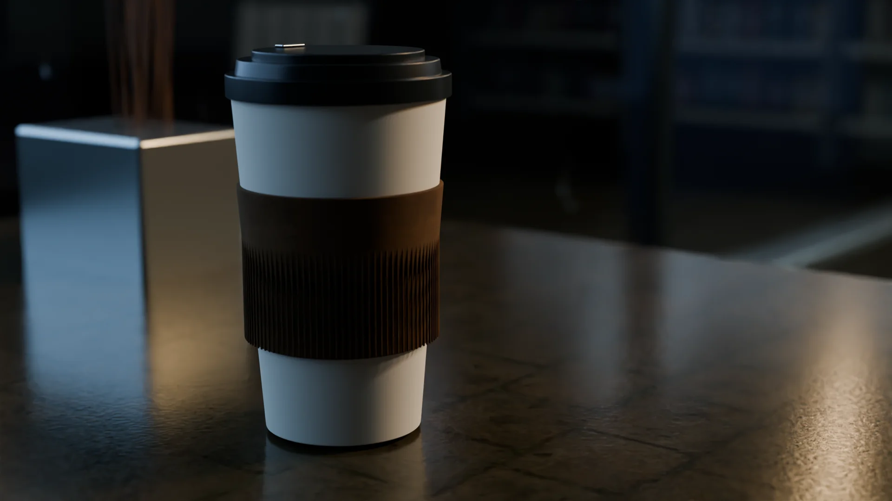

| 항목 | 내용 |
|---|---|
| 파일 | `projects/dawn-store/art/blender-study/counter.png` 1920×1080 · 2,053,696B; `coffee.png` 동일 크기 · 1,907,354B. WebP 68,596B / 40,614B. `night-store.blend` 원본 |
| 쓰이는 곳 | 계산대/커피 미디어 층 후보. 기본 앱 미적용 |
| 도구 | Blender 4.5.12 LTS · Cycles CPU · 2026-10-02. AI 생성 아님 |
| 참조 이미지 | 기존 계산대 v2를 시각 확인, 모델 입력 이미지 아님 |
| 설정 | seed 31 · AgX/denoise · 계산대 256/커피 128샘플 · 렌즈 38/58mm, f/2.8 · 반사 12/굴절 8 |
| 재현 | `projects/dawn-store/scripts/render-store.py`, `render-study-camera.py`; [설정](../projects/dawn-store/art/blender-study/render-settings.json), [촬영 재질 출처](../art/materials/README.md) |

**무엇을 그리나** — 실제 유리 반사, 종이컵·영수증·진열대·금속·석재, 따뜻한 작은 등과 청백색 형광등이 있는 같은 밤 편의점의 두 카메라.
자연어 생성 프롬프트는 없다. 아래는 사용자 제작 요청 원문이고 형상·광원은 연결된 Python 소스에 있다.

```text
그럼 새벽세시를 좀 더 블렌더 고품질 렌더로 만들어보고 jooho lab은  3d를 기반으로 한 단계 더 다듬는걸로 해보자.
```

**생성 후 확인** — 실제 PNG 두 장의 반사·형상·심도·해상도를 확인했다. 외부 이미지 3개 pack. 상품이 규칙적이고 사용 흔적이 부족해서 기존 컷보다 사실적이라는 합격 판단은 하지 않았고 후보로 보관한다. 커피 256샘플 진행은 계산대 완성 후 중단하고 128샘플로 재렌더했다. 비 없음/단일 광원 초기 방향과 달리 현 v2의 물방울·작은 따뜻한 조명을 참고했고 사람은 만들지 않았다. 정지 렌더 두 장이며 영상이 아니다.
