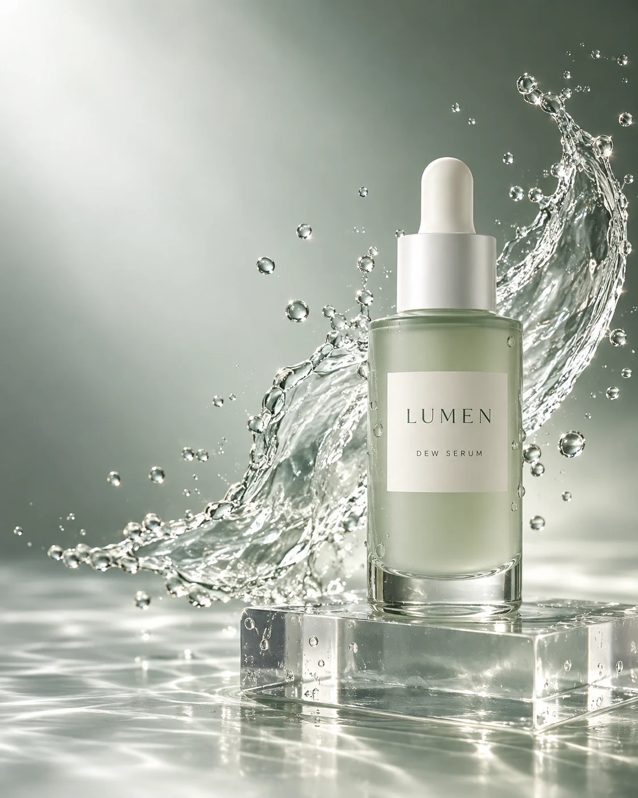
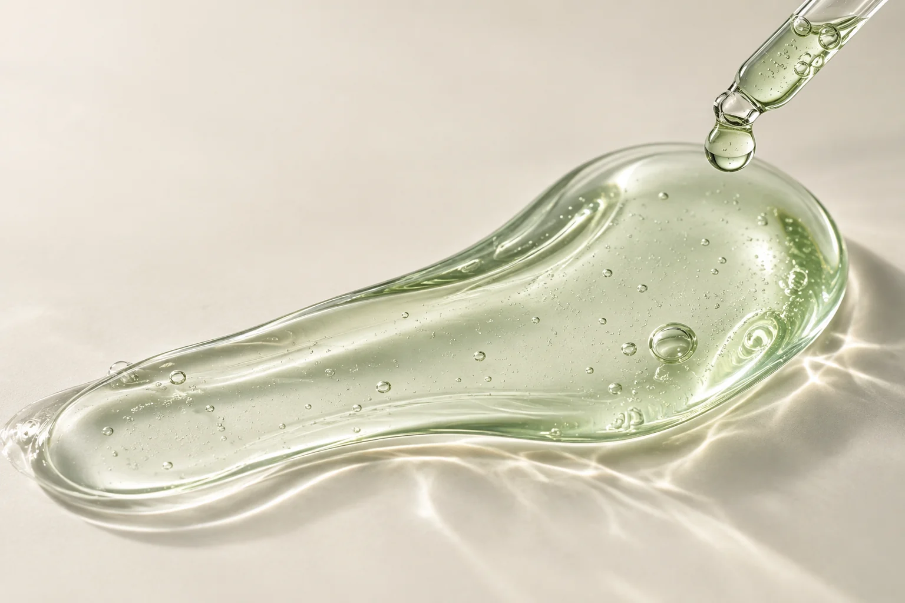
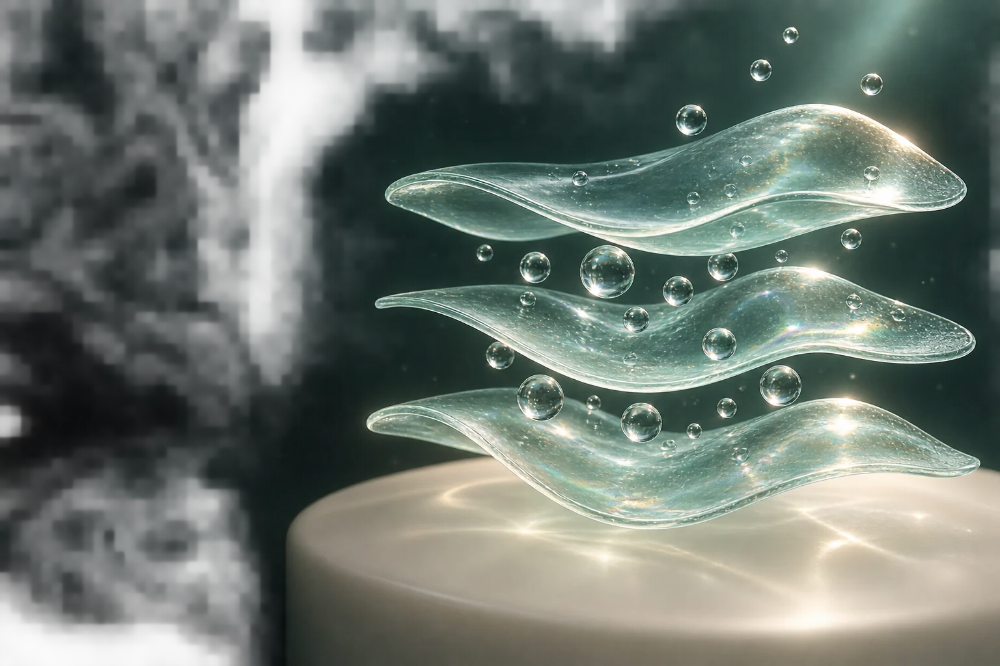
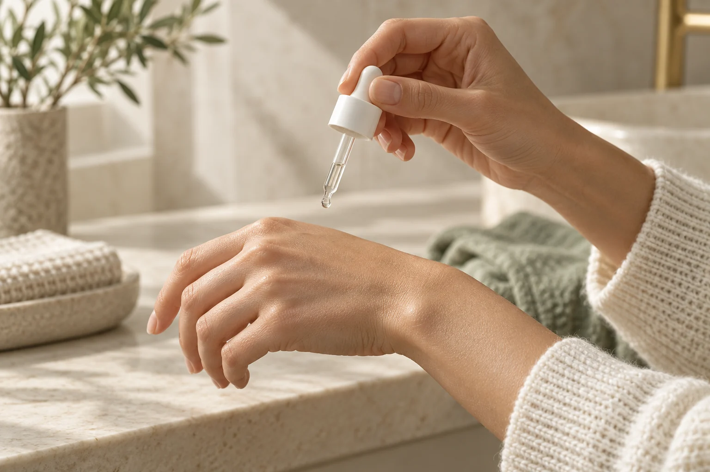
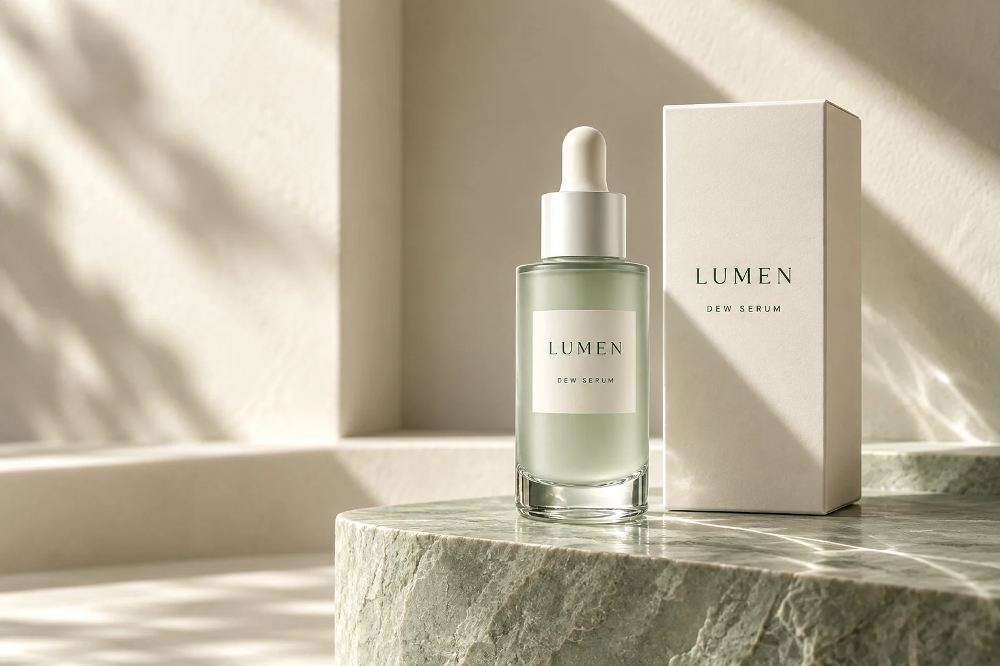
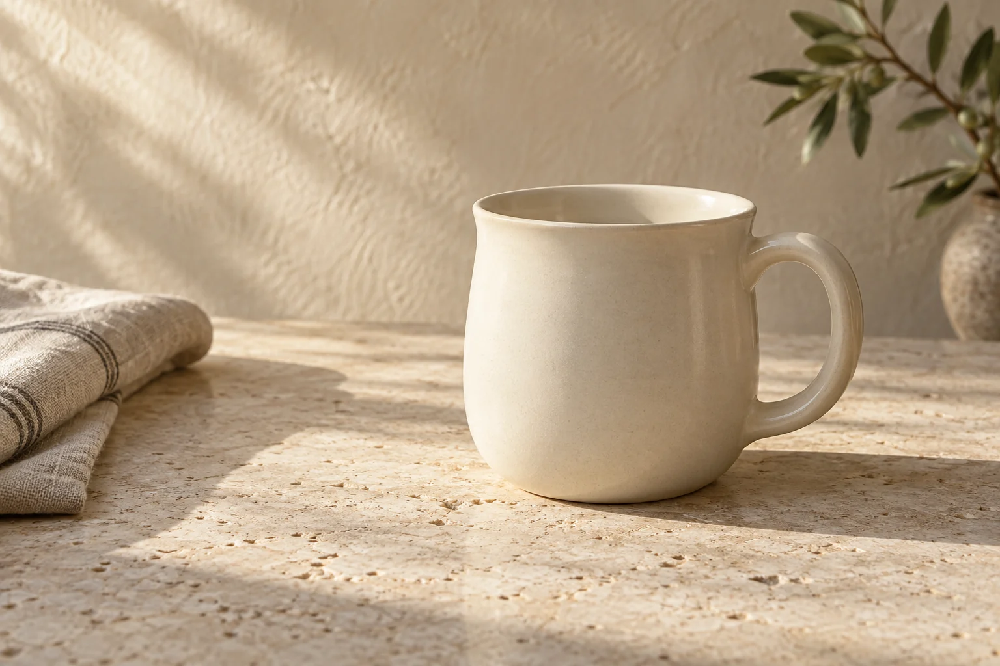

# 상세페이지 — 에셋 프롬프트

`projects/detail-pages` 포트폴리오에 싣는 상세페이지 시안의 그림. 그림은 **shortform-automation 저장소**의 상세페이지 작업실에서 Codex 내장 `image_gen`으로 만들었고(2026-09-12), 이 저장소에는 `scripts/sync-pages.py`가 독립 HTML 속 base64 PNG를 WebP 파일로 꺼내 옮겼다. 원본 이력은 그쪽 저장소에 그대로 둔다 — LUMEN `상세페이지/db6b2f93-…/이미지-프롬프트.json`·`docs/35-화장품-상세페이지-리디자인.md`, 온기 `docs/전략/34-상세페이지-샘플-테스트.md`.

**규칙** — 모든 브랜드·제품은 가상이다. 그림 속 제형·CGI는 연출이며 실제 성분·효능의 근거로 쓰지 않는다. 한글 문구는 그림에 굽지 않고 HTML로 조판했다. 포트폴리오 카드의 긴 미리보기와 전시관 표지는 이 그림들을 담은 **페이지 캡처**이며 새로 생성하지 않았다([jooho-lab.md 30](jooho-lab.md#30--상세페이지-전시-표지--work-detail-pages)).

### 01 · LUMEN 제품 대표컷 — hero



| 항목 | 내용 |
|---|---|
| 파일 | `projects/detail-pages/dist/pages/lumen-dew-serum/media/01.webp` · 1122×1402 · 137,344B (원본 `shortform-automation/pipeline/web/public/detail-samples/lumen/hero.png`) |
| 쓰이는 곳 | LUMEN DEW 세럼 상세페이지 · 첫 화면 오른쪽 제품 그림. 포트폴리오 목록은 레이어가 아닌 콘텐츠(`pages.js`) |
| 도구·모드 | Codex 내장 `image_gen.imagegen` · 2026-09-12 (shortform-automation) |
| 참조 이미지 | 없음 |
| 설정 | 세로 4:5, 후보 1개. 이 저장소로 옮길 때 WebP quality 86(해상도 유지) |

**한국어 요약** — 세이지 유리 세럼 병이 아크릴 블록 위에 서 있고 뒤로 물보라가 휘어진다. 왼쪽 위는 큰 한글 제목 자리로 비운다. 병 라벨의 LUMEN·DEW SERUM만 그림 속 글자.

**프롬프트 원문 그대로**

```text
Premium luxury skincare advertising photograph, portrait 4:5. Fictional brand LUMEN, product DEW SERUM. ONE elegant cylindrical frosted pale sage-green glass serum bottle with flat thick transparent glass base, softly rounded shoulders, white satin cylindrical dropper cap with white rubber bulb. Minimal ivory label precisely reads 'LUMEN' and smaller 'DEW SERUM', no other text/numbers/claims. Bottle upright center-right on clear translucent acrylic block, large single sculptural water splash arcing behind bottle, suspended crystalline droplets, soft silver-sage gradient studio backdrop, crisp caustic shadows, sophisticated Korean skincare campaign, extremely polished tangible glass, softbox lighting, mint/ivory/deep forest palette. Product completely visible, generous clean negative space upper left and left for later large Korean typography. No collage, no extra bottle, no plants, no fake certification, no hands. Physically convincing commercial 3D-render finish with photoreal materials. This is a fictional product concept design.
```

**생성 후 확인** — shortform-automation 기록: 이미지 5개가 각각 한 번씩 쓰이고 SHA-256이 모두 다름, 제품 정체성은 hero를 참조로 유지. 이 저장소에서는 추출 뒤 원본과 같은 장면·비율인지 직접 열어 확인했다.

### 02 · LUMEN 제형 매크로 — texture



| 항목 | 내용 |
|---|---|
| 파일 | `projects/detail-pages/dist/pages/lumen-dew-serum/media/02.webp` · 1536×1024 · 91,506B (원본 `shortform-automation/pipeline/web/public/detail-samples/lumen/texture.png`) |
| 쓰이는 곳 | LUMEN DEW 세럼 상세페이지 · “투명한 제형을 가까이에서” 구간 그림(사진 안 한글 콜아웃 3개는 HTML). 포트폴리오 목록은 레이어가 아닌 콘텐츠(`pages.js`) |
| 도구·모드 | Codex 내장 `image_gen.imagegen` · 2026-09-12 (shortform-automation) |
| 참조 이미지 | 없음 |
| 설정 | 가로 3:2, 후보 1개. 이 저장소로 옮길 때 WebP quality 86(해상도 유지) |

**한국어 요약** — 아이보리 유리면 위로 길게 펴 바른 민트 세럼, 작은 기포, 오른쪽 위에서 들어오는 피펫 방울. 왼쪽 위는 설명 문구 자리. 실제 성분 근거가 아닌 연출.

**프롬프트 원문 그대로**

```text
Luxury skincare texture macro photograph, landscape 3:2. One long glossy translucent pale mint serum swatch across a clean warm ivory glass surface, sculpted curved edge, tiny realistic trapped bubbles and one rounded droplet suspended from a transparent glass pipette entering upper right, shallow depth of field but swatch edge sharply detailed, soft directional studio light with subtle caustic shadows, pristine high-end cosmetics editorial. Composition macro abstraction with asymmetrical arc and empty upper-left for explanatory typography added later. No bottle, no hands, no text, no flowers, no fruit, no scientific charts. Convincing tactile transparent gel and varied refractive thickness, refined sage-ivory palette. Fictional product texture concept, not evidence of actual ingredients.
```

**생성 후 확인** — shortform-automation 기록: 이미지 5개가 각각 한 번씩 쓰이고 SHA-256이 모두 다름, 제품 정체성은 hero를 참조로 유지. 이 저장소에서는 추출 뒤 원본과 같은 장면·비율인지 직접 열어 확인했다.

### 03 · LUMEN 수분막 CGI — cgi



| 항목 | 내용 |
|---|---|
| 파일 | `projects/detail-pages/dist/pages/lumen-dew-serum/media/03.webp` · 1536×1024 · 445,214B (원본 `shortform-automation/pipeline/web/public/detail-samples/lumen/cgi.png`) |
| 쓰이는 곳 | LUMEN DEW 세럼 상세페이지 · “수분을 설명하는 세 개의 레이어” 구간 그림. 포트폴리오 목록은 레이어가 아닌 콘텐츠(`pages.js`) |
| 도구·모드 | Codex 내장 `image_gen.imagegen` · 2026-09-12 (shortform-automation) |
| 참조 이미지 | 없음 |
| 설정 | 가로 3:2, 후보 1개. 이 저장소로 옮길 때 WebP quality 86(해상도 유지) |

**한국어 요약** — 짙은 숲빛 배경에 떠 있는 투명 민트 하이드로겔 세 겹과 물방울 구슬. 피부 조직·효능·분자식 없이 추상적인 개념 연출로 한정.

**프롬프트 원문 그대로**

```text
Create a premium 3D scientific-inspired cosmetics concept illustration, landscape 3:2, high production quality Octane-style CGI. Exploded isometric close-up of THREE gently undulating transparent mint hydrogel sheets floating parallel in space above a soft warm ivory base. Small crystal-clear water spheres nestled between the layers, a few droplets above, finely detailed refractive surfaces and subtle thin-film interference, ordered physical spacing, clear visual hierarchy. Background is deep forest teal fading to near black, dramatic rim lighting and soft volumetric glow, luxurious precise render. Main structure at center-right, substantial dark negative space on left for Korean annotations added later. No actual skin tissue, no cells, no epidermal penetration, no before-after, no molecular formulas, no brands, no text, no claims. A purely abstract hydration-film visual metaphor for a clearly labeled conceptual product page.
```

**생성 후 확인** — shortform-automation 기록: 이미지 5개가 각각 한 번씩 쓰이고 SHA-256이 모두 다름, 제품 정체성은 hero를 참조로 유지. 이 저장소에서는 추출 뒤 원본과 같은 장면·비율인지 직접 열어 확인했다.

### 04 · LUMEN 사용 장면 — ritual



| 항목 | 내용 |
|---|---|
| 파일 | `projects/detail-pages/dist/pages/lumen-dew-serum/media/04.webp` · 1536×1024 · 115,308B (원본 `shortform-automation/pipeline/web/public/detail-samples/lumen/ritual.png`) |
| 쓰이는 곳 | LUMEN DEW 세럼 상세페이지 · “드롭부터 루틴까지” 구간 그림. 포트폴리오 목록은 레이어가 아닌 콘텐츠(`pages.js`) |
| 도구·모드 | Codex 내장 `image_gen.imagegen` · 2026-09-12 (shortform-automation) |
| 참조 이미지 | 없음 |
| 설정 | 가로 3:2, 후보 1개. 이 저장소로 옮길 때 WebP quality 86(해상도 유지) |

**한국어 요약** — 크림 니트 소매의 두 손, 한 손의 스포이트에서 다른 손등으로 떨어지기 직전의 세럼 한 방울. 얼굴·병·글자 없음.

**프롬프트 원문 그대로**

```text
Premium skincare editorial close-up photograph, landscape 3:2. Two graceful adult hands with natural unpolished nails, one holds a white-capped clear glass dropper above the back of the other hand. Exactly one clear serum droplet at pipette tip. Cream knit sleeve, warm ivory stone bathroom background softly blurred, morning sidelight, realistic skin texture, sophisticated minimal beauty campaign, sage and cream palette. No face, no bottle, no jewelry, no text, no claims. Anatomically correct hands, quiet intimate ritual, generous negative space, premium commercial photography.
```

**생성 후 확인** — shortform-automation 기록: 이미지 5개가 각각 한 번씩 쓰이고 SHA-256이 모두 다름, 제품 정체성은 hero를 참조로 유지. 이 저장소에서는 추출 뒤 원본과 같은 장면·비율인지 직접 열어 확인했다.

### 05 · LUMEN 패키지 — pack



| 항목 | 내용 |
|---|---|
| 파일 | `projects/detail-pages/dist/pages/lumen-dew-serum/media/05.webp` · 1536×1024 · 87,292B (원본 `shortform-automation/pipeline/web/public/detail-samples/lumen/pack.png`) |
| 쓰이는 곳 | LUMEN DEW 세럼 상세페이지 · “당신의 선반 위, LUMEN” 마무리 구간 그림. 포트폴리오 목록은 레이어가 아닌 콘텐츠(`pages.js`) |
| 도구·모드 | Codex 내장 `image_gen.imagegen` · 2026-09-12 (shortform-automation) |
| 참조 이미지 | hero 결과(01)를 병 모양 기준으로 첨부 |
| 설정 | 가로 3:2, 후보 1개. 이 저장소로 옮길 때 WebP quality 86(해상도 유지) |

**한국어 요약** — 같은 병과 아이보리 상자를 햇빛 드는 크림색 벽감의 세이지 돌 받침 위에. 물보라·아크릴 블록 없이 장면만 새로.

**프롬프트 원문 그대로**

```text
Use the attached LUMEN DEW SERUM bottle as exact packaging reference: same frosted pale sage cylindrical bottle, thick clear glass base, ivory LUMEN / DEW SERUM label and white dropper cap. Create a distinctly NEW luxury commercial packaging still-life photograph, landscape 3:2. Show the entire single bottle standing beside one slim warm-ivory rectangular carton with understated dark-forest 'LUMEN' and smaller 'DEW SERUM' typography. Arrange on sculptural pale sage stone plinth in a sunlit cream alcove, diagonal elegant hard shadows, subtle reflected light, pristine materials, refined high-end beauty editorial. Bottle left of carton, group center-right with empty left third. No water splash, no acrylic cube, no additional text or claims, no flowers. Maintain product identity while completely changing scene and composition.
```

**생성 후 확인** — shortform-automation 기록: 이미지 5개가 각각 한 번씩 쓰이고 SHA-256이 모두 다름, 제품 정체성은 hero를 참조로 유지. 이 저장소에서는 추출 뒤 원본과 같은 장면·비율인지 직접 열어 확인했다.

### 06 · 온기 아이보리 머그 — ongi-mug



| 항목 | 내용 |
|---|---|
| 파일 | `projects/detail-pages/dist/pages/ongi-mug/media/01.webp` · 1536×1024 · 132,064B (원본 `shortform-automation/pipeline/web/public/detail-samples/ongi-mug.png`) |
| 쓰이는 곳 | 온기 머그 상세페이지의 첫 화면·형태 디테일·일상 장면(같은 그림을 세 곳에서 자르기만 다르게 사용) |
| 도구·모드 | Codex 내장 `image_gen` · 2026-09-12 (shortform-automation) |
| 참조 이미지 | 없음 |
| 설정 | 가로 3:2, 후보 1개. 이 저장소로 옮길 때 WebP quality 86, 같은 그림 세 번은 파일 하나로 합침 |

**한국어 요약** — 트래버틴 테이블 위 아이보리 머그, 왼쪽 위 아침 햇빛과 긴 그림자, 리넨·올리브 가지. 로고·글자 없음. 왼쪽은 제목 자리로 비운다.

**프롬프트 원문 그대로**

```text
Create one premium editorial product photograph for a fictional Korean homeware brand sample detail page. Landscape 3:2 composition. A single beautifully proportioned warm ivory ceramic mug with a rounded cylindrical body, slightly flared rim, and generous rounded D-shaped handle on the right; no logo. Mug sits on a pale travertine tabletop, morning sunlight from upper left, delicate elongated shadows, subtly textured limewash beige wall, folded natural linen on far left, small soft olive branch blurred in far background. Mug occupies center-right with ample empty space at left. Understated modern homeware campaign, tactile matte glaze, realistic fine surface and soft reflections, sophisticated art direction, warm cream and muted olive palette, photographed 70mm lens, no text, no watermark, no price, no collage. This is an invented product visual for a clearly labeled design demonstration, not an actual product photograph.
```

**생성 후 확인** — shortform-automation 기록: 같은 대표 이미지를 세 곳에서 재사용하며 별도 촬영 3장으로 주장하지 않는다. 이후 LUMEN 리디자인에서 “사진 한 장 확대 재사용을 독립 컷으로 세지 않는다”는 기준이 생겼다(docs/35).
