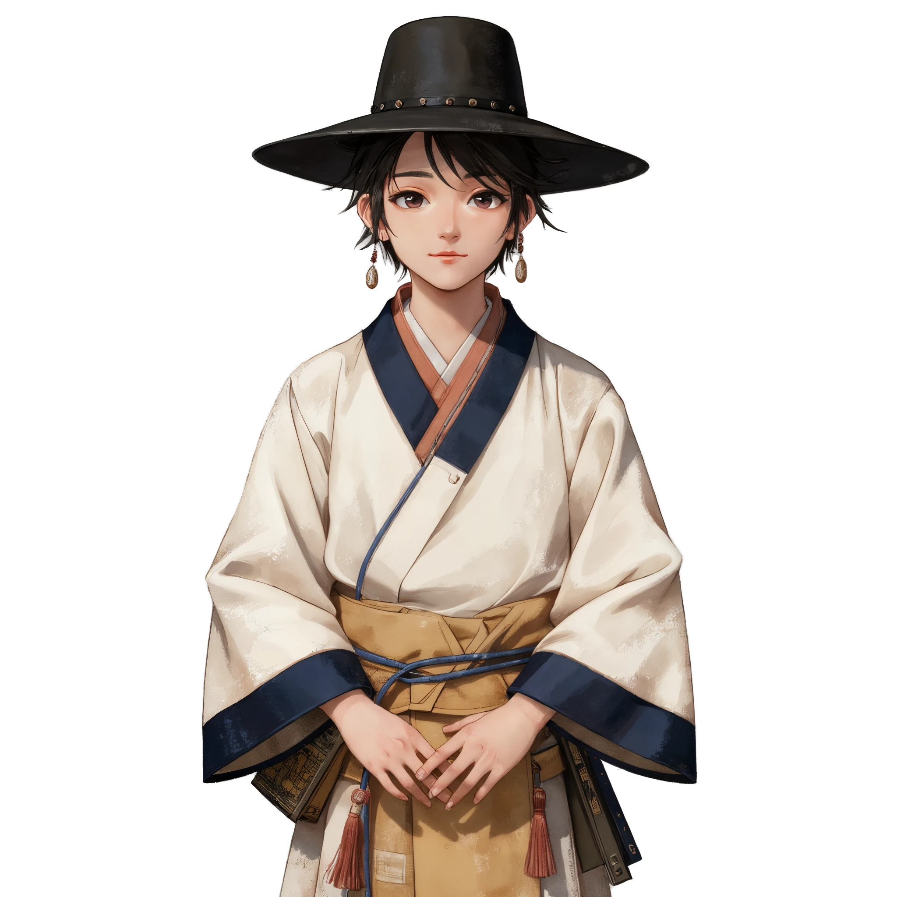
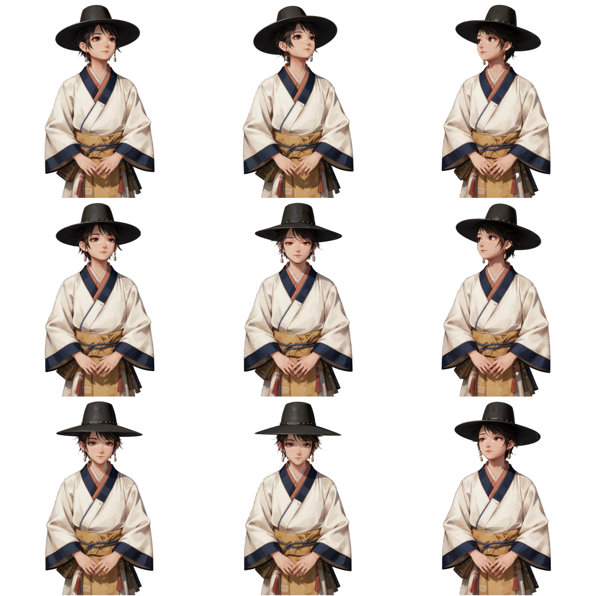
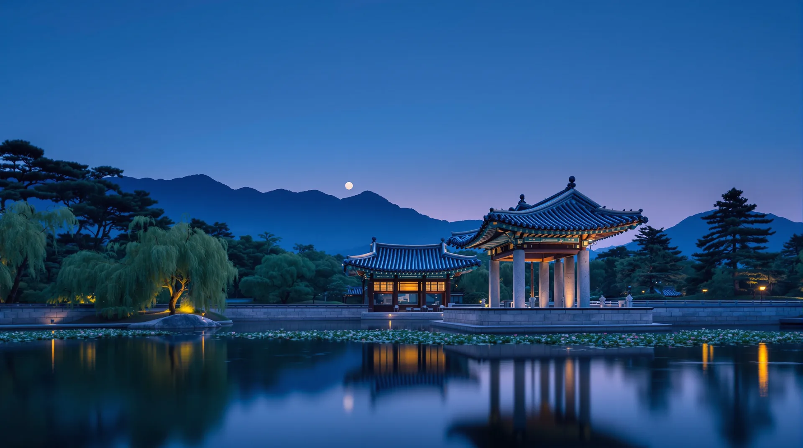
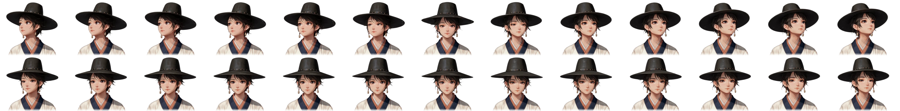
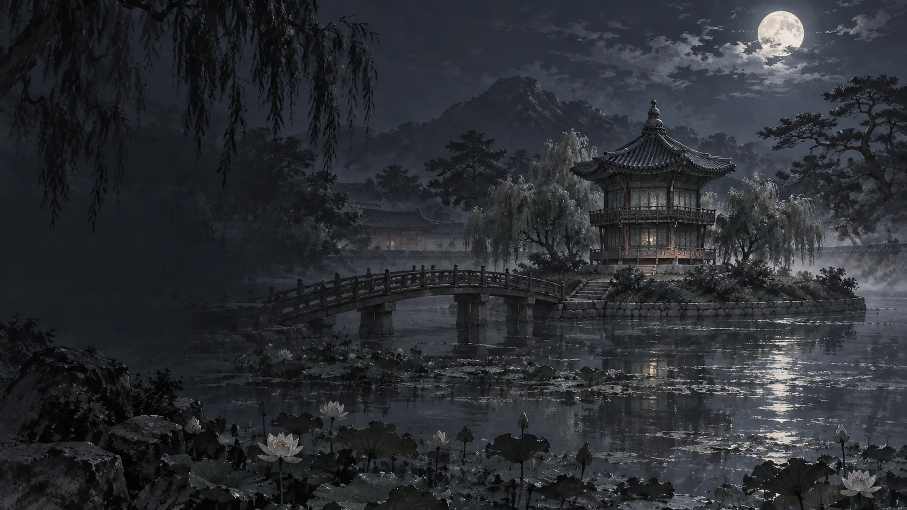
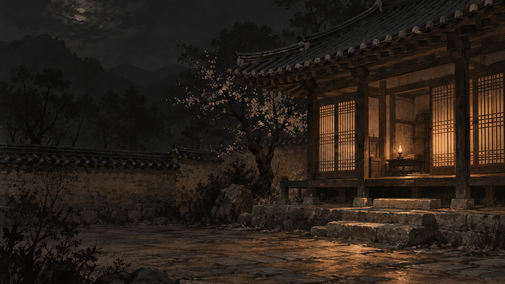
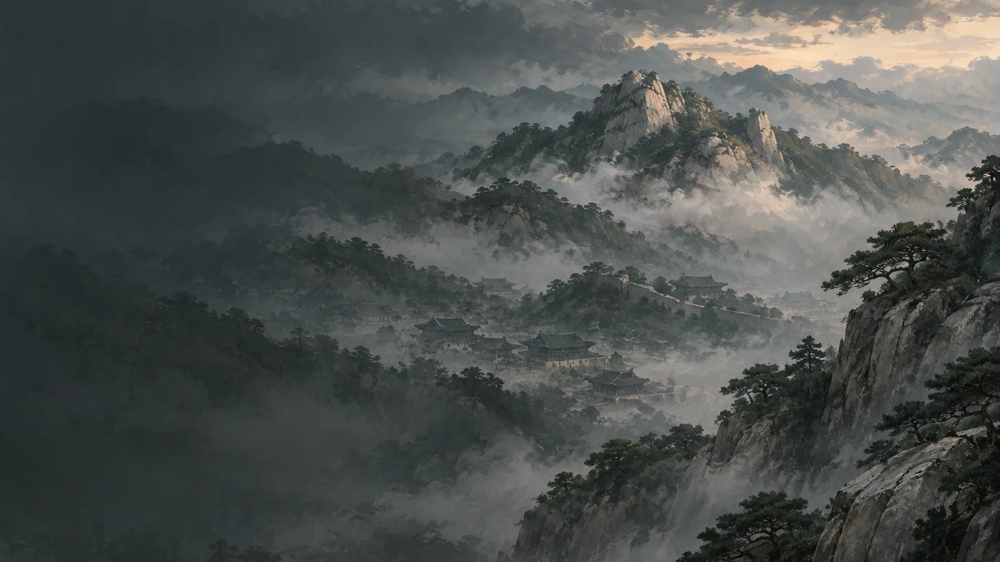

# 한복 히어로 — 에셋 프롬프트

포트폴리오 첫 화면 `projects/hanbok-hero`. 레퍼런스 카드 `references/instagram-reposts.md#lovart-interactive-assets`의 "정지 그림을 방향별 프레임으로" 방식을 **갓 쓴 조선 선비** 캐릭터로 다시 만든다. 레퍼런스의 사무라이 외형·문구는 가져오지 않고, 회화풍 스플래시 아트 느낌(큰 인물·거친 결)만 참고했다.

**규칙(2026-10-03 사용자 정정)** — 정지 이미지는 **Codex `image_gen`**으로 만든다. fal.ai는 **영상(image-to-video)에만** 쓴다. 이번 라운드의 정면 컷은 그 정정 전에 fal Kontext로 만들었고 영상까지 끝난 상태라 그대로 썼다. 다음 수정부터는 정면 컷을 Codex로 만든다. fal 잔액은 2026-10-03에 소진됐다.

**방향 수정 이력** — ① 흰 저고리 사진풍 → ② 적의·금관 중전(일본·중국풍으로 읽힘, 인물 조잡) → ③ 당의 중전 회화풍 → ④ 사용자가 그림체 참조 1장(등불 든 소녀, 거친 붓 결·낮은 채도)과 디자인 참조 1장(갓 쓴 선비, 남색 선 도포·갈색 띠·붉은 술)을 주어 **그림체=참조 1, 디자인=참조 2**로 확정. 참조 이미지는 외부 작가의 작품이라 저장소에 넣지 않고 `docs/참고/`(미추적)에 둔다. 버린 후보와 이유는 각 카드에 적었다.

### 01 · 정면 기준 컷 (hanbok-still) ✅



**2026-10-03 교체** — 화면에서는 더 이상 쓰지 않는다. 02 영상의 입력 원본이라 이력으로 남기고 파일은 `art/superseded/`로 옮겼다. 지금 정면 그림은 [04](#04--몸-고정--얼굴-시트-scholar-still--scholar-body--scholar-heads-)의 `scholar-still`.

| 항목 | 내용 |
|---|---|
| 파일 | `projects/hanbok-hero/art/superseded/hanbok-still.webp`(2026-10-03까지 `dist/assets/`) · 2048×2048 · 262KB · 알파 있음(모서리 알파 0) |
| 쓰이는 곳 | 레이어 `character` 파라미터 `still`. 시트 로딩 전·동작 줄이기·`react` 끔·시트 실패 시 보이는 정면 그림. 시트가 반응 중이면 숨는다 |
| 도구·모드 | fal.ai `fal-ai/flux-pro/kontext/max/multi` (참조 2장 + 텍스트) → `fal-ai/clarity-upscaler` 2× → 로컬 `rembg`(isnet-general-use, alpha matting) · 2026-10-03 |
| 참조 이미지 | 1) 화풍: 등불 든 소녀 콘셉트 아트(사용자 제공, `docs/참고/풍.jpg`, 미추적) 2) 디자인: 갓 쓴 선비 일러스트(사용자 제공, `docs/참고/디자인.jpg`, 미추적). 둘 다 외부 작가 작품 — 그대로 옮기지 않는다 |
| 설정 | `image_urls: [화풍, 디자인]` · `seed: 8` · `aspect_ratio: 1:1` · `guidance_scale: 3.5` · `safety_tolerance: 2` · 출력 1024² → clarity 2048² → webp q90 |

**한국어 요약** — 화풍은 첫 번째 그림 그대로(거친 드라이브러시, 캔버스 결, 번진 가장자리, 낮은 채도, 먼지 낀 따뜻한 빛, 큰 눈의 세미리얼 애니 얼굴). 디자인과 색은 두 번째 그림 그대로(검은 갓 — 높은 평평한 모정·넓은 둥근 챙·턱 아래 옥·호박 구슬 끈, 흰 도포에 짙은 남색 깃·소매·단, 황갈색 안옷, 파란 끈으로 묶은 복숭아빛 갈색 띠, 붉은 술, 옆구리의 책). 색은 흰·짙은 남색·황갈·검정·붉은 포인트. 정면, 갓에서 허리까지, 얼굴 크게, 갓을 뒤로 젖혀 얼굴 전부 보임, 정면 응시, 손은 허리 앞. 연회색 단색 배경, 글자·워터마크·서명 없음.

**프롬프트 원문**

```text
Paint a NEW portrait. Painting style: copy the FIRST image exactly — rough dry-brush strokes, scratchy canvas grain, soft smudged edges, muted desaturated palette, dusty warm light, semi-realistic anime face with large calm eyes. Character design and colors: copy the SECOND image's outfit faithfully — a Korean Joseon scholar wearing a black gat hat (tall flat-topped crown, wide round brim, a string of jade and amber beads hanging under the chin), a white dopo overcoat with wide deep-navy-blue borders on the collar, sleeve ends and hem, a tan-peach inner robe, a long peach-brown sash tied at the waist with a blue cord, red tassel ornaments, and books bound with cord at his side. Keep these exact colors: white, deep navy blue, tan peach-brown, black, small red accents. Pose: front-facing, framed from the top of the gat to the waist so the face is large, the gat tilted back so his whole face is visible, eyes looking straight at the viewer, shoulders square, hands folded at the waist. Centered with generous margin on a perfectly plain flat uniform light gray backdrop. No scroll, no leaves, no text, no calligraphy, no watermark, no signature, no logo, no floor line.
```

**버린 후보** — 텍스트만 쓴 flux ultra 후보(T17 등)는 그림체가 매끈하고 디자인이 매번 흔들렸다. 참조를 넣은 1차(K5·K29)는 그림체가 정확했지만 전신이라 얼굴이 작고 디자인 참조의 워터마크 글씨가 따라왔다. 2차(R8·R61·R90)는 상반신이 됐지만 사용자가 "화풍은 K5, 디자인·색은 참조를 더"라고 해서 3차에서 색 지정을 강화했다. 3차 네 장 중 S61·D61은 글자가 생겼고 D8은 갓 챙이 없어 **S8(seed 8, 화풍 먼저·디자인 둘째 순서)**를 골랐다. 업스케일은 `aura-sr`가 잔액 잠금(403)으로 실패해 `clarity-upscaler`(2×, creativity 0.2)를 썼다.

**생성 후 확인** — `alphaReport('/assets/hanbok-still.webp')` → `cornerAlpha [0,0,0,0]`, `checkerboard false`. 로컬 rembg 결과는 fal birefnet과 눈으로 구분되지 않았다(갓 챙 가장자리·술까지 깨끗).

### 02 · 3×3 방향 시트 (hanbok-sheet) ✅



**2026-10-03 교체** — 칸마다 몸 전체가 다른 프레임이라 칸이 바뀔 때 몸·갓이 튀었다. 같은 영상에서 얼굴 칸만 다시 뽑은 [04](#04--몸-고정--얼굴-시트-scholar-still--scholar-body--scholar-heads-)로 바꿨고 파일은 `art/superseded/`로 옮겼다. 아래 영상 프롬프트는 04의 원본이기도 하다.

| 항목 | 내용 |
|---|---|
| 파일 | `projects/hanbok-hero/art/superseded/hanbok-sheet.webp`(2026-10-03까지 `dist/assets/`) · 3072×3072(칸 1024, 칸마다 4px 투명 여백) · 607KB · 알파 있음 |
| 쓰이는 곳 | 레이어 `character` 파라미터 `sheet`. 포인터 방향에 따라 칸을 **즉시 교체**(`fade`·`follow` 0 — 크로스페이드는 두 머리가 겹쳐 잔상처럼 보여 껐다). 행: 좌상·상·우상 / 좌·정면·우 / 좌하·하·우하 |
| 도구·모드 | fal.ai `fal-ai/kling-video/v2.1/standard/image-to-video` (01의 1024² 원본 입력) → `ffmpeg fps=3` 30프레임 → 로컬 `rembg` 9장 → `ffmpeg xstack` 조립 · 2026-10-03 |
| 참조 이미지 | 01 원본(Kontext 출력, 배경 제거 전) |
| 설정 | `duration: "10"` · `cfg_scale: 0.5` · `negative_prompt: "blur, distortion, extra people, camera movement, zoom, text, watermark, hands moving"` · 출력 1440×1440 24fps · webp q88 |

**한국어 요약** — 카메라 고정, 몸·어깨·손·갓은 그대로. 머리와 눈만 천천히: 자기 왼쪽 → 정면 → 오른쪽 → 정면 → 위 → 정면 → 아래 → 정면.

**프롬프트 원문**

```text
Static camera, plain backdrop, the painted Korean Joseon scholar in a black gat hat and white dopo keeps his body, shoulders, hands and hat perfectly still. Only his head and eyes move, slowly and smoothly, like he is following something near the viewer. No zoom, no camera motion, no other people, consistent lighting. Sequence: he turns his head and eyes to look to his left, returns to center, turns to look to his right, returns to center, then looks up, returns to center, then looks down, and returns to center.
```

**고른 프레임** (3fps 번호, 보는 사람 기준) — 좌상 f19 · 상 f21 · 우상 f8 / 좌 f18 · 정면 f1 · 우 f7 / 좌하 f27 · 하 f28 · 우하 f4. 눈 깜빡임 프레임(f2·f3·f9·f10·f16·f17·f23·f24)은 제외. 위·아래는 눈 위주라 변화가 작다.

**생성 후 확인** — `alphaReport('/assets/hanbok-sheet.webp')` → 모서리 알파 0. `runChecks` 21/21 ×2, probe 70/70, 390px 6/6.

### 03 · 배경 — 경회루 야경 (palace) ✅

**2026-10-05 교체** — 시·서·화 분야별 배경(05~07)으로 바뀌었다. 그림은 이력으로 `art/superseded/palace.webp`에 남겼다.



| 항목 | 내용 |
|---|---|
| 파일 | `projects/hanbok-hero/art/superseded/palace.webp`(2026-10-05까지 `dist/assets/palace.webp`) · 1920×1072 · 111KB |
| 쓰이는 곳 | 레이어 `paper` 파라미터 `image`(cover). 위에 `vignette` 0.5 |
| 도구·모드 | fal.ai `fal-ai/flux-pro/v1.1-ultra` 텍스트→이미지 · 2026-10-02 (정정 전 생성; 다음 교체 시 Codex) |
| 참조 이미지 | 없음 |
| 설정 | `aspect_ratio: 16:9` · `seed: 23` · `raw: false` · 출력 2752×1536 → 1920 폭 webp q82 |

**한국어 요약** — 경복궁 경회루, 해 질 녘 블루아워. 연못 위 돌기둥·곡선 기와지붕 누각, 물에 비친 반영, 버드나무·소나무, 뒤에 인왕산, 얇은 달, 등불. "한국 조선 건축, 중국·일본 아님, 붉은 해·깃발·사람·글자·현판·처마 밑 명패 없음".

**프롬프트 원문**

```text
Photographic cinematic wide shot of Gyeonghoeru pavilion at Gyeongbokgung Palace, Seoul, KOREA at dusk, for a website hero background: the large Korean wooden pavilion with a curved grey giwa roof and tall stone pillars standing in a still lotus pond, reflections on the water, willow and pine trees, Inwangsan mountain behind, soft indigo blue-hour sky with a thin moon, warm lantern glow, slight haze. Authentically Korean Joseon architecture, not Chinese, not Japanese, no red sun, no flags, no people, no text, no signboard, no nameplate, no hanging plaques under the eaves, bare wooden eaves only.
```

**버린 후보** — ⓪ 같은 프롬프트 seed 12: 처마 밑 명패에 가짜 로마자. ① 궁 실내 + 일월오봉도 1차: 노란 병풍 위 붉은 해가 일장기처럼, 붉은 기둥·금색이 중국풍으로 읽혔고 현판 글씨가 계속 생겼다(인페인팅도 현판을 다시 그림). ② 근정전 마당 사진풍: 밝아서 글자 대비 약함. ③ 남색 하늘 일월오봉도 실내: 붉은 나무가 어색. 가장 오해 없이 한국이고 어두워 글자가 잘 읽히는 경회루를 골랐다.

### 04 · 몸 고정 + 얼굴 시트 (scholar-still · scholar-body · scholar-heads) ✅



| 항목 | 내용 |
|---|---|
| 파일 | `projects/hanbok-hero/dist/assets/scholar-still.webp` 1440×1440 · 112KB / `scholar-body.webp` 1440×1440 · 71KB / `scholar-heads.webp` 7644×952(칸 588×476, 13×2) · 660KB · 셋 다 알파(모서리 알파 0) |
| 쓰이는 곳 | 레이어 `character` — `still` 정면 그림(반응 전·동작 줄이기·`react` 끔·실패 시), `body` 얼굴 자리를 비운 몸(반응 중), `sheet` 얼굴 칸(창 `headX` 22.917 · `headY` 0 · `headW` 58.333 · `headH` 47.222 %, `cols` 13 · `rows` 2). 쉬는 칸(아래 행 가운데) + 몸 = 정면 그림 |
| 도구·모드 | 새 생성 없음. 02의 Kling 영상(1440² 24fps 241프레임) → 로컬 `rembg`(isnet-general-use, 알파 매팅) → `projects/hanbok-hero/scripts/assets/build-heads.py`(위상 상관으로 몸 흔들림 정렬 + TV-L1 광학 흐름으로 깃 맞춤 + 띠 섞기) → PIL WebP · 2026-10-03 |
| 참조 이미지 | 없음(02 영상 프레임만) |
| 설정 | 기준 몸 프레임 110 · 위 행 56 50 44 38 32 26 2 136 142 148 156 164 170 · 아래 행 80 84 88 92 96 102 110 212 208 204 200 198 196 · 머리 영역 x330–1170 y0–680 · 깃 맞춤 띠 y450–530 · 색 섞기 띠 y455–620 · 가장자리 페더 30px · 축소 0.7 · WebP q88(정면·몸) / q86(시트) |

**무엇을 그리나** — 02 영상에서 고개만 다른 26프레임을 골라, 몸은 한 장(프레임 110)으로 고정하고 머리·갓·목 부분만 칸으로 잘랐다. 왼쪽 → 오른쪽 열은 고개 방향, 위 행은 고개를 들며 크게 도는 구간(포인터가 얼굴보다 위), 아래 행은 정면-아래로 돌아오는 두 구간을 이은 것(쉬는 행). 칸이 바뀌어도 몸·깃·소매는 그대로다.

**프롬프트 원문** — 새 프롬프트 없음. 영상 프롬프트는 02 원문 그대로다.

**방향을 바꾼 이유** — 사용자 피드백 "선비 얼굴이 마우스를 따라가게, 버벅거림이나 잔상은 없애고". 3×3 시트는 칸마다 몸이 최대 ±20px 흔들리고 갓 모양도 달라 칸이 바뀔 때 몸 전체가 튀었고, 정면 그림(Kontext 2048 업스케일본)과 시트 가운데 칸이 달라 반응이 켜질 때 한 번 바뀌었다. 그래서 정면 그림도 영상 프레임 110으로 바꿨다 — 업스케일본보다 조금 부드럽지만 반응 중 화면과 픽셀이 같다.

**버린 후보** — ① 원본 프레임 0을 기준 몸으로: 다른 모든 프레임과 머리 영역 차이가 커서(RMS 29~53) 쉬는 칸에서 한 칸만 움직여도 크게 바뀐다. ② 아래 행 양 끝에 고개 든 프레임(56·50·164·170)을 섞은 배치: 갓 기울기가 확 바뀌어 튄다. ③ 192·194: 눈꺼풀이 덜 올라왔다. ④ 띠 섞기만(흐름 없이): 깃 주황·흰 선이 두 겹으로 비친다. ⑤ 평활 없는 광학 흐름: 그림 결 때문에 점처럼 깨진다.

**생성 후 확인** — `alphaReport` 세 장 모서리 알파 0 · `restMatchesStill()` 평균 차이 0.40/255 · 고개를 가장 많이 돌린 칸의 목·깃을 원본 크기로 보고 겹선 없음 확인 · `runChecks` 24/24. 한계: 영상이 고개를 돌리는 동안 눈은 대체로 관람자를 본다.

**방향 전환(2026-10-05)** — 사진풍 경회루 한 장(03) → 분야별 회화풍 배경 세 장(05~07). 사용자 결정: 시·서·화 분야를 고르면 장소까지 바뀌어야 분위기 차이가 분명하고(안 B), 그림체는 선비 캐릭터·참조 화풍과 같은 회화풍 콘셉트 아트로 맞춘다. 전에 실내·일월오봉도 배경이 일본·중국풍으로 읽히고 현판 글씨가 생겼던 기록(03 버린 후보) 때문에 세 장 모두 실외로 정했다.

### 05 · 배경 — 시 詩 — 향원정 달밤 (mood-si) ✅



| 항목 | 내용 |
|---|---|
| 파일 | `projects/hanbok-hero/dist/assets/mood-si.webp` · 1920×1080 · 160KB(q76) |
| 쓰이는 곳 | 레이어 `paper` 파라미터 `image`, 장면 `si`의 `set.paper.image`(매니페스트). 위에 `vignette` 0.5 |
| 도구·모드 | Codex CLI `codex exec` → 내장 `image_gen`(imagegen 스킬 기본 모드) · 2026-10-05. 모델명·시드는 노출되지 않음 |
| 참조 이미지 | `docs/참고/풍.jpg`(사용자 제공 화풍 참조 — 등불 든 소녀 콘셉트 아트, 미추적 외부 작품). **화풍만** 참조하고 인물·등불·글자·낙관은 가져오지 말라고 프롬프트에 적었다 |
| 설정 | 출력 1536×1024 → 가운데 16:9(1536×864)로 자름 → 1920×1080 LANCZOS → webp(200KB 이하가 되는 첫 품질). 후보 3장 중 사용자가 `si-2`를 고름 |

**한국어 요약** — 경복궁 향원정의 보름달 밤. 연못 섬 위 육각 2층 정자, 나무 다리(취향교), 연꽃, 버드나무·소나무 실루엣, 옅은 안개. 은청빛. 공통 조건: 회화풍 콘셉트 아트(붓 결이 보임), 전체가 어두워 밝은 글자가 읽힘, 왼쪽 45%는 이름 자리라 어둡고 단순하게, 오른쪽 가운데(선비 자리)는 조용하게. 사람·동물·글자·현판·명패·낙관·붉은 해·깃발 없음, "not Chinese, not Japanese".

**프롬프트 원문** (Codex에 표준입력으로 넘긴 그대로, `-i docs/참고/풍.jpg` 첨부)

```text
Use your built-in image generation tool to create ONE landscape image (1536x1024). Prompt: Moonlit night at Hyangwonjeong pavilion in Gyeongbokgung Palace, Seoul, Korea: the small hexagonal two-story Korean wooden pavilion with a grey giwa tile roof on a round islet in a still lotus pond, the arched wooden Chwihyanggyo bridge leading to it, a full moon low in a deep indigo sky, silver-blue moonlight on the water with soft reflections, willow and pine silhouettes, faint mist. Cool silver-blue palette. Painterly Korean concept art illustration with visible brush strokes, painted in the same style as the attached reference image (use the reference ONLY for painting style: brushwork, muted palette, soft texture; do not copy its subject, figure, lantern, text or seal). Wide landscape website hero background, dark and moody overall so light text stays readable. Composition: the left 45 percent of the frame is dark, calm and uncluttered for a title; the right-center area is quiet with no strong focal point because a character will stand there; the main landmark sits in the middle distance. Authentically Korean Joseon-era scenery, not Chinese, not Japanese. No people, no figures, no animals, no text, no calligraphy, no letters, no signboard, no hanging plaques, no nameplate, no red sun, no flags, no watermark, no signature, no seal stamp, no border or frame. Save the image in the current directory as si-2.png and reply only with the saved file path.
```

**버린 후보** — ① si-1 — 같은 구성의 푸른 달빛(밝기 30), 통과했으나 사용자가 2번을 골랐다. ② si-3 — 정자 가운데·버드나무(밝기 31), 1차 생성은 Codex "model at capacity"로 실패해 다시 만들었고 통과, 사용자가 고르지 않음.

**생성 후 확인** — 이름 자리 밝기 31 · 글자·현판 없음 · 정자가 오른쪽에 있어 선비 머리 뒤가 비어 있다. 거르기 기준: 이름 자리(1440×900 cover 기준 x 0~45%·y 45~85%) 평균 밝기 0~255, 기존 경회루 45 · 기준 70 이하. 원본에서 글자·현판·명패·낙관, 일본·중국풍 단서(붉은 원, 붉은 기둥+금색, 일본식 석등)를 보고, 선비를 얹은 합성으로 머리 뒤 초점을 확인했다.

### 06 · 배경 — 서 書 — 사랑채 등불 (mood-seo) ✅



| 항목 | 내용 |
|---|---|
| 파일 | `projects/hanbok-hero/dist/assets/mood-seo.webp` · 1920×1080 · 182KB(q82) |
| 쓰이는 곳 | 레이어 `paper` 파라미터 `image`, 장면 `seo`의 `set.paper.image`(매니페스트). 위에 `vignette` 0.5 |
| 도구·모드 | Codex CLI `codex exec` → 내장 `image_gen`(imagegen 스킬 기본 모드) · 2026-10-05. 모델명·시드는 노출되지 않음 |
| 참조 이미지 | `docs/참고/풍.jpg`(사용자 제공 화풍 참조 — 등불 든 소녀 콘셉트 아트, 미추적 외부 작품). **화풍만** 참조하고 인물·등불·글자·낙관은 가져오지 말라고 프롬프트에 적었다 |
| 설정 | 출력 1536×1024 → 가운데 16:9(1536×864)로 자름 → 1920×1080 LANCZOS → webp(200KB 이하가 되는 첫 품질). 후보 3장 중 사용자가 `seo-1`를 고름 |

**한국어 요약** — 조선 서원의 사랑채(선비의 공부방)를 마당에서 본 늦은 밤. 낮은 기와지붕, 마루, 등잔 하나로 따뜻하게 빛나는 창호지 문, 돌계단, 흙담 옆 매화. 먹빛 어둠과 주홍 등불. 공통 조건: 회화풍 콘셉트 아트(붓 결이 보임), 전체가 어두워 밝은 글자가 읽힘, 왼쪽 45%는 이름 자리라 어둡고 단순하게, 오른쪽 가운데(선비 자리)는 조용하게. 사람·동물·글자·현판·명패·낙관·붉은 해·깃발 없음, "not Chinese, not Japanese".

**프롬프트 원문** (Codex에 표준입력으로 넘긴 그대로, `-i docs/참고/풍.jpg` 첨부)

```text
Use your built-in image generation tool to create ONE landscape image (1536x1024). Prompt: Late night at a Korean hanok sarangchae, the scholar's study of a Joseon seowon Confucian academy, seen from the courtyard outside: low tiled roof with gently curved eaves, wooden maru veranda, hanji paper lattice doors glowing warm from a single oil lamp inside, stone steps, a plum tree with a few blossoms beside the earthen wall, ink-dark night with deep shadows. Palette of sumi ink blacks and warm vermilion-orange lamp glow. Painterly Korean concept art illustration with visible brush strokes, painted in the same style as the attached reference image (use the reference ONLY for painting style: brushwork, muted palette, soft texture; do not copy its subject, figure, lantern, text or seal). Wide landscape website hero background, dark and moody overall so light text stays readable. Composition: the left 45 percent of the frame is dark, calm and uncluttered for a title; the right-center area is quiet with no strong focal point because a character will stand there; the main landmark sits in the middle distance. Authentically Korean Joseon-era scenery, not Chinese, not Japanese. No people, no figures, no animals, no text, no calligraphy, no letters, no signboard, no hanging plaques, no nameplate, no red sun, no flags, no watermark, no signature, no seal stamp, no border or frame. Save the image in the current directory as seo-1.png and reply only with the saved file path.
```

**버린 후보** — ① seo-2 — 가장 어둡고 뒤에 산(밝기 20), 통과. ② seo-3 — 건물이 오른쪽 뒤로 작게(밝기 28), 통과. 둘 다 사용자가 고르지 않음.

**생성 후 확인** — 이름 자리 밝기 27 · 글자·현판 없음 · 등불 켜진 문이 화면 오른쪽 가운데에 와서, 분야 버튼 받침(moods.plate)과 밝은 강조색 `#e8866b`로 대비를 맞췄다. 거르기 기준: 이름 자리(1440×900 cover 기준 x 0~45%·y 45~85%) 평균 밝기 0~255, 기존 경회루 45 · 기준 70 이하. 원본에서 글자·현판·명패·낙관, 일본·중국풍 단서(붉은 원, 붉은 기둥+금색, 일본식 석등)를 보고, 선비를 얹은 합성으로 머리 뒤 초점을 확인했다.

### 07 · 배경 — 화 畫 — 비 갠 인왕산 새벽 (mood-hwa) ✅



| 항목 | 내용 |
|---|---|
| 파일 | `projects/hanbok-hero/dist/assets/mood-hwa.webp` · 1920×1080 · 124KB(q82) |
| 쓰이는 곳 | 레이어 `paper` 파라미터 `image`, 장면 `hwa`의 `set.paper.image`(매니페스트). 위에 `vignette` 0.5 |
| 도구·모드 | Codex CLI `codex exec` → 내장 `image_gen`(imagegen 스킬 기본 모드) · 2026-10-05. 모델명·시드는 노출되지 않음 |
| 참조 이미지 | `docs/참고/풍.jpg`(사용자 제공 화풍 참조 — 등불 든 소녀 콘셉트 아트, 미추적 외부 작품). **화풍만** 참조하고 인물·등불·글자·낙관은 가져오지 말라고 프롬프트에 적었다 |
| 설정 | 출력 1536×1024 → 가운데 16:9(1536×864)로 자름 → 1920×1080 LANCZOS → webp(200KB 이하가 되는 첫 품질). 후보 3장 중 사용자가 `hwa-1`를 고름 |

**한국어 요약** — 비 갠 뒤 새벽의 인왕산. 운무 사이로 솟은 화강암 봉우리, 바위에 붙은 소나무, 겹겹이 흐려지는 능선, 골짜기의 기와집. 진경산수의 분위기. 석채 녹청·청회색. 공통 조건: 회화풍 콘셉트 아트(붓 결이 보임), 전체가 어두워 밝은 글자가 읽힘, 왼쪽 45%는 이름 자리라 어둡고 단순하게, 오른쪽 가운데(선비 자리)는 조용하게. 사람·동물·글자·현판·명패·낙관·붉은 해·깃발 없음, "not Chinese, not Japanese".

**프롬프트 원문** (Codex에 표준입력으로 넘긴 그대로, `-i docs/참고/풍.jpg` 첨부)

```text
Use your built-in image generation tool to create ONE landscape image (1536x1024). Prompt: Dawn after rain at Inwangsan mountain in Seoul, Korea: pale granite rock peaks emerging from drifting clouds and mist, pine trees clinging to the rocks, layered ridges fading into fog, the mood of a Joseon true-view landscape painting, first light just touching the peaks. Palette of mineral malachite green, slate teal and soft grey. Painterly Korean concept art illustration with visible brush strokes, painted in the same style as the attached reference image (use the reference ONLY for painting style: brushwork, muted palette, soft texture; do not copy its subject, figure, lantern, text or seal). Wide landscape website hero background, dark and moody overall so light text stays readable. Composition: the left 45 percent of the frame is dark, calm and uncluttered for a title; the right-center area is quiet with no strong focal point because a character will stand there; the main landmark sits in the middle distance. Authentically Korean Joseon-era scenery, not Chinese, not Japanese. No people, no figures, no animals, no text, no calligraphy, no letters, no signboard, no hanging plaques, no nameplate, no red sun, no flags, no watermark, no signature, no seal stamp, no border or frame. Save the image in the current directory as hwa-1.png and reply only with the saved file path.
```

**버린 후보** — ① hwa-2 — **탈락**: 먼 산 위에 남산타워 같은 현대식 탑과 도시가 그려져 조선 풍경이 깨짐(밝기 44). ② hwa-3 — 앞에 바위·오른쪽 먼 궁궐(밝기 37), 통과했으나 사용자가 고르지 않음.

**생성 후 확인** — 이름 자리 밝기 54(왼쪽 안개가 밝음, 기준 이하) · 글자·현판 없음 · 강조색을 `#93c9b8`로 밝혔다. 거르기 기준: 이름 자리(1440×900 cover 기준 x 0~45%·y 45~85%) 평균 밝기 0~255, 기존 경회루 45 · 기준 70 이하. 원본에서 글자·현판·명패·낙관, 일본·중국풍 단서(붉은 원, 붉은 기둥+금색, 일본식 석등)를 보고, 선비를 얹은 합성으로 머리 뒤 초점을 확인했다.
