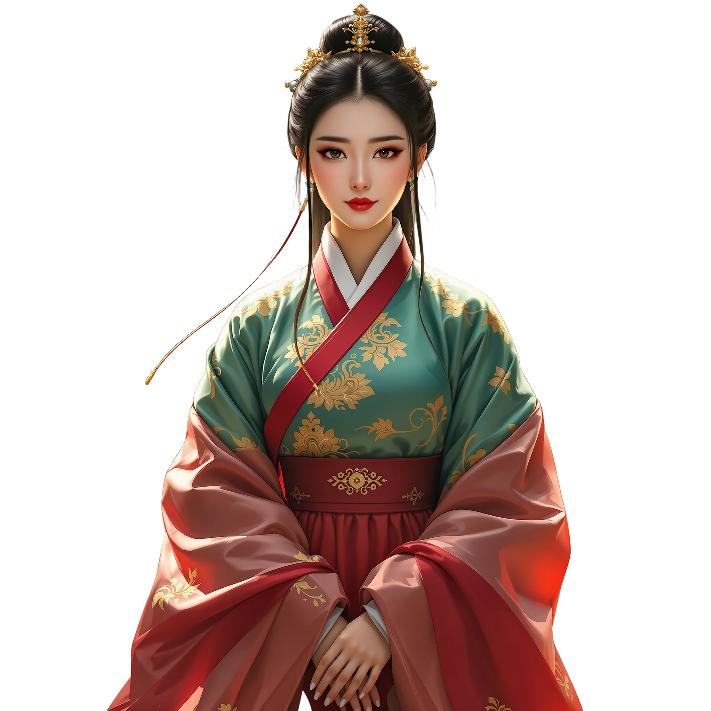
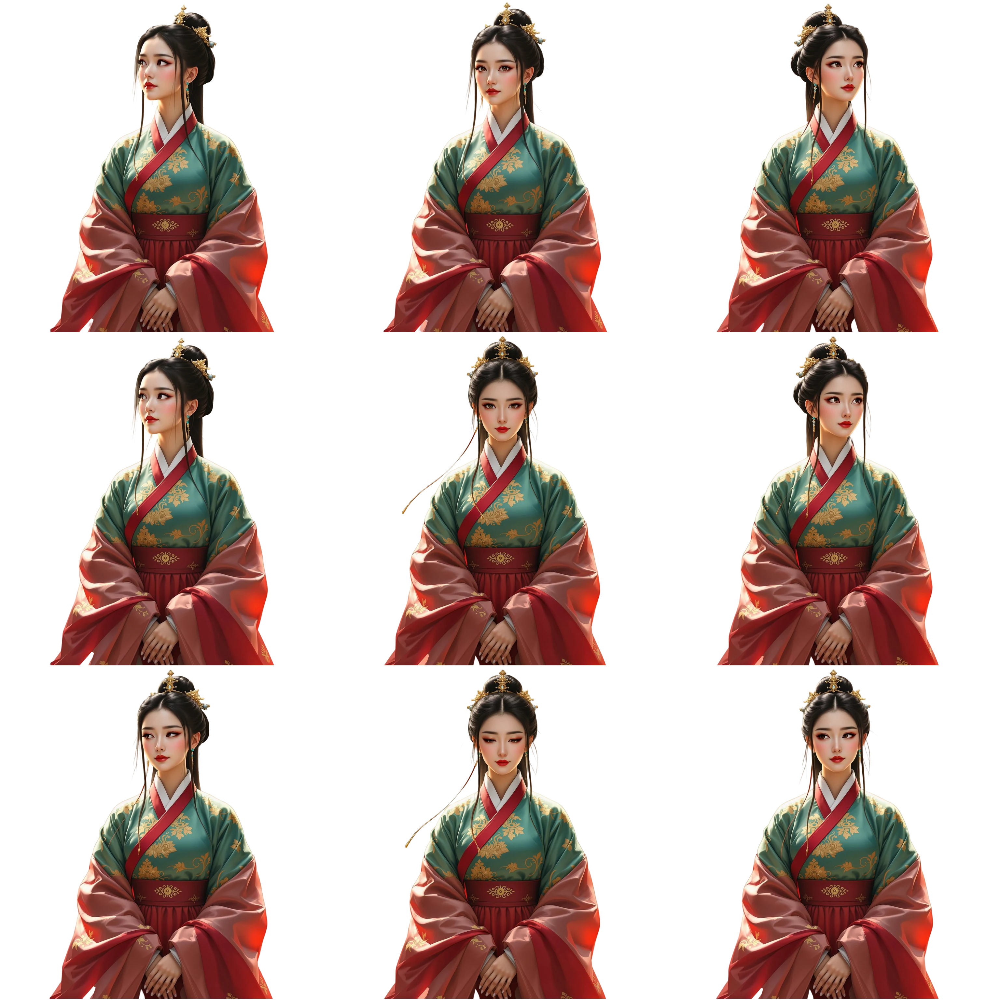

# 한복 히어로 — 에셋 프롬프트

포트폴리오 첫 화면 `projects/hanbok-hero`. 레퍼런스 카드 `references/instagram-reposts.md#lovart-interactive-assets`의 "정지 그림을 방향별 프레임으로" 방식을 한복 캐릭터로 다시 만든다. 레퍼런스의 사무라이 외형은 가져오지 않는다.

2026-10-02 실제 에셋은 **fal.ai 경로**로 만들었다: 정면 컷(flux-pro) → 배경 제거(birefnet) → 머리를 돌리는 영상(Kling i2v) → ffmpeg로 프레임 9장 추출·배경 제거 → 3×3 시트 조립. 사용자가 "2.5D라 fal.ai 영상으로 품질을 높여도 된다"고 허용했다. 재현 스크립트는 [`projects/hanbok-hero/scripts/assets/`](../projects/hanbok-hero/scripts/assets/README.md)에 있다(키는 환경 변수 `FAL_KEY`).

### 01 · 정면 기준 컷 (hanbok-still) ✅



| 항목 | 내용 |
|---|---|
| 파일 | `projects/hanbok-hero/dist/assets/hanbok-still.webp` · 1024×1024 · 61KB · 알파 있음(모서리 알파 0, 체커보드 아님) |
| 쓰이는 곳 | 레이어 `character` 파라미터 `still`. 시트 로딩 전·동작 줄이기·`react` 끔·시트 실패 시 보이는 정면 그림. 시트가 반응 중이면 숨는다 |
| 도구·모드 | fal.ai `fal-ai/flux-pro/v1.1` 텍스트→이미지 → `fal-ai/birefnet/v2` 배경 제거 · 2026-10-02 |
| 참조 이미지 | 없음 |
| 설정 | `image_size: square_hd`(1024²) · `seed: 22` · `output_format: png` · birefnet `General Use (Heavy)`, `2048x2048`, `refine_foreground: true` · webp q92 |

**한국어 요약** — 20대 한국 여성, 흰 저고리에 붉은 고름·붉은 치마, 낮게 땋은 머리에 붉은 댕기. 정면을 보고 살짝 미소, 손을 앞에 모음. 머리 꼭대기에서 무릎 아래까지, 가운데 배치. 배경은 **단색 연회색**(투명 요청 대신 — 배경 제거를 뒤에서 한다). 글자·UI·바닥선·그림자 없음, 초록 금지.

**프롬프트 원문**

```text
Premium stylized 3D collectible figure of a young Korean woman in her twenties wearing a traditional hanbok: ivory-white jeogori jacket with a deep red goreum ribbon, full crimson chima skirt, hair in a low braid with a red daenggi ribbon, soft natural makeup, gentle closed-mouth smile.
She faces the camera directly, eyes looking straight at the viewer, shoulders square, hands folded in front at the waist. Framed from the top of the head to just below the knees, centered, generous margin around the figure.
Full figure within a square frame, standing in front of a perfectly plain flat uniform light gray studio backdrop (#d9d9d9), soft neutral studio lighting, detailed fabric folds, no text, no UI, no floor line, no cast shadow on the ground. Avoid any green color in the outfit.
```

**생성 후 확인** — seed 11·22 두 장을 뽑았다. 11은 전신이 작아 얼굴(시선)이 안 보이고, 22는 얼굴이 크고 치마가 아래로 잘려 화면 바닥에 붙이기 좋아 22를 골랐다. "3D 피규어" 느낌보다는 사진에 가깝게 나왔지만 품질이 좋아 그대로 썼다. 배경 제거 결과: 알파 경계 박스 x 124~896, y 133~1023(치마가 아래 가장자리에 닿음). 작품 페이지 `alphaReport('/assets/hanbok-still.webp')` → `cornerAlpha [0,0,0,0]`, `checkerboard false`.

### 02 · 3×3 방향 시트 (hanbok-sheet) ✅



| 항목 | 내용 |
|---|---|
| 파일 | `projects/hanbok-hero/dist/assets/hanbok-sheet.webp` · 3072×3072(칸 1024, 칸마다 4px 투명 여백) · 405KB · 알파 있음 |
| 쓰이는 곳 | 레이어 `character` 파라미터 `sheet`. 포인터 방향에 따라 칸을 바꾼다(cols 3 · rows 3). 행: 좌상·상·우상 / 좌·정면·우 / 좌하·하·우하 |
| 도구·모드 | fal.ai `fal-ai/kling-video/v2.1/standard/image-to-video` (01 원본 PNG를 입력) → `ffmpeg fps=3` 프레임 추출 → `fal-ai/birefnet/v2` 프레임별 배경 제거 → `ffmpeg xstack` 조립 · 2026-10-02 |
| 참조 이미지 | 01의 배경 제거 전 원본(flux-pro 출력, 연회색 배경) |
| 설정 | `duration: "10"` · `cfg_scale: 0.5` · `negative_prompt: "blur, distortion, extra people, camera movement, zoom, text, watermark"` · 출력 1440×1440 24fps 10초 · 프레임은 3fps로 30장 · webp q88 |

**한국어 요약** — 카메라 고정, 연회색 배경, 몸·어깨·손은 그대로. 머리와 눈만 천천히 움직인다: 자기 왼쪽을 봤다가 정면, 오른쪽, 정면, 위, 정면, 아래, 정면 순서.

**프롬프트 원문**

```text
Static camera, plain light gray studio backdrop, the woman in hanbok keeps her body, shoulders and hands perfectly still. Only her head and eyes move, slowly and smoothly, like she is following something near the viewer. No zoom, no camera motion, no other people, consistent lighting. Sequence: she turns her head and eyes to look to her left, returns to center, turns to look to her right, returns to center, then looks up, returns to center, then looks down, and returns to center.
```

**고른 프레임** (3fps 번호, 보는 사람 기준 방향) — 좌상 f18 · 상 f20 · 우상 f10 / 좌 f16 · 정면 f1 · 우 f8 / 좌하 f15 · 하 f26 · 우하 f5. 영상이 "자기 왼쪽"을 먼저 봐서 f5~f10이 화면 오른쪽, f16~f19가 화면 왼쪽을 본다. 좌하·우하는 고개를 아래로 돌린 프레임이 없어 눈만 옆을 보는 f15·f5를 썼다(5방향 축소 규칙 대신 이 선택을 했다).

**버린 후보** — 같은 조건으로 만든 5초 영상(좌→정면→우만)은 처음 11프레임이 거의 정면이라 쓰지 않았다. 두 영상 모두 눈을 깜빡이는 프레임(f4·f11·f12·f21·f29)은 제외했다.

**생성 후 확인** — `alphaReport('/assets/hanbok-sheet.webp')` → `cornerAlpha [0,0,0,0]`. 처음 조립본은 칸 경계가 소수점 픽셀에서 이웃 칸(아래 행의 붉은 치마)을 1px 비춰 모바일에서 붉은 선이 보였다 → 칸마다 4px 투명 여백을 두고 다시 조립해 해결. 작품 페이지에서 포인터를 돌려 9칸이 같은 인물·같은 자리인지, 시트가 앞에 나올 때 정면 외곽선이 비치지 않는지 확인했다(`runChecks` 22/22).

## 03 · 배경 (paper) — 없음

첫 버전은 단색 배경(`paper.color`)이다. 배경 그림을 넣게 되면 여기에 카드를 추가한다.
