# JOOHO LAB (허브) — 에셋 프롬프트

### 19 · lab-bright-interior — 밝은 풍경과 정교한 실내

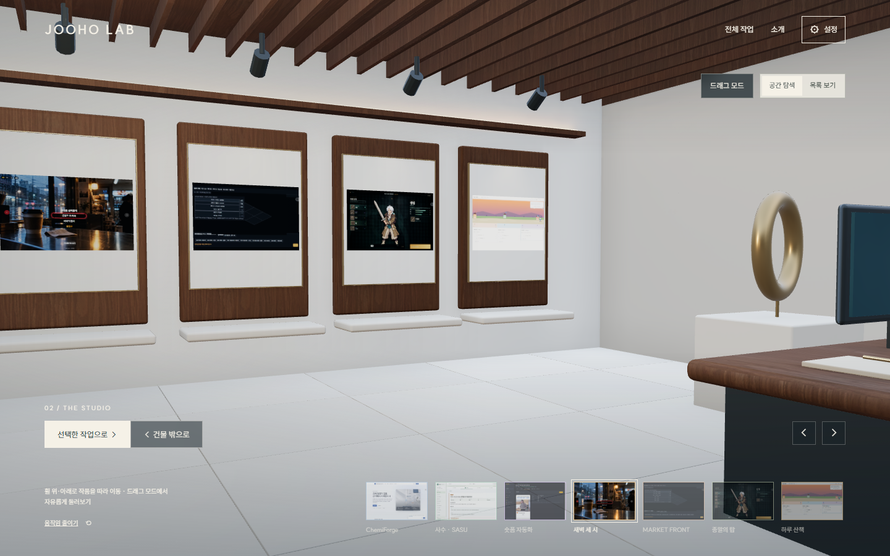

| 항목 | 내용 |
|---|---|
| 파일·크기 | `projects/jooho-lab/public/assets/lab-pavilion.glb` · 4,701,148B; 편집 원본 `art/lab-pavilion.blend`; `art/interior-after-exterior.png` / `art/interior-after-interior.png` · 1440×900 |
| 쓰이는 곳 | `stage` 가구·전시 마감·실내 조명, `landscape` 배경 밝기/음영. 헤더는 기존 `shell`/`controls` 색 재사용 |
| 도구·모드 | Blender 4.5.12 LTS / Cycles CPU 베이크, 절차 모델링·PBR 지도, Three.js r180 실시간 공간. AI 이미지 생성 없음 |
| 참조 | 승인된 카드 18의 깨끗한 외관/실내 캡처. 기존 풍경 사진 파일은 그대로 사용하고 CSS 밝기를 조절 |
| 설정 | 풍경 brightness 1.18 / shade .4 / 마당 #a8ab9b. 실내 간접광 32, 전시 조명 20, 색 #ffe8c9. 조명 2048²·32샘플, AO 2048²·64샘플·거리 .8m, 두 지도 모두 denoise. UV0 조명/AO, UV1 표면. 직물 512² 반복 지도, 조형물 96×24 분할·smooth normals |
| 재현 | `python scripts/prepare-photo-textures.py` → `blender -b --threads 4 --python scripts/build-spatial-lab.py`; 기존 원본 재질/조명 갱신은 `blender -b art/lab-pavilion.blend --threads 4 --python scripts/export-photo-surfaces.py` |

**한국어 요약** — 배경을 밝히고 과한 화면 음영을 줄인다. 전시물을 종이색 마운트와 가는 금속 테두리로 마감하고 전용 fixture의 빛을 더한다. 직물 짜임·쿠션·책상 키캡/노트/서랍/컵, 곡면이 매끄럽고 받침에 연결된 금속 조형물을 만든다. 승인된 석재에 얼룩을 다시 넣지 않는다. 색·조명·배경 밝기는 57개 레이어 설정의 일부로 조절한다.

생성 모델에 보낸 별도 프롬프트는 없다. **사용자 요청 원문 그대로**:

```text
훨씬 괜찮다. 배경도 좀 밝게 해주고 내부도 퀄리티 올려줘~
```

**후보 선택과 생성 후 확인** — 실시간 spot 7개 후보는 데스크톱 첫 이동 검사 12.273초로 렌더 비용이 커서 탈락했다. 최종본은 Blender에서 새 형상에 맞춰 fixture 조명을 굽고 웹에서 색/세기만 조절한다. 이전 atlas를 새 UV에 재사용하지 않는다. 동선·입구·작품 좌표는 유지한다. 실제 비교/입력/레이어 검수 결과와 한계는 [QA](../projects/jooho-lab/QA-spatial.md)에 남긴다. 카드 18 캡처는 보존한다. 목재·자갈·HDRI의 CC0 출처는 카드 17, 풍경 원본 출처는 기존 풍경 카드와 같다.

전체 회귀 desktop 141/mobile 142/short-mobile 142 및 57/57 파라미터 probe 통과. 마지막 광원 방출점/기본 밝기 보정은 외관·실내 재캡처와 실제 드래그·입장·복귀로 확인했다. 최종 app check/build 통과. 외부 서비스 배포는 하지 않았다.

### 18 · lab-clean-stone — 얼룩 없는 건물 표면

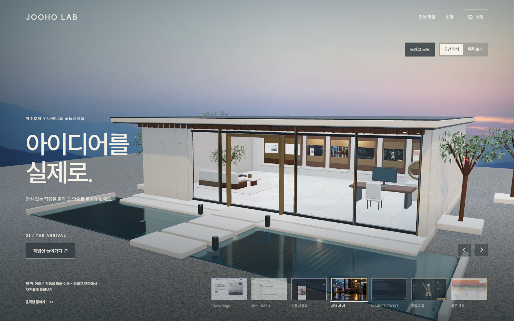

| 항목 | 내용 |
|---|---|
| 파일 | `projects/jooho-lab/public/assets/lab-pavilion.glb` · 4,357,584B, pack된 `art/lab-pavilion.blend`; 캡처 `art/clean-after-exterior.png`, `art/clean-after-interior.png` · 1440×900 |
| 쓰이는 곳 | `stage` 외벽·실내 벽·바닥·디딤돌·좌석 표면 |
| 도구·모드 | Blender 4.5.12 LTS 재질 교체·AO 베이크 / Python Pillow 절차 재질 데이터 / Three.js r180. AI 이미지 생성 없음 |
| 참조 | 자체 카드 16의 깔끔한 인상과 카드 17의 얼룩진 외관 비교. 외부 이미지 없음 |
| 설정 | 시드 42, 512² 색·노멀·거칠기·높이 지도. limestone RGB 246/244/238, honed stone 244/241/233, 색 입자 ±1. AO 2048²·64샘플·거리 0.8m·Blender denoise. 기존 stage 요철 .2/AO .35와 6재질 tint 유지 |
| 재현 | `prepare-photo-textures.py` → `blender -b art/lab-pavilion.blend --threads 4 --python scripts/export-photo-surfaces.py`; 전체 모델 재현 `build-spatial-lab.py`도 같은 표면을 사용 |

**한국어 요약** — 큰 풍화 얼룩과 작은 돌바닥 반복 무늬를 제거해 균일한 밝은 석재로 만든다. 미세 입자, 실제 패널 줄눈, 목재 결, 환경 반사는 남긴다. 옛 색 베이크와 거친 AO가 얼룩을 재도입하지 않도록 정리한다. 카드 17의 벽·바닥은 사용자 피드백으로 교체했으며 당시 캡처는 이력으로 보존했다. 촬영 재질이면 항상 더 좋은 결과라고 판단하지 않는다.

생성 모델에 보낸 별도 프롬프트는 없다. **사용자 요청 원문 그대로**:

```text
이 전이 훨씬 나은데 건물이 너무 얼룩덜룩해. 좀 더 깔끔해야지.
```

**생성 후 확인** — 모바일 두 크기 각 134검사와 레이어 53파라미터 probe 통과. 데스크톱 첫 이동 시간은 기준을 넘어 전체 PASS로 표시하지 않았다. 상세 비교·브라우저 결과는 [QA](../projects/jooho-lab/QA-spatial.md). 새 지도는 절차 생성이며 공유 CC0 사진 원본을 편집하지 않았다. 목재·자갈·HDRI 출처는 카드 17과 같다. 원격 서비스 배포는 하지 않았다.

### 17 · lab-photo-pbr — 촬영 재질·HDRI·근접 표면 개선

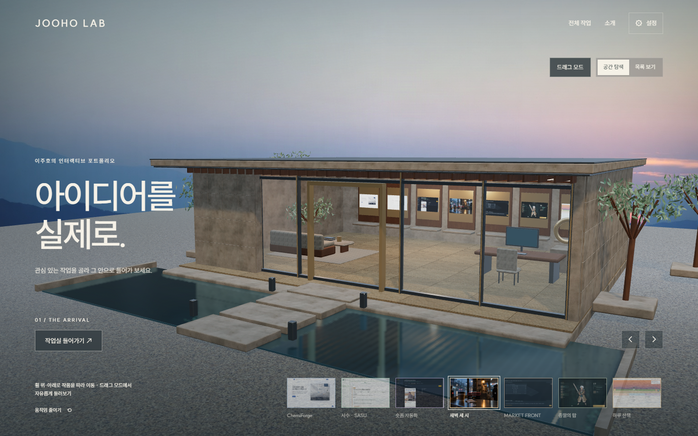

| 항목 | 내용 |
|---|---|
| 파일 | `projects/jooho-lab/public/assets/lab-pavilion.glb` · 5,299,628B. pack된 원본 `art/lab-pavilion.blend`, 캡처 `art/photo-after-exterior.png`, `art/photo-after-interior.png` 1440×900 |
| 쓰이는 곳 | stage(건물·마당·반사·광원), 기존 landscape |
| 도구 | Blender 4.5.12 LTS + Three.js r180 · 2026-10-02. 촬영 재질, AI 생성 없음 |
| 참조 이미지 | 이전 `art/realism-after-exterior.png`, `art/realism-after-interior.png`와 비교 |
| 설정 | GI 64샘플 · lightmap 3072², AO 2048² · UV1 사진 1K를 2m/직물 0.3m로 반복. UV0 그림자/작은 간접광 기여. JPEG 색 82/노멀 88, GLB 85 |
| 출처 | [Poly Haven 공유 CC0 소스·해시](../art/materials/README.md). Overcast Industrial Courtyard HDRI 1K. 마당 runtime 512² 3맵 합계 290,624B |
| 재현 | `prepare-photo-textures.py` → `build-spatial-lab.py`; 재질만 갱신은 `export-photo-surfaces.py` |

**무엇을 다듬나** — 촬영 벽 미세 입자·목재·석재·자갈과 HDRI를 적용한다. 사진을 큰 아틀라스에만 굽지 않고 실제 크기로 반복해 근접 질감을 유지한다. 접촉 그림자·마당 색을 포함해 7층 53개 설정을 renderer에서 검수한다. 재질 6그룹으로 외관 44 draw calls(반사 포함).
자연어 3D 생성 프롬프트는 없다. 사용자 요청 원문:

```text
그럼 새벽세시를 좀 더 블렌더 고품질 렌더로 만들어보고 jooho lab은  3d를 기반으로 한 단계 더 다듬는걸로 해보자.
```

**생성 후 확인** — 원본 16파일 MD5/출처/CC0 확인. 초기 단일 아틀라스 후보는 근접 질감이 흐려서 수정했다. 사진/노멀/거칠기 UV1과 AO UV0를 GLB에 보존했다. tint는 exporter 누락을 피해 표준 baseColorFactor로 명시했다. 8.4MB 원본 JPEG 후보는 6MB 한도를 넘어 탈락, 해상도 그대로 웹 인코딩한 5.30MB를 채택했다. shader/buffer는 첫 입장 전 준비한다. 나무·풍경·소품은 아직 실사 스캔이 아니며 영화 수준 완성으로 표현하지 않는다. 카드 16의 파일은 이번 개선본으로 갱신됐다. [QA](../projects/jooho-lab/QA-spatial.md).


### 16 · lab-pavilion-realism — 건물 구조·재질 정교화

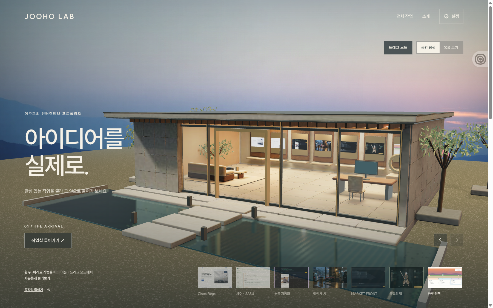

| 항목 | 내용 |
|---|---|
| 파일 | `projects/jooho-lab/public/assets/lab-pavilion.glb` · 3,764,564B. 원본 `art/lab-pavilion.blend`. 비교 캡처 `art/realism-before-exterior.png`, `art/realism-after-exterior.png` · 1800×1125 |
| 쓰이는 곳 | JOOHO LAB 외관·작업실·작품 장면, 레이어 `stage`; 화면 음영은 `landscape.shade` |
| 도구 | Blender 4.5.12 LTS / Cycles CPU, Python 절차 모델링·베이크; Three r180 PBR 및 Reflector · 2026-10-02 |
| 참조 이미지 | 기존 Blender 건물과 동일 시점의 웹 화면. 외부 사진·AI 이미지 없음 |
| 설정 | 시드 42, diffuse 3072×3072 / tangent normal 2048×2048 / roughness 2048×2048, Cycles 32 samples, diffuse denoise, GLB JPEG quality 92. 데스크톱 평면 반사 512×512 / MSAA 0, ≤650px 추가 반사 패스 끔. 자갈은 Canvas 512px 시드 42, 물리 2m 반복 |
| 재현 | `projects/jooho-lab/scripts/build-spatial-lab.py`; 브라우저 재질·반사·자갈은 `public/spatial-scene.js`, 조절값 정본은 `public/layers.manifest.js` |

**무엇을 그리나** — 기존 건물의 석재 패널 이음새, 지붕 금속 마감과 음영 틈, 창틀 깊이와 유리, 목재·석재 요철과 거칠기, 잎 형태를 정교하게 만든다. 수면에 실제 건물을 반사하고 주변 지면의 자갈을 표현한다. 이동 동선과 전시 7개는 유지한다. Tripo 후보는 쓰지 않는다.

**사용자 제작 요청 원문** — AI 생성 모델에 보낸 프롬프트는 없으며, 아래 요청을 절차 모델링으로 구현했다. 원문을 대체하는 가상의 생성 프롬프트를 만들지 않는다.

```text
좀 더 영상 같고 사실적인 건물이면 좋겠어. 일단 정교하게 다듬어줘.
```

**생성 후 확인** — 기존 emission-only 건물을 표면 요철·거칠기 지도와 약한 베이크 발광을 가진 PBR 재질로 변경. 동일 외관 시점에서 패널 분할·처마 깊이·실제 건물 반사가 확인됨. 기본 치수·입구·전시 위치와 기존 6MB 전송 제한 유지. 이전 유리 없는/단순 환경광 수면 버전은 구조와 재질 반응이 부족해 교체. 사진 기반 재질이나 오프라인 영상 렌더는 아니며, 웹 실시간 화면의 정교화다. 상세 브라우저 검수와 한계: [QA](../projects/jooho-lab/QA-spatial.md).

### 15 · lab-pavilion-tripo — 전시관 건물 전체 후보

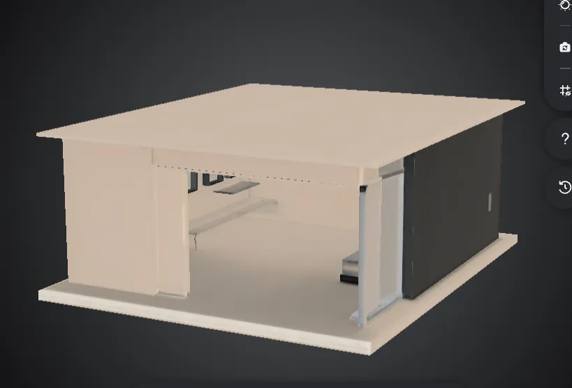

| 항목 | 내용 |
|---|---|
| 파일 | 검수 캡처 `projects/jooho-lab/art/tripo/lab-pavilion-preview.webp` · 819×556 · 10,532B. GLB는 내보내기 제한으로 미확보 |
| 쓰이는 곳 | JOOHO LAB 건물 교체 후보 · 미적용 · 예정 레이어 `architecture` |
| 도구 | Tripo Studio Smart Mesh P2.0 · 브라우저 text-to-3D · 2026-10-02 |
| 참조 이미지 | 없음 |
| 설정 | 남은 무료 체험 1회 사용, 메시 생성 비용 0, 후보 1개, 공개, Quad 면 4,095 / 버텍스 3,596. 완료 후 Studio의 `텍스처 20` 자동 재질 생성 성공(기존 무료 잔액 200→180). 별도 텍스처 프롬프트 입력란은 없었음. 내보내기 창에는 `4k Current` 표시(다운로드로 실제 해상도 확인은 못 함) |
| 모델 | [Studio 작업](https://studio.tripo3d.ai/ko/workspace/generate/24252813-eff2-4d98-b581-b7bf4c63f29b) |

**무엇을 그리나** — 기존 석회석·목재·브론즈 전시관을 참고한 단층 건물 전체. 중앙 입구, 빈 실내 통로, 후면 전시 패널 7개를 명시했다. 사용자가 소품보다 건물부터 만들라고 바로잡아 의자/조형물 우선 계획을 변경했다. docs/04의 개별 오브젝트 생성 원칙과 달리 건물 전체를 한 번에 생성하는 시험이며, 실내가 막히거나 합쳐지는 결함을 별도로 검수한다.

```text
A complete single-storey contemporary art gallery pavilion, isolated architectural 3D building, not furniture. Rectangular 18m wide, 16m deep, 5m high. Refined warm limestone walls, thin flat cantilevered roof with deep overhang, ribbed timber soffit, slender bronze facade mullions, travertine floor and a low stone foundation. Front facade has a wide central doorway, 3.6m wide and 4.2m tall, genuinely open with no door or glass blocking it. Large open window bays reveal a hollow interior gallery hall, realistic wall thickness, continuous empty central walking aisle from entrance to rear wall. Seven evenly spaced blank rectangular artwork mounting panels across the rear interior wall. Restrained Japanese modernist architecture, precise clean edges and construction details, coherent roof/walls/floor, clean quad topology. One complete building only. No chairs, tables, sculptures, plants, people, text, logos, artwork images, terrain or surrounding buildings.
```

**생성 후 확인** — 메시·재질 생성 성공, 무료 체험 횟수 소진, 잔액 180. 실제 마우스 회전으로 평지붕·외벽·기단과 전면 열린 공간을 확인했다. 재질은 크림색 벽과 어두운 외벽·프레임으로 나왔으며 목재 처마 디테일은 뚜렷하지 않다. 정면에 보이는 후면 패널은 3개로, 요청한 7개와 다르다. 내부 오른쪽에 요청하지 않은 단/가구 같은 형상이 보이고 프레임·모서리가 불규칙하다. 정확한 중앙 입구·실내 동선·치수·충돌·전체 내부 연결은 다운로드 없이는 검증할 수 없다. 기존 Blender 전시관의 개선본으로 채택하지 않았다. GLB / `4k Current`로 정상 내보내기를 실행했으나 Pro/Max 구독 안내가 나와 파일을 받지 못했다. [제한 화면](../projects/jooho-lab/art/tripo/lab-pavilion-export-gate.png). 앱 건물 교체·레이어 변경·배포는 미실행. 메시 전후 정면·측면 캡처는 `art/tripo/lab-pavilion-*`에 보관했다.

### 14 · lounge-chair — 스마트 메시 라운지 체어 후보

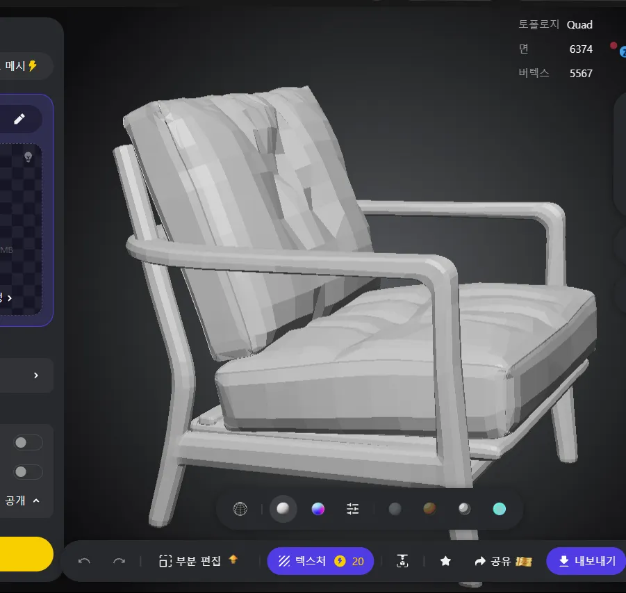

| 항목 | 내용 |
|---|---|
| 파일 | 검수 캡처 `projects/jooho-lab/art/tripo/lounge-chair-preview.webp` · 901×853 · 29,380B. GLB는 내보내기 제한으로 받지 못함 |
| 쓰이는 곳 | JOOHO LAB 라운지 의자 교체 후보 · 미적용. 예정 레이어 `lounge-chair` |
| 도구 | Tripo Studio Smart Mesh P2.0 · 브라우저 text-to-3D · 2026-10-02 |
| 참조 이미지 | 없음 |
| 설정 | 무료 체험 1회, 생성 비용 0, 후보 1개, 공개, Quad. UI 결과: 면 6,374 / 버텍스 5,567. 텍스처 추가 생성 안 함 |
| 모델 | [Studio 작업](https://studio.tripo3d.ai/ko/workspace/generate/bcb900f9-2dea-4906-9110-a0f220fe9c23) · 객체 `tripo_4db9b9f5_2e18_4023_ae22_cc42cde448fd` |

**무엇을 그리나** — 조용한 전시관에 놓을 오크 프레임과 아이보리 리넨 쿠션의 라운지 체어 한 개. 기존 파빌리온의 따뜻한 재질에 맞춰 독립 소품으로 요청했다.

```text
A single refined contemporary lounge armchair for a quiet architectural gallery. Sculptural solid smoked oak frame, broad softly curved armrests, rounded joinery, four short sturdy wooden legs. Thick ivory woven linen seat and back cushions with subtle fabric texture and realistic seams. Warm natural materials, understated Japanese Scandinavian design, premium furniture craftsmanship. Complete freestanding chair, front three-quarter view, accurately proportioned, clean production-ready quad topology, detailed PBR materials. No person, no text, no logo, no floor, no room, no other objects.
```

**생성 후 확인** — 무료 생성 성공, Studio 잔액 200 유지, 체험 2회→1회. 정면 와이어프레임과 실제 마우스 회전 후 측면을 확인했다. 쿠션·팔걸이·프레임·다리 형태가 생성됐지만 쿠션 표면은 각져 보이며, 프롬프트의 PBR 요청과 달리 현재 모델은 텍스처 없는 회색 메시다. 웹용 최종 품질 합격으로 판단하지 않는다. GLB 형식을 선택하고 정상 내보내기를 두 번 시도했으나 모두 Pro/Max 구독 안내가 나왔다. [제한 화면](../projects/jooho-lab/art/tripo/lounge-chair-export-gate.png). 다운로드·최적화·앱 적용은 미완료이며, 생성 후보를 스크린샷으로 대체해 앱에 넣지 않았다. 무료 체험 1회는 남겼다. 유료 구독이나 충전은 하지 않았다.

[← 전체 목록](README.md)

작품을 모아 보여 주는 3D 공간 갤러리입니다. 현재는 Blender 파빌리온과 Three.js 카메라를 사용합니다. 아래 기존 마을 기록은 이전 버전의 이력입니다.

**기존 마을 에셋에는 프롬프트 기록이 없습니다.** 플랜에는 "에셋 전용 에이전트 1명이 생성"이라고만 적혀 있습니다(2026-09-12). 2026-10-01 공간 데모의 신규 생성 프롬프트와 Blender 제작 절차는 아래 05·06에 기록했습니다.

---

### 01 · 마을 파노라마 (project-village)


| 항목 | 내용 |
|---|---|
| 파일 | `public/assets/project-village.webp` · 2164×727 · 410KB |
| 쓰이는 곳 | 별도 `village.html`의 초기 작업 동네 배경(`scene.js`) — 현재 레이어 `stage`; 집/산책길 DOM 이름표는 `labels`. 2026-10-03 원본 재사용, 새 생성 없음 |
| 도구 | ❌ 기록 없음 (2026-09-12 월드 설정 플랜의 에셋 에이전트) |

**그림 내용** — 광장을 따라 늘어선 작품 집 6채. 왼쪽부터 플라스크 지붕 집, 초록 사무실, 필름 릴 극장, 달 간판 가게, 벽돌 홀, 탑. 파란 하늘, 둥근 나무, 미니어처 느낌.

❌ **프롬프트 기록 없음.**
⚠️ 집 6채가 그림 안에 그려져 있어서 작품이 7번째부터는 마을에 안 나온다(Day Walk는 목록 보기에만 있음). "Day Walk 집을 그려 넣기"가 계획돼 있지만 프롬프트는 없다. 새로 만들 때는 [templates §4](templates.md#4-조명시간대만-바꾸기-같은-구도)처럼 **원본 구도를 유지하는 편집**으로 집 하나만 추가해야 기존 집 좌표가 안 깨진다.

**2026-10-03 재사용 확인** — 사용자가 처음 동네 디자인을 별도 페이지로 활용하도록 요청했다. 위 경고는 이전 구현의 이력이다. 현재는 원본 여섯 집을 수정하지 않고 Day Walk를 앞쪽 산책길 정류장으로 연결해 번호/키보드/목록으로 일곱 작품을 모두 선택한다. 집의 원래 장식은 보존하고 현재 작품 이름·운영 링크는 DOM에서 분리한다. 동네 전용 8개 레이어/42개 파라미터, 입장/취소/동작 줄이기와 모바일 검수는 LAB `QA-village.md`에 기록한다. 원본 생성 프롬프트는 여전히 미확인이다.

---

### 02 · 배낭 로봇 산책자 (village-walker)


| 항목 | 내용 |
|---|---|
| 파일 | `public/assets/village-walker.png` · 1254×1254, 투명 PNG · 1.1MB |
| 쓰이는 곳 | 별도 `village.html`에서 걸어 다니는 기본 마스코트 — 현재 레이어 `character`. 2026-10-03 투명 원본 그대로 재사용; 이미지·기본 보이기/크기/속도는 공유 편집기, 레이어에서 추가 크기/속도·보이기/불투명도 조정 |
| 도구 | 파일 메타데이터(C2PA): **gpt-image 2.0**, OpenAI 서명, 2026-09-12 |

**그림 내용** — 크림색 둥근 몸에 까만 점 눈, 초록 등산 배낭(돌돌 만 매트)을 멘 작은 로봇. 점토 피규어 느낌, 오른쪽으로 걷는 자세.

❌ **프롬프트 기록 없음.**

---

### 03 · 어두운 전시실 (atelier, 지금 안 씀)


| 항목 | 내용 |
|---|---|
| 파일 | `public/assets/atelier.webp` · 1536×1024 · 158KB |
| 쓰이는 곳 | 2026-09-12 "시네마틱 3D 아틀리에" 개편 배경. **지금 코드에서는 안 씀** |
| 도구 | ❌ 기록 없음 (개편 플랜: "야간 개인 전시실, 실제 재질의 건축 배경") |

**그림 내용** — 노출 콘크리트 벽의 어두운 전시 홀, 천장 가장자리 따뜻한 간접조명, 반사되는 바닥.

❌ **프롬프트 기록 없음.**

---

### 04 · 작품 표지

| 파일 | 크기 | 내용 | 출처 |
|---|---|---|---|
| `public/assets/dawn.webp` | 1920×1080 · 122KB | 새벽 세 시 `hub` 컷과 **같은 파일** | [dawn-store.md 01](dawn-store.md#01--hub--계산대) |
| `public/assets/chemiforge.webp` | 1400×933 · 66KB | 서류와 약병을 위에서 찍은 사진풍 | 이 저장소에 생성 기록 없음 — 케미포지 프로젝트 자료로 보임 |
| `public/assets/spire.webp` | 1400×788 · 290KB | 픽셀아트 키아트 "TOWER OF THE END" | 이 저장소에 생성 기록 없음 — 해당 게임 프로젝트 자료로 보임 |
| `public/assets/sasu.webp` | 1280×720 · 39KB | SASU 화면 캡처(생성 이미지 아님) | — |

`public/experiences/dawn-store/` 안의 그림·소리는 새벽 세 시 작품 파일을 그대로 복사한 것이다.

---

### 05 · lab-landscape — 작업실 뒤 먼 풍경

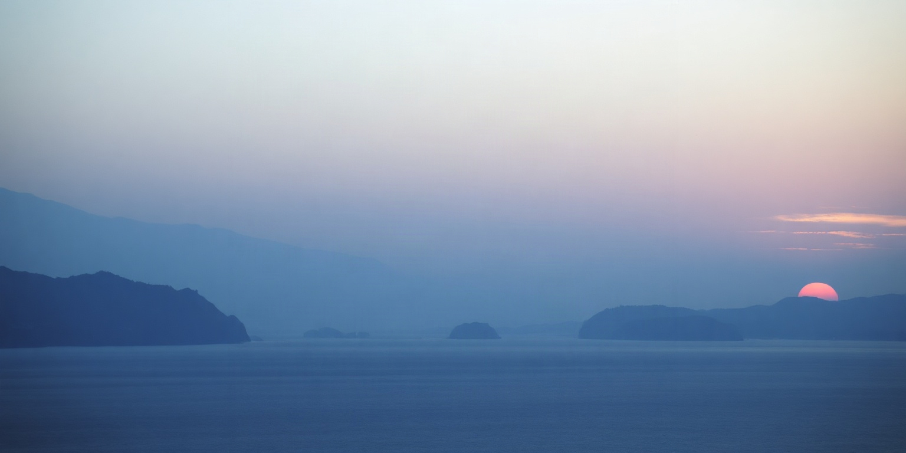

| 항목 | 내용 |
|---|---|
| 파일 | `public/assets/lab-landscape.jpg` · 1536×768 · 493,610 bytes |
| 쓰이는 곳 | 외관과 창밖의 먼 배경 · `landscape` 레이어 |
| 도구 | fal.ai `fal-ai/flux/schnell` · text-to-image · 2026-10-01 |
| 참조 이미지 | 없음 |
| 설정 | 1장, 4 steps, seed 10012026, JPEG. `scripts/prepare-spatial-assets.mjs --generate` |

**무엇을 그리나** — 건물 없는 저녁 해안과 산, 넓은 하늘. 건축은 Blender의 실제 입체 모델로 따로 만든다.

```text
Photographic panoramic landscape at blue hour, distant layered coastal mountains and calm water, a very low horizon in the bottom quarter, expansive pale desaturated blue sky with delicate peach clouds and a faint warm sunset on the right, refined atmospheric architectural photography background, natural subtle film grain, realistic, tranquil, no buildings, no people, no text, no borders. Wide landscape photograph.
```

**생성 후 확인** — fal 호출 성공, Aside 외관에서 배경 확인. 1개 후보 사용. 이 이미지는 입체 건물이나 실내를 대체하지 않는다.

### 06 · lab-pavilion — 연결된 3D 작업실

| 항목 | 내용 |
|---|---|
| 파일 | `public/assets/lab-pavilion.glb`, 원본 `art/lab-pavilion.blend` |
| 쓰이는 곳 | 외관 → 실제 입구 → 작업실 → 7개 전시물 · `stage` 레이어 |
| 도구 | Blender 4.5.12 LTS Python 모델링, Cycles diffuse bake, compositor denoise, glTF export · 2026-10-01 |
| 참조 이미지 | 사용자 Instagram Ddb6_ISh8pA의 연속 공간 이동 개념. 원본 브랜드·이미지 복제 없음 |
| 설정 | `scripts/build-spatial-lab.py`가 정본. 2048² lightmap, 16 samples, seed 42, JPEG embedded GLB |

**무엇을 만드나** — 석재 파빌리온, 나무 천장, 라운지와 작업 데스크, 프로젝트별 전시 벽. 건물 입구는 비어 있고 카메라가 실제로 통과한다.

**생성 원문** — 모델 API 프롬프트는 없음. 모델링 명세와 좌표·재질·조명·노이즈 제거 과정 전체가 위 Python 스크립트에 기록되어 있다. Tripo는 사용하지 않았다.

**생성 후 확인** — 처음 단색 재질 버전은 모형처럼 보여 채택하지 않음. 첫 조명 bake는 노이즈가 심해 denoise를 추가. 잎사귀 메시를 줄여 파일 크기를 낮춤. 소개 문구·작품명·실행 링크는 HTML로 유지하고 이미지 없는 작품은 레지스트리에서 포스터를 생성한다.

### 07 · 실제 작품 화면 — 갤러리 대표 이미지 7장

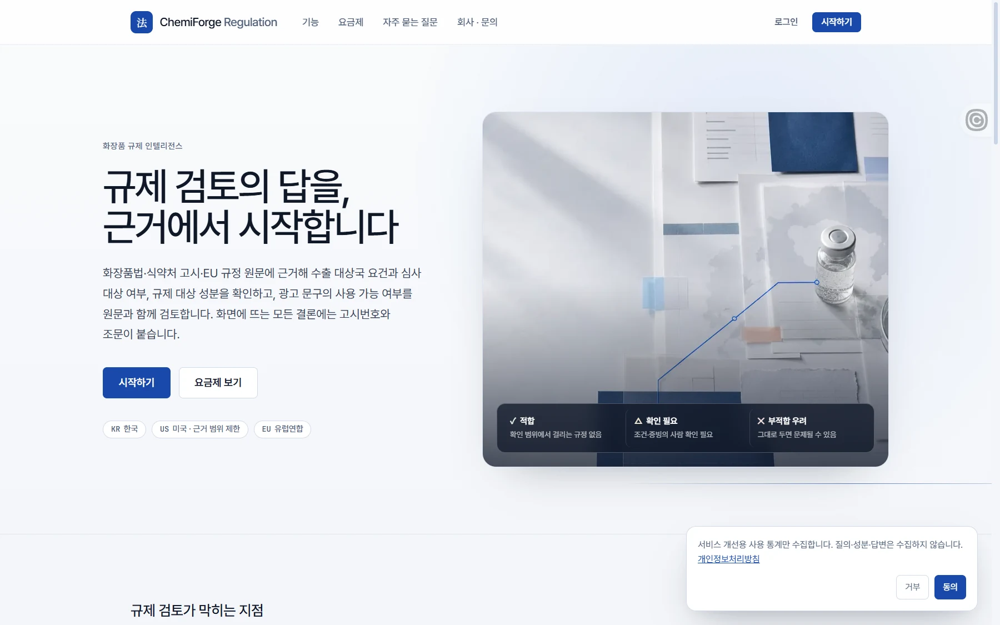

| 항목 | 내용 |
|---|---|
| 파일 | `projects/jooho-lab/public/assets/work-*.webp` · 아래 개별 크기 참고 |
| 쓰이는 곳 | `stage` 전시물, `rail` 썸네일, `shell` 작품 목록과 작품 상세. 내용은 projects.js에서 관리 |
| 도구 | Aside 실제 브라우저 캡처 · 2026-10-01. 생성 에셋 아님 |
| 참조 이미지 | `projects/jooho-lab/art/captures/<id>.png` 원본 7장 |
| 설정 | 원본 해상도·비율 유지, Pillow WebP quality=88, method=6. 재생성·합성·크롭 없음 |
| 프롬프트 | 해당 없음 — 실제 프로젝트 화면 캡처 |

**무엇을 보여 주나** — 서비스를 실제로 열어 고른 화면이다. 기존 장식 표지와 글자 포스터를 교체했다. ChemiForge는 공개 첫 화면, MARKET FRONT는 현재 프로토타입의 국가 운영 화면이며 완성된 게임 그래픽으로 꾸미지 않았다.

| 작품 / 파일 | 출처와 선택한 화면 | 크기 · 용량 |
|---|---|---|
| ChemiForge · `work-chemiforge.webp` | https://chemi-forge.vercel.app/ · 공개 첫 화면 | 1800×1125 · 74,976B |
| SASU · `work-sasu.webp` | https://sasu-alpha.vercel.app/demo/d/bbbbbbbb-bbbb-4bbb-8bbb-bbbbbbbbbbbb/cards/10000000-0000-4000-8000-000000000121 · 가상 회사의 외주 견적 결정 카드 | 1725×1125 · 83,752B |
| 숏폼 · `work-shortform.webp` | http://localhost:3123/ep/B/2026-09-11/01?tab=preview · 건강검진 결과 나온 날의 요정식탁, 미리보기·타임라인 | 1800×1125 · 80,494B |
| 새벽 세 시 · `work-dawn-store.webp` | http://127.0.0.1:8879/experiences/dawn-store/play.html · 계산대의 커피·잡지·출입구 선택 | 1800×1125 · 120,550B |
| MARKET FRONT · `work-market-front.webp` | http://127.0.0.1:8891/ · 1일차 국가 운영·부지·전략산업 선택 | 1800×1125 · 60,566B |
| 종말의 탑 · `work-spire.webp` | https://tower-50.vercel.app/ · 에른의 시작 무기 선택 | 1800×1125 · 100,400B |
| 하루 산책 · `work-day-walk.webp` | http://127.0.0.1:8879/experiences/day-walk/play.html · 저녁 동네와 세 마감 목록 | 1800×1125 · 57,422B |

**캡처 후 확인** — 원본 7장을 직접 열어 내용·비율을 확인했다. 일부 오른쪽 위의 원형 표시는 Aside 브라우저 버튼이며 작품 UI가 아니다. SASU는 데모 데이터이고, 로컬 주소는 공개 서비스 주소로 등록하지 않는다. 기존 작품 링크는 유지한다. 총 WebP 578,160B. 생성 프롬프트는 없으며 기존 생성 에셋 프롬프트와 구분한다.

### 08 · SASU — 실제 화면 캡처

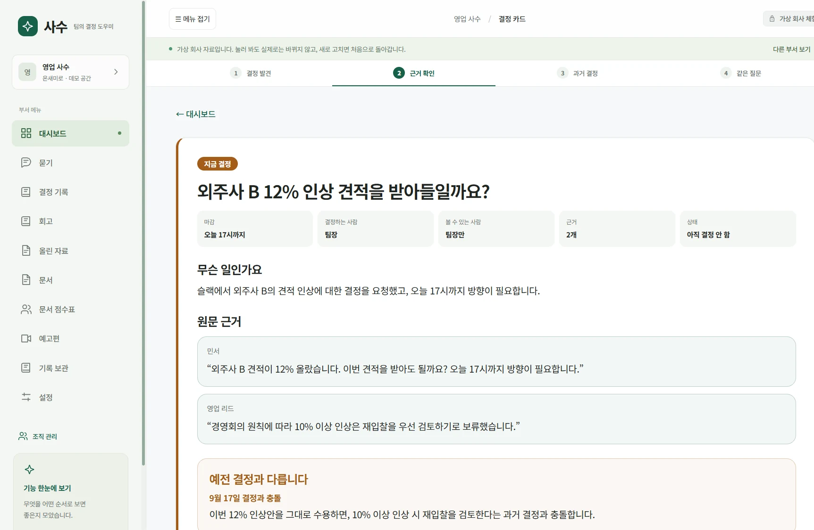

| 항목 | 내용 |
|---|---|
| 파일 | `projects/jooho-lab/public/assets/work-sasu.webp` · 1725×1125 · 83,752B |
| 쓰이는 곳 | stage 전시물 · rail 썸네일 · shell 목록 · 작품 상세 |
| 도구 | Aside 실제 브라우저 캡처 · 2026-10-01. 생성 에셋 아님 |
| 참조 이미지 | `projects/jooho-lab/art/captures/sasu.png` |
| 설정 | 원본 비율·해상도 유지, Pillow WebP quality=88, method=6 |
| 출처 | https://sasu-alpha.vercel.app/demo/d/bbbbbbbb-bbbb-4bbb-8bbb-bbbbbbbbbbbb/cards/10000000-0000-4000-8000-000000000121 |
| 프롬프트 | 해당 없음 — 실제 프로젝트 화면 캡처 |

**무엇을 보여 주나** — 가상 회사의 외주 견적 결정 카드.

**캡처 후 확인** — 원본 이미지와 갤러리의 전체 비율을 확인했다. 선택 배경·브라우저 표시·공통 한계는 07 카드에 기록했다.

### 09 · 숏폼 자동화 — 실제 화면 캡처

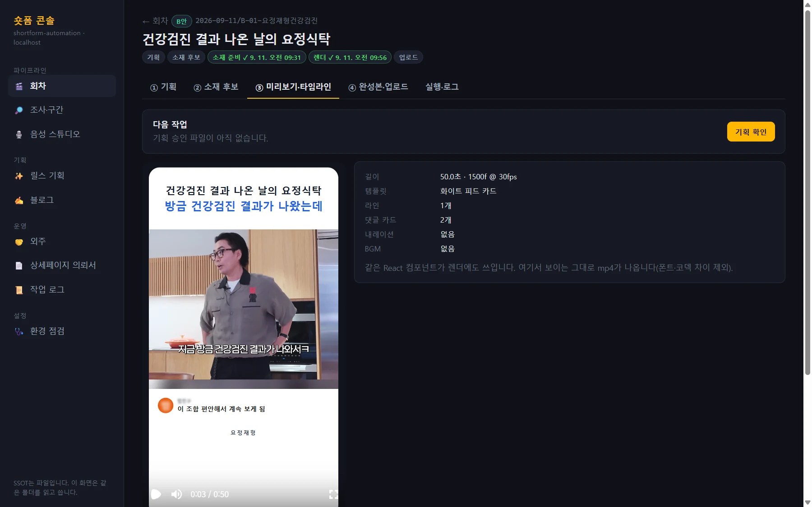

| 항목 | 내용 |
|---|---|
| 파일 | `projects/jooho-lab/public/assets/work-shortform.webp` · 1800×1125 · 80,494B |
| 쓰이는 곳 | stage 전시물 · rail 썸네일 · shell 목록 · 작품 상세 |
| 도구 | Aside 실제 브라우저 캡처 · 2026-10-01. 생성 에셋 아님 |
| 참조 이미지 | `projects/jooho-lab/art/captures/shortform.png` |
| 설정 | 원본 비율·해상도 유지, Pillow WebP quality=88, method=6 |
| 출처 | http://localhost:3123/ep/B/2026-09-11/01?tab=preview |
| 프롬프트 | 해당 없음 — 실제 프로젝트 화면 캡처 |

**무엇을 보여 주나** — 회차의 영상 미리보기와 타임라인.

**캡처 후 확인** — 원본 이미지와 갤러리의 전체 비율을 확인했다. 선택 배경·브라우저 표시·공통 한계는 07 카드에 기록했다.

### 10 · 새벽 세 시 — 실제 화면 캡처

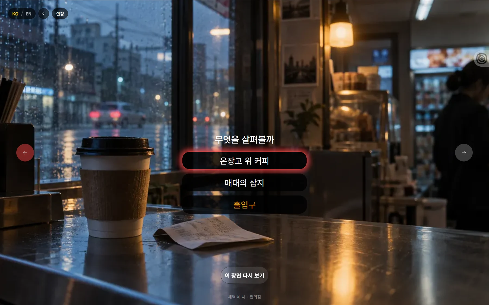

| 항목 | 내용 |
|---|---|
| 파일 | `projects/jooho-lab/public/assets/work-dawn-store.webp` · 1800×1125 · 120,550B |
| 쓰이는 곳 | stage 전시물 · rail 썸네일 · shell 목록 · 작품 상세 |
| 도구 | Aside 실제 브라우저 캡처 · 2026-10-01. 생성 에셋 아님 |
| 참조 이미지 | `projects/jooho-lab/art/captures/dawn-store.png` |
| 설정 | 원본 비율·해상도 유지, Pillow WebP quality=88, method=6 |
| 출처 | http://127.0.0.1:8879/experiences/dawn-store/play.html |
| 프롬프트 | 해당 없음 — 실제 프로젝트 화면 캡처 |

**무엇을 보여 주나** — 계산대의 커피·잡지·출입구 선택.

**캡처 후 확인** — 원본 이미지와 갤러리의 전체 비율을 확인했다. 선택 배경·브라우저 표시·공통 한계는 07 카드에 기록했다.

### 11 · MARKET FRONT — 실제 화면 캡처

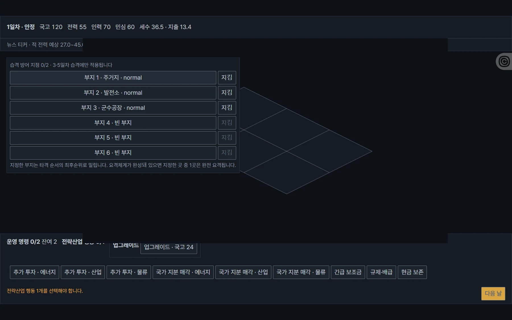

| 항목 | 내용 |
|---|---|
| 파일 | `projects/jooho-lab/public/assets/work-market-front.webp` · 1800×1125 · 60,566B |
| 쓰이는 곳 | stage 전시물 · rail 썸네일 · shell 목록 · 작품 상세 |
| 도구 | Aside 실제 브라우저 캡처 · 2026-10-01. 생성 에셋 아님 |
| 참조 이미지 | `projects/jooho-lab/art/captures/market-front.png` |
| 설정 | 원본 비율·해상도 유지, Pillow WebP quality=88, method=6 |
| 출처 | http://127.0.0.1:8891/ |
| 프롬프트 | 해당 없음 — 실제 프로젝트 화면 캡처 |

**무엇을 보여 주나** — 1일차 국가 운영 프로토타입.

**캡처 후 확인** — 원본 이미지와 갤러리의 전체 비율을 확인했다. 선택 배경·브라우저 표시·공통 한계는 07 카드에 기록했다.

### 12 · 종말의 탑 — 실제 화면 캡처

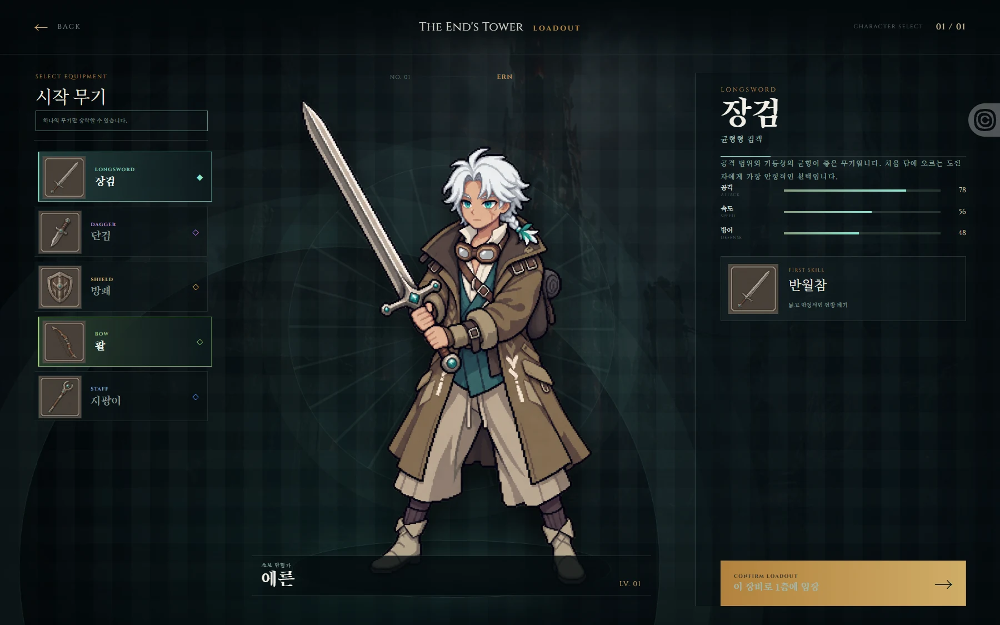

| 항목 | 내용 |
|---|---|
| 파일 | `projects/jooho-lab/public/assets/work-spire.webp` · 1800×1125 · 100,400B |
| 쓰이는 곳 | stage 전시물 · rail 썸네일 · shell 목록 · 작품 상세 |
| 도구 | Aside 실제 브라우저 캡처 · 2026-10-01. 생성 에셋 아님 |
| 참조 이미지 | `projects/jooho-lab/art/captures/spire.png` |
| 설정 | 원본 비율·해상도 유지, Pillow WebP quality=88, method=6 |
| 출처 | https://tower-50.vercel.app/ |
| 프롬프트 | 해당 없음 — 실제 프로젝트 화면 캡처 |

**무엇을 보여 주나** — 에른의 시작 무기 선택.

**캡처 후 확인** — 원본 이미지와 갤러리의 전체 비율을 확인했다. 선택 배경·브라우저 표시·공통 한계는 07 카드에 기록했다.

### 13 · 하루 산책 — 실제 화면 캡처

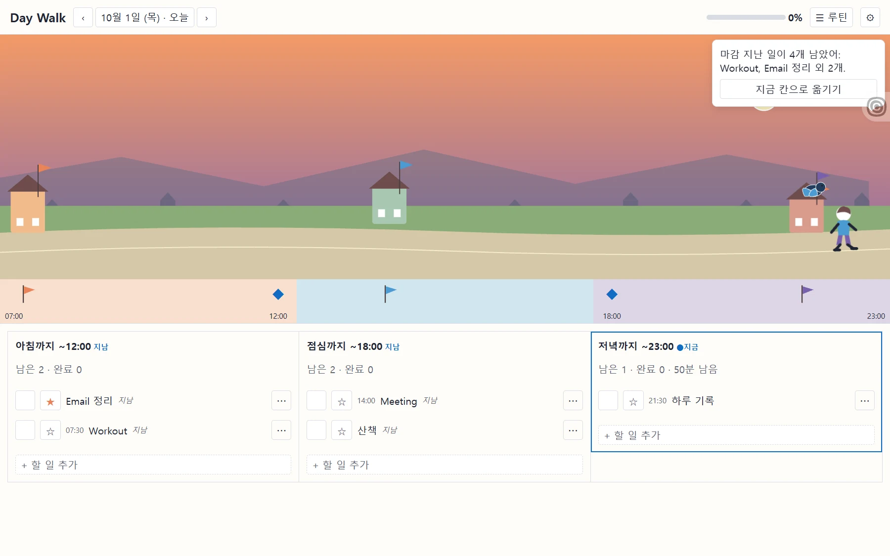

| 항목 | 내용 |
|---|---|
| 파일 | `projects/jooho-lab/public/assets/work-day-walk.webp` · 1800×1125 · 57,422B |
| 쓰이는 곳 | stage 전시물 · rail 썸네일 · shell 목록 · 작품 상세 |
| 도구 | Aside 실제 브라우저 캡처 · 2026-10-01. 생성 에셋 아님 |
| 참조 이미지 | `projects/jooho-lab/art/captures/day-walk.png` |
| 설정 | 원본 비율·해상도 유지, Pillow WebP quality=88, method=6 |
| 출처 | http://127.0.0.1:8879/experiences/day-walk/play.html |
| 프롬프트 | 해당 없음 — 실제 프로젝트 화면 캡처 |

**무엇을 보여 주나** — 저녁 동네와 아침·점심·저녁 마감 목록.

**캡처 후 확인** — 원본 이미지와 갤러리의 전체 비율을 확인했다. 선택 배경·브라우저 표시·공통 한계는 07 카드에 기록했다.


### 20 · exhibition-art — 운영 작품의 전시 키 비주얼

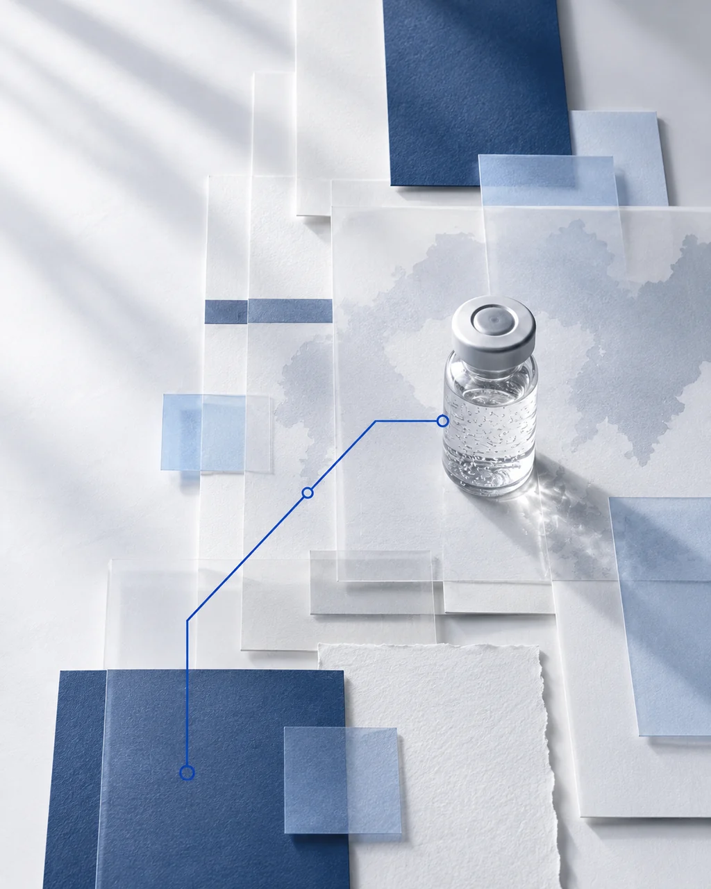
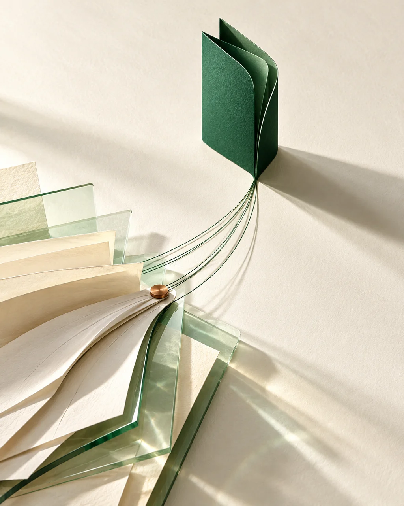
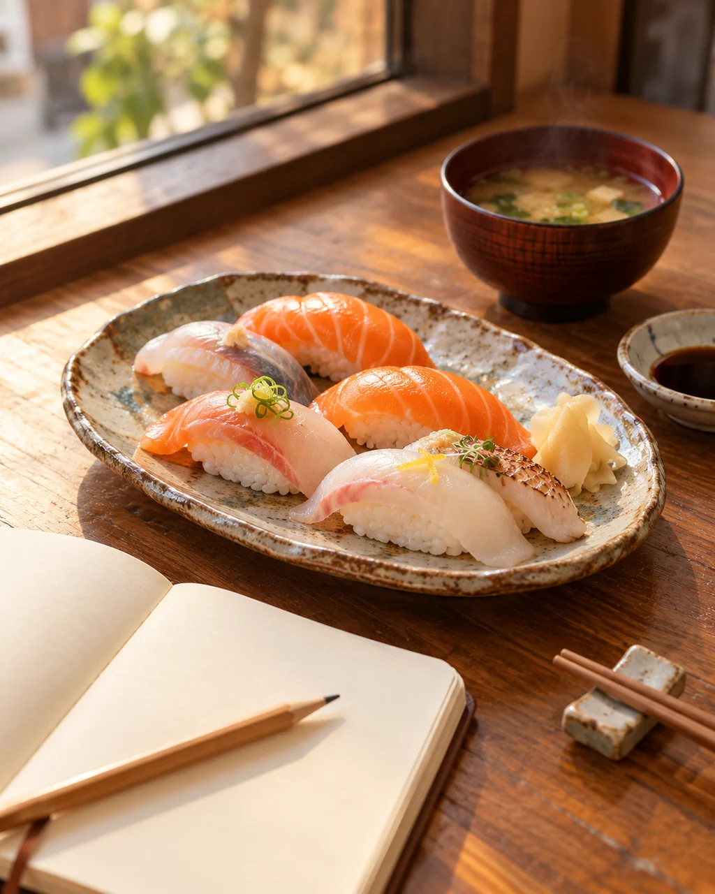
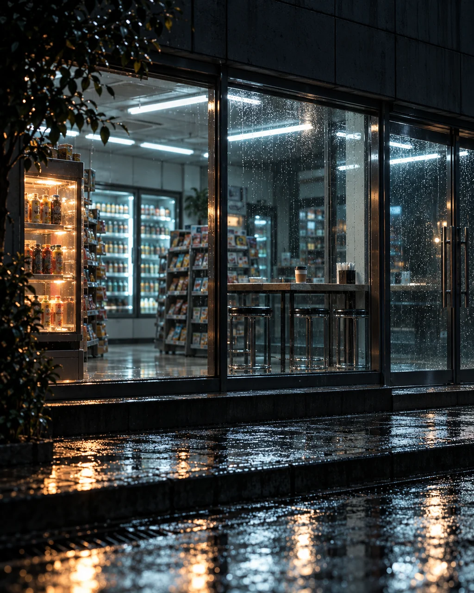
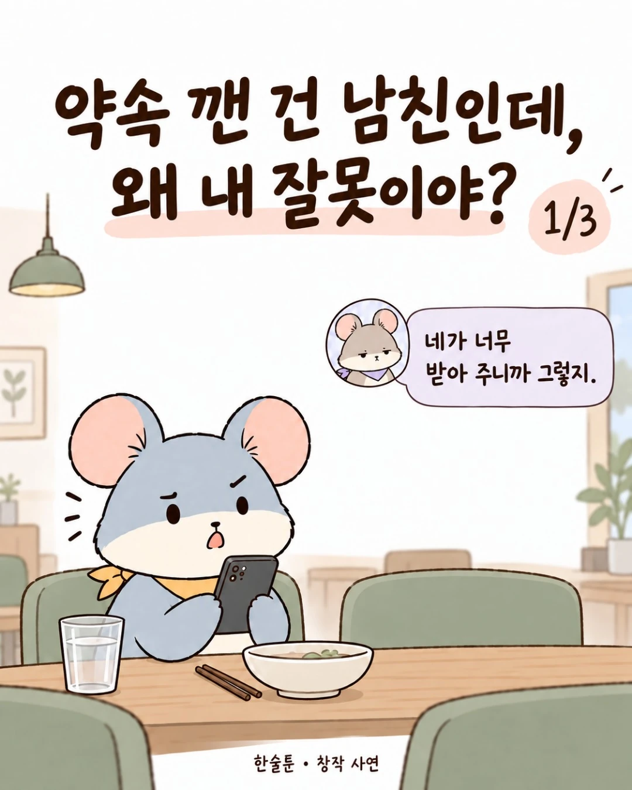
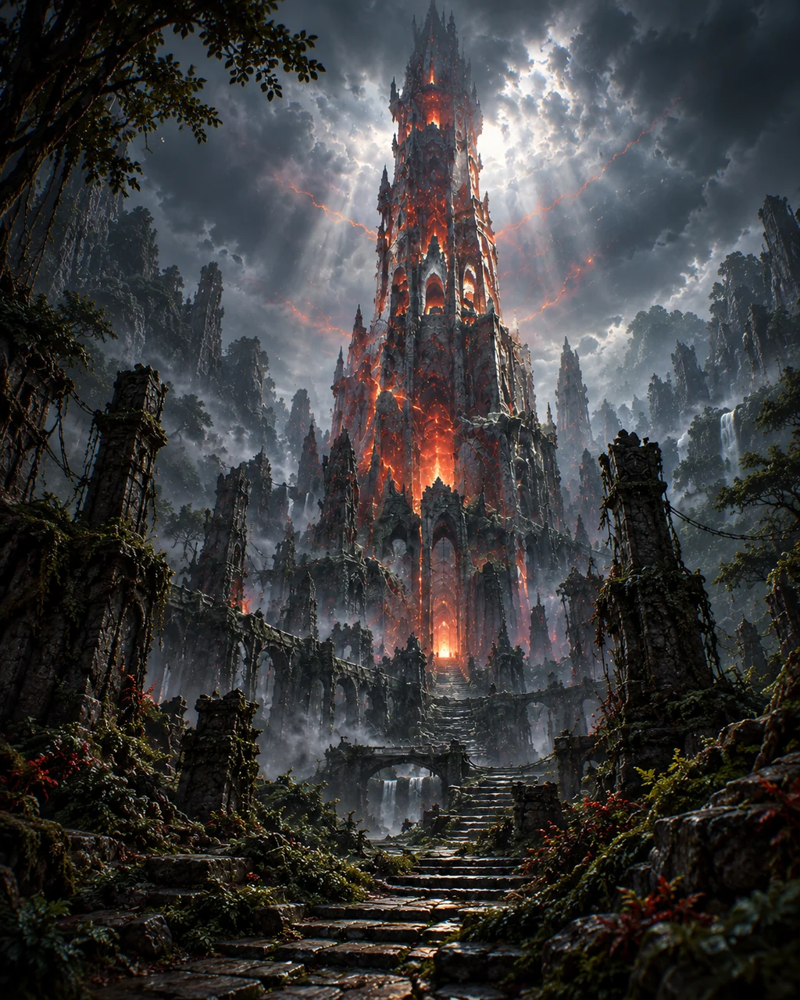
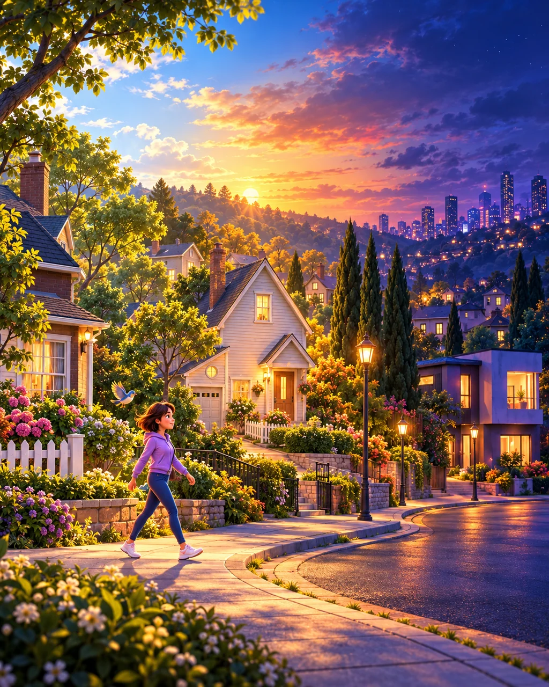

| 항목 | 내용 |
|---|---|
| 파일 | `projects/jooho-lab/public/assets/exhibit-*.webp` 7개 · 총 1,354,226B · 아래 크기 표 참조 |
| 쓰이는 곳 | JOOHO LAB stage 작품 패널 · rail 썸네일 · detail/목록/소개 페이지. 작품 목록 데이터이며 image 편집은 기존 소유자 편집기를 사용 |
| 도구 | built-in image_gen 참조 생성 6개 + Aside 공개 만화 원본 재사용 1개 · 2026-10-03. image_gen 모델명·시드는 노출되지 않음 |
| 참조 이미지 | `projects/jooho-lab/art/exhibition-20261003/<id>.png` — 실제 운영 화면 7개. ChemiForge 생성은 같은 폴더의 다운로드 운영 hero `chemiforge-hero.webp`를 참조. 실제 전달 경로는 `prompts.json`. localhost 캡처를 생성 참조로 사용하지 않음 |
| 설정 | 생성 후보 각 1개, 세로 4:5 요청/1122×1402 원본. 최종 1024×1280 WebP quality86/method6. 한술툰 운영 원본은 무크롭·비율 유지 quality90/method6 |

**무엇을 그리나** — 각 사이트의 주제를 전시 그림으로 표현한다. 운영 없는 숏폼/Market Front는 사용자 정정에 따라 블로그/한술툰으로 교체. ChemiForge는 운영 hero의 구성으로 세로 이미지를 새로 만들고, 한술툰은 공개 1편 표지 원작을 재사용한다. 공개 만화의 글자는 작품 내용이므로 보존했다. 새 생성 그림에는 타이틀·메뉴를 굽지 않았다. 블로그 정물은 실제 방문 사진이 아닌 음식 기록을 나타내는 이미지다.

| 작품 | 운영 참조 | 최종 크기 · 용량 |
|---|---|---|
| 그날의 먹거리 | https://blog.naver.com/chip109 | 1024×1280 · 133,738B |
| ChemiForge | https://chemiforge.com/ | 1024×1280 · 111,846B |
| 새벽 세 시 | https://interactive-web-app-three.vercel.app/experiences/dawn-store/ | 1024×1280 · 253,814B |
| 하루 산책 | https://interactive-web-app-three.vercel.app/experiences/day-walk/ | 1024×1280 · 350,876B |
| 한술툰 | https://www.instagram.com/hansul_toon/ | 1080×1350 · 100,580B |
| 사수 | https://sasu-alpha.vercel.app/ | 1024×1280 · 113,020B |
| 종말의 탑 | https://tower-50.vercel.app/ | 1024×1280 · 290,352B |

**운영 원본 출처** — ChemiForge 운영 이미지 `/images/brand/evidence-hero.png`를 관찰한 Next image URL에서 다운로드. 한술툰은 프로필의 공개 1편 표지 이미지. 원본은 `chemiforge-hero.webp`, `instatoon-cover.webp`에 보관(원본 MIME과 무관한 다운로드 파일명). 로그인 화면·내비게이션·팔로워 수는 최종 그림에 포함하지 않음. 전체 출처/크기/인코딩은 `art/exhibition-20261003/sources.json`.

**사용자 요청 원문**

```text
지금 각 사이트별로 전시이미지가 별로야. 특히 day walk는 https://interactive-web-app-three.vercel.app/experiences/day-walk/ 이거거든? 로컬 말고 실제 운영주소를 이용해. 그리고 캡쳐본이 별로면 별도로 해당 사이트를 나타내는 이미지를 뽑아. 전시회처럼.
그 두개는 운영 주소가 없다. 대신 블로그랑 인스타툰이 있잖아.
```

**하루 산책 생성 프롬프트 원문**

```text
Use case: stylized-concept
Asset type: standalone portrait artwork for the Day Walk project, displayed in a contemporary art exhibition. Create one premium 4:5 portrait image, not a framed mockup.
Input image: reference screenshot from the ACTUAL production Day Walk website, reference for the neighborhood, female walking character, bird, and warm animated feature-film look. Do not reproduce any interface.
Primary request: turn the application's beautiful neighborhood and day-to-night walking theme into an exhibition-worthy key visual.
Scene: a winding residential walking path through a lush intimate neighborhood of charming gabled homes and one understated modern home. The same continuous world travels from fresh pale-blue morning in the upper left through warm afternoon/amber sunset in the center to indigo evening and lit windows on the right. Natural atmospheric transition, no separate panels or hard division. The curved path brings depth into the portrait.
Subject: a small but clearly visible female walker in a purple jacket, blue trousers and light sneakers, accompanied by one tiny bird, drawing on the reference character. She is an everyday person walking through her day. Preserve the friendly scale, crisp architectural detail, foliage and cinematic sunlight of the actual project.
Composition: full-bleed portrait composition, a clear visual center, character in the lower third, detailed homes midground, generous sky with atmospheric depth. Rich feature animation lighting, tasteful finely textured materials, no toy diorama, no UI-looking checklist.
Constraints: no title, no typography, no lettering, no date, no clocks, no dashboards, no web browser, no logo, no watermark, no frame, no fake product interface. This is a concept artwork representing the existing app, not a screenshot.
```

**사수 생성 프롬프트 원문**

```text
Use case: photorealistic-natural
Asset type: standalone 4:5 portrait editorial exhibition artwork representing SASU, an AI colleague that connects team conversations and original records to a clear decision.
Input image: screenshot of the actual public SASU website, reference only for emerald-green brand direction and the idea of evidence-backed team decisions. Do not reproduce the interface or text.
Scene and subject: an elegant tactile sculptural still life on warm ivory paper. Several thin cream pages and translucent green glass strips begin loosely separated near the lower left, gently converge along precise fine emerald threads into one upright, beautifully resolved dark-green folded paper form near the upper center. The single resolved form stands for a decision, the connected paper layers for preserved context. Real paper edges, subtly impressed lines without writing, glass with believable refraction. A restrained small copper paper fastener provides human scale. Thoughtful, understandable, crafted rather than generic AI symbols.
Style: premium editorial studio photography, contemporary museum art print, refined physical materials, daylight from the left casting long soft shadows, warm ivory and deep emerald with quiet gray-green reflections. Strong deliberate portrait composition and abundant calm negative space, detailed but no clutter.
Constraints: absolutely no words, letters, numbers, interface cards, buttons, logos, watermarks, robot faces, brains, neon circuits, presentation mockup, or picture frame. Create the artwork itself.
```

**그날의 먹거리 생성 프롬프트 원문**

```text
Use case: photorealistic-natural
Asset type: one 4:5 portrait photographic exhibition artwork representing the Korean food diary blog '그날의 먹거리'. Not a website screenshot and not a framed mockup.
Input image: actual live food blog screenshot, reference for the honest everyday dining and personal food-note theme; do not copy the interface or writing. This is illustrative editorial key art, not a photograph claiming to document a particular restaurant visit.
Scene: an intimate everyday neighborhood restaurant tabletop by a window. A beautifully natural ceramic plate of several salmon and white-fish nigiri sushi is the main subject, reflecting the blog's publicly visible sushi diary. Nearby are a small bowl of miso soup, a tiny soy dish and plain wooden chopsticks. A small open cream notebook with entirely blank pages and a pencil sit to the side to suggest recording the meal. No other food, no branded packaging, no lavish feast. Slightly lived-in wooden table, genuine ceramic glaze, believable fresh fish translucency and restrained natural highlights.
Composition: carefully composed elevated three-quarter viewpoint, main plate centered in the middle third with breathing room, notebook partially visible below, portrait visual hierarchy. Warm soft late-afternoon window light, natural editorial food photography, gentle film grain, appetizing but understated, beautiful yet ordinary. No human figures or hands.
Constraints: no text, no typography, no letters or numbers even on notebook, no restaurant logos, no price tags, no web UI, no watermark, no frames. Do not make a generic stock-photo collage.
```

**새벽 세 시 생성 프롬프트 원문**

```text
Use case: photorealistic-natural
Asset type: one standalone 4:5 portrait cinematic exhibition artwork for the existing interactive story '새벽 세 시 / Still Open'.
Input image: actual production screenshot, reference for the empty Korean convenience store, rain-soaked windows, fluorescent light, solitude and subdued film mood. Do not reproduce the site's interface, subtitles or outside person.
Scene: outside an unbranded small Korean neighborhood convenience store at three in the morning, looking diagonally through rain-streaked glass. A softly glowing cold-white fluorescent interior with real shelves and a quiet window counter. One plain takeaway coffee cup on that counter provides the intimate narrative anchor. Warm amber fridge highlights are a tiny contrast. Wet pavement in the lower third reflects the still-lit window. The street disappears into blue-black quiet; the cup and glass stay clearly legible. Store architecture believable and restrained.
Composition: portrait film-still framing, closer than the wide screenshot, vertically emphasize reflections and the warmly occupied-looking but entirely empty interior; beautiful depth through glass, a feeling of waiting, finely observed raindrops, premium live-action cinematography, gentle analog grain, controlled highlights, luminous shadows rather than crushed darkness.
Constraints: no people, no silhouettes, no text, no subtitle, no typography, no clock digits, no brands, no menus, no browser or controls, no watermark, no frame. Produce only the artwork, inspired by the real site's visual atmosphere.
```

**종말의 탑 생성 프롬프트 원문**

```text
Use case: stylized-concept
Asset type: one standalone premium 4:5 portrait game key artwork for the existing 'The End's Tower / 종말의 탑' project displayed as a gallery art print.
Input image: ACTUAL production website screenshot. Reference the specific towering ruined black-stone spire with glowing ember-red fissures, forested ruins, huge vertical scale, stairs and storm mist. Preserve this visual identity rather than invent a different fantasy universe. Do not copy the interface text.
Scene: a monumental jagged black stone tower rising through storm-gray clouds, fine ember-red cracks glowing within its many ruined arched chambers. Ancient mossy steps lead from the lower foreground across a ruined stone bridge into a single warm orange entrance. Dense subdued forest and weathered stone on either side. No characters needed; the path itself makes ascent feel possible. Strong readable silhouette, intricate masonry, atmospheric scale, a pale cool break in the sky makes the tower legible.
Style: polished painterly dark-fantasy game key art with cinematic depth, crisp central architectural detail, atmospheric textured edges, restrained soot-gray, deep forest green and amber-red palette. Portrait art print hierarchy: unmistakable tall tower as focal point, leading path below, enough contrast to read when hung in a bright virtual gallery.
Constraints: no text, no title, no logos, no numbers, no menus, no browser, no health bars, no watermark, no frame, no unrelated monsters. Create the artwork itself, not a gallery mockup.
```

**생성 후 확인** — 7개 최종 이미지/원본을 직접 열어 확인. Day Walk 캐릭터·새·시간대별 집, 편의점의 무인 야간 구도, 탑의 수직 규모, 블로그 음식 정물, 사수의 근거→결정 연결을 채택. 한술툰은 원작의 캐릭터·그림을 유지하기 위해 다시 생성하지 않았다. ChemiForge의 가로 원본 직접 사용 후보는 세로 액자에서 작게 보여 원본의 시료·문서·파란 근거선을 참조한 세로 생성본으로 교체했다. 버린 생성 후보 없음. 기존 UI 캡처 7개는 이전 카드 07 이력으로 보존. 실제 화면 검수와 한계는 LAB `QA-spatial.md`의 2026-10-03 항목을 따른다.

**ChemiForge 추가 생성 프롬프트 원문**

```text
Use case: photorealistic-natural
Asset type: standalone 4:5 portrait exhibition key artwork representing ChemiForge Regulation.
Input image: the actual public production-site hero image, supporting visual reference for its physical materials and blue evidence-line motif. Create a portrait reinterpretation rather than a screenshot or a cropped landscape.
Primary request: retain the original's clear glass cosmetic-formulation sample vial, layered unprinted regulatory-paper sheets, translucent glass/paper shapes and one thin cobalt-blue line with tiny circular evidence nodes, and recompose them elegantly as a vertical photographic still life.
Composition: a deliberate portrait arrangement that fills the gallery print: layered white textured pages and muted navy/cool blue swatches step upward from the lower quarter to the upper third, with the glass sample vial in the central-right middle. A thin blue evidence line travels vertically through the paper layers towards the vial. Balanced calm white negative space with a tactile subject large enough to read in an exhibition. Preserve real glass refraction, delicate water bubbles, paper fiber and shadow detail. Pale ceramic or frosted-glass plane beneath, no additional objects.
Style and lighting: premium scientific/editorial still-life photography, soft daylight from upper left, very subtle long shadows, cool ivory, pale blue and muted navy. Refined, restrained, physical, credible, warm enough to be welcoming. Keep the actual reference's feel; no fantasy lab or generic tech iconography.
Constraints: no text or lettering on pages or vial, no logo, no regulatory numbers, no labels, no graphs or axes, no dashboard, no web controls, no watermark, no frame or mockup. The blue connecting line is the reference's conceptual evidence motif, not a claim about a measurement.
```

### 21 · 선비 — 실제 화면 캡처

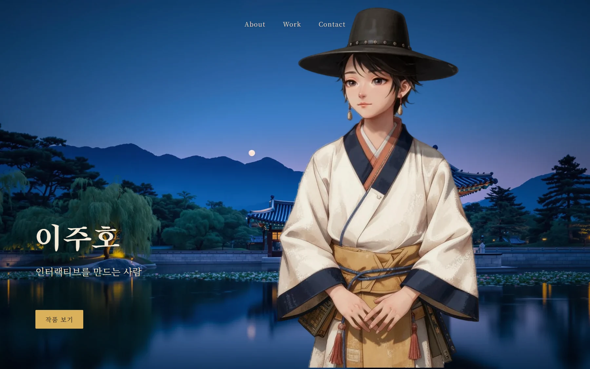

| 항목 | 내용 |
|---|---|
| 파일 | `projects/jooho-lab/public/assets/work-hanbok-hero.webp` · 1800×1125 · 131,862B |
| 쓰이는 곳 | rail 썸네일 · shell 목록 · 작품 상세(08번). 3D 벽에는 걸지 않는다 — 전시관에 구운 칸이 7개라 8번째부터는 목록·레일·작업 소개로만 연다 |
| 도구 | Playwright Chromium 캡처(1440×900, 배율 1.25) · 2026-10-03. 생성 에셋 아님 |
| 참조 이미지 | `projects/jooho-lab/art/captures/hanbok-hero.png` |
| 설정 | 원본 비율·해상도 유지, Pillow WebP quality=88, method=6 |
| 출처 | http://127.0.0.1:8897/experiences/hanbok-hero/play.html · 포인터를 이름 쪽(왼쪽 아래)에 두어 선비가 고개를 돌린 상태, 안내 문구가 사라진 뒤 |
| 프롬프트 | 해당 없음 — 실제 프로젝트 화면 캡처 |

**무엇을 보여 주나** — 경회루 야경 위에서 갓 쓴 선비가 이름 쪽으로 고개를 돌린 첫 화면.

**캡처 후 확인** — 원본을 열어 비율·안내 문구 없음·얼굴 칸(왼쪽 끝) 확인. Aside 창이 가려져 캡처가 시간 초과돼 Playwright로 찍었다. 선비 히어로의 그림 출처는 [hanbok-hero.md](hanbok-hero.md).
