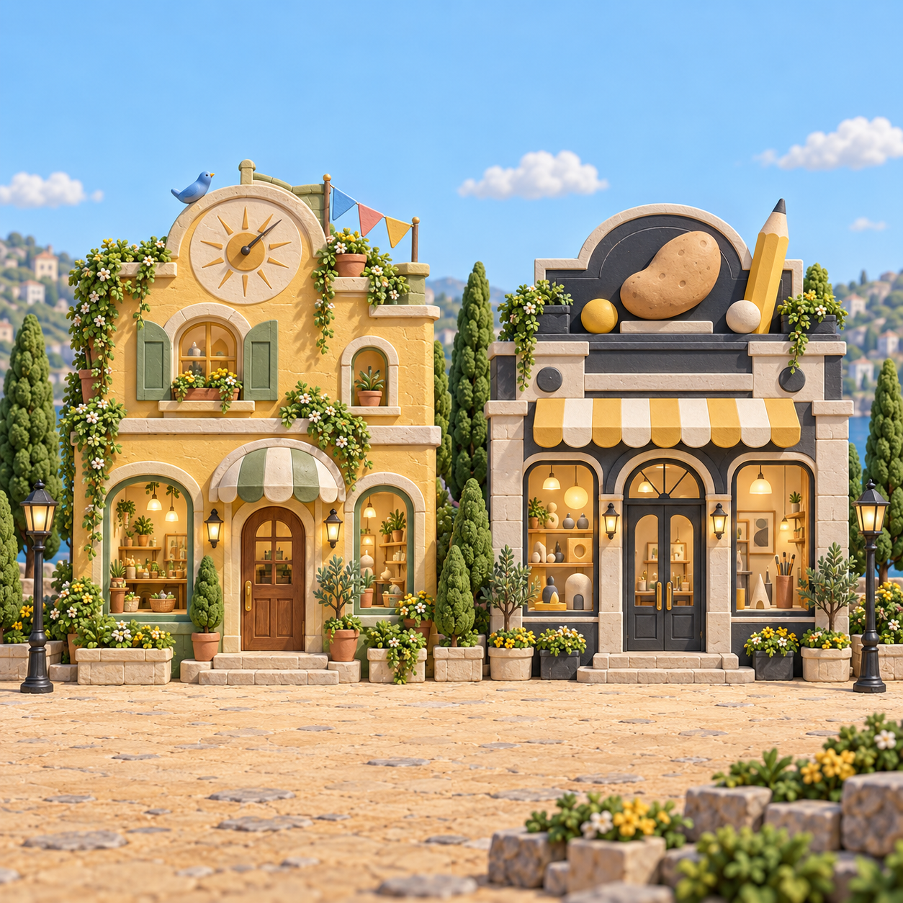

# JOOHO LAB (허브) — 에셋 프롬프트

[← 전체 목록](README.md)

작품을 모아 보여 주는 3D 마을 허브입니다. 마을은 2D 파노라마 그림을 three.js 화면에 붙이고, 그 위를 캐릭터가 걸어 다닙니다.

**2026-09-12의 기존 생성 에셋은 프롬프트 기록이 없습니다.** 당시 플랜에는 "에셋 전용 에이전트 1명이 생성"이라고만 적혀 있습니다. 2026-10-04부터 새로 만든 7·8번 건물 그림은 아래 05번 카드에 원문과 확인 결과를 기록합니다.

---

### 01 · 마을 파노라마 (project-village)


| 항목 | 내용 |
|---|---|
| 파일 | `public/assets/project-village.webp` · 2164×727 · 410KB |
| 쓰이는 곳 | 3D 마을 배경(`scene.js`) — 레이어 `panorama`·`houses`(docs/11 §9-4) |
| 도구 | ❌ 기록 없음 (2026-09-12 월드 설정 플랜의 에셋 에이전트) |

**그림 내용** — 광장을 따라 늘어선 작품 집 6채. 왼쪽부터 플라스크 지붕 집, 초록 사무실, 필름 릴 극장, 달 간판 가게, 벽돌 홀, 탑. 파란 하늘, 둥근 나무, 미니어처 느낌.

❌ **프롬프트 기록 없음.**
원본은 집 6채를 포함한다. 2026-10-04에 원본의 위치·그림을 유지하고 오른쪽에 05번의 두 건물 패널을 추가했다. 하루 산책·POTATO의 입구 좌표는 실제 생성 결과에 맞춰 선언하며, 연결부는 레이어 블렌드 값으로 조절한다.

---

### 02 · 배낭 로봇 산책자 (village-walker)


| 항목 | 내용 |
|---|---|
| 파일 | `public/assets/village-walker.png` · 1254×1254, 투명 PNG · 1.1MB |
| 쓰이는 곳 | 마을을 걸어 다니는 기본 마스코트 — 레이어 `walker` |
| 도구 | 파일 메타데이터(C2PA): **gpt-image 2.0**, OpenAI 서명, 2026-09-12 |

**그림 내용** — 크림색 둥근 몸에 까만 점 눈, 초록 등산 배낭(돌돌 만 매트)을 멘 작은 로봇. 점토 피규어 느낌, 오른쪽으로 걷는 자세.

❌ **프롬프트 기록 없음.**

---

### 03 · 어두운 전시실 (atelier, 지금 안 씀)


| 항목 | 내용 |
|---|---|
| 파일 | `public/assets/atelier.webp` · 1536×1024 · 158KB |
| 쓰이는 곳 | 2026-09-12 "시네마틱 3D 아틀리에" 개편 배경. **지금 코드에서는 안 씀** |
| 도구 | ❌ 기록 없음 (개편 플랜: "야간 개인 전시실, 실제 재질의 건축 배경") |

**그림 내용** — 노출 콘크리트 벽의 어두운 전시 홀, 천장 가장자리 따뜻한 간접조명, 반사되는 바닥.

❌ **프롬프트 기록 없음.**

---

### 04 · 작품 표지

| 파일 | 크기 | 내용 | 출처 |
|---|---|---|---|
| `public/assets/dawn.webp` | 1920×1080 · 122KB | 새벽 세 시 `hub` 컷과 **같은 파일** | [dawn-store.md 01](dawn-store.md#01--hub--계산대) |
| `public/assets/chemiforge.webp` | 1400×933 · 66KB | 서류와 약병을 위에서 찍은 사진풍 | 이 저장소에 생성 기록 없음 — 케미포지 프로젝트 자료로 보임 |

---

### 05 · 하루 산책·POTATO 건물 확장 (village-extension-v1)



| 항목 | 내용 |
|---|---|
| 파일 | `public/assets/village-extension-v1.png` · 1254×1254 · 2,420,243 bytes · 불투명 PNG |
| 쓰이는 곳 | 상단 마을 오른쪽 확장 그림, 레이어 `village-extension`; 클릭/라벨/불빛 레이어 `house-day-walk`·`house-potato-designer` |
| 도구·모드 | 내장 `image_gen` · 기존 그림을 스타일/접합 기준으로 참조한 확장 패널 제작, `transparent_background: false` |
| 만든 날 | 2026-10-04 |
| 참조 이미지 | `public/assets/project-village.webp` — 기존 6채 그림의 재질·하늘·광장·입구 높이 기준. 원본 파일은 유지 |
| 설정 | 정사각형 1024×1024를 프롬프트에 요청; 실제 반환은 1254×1254. 두 건물만, 읽을 수 있는 문구·UI·사람·로봇 없음 |

**한국어 요약** — 기존 미니어처 마을의 오른쪽에 이어 붙이는 집 두 채. 하루 산책은 해 시계·파랑새·세 색 깃발과 초록 덧문이 있는 노란 집, POTATO는 감자 조형물·연필·줄무늬 차양이 있는 디자인 아틀리에. 파란 하늘, 연한 돌 광장, 입구 높이를 원본과 맞춘다.

```text
Create a seamless RIGHT-HAND EXTENSION panel for the supplied miniature village panorama. The supplied image is a style and edge-continuity reference, not something to repeat. OUTPUT: one square 1024x1024 illustration containing EXACTLY TWO new adjacent buildings, full facades and entrances, no other buildings. Preserve the reference's premium handcrafted 3D miniature clay/stone rendering, daylight, clear pastel blue sky, warm sandy stone plaza, cypress trees, flowers, miniature streetlamps, front-facing slightly elevated orthographic view, scale and sharpness. Match the reference's vertical arrangement: sky in upper ~25%, building door thresholds on a horizontal line at 76% from the top, pale stone plaza continuing across lower 24%. Left building center at 27% image width: 'Day Walk' as a cozy honey-yellow and sage-green walking/routine cottage, with an analog sun clock, small blue bird ornament, three tiny colorful pennant flags on the roof, garden plants and a clear central wooden front door. Right building center at 73% width: 'POTATO' as a sophisticated charcoal and ivory designer atelier with soft yellow accents, striped awning, playful rounded sculptural sign resembling a small potato form, oversized pencil sculpture, creative shapes visible through windows and a clear central front door. No human characters. No robots. No readable text, numbers, letters, logos or UI. Both houses fit completely inside frame with sky above roofs and clearly separated entry doors. Left edge and right edge have unobtrusive sky and sandy plaza/cypress foliage so this square panel can be placed immediately right of the existing panoramic village. Do not depict the original six buildings, especially do not repeat the stone tower.
```

**생성 후 확인** — 두 건물·출입문·시계·새·깃발·감자 조형물·연필이 모두 보이며 사람이나 읽을 수 있는 글자가 없다. 실제 문 중심은 요청한 27%보다 오른쪽인 약 31%와 74%여서 코드 좌표를 결과에 맞췄다. 원본 6채의 좌표는 유지한다. 브라우저에서 확인한 하늘 접합 경계는 겹침과 왼쪽 블렌드로 완화하며, 위치·크기·밝기·블렌드를 설정에서 조절한다. 후보 1개를 채택했으며 폐기한 후보는 없다. 새 생성물은 실제 3D 모델이 아니라 이미지다. 실제 입장·모바일·레이어 검수 결과는 [허브 QA](../projects/jooho-lab/QA.md)에 기록한다.
| `public/assets/spire.webp` | 1400×788 · 290KB | 픽셀아트 키아트 "TOWER OF THE END" | 이 저장소에 생성 기록 없음 — 해당 게임 프로젝트 자료로 보임 |
| `public/assets/sasu.webp` | 1280×720 · 39KB | SASU 화면 캡처(생성 이미지 아님) | — |

`public/experiences/dawn-store/` 안의 그림·소리는 새벽 세 시 작품 파일을 그대로 복사한 것이다.
