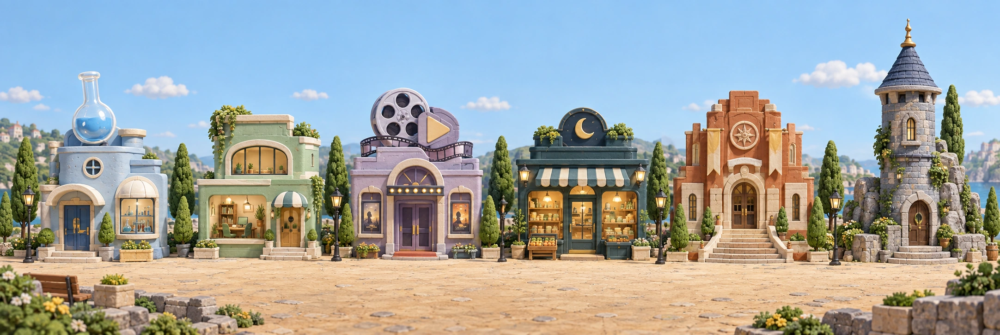

# JUHO LAB (허브) — 에셋 프롬프트

[← 전체 목록](README.md)

작품을 모아 보여 주는 3D 마을 허브입니다. 마을은 2D 파노라마 그림을 three.js 화면에 붙이고, 그 위를 캐릭터가 걸어 다닙니다.

**이 앱의 생성 에셋에는 프롬프트 기록이 하나도 없습니다.** 플랜에는 "에셋 전용 에이전트 1명이 생성"이라고만 적혀 있습니다(2026-09-12). 아래 카드는 파일에서 확인할 수 있는 정보만 담았습니다.

---

### 01 · 마을 파노라마 (project-village)

| 항목 | 내용 |
|---|---|
| 파일 | `public/assets/project-village.webp` · 2164×727 · 410KB |
| 쓰이는 곳 | 3D 마을 배경(`scene.js`) — 레이어 `panorama`·`houses`(docs/11 §9-4) |
| 도구 | ❌ 기록 없음 (2026-09-12 월드 설정 플랜의 에셋 에이전트) |

**그림 내용** — 광장을 따라 늘어선 작품 집 6채. 왼쪽부터 플라스크 지붕 집, 초록 사무실, 필름 릴 극장, 달 간판 가게, 벽돌 홀, 탑. 파란 하늘, 둥근 나무, 미니어처 느낌.

❌ **프롬프트 기록 없음.**
⚠️ 집 6채가 그림 안에 그려져 있어서 작품이 7번째부터는 마을에 안 나온다(Day Walk는 목록 보기에만 있음). "Day Walk 집을 그려 넣기"가 계획돼 있지만 프롬프트는 없다. 새로 만들 때는 [templates §4](templates.md#4-조명시간대만-바꾸기-같은-구도)처럼 **원본 구도를 유지하는 편집**으로 집 하나만 추가해야 기존 집 좌표가 안 깨진다.

---

### 02 · 배낭 로봇 산책자 (village-walker)

| 항목 | 내용 |
|---|---|
| 파일 | `public/assets/village-walker.png` · 1254×1254, 투명 PNG · 1.1MB |
| 쓰이는 곳 | 마을을 걸어 다니는 기본 마스코트 — 레이어 `walker` |
| 도구 | 파일 메타데이터(C2PA): **gpt-image 2.0**, OpenAI 서명, 2026-09-12 |

**그림 내용** — 크림색 둥근 몸에 까만 점 눈, 초록 등산 배낭(돌돌 만 매트)을 멘 작은 로봇. 점토 피규어 느낌, 오른쪽으로 걷는 자세.

❌ **프롬프트 기록 없음.**

---

### 03 · 어두운 전시실 (atelier, 지금 안 씀)

| 항목 | 내용 |
|---|---|
| 파일 | `public/assets/atelier.webp` · 1536×1024 · 158KB |
| 쓰이는 곳 | 2026-09-12 "시네마틱 3D 아틀리에" 개편 배경. **지금 코드에서는 안 씀** |
| 도구 | ❌ 기록 없음 (개편 플랜: "야간 개인 전시실, 실제 재질의 건축 배경") |

**그림 내용** — 노출 콘크리트 벽의 어두운 전시 홀, 천장 가장자리 따뜻한 간접조명, 반사되는 바닥.

❌ **프롬프트 기록 없음.**

---

### 04 · 작품 표지

| 파일 | 크기 | 내용 | 출처 |
|---|---|---|---|
| `public/assets/dawn.webp` | 1920×1080 · 122KB | 새벽 세 시 `hub` 컷과 **같은 파일** | [dawn-store.md 01](dawn-store.md#01--hub--계산대) |
| `public/assets/chemiforge.webp` | 1400×933 · 66KB | 서류와 약병을 위에서 찍은 사진풍 | 이 저장소에 생성 기록 없음 — 케미포지 프로젝트 자료로 보임 |
| `public/assets/spire.webp` | 1400×788 · 290KB | 픽셀아트 키아트 "TOWER OF THE END" | 이 저장소에 생성 기록 없음 — 해당 게임 프로젝트 자료로 보임 |
| `public/assets/sasu.webp` | 1280×720 · 39KB | SASU 화면 캡처(생성 이미지 아님) | — |

`public/experiences/dawn-store/` 안의 그림·소리는 새벽 세 시 작품 파일을 그대로 복사한 것이다.
