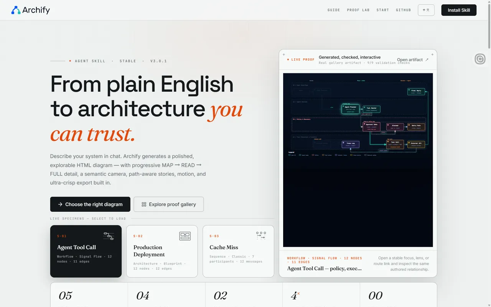
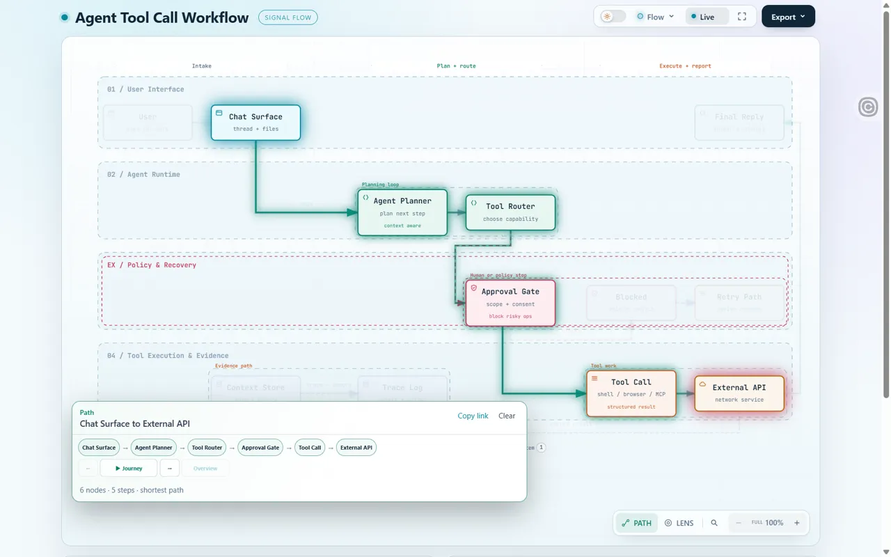

# Archify — 탐색하는 HTML 구조도

인스타그램 DM(REBORN LABS의 한국어 소개 rebornlabs.kr/archify)으로 받은 오픈소스 도구. 원작자는 tt-a1i이고 MIT 라이선스다. 설명이나 코드베이스를 주면 에이전트 스킬이 **HTML 한 장짜리 인터랙티브 구조도**를 만든다. 도구를 설치·실행하지 않았고, 공개 홈페이지와 갤러리의 결과물만 열어 봤다. DM이 안내한 제3자 설치기(`reborn-archify`)와 원 프로젝트는 다르다.

### archify · Archify — 노드를 누르면 위아래 흐름과 경로를 따라가는 구조도

 

| 항목 | 내용 |
|---|---|
| 주소 | https://tt-a1i.github.io/archify/ |
| 출처 | Archify 소개 DM(REBORN LABS) · 가져온 날 2026-10-01. 저장소 https://github.com/tt-a1i/archify (MIT) |
| 노션 | `3ead12f2-3255-810f-bd01-d423fdf96bbb` |
| 확인 | ✅ 2026-10-01 · 1440px · Aside (홈, gallery.html, agent-tool-call.workflow.html) |
| 패턴 | `explorable-diagram` |
| 패밀리 | 새 패턴 |
| 기술 흔적 | 구조도 하나가 외부 리소스 0개인 HTML 한 장(약 750KB, 인라인 스크립트 약 400KB). SVG(`viewBox 0 0 1096 684`)를 CSS `transform: translate() scale()`로 움직이는 카메라. d3·mermaid·elk·GSAP 없음. 노드는 `g[role=button][tabindex=0][aria-pressed]`, 관계선도 `role=button`이고 로빙 tabindex. 상태를 주소 해시로 공유(`#focus=` `&reach=` `#route=a~b` `#lens=` `#relation=`, `history.replaceState`). 내보내기는 MediaRecorder WebM 등. 홈·갤러리는 GitHub Pages 정적 페이지(갤러리 CSS에 Tailwind v4 표기), 결과물은 sandbox iframe으로 끼운다 |
| 쓰인 작품 | — |

**무엇이 다른가** — 구조도를 그림으로 한 번 보여 주고 끝내지 않고, **노드 하나를 골라 그 위·아래 흐름만 남기거나, 두 노드 사이 최단 경로를 따라 카메라가 이동하는** 탐색 도구로 만든다. 노드를 누르면 오른쪽에 "Semantic Passport" 패널(위로 2개·아래로 8개, 들어오고 나가는 관계 목록, 링크 복사)이 열리고 관련 없는 노드는 흐려진다(불투명도 0.13). PATH에서 출발·도착 노드를 고르면 6노드 5단계 경로 칩이 생기고 ▶ Journey가 약 1초마다 다음 노드로 넘어간다. 확대할수록 세부(태그)가 드러나는 단계형 확대도 있다.

| 입력 | 바뀌는 상태 | 보이는 피드백 | 되돌리기 |
|---|---|---|---|
| 노드 호버·Tab 포커스 | 이웃 노드만 남기고 흐림 | 빛나는 테두리, 숨은 태그 표시 | 포인터 빼기·포커스 이동 |
| 노드 클릭(Enter) | `#focus=planner`, 카메라 확대(122%) | Passport 패널(위·아래 개수, 관계 목록, Copy link) | **Escape 한 번에 전부 해제**, 해시 지움, 포커스는 노드로 복귀 |
| Passport "Downstream" | `&reach=downstream`, 전체 보기 | 아래쪽 8노드·8관계·최대 5단계 강조 | Escape |
| PATH → 출발 클릭 → 도착 클릭 | `#route=chat~external` | 갈 수 있는 노드 표시 → 최단 경로 칩, ← ▶Journey → Overview | Clear·Escape |
| 확대 +/− | 100→200%, 175%부터 세부 표시 | 배율과 "Zoom in again to reveal tags" 안내 | `0` 키·Reset |
| L 키 → "Database" 렌즈 | `#lens=database`, 해당 노드만 진하게 | 렌즈 패널 | Escape 한 번 패널, 두 번 렌즈 해제 |
| 갤러리 분류 "Sequence" | 11개 중 2개만 보임 | 칩 눌림(`aria-pressed`) | "All / 11" |

**대체 경로** — 키보드: 지금까지 보관함에서 직접 연 사이트 가운데 가장 잘 되어 있다. 도구 줄 → 관계 그룹 → 관계선 → 노드 12개 순으로 Tab이 가고, 관계선은 →로 다음 관계·Enter로 상세, 단축키(`? T S E F M L R + − 0`)와 단계별 Escape 해제가 있다. 노드 포커스는 outline 대신 빛 테두리로 보인다. 휠 확대·끌어서 이동은 없다(끌다 놓으면 노드 클릭으로 처리됨). 터치/모바일: `(hover:none),(pointer:coarse)`, 720·420·360px 규칙이 있다(스타일시트에서 읽음, 실측 못 함). 동작 줄이기: CSS가 메뉴·등장 애니메이션을 끄고 JS가 배경 흐름 모션을 끄며 카메라 이동 지연을 0으로 둔다. **Live/Still 버튼**(`aria-pressed`)으로 사용자가 직접 멈출 수 있고 실제로 멈췄다. 로딩: 캐시 상태 구조도 FCP 0.13초(리소스 0개), 갤러리 load 약 1초.

**가져올 것** — 고른 대상의 **위·아래 흐름만 남기는 초점 모드**와 두 지점 경로 따라가기, 상태를 해시에 담아 링크로 공유하는 방식(`replaceState`라 뒤로 가기가 쌓이지 않음), 확대 단계에 따라 세부를 드러내는 정보 밀도 조절, Escape 한 번으로 모든 강조를 푸는 되돌리기, 노드를 버튼으로 만든 키보드 구조, 사용자가 누르는 모션 정지 버튼, 외부 리소스 없는 한 장짜리 결과물

**안 가져올 것** — 단축키 수십 개를 그대로 들여오기(우리 작품에는 몇 개면 된다), 휠·끌기 이동이 없는 탐색(넓은 그림에서는 필요하다), 갤러리 필터가 주소에 안 남는 점, 구조도를 "검증된 사실"처럼 보이게 하는 문구(도구도 실제 운영 안전성을 증명하지 않는다고 밝힌다)

**우리 레이어로 옮기면** — `그림판`(배경 격자·구역 상자·테마) · `노드`(모양·크기·이름표·태그 — 노드 목록은 콘텐츠 데이터) · `관계선`(굵기·화살표·흐름 모션 속도) · `초점 효과`(흐림 불투명도·빛 테두리·카메라 확대율) · `경로 재생`(단계 간격 초·카메라 배율) · `정보 패널`(위치·폭·항목) · `확대 단계`(배율 목록·세부를 보일 배율) · `모션 정지 버튼`. 분기형 흐름(docs/08·09)의 노드 지도를 보여 줄 때 바로 쓸 수 있는 구조다.

**확인 한계** — 1440px만 봤다. 내보내기(파일 다운로드), 발표 모드, 레이더·가이드 화면은 열지 않았다. 모바일 실제 화면·터치 동작, 빈 캐시 첫 로딩은 확인 못 함. 도구를 설치해 우리 저장소 구조도를 만들어 보지는 않았다. GitHub 스타 수는 출처마다 달라(60,186 · 75.5k) 적지 않는다.
