# 인스타그램 리포스트 — 릴스로 본 인터랙티브 웹 화면

노션 **Instagram 리서치** DB에서 리포스트(릴스·카루셀) 행 가운데 인터랙티브 웹 화면이나 프론트엔드 코드가 나오는 것을 골랐다(2026-10-01 전체 행 검토). 리포스트 행에는 사이트 주소가 없어서 원본 사이트를 따로 찾았다. **원본을 찾아 직접 열어 본 카드는 ✅**, 찾지 못해 노션에 저장된 릴스 캡처(휴대폰 화면 1080×2400)만 본 카드는 **⏸**다. ⏸ 카드의 동작은 캡처 몇 장과 캡션에서 읽은 것이라 근거로 단정하지 않는다. 캡처는 인스타그램 앱 화면을 잘라 낸 것이라 오른쪽에 좋아요·댓글 아이콘이 찍혀 있다 — 사이트 UI가 아니다.

### everest · Everest · The Ascent — 스크롤로 오르는 실시간 3D 에베레스트 원정

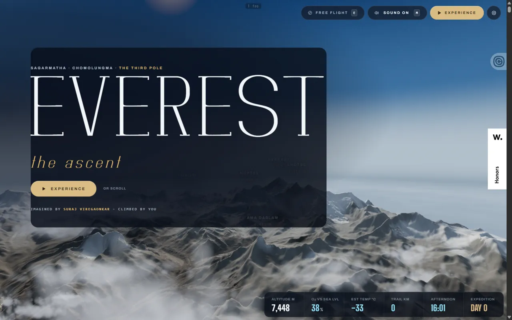 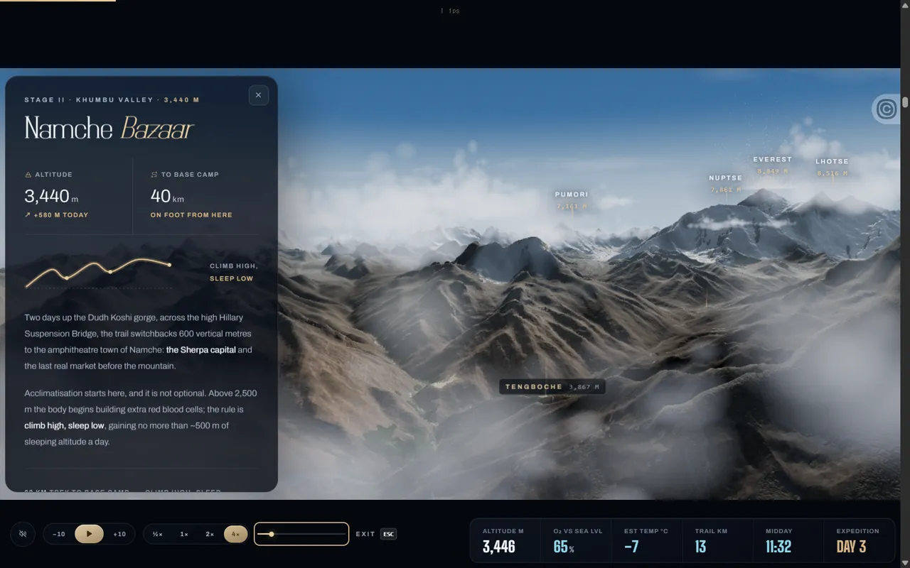

| 항목 | 내용 |
|---|---|
| 주소 | https://everest.suraj.work/ |
| 출처 | @studiodle_ 릴스 "2027홈페이지 트렌드#4"(리포스트)에 나온 사이트 · 가져온 날 2026-10-01. 제작 Suraj Viregaonkar, Awwwards Honorable Mention(2026-07) |
| 노션 | `3e9d12f2-3255-81af-bcb5-db57c7fdfc64` |
| 확인 | ✅ 2026-10-01 · 1440px · Aside |
| 패턴 | `scroll-journey-3d` |
| 패밀리 | A |
| 기술 흔적 | Vite 번들, three.js r170 WebGL2(EffectComposer 후처리, InstancedMesh, ShaderMaterial), 지형은 높이 지도 PNG + 위성 텍스처 webp(AWS Terrain Tiles·Esri 영상), Lenis 부드러운 스크롤, AudioContext, PointerLock. 리소스 33개·전송 약 6.9MB. `setPixelRatio(min(dpr, 1.5))`와 자동 성능 모드(추정). WebGL이 없으면 "This experience needs WebGL…" 대체 문구 |
| 쓰인 작품 | JOOHO LAB 공간 갤러리 · 2026-10-01 · 순차 휠 이동과 수동 카메라 모드 분리, 작품 바로 가기 유지; 2026-10-02 건물 정교화에서 기존 카메라·모바일 렌더 예산 재사용 |

**무엇이 다른가** — 페이지 스크롤(높이 약 61,000px)이 곧 **루클라 활주로에서 8,849m 정상까지의 원정 진행률**이다. 3D 산맥 위로 카메라가 움직이고, 아래 HUD 여섯 칸(고도·산소 %·기온·트레일 km·현지 시각·DAY)이 스크롤에 따라 계속 바뀐다. 구간에 들어서면 왼쪽에 단계 패널("STAGE II · KHUMBU VALLEY · 3,440 M Namche Bazaar", 고도 그래프·남은 거리·"Climb high, sleep low")이 뜬다. **EXPERIENCE**를 누르면 같은 여정이 영화처럼 자동 재생되고 레터박스·재생 컨트롤이 나온다. E 키로 자유 비행(WASD)도 된다.

| 입력 | 바뀌는 상태 | 보이는 피드백 | 되돌리기 |
|---|---|---|---|
| BEGIN THE ASCENT(로딩 끝) | 로딩 화면 사라짐, 소리 켜짐 | 큰 세리프 "EVEREST", 3D 산맥·구름·봉우리 이름표, HUD, 상단 도구(FREE FLIGHT·SOUND·EXPERIENCE·설정) | — |
| 휠 스크롤 1200px × 5 | 여정 진행(y 0→6300) | 고도 7,448→2,914m, 시계 16:01→11:27, DAY 0→1, Stage I 패널 | 위로 스크롤 |
| EXPERIENCE | 자동 재생 모드 | 위아래 레터박스, 하단 −10초·일시정지·+10초·배속(½×~4×)·탐색 슬라이더(`role=slider`)·EXIT ESC | Escape(스크롤 위치는 그대로) |
| 탐색 슬라이더에 포커스 후 End·Home·→ | 진행률 100%·0%·16% | 정상 8,849m DAY 60 / 처음 / Namche 3,446m DAY 3, 금색 포커스 링 | Home |
| E 키 | 자유 비행 모드 | "MOUSE LOOK · WASD MOVE · SPACE UP · SHIFT BOOST · ESC EXIT", 시간대 1~5 선택 | Escape |

**대체 경로** — 키보드: Tab이 상단 도구 → EXPERIENCE → 각주 링크로 가고 포커스 링이 있다. 탐색 슬라이더는 Home·End·방향키로 움직인다. 그러나 **단계 목록(`nav#rail`, 16개)이 CSS로 꺼져 있어** 슬라이더 말고는 원하는 단계로 바로 갈 길이 없고, 이미 사라진 로딩 화면과 투명한 버튼이 Tab을 받는다(보이지 않는 정지점). 화면 밖 요소로 포커스가 가도 스크롤이 따라가지 않았다(Lenis 때문인지 Aside 지연 때문인지 구분 못 함). 일시정지는 버튼으로만 됐다(Space·p는 안 됨). 터치/모바일: `(hover:none) and (pointer:coarse)`면 3D를 통째로 끄고 "Open on a desktop · The 3D climb runs on desktop only"와 **글로 읽는 기록(Ledger)** 버튼을 보여 준다(스크립트에서 읽음, 실측 못 함). 동작 줄이기: CSS 9곳 + JS에서 Lenis·구름 흐름·숫자 카운트업·패널 전환을 끈다(코드에서 읽음). 로딩: 텍스처는 약 1.8초에 다 받았지만 "BEGIN THE ASCENT"가 나오기까지 약 25초(Aside에서 렌더가 1~5fps로 느렸다). 로딩 화면에 단계 문구(CARVING THE KHUMBU → SCATTERING FORESTS → LIGHTING THE RANGE)와 % 막대가 있다.

**가져올 것** — 스크롤 진행률 하나로 **3D 카메라·HUD 숫자·단계 패널을 함께 묶는** 구조(숫자가 바뀌는 것만으로 이동감이 생긴다). 같은 여정을 스크롤·자동 재생·자유 비행 세 방식으로 보게 하는 선택지. 자동 재생의 배속·±10초·탐색 슬라이더 조작. 모바일에서 3D를 억지로 돌리지 않고 글 기록으로 바꾸는 대체 화면. 기다리는 동안 무엇을 만드는지 말해 주는 로딩 문구

**안 가져올 것** — 단계 목록을 숨겨 바로 가기 경로를 없앤 구성, 보이지 않는 요소가 포커스를 받는 것, 수십 초 걸리는 첫 진입, 6만 px짜리 스크롤에 의존한 진행(스크롤바로 위치를 가늠하기 어렵다)

**우리 레이어로 옮기면** — `월드`(지형 높이 지도·텍스처·안개·구름 밀도) · `카메라 경로`(단계별 위치·높이·시선, 구간 사이 보간) · `HUD`(항목 목록·단위·숫자 카운트 길이) · `단계 패널`(단계별 제목·고도·그래프·본문 — 콘텐츠 데이터) · `단계 목록`(바로 가기, 끄지 않는다) · `재생 컨트롤`(배속 목록·건너뛰기 초) · `로딩 화면`(단계 문구) · `모바일 대체`(글 기록). 장면은 단계(STAGE I~)로 선언하고 진행 입력은 스크롤·자동 재생 둘로 둔다. 픽셀 비율 상한은 성능 파라미터로 둔다.

**확인 한계** — 1440px만 봤다. Aside에서 WebGL이 1~5fps라 정상 속도의 카메라 움직임·자동 재생 빠르기는 보지 못했고, 로딩 25초도 실제보다 길 수 있다. 지형 위 트레일 선은 캡처에서 뚜렷하게 보지 못했다. 소리, 자유 비행 조작, 설정(성능) 패널, 모바일·동작 줄이기 실제 화면은 확인 못 함. 릴스 캡션 "클로드는 이런 홈페이지 못 만듦"과 달리 제작 방식(AI 사용 여부)은 알 수 없다 — Awwwards 설명은 "built solo with Three.js"뿐이다.

### ascenta · ASCENTA Sparkling Watermelon — 스크롤로 넘기는 1,000장 이미지 시퀀스 음료 사이트

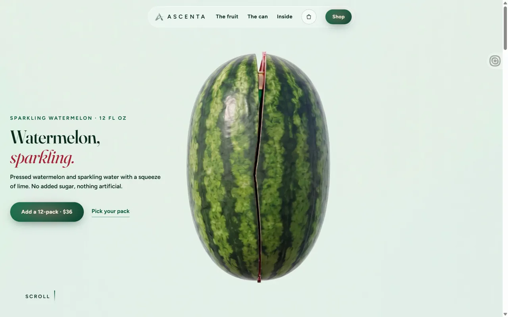 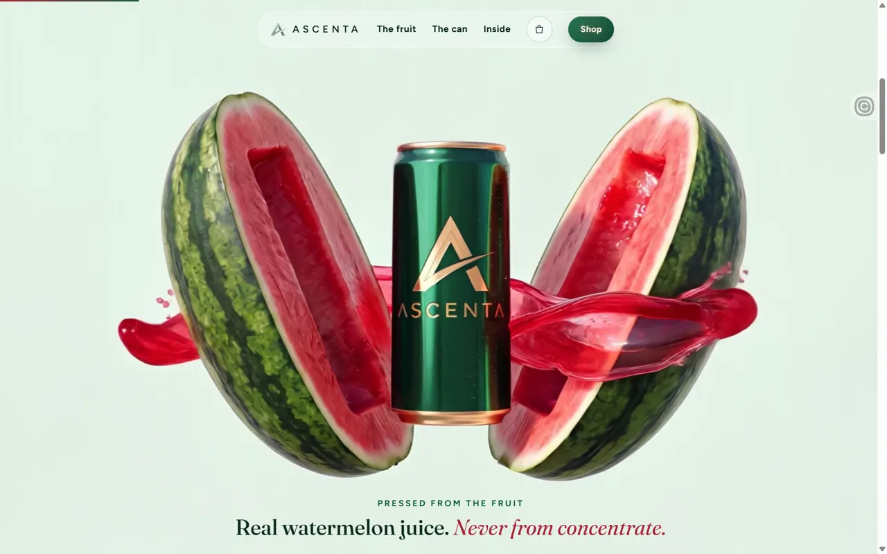

| 항목 | 내용 |
|---|---|
| 주소 | https://ascentatrack.com/watermelon/ |
| 출처 | @ascenta.studio 릴스(리포스트) · 가져온 날 2026-10-01. 제품 브랜드 웹사이트 스튜디오 ascentastudio.com의 콘셉트 데모 8개 중 하나 |
| 노션 | `3ebd12f2-3255-8167-8dfd-d0f5981c98f5` |
| 확인 | ✅ 2026-10-01 · 1440px · Aside |
| 패턴 | `scroll-product-story` |
| 패밀리 | 새 패턴 |
| 기술 흔적 | 정적 HTML + Lenis(`lerp .12`). 화면 전체에 고정된 2D `<canvas id="film">` 하나에 **스크롤 진행률 → 프레임 번호**로 이미지 시퀀스를 그린다: `frames/f_0001…1000.webp`(1928×1072, 1,000장, 주석상 RIFE 보간), `framemap.js`(240점 진행률 지도), Worker 풀의 `createImageBitmap` 디코드. video·WebGL·GSAP 없음. 문구 블록(`.beat`)은 `data-from`/`data-to` 진행률 구간에서만 켜지고 `data-box`(프레임 좌표)를 화면 cover 계산으로 옮겨 놓는다. 장바구니는 결제 없는 데모(`checkout.js`, localStorage) |
| 쓰인 작품 | — |

**무엇이 다른가** — 핀 고정이나 3D 없이, **영상처럼 보이는 이미지 1,000장을 스크롤로 넘겨** 제품 이야기를 한다. 통수박 → 수박이 갈라지며 캔과 과즙이 튀어나옴("Real watermelon juice. Never from concentrate.") → 얼음 같은 캔 클로즈업("Best ice cold.") → 위에서 본 캔 뚜껑("Crack it. It's pink.") → "Pick your pack." 구매 섹션으로 끝난다. 스크롤을 올리면 그대로 거꾸로 재생된다. 문구는 화면 위치가 아니라 **프레임 속 물체 좌표에 맞춰** 붙는다.

| 입력 | 바뀌는 상태 | 보이는 피드백 | 되돌리기 |
|---|---|---|---|
| 휠 800px × 6 | 진행률 0.15→1.0, 켜지는 문구가 fruit→can→inside 순으로 바뀜 | 프레임이 이어 바뀜, 상단 진행 막대가 늘어남 | 위로 스크롤(거꾸로 재생) |
| 메뉴 "The can" | Lenis로 약 1.6초 동안 진행률 0.53 지점까지 이동(주소 해시는 안 바뀜) | 부드러운 이동, can 문구 | 다른 메뉴·스크롤 |
| 장바구니 버튼 | 오른쪽 서랍 열림, 배경 막, 스크롤 잠김 | "Your bag is empty.", 포커스가 Close bag으로 | Escape로 닫힘 |
| Add 버튼 호버 | 그라디언트 색이 조금 밝아짐 | 색 변화만 | 포인터 빼기 |

**대체 경로** — 키보드: Tab 순서가 로고 → 메뉴 → 장바구니 → Shop → "Add a 12-pack · $36" → 구매 섹션 Add 3개 → 푸터로 자연스럽고 `:focus-visible` 2px 링이 있다. PageDown·Space·방향키로도 필름이 움직인다. 숨은 문구 안의 버튼은 `visibility:hidden`이라 Tab이 건너뛴다. 결함: **닫힌 장바구니 서랍이 화면 밖으로 밀려 있을 뿐이라 Tab이 보이지 않는 "Close bag"에 멈추고**, Escape로 닫은 뒤 포커스가 장바구니 버튼으로 돌아오지 않는다. 터치/모바일: `pointer:coarse`면 흐림 효과를 끄고 절반 해상도·절반 장수 프레임(`frames-m/`, 주석상 약 19MB)을 받는다. 세로 화면은 프레임 전체가 보이게 맞춘다(스크립트에서 읽음, 실측 못 함). 동작 줄이기: JS가 필름을 **중간 프레임 한 장에 고정**하고 구매 섹션을 바로 보여 주며 Lenis를 쓰지 않는다(코드에서 읽음). 로딩: 캐시가 있을 때 FCP 0.3초·load 0.8초. 프레임 1,000장을 모두 미리 받는데 약 20초에 다 받았고, 합계는 약 91MB로 추정된다(50장 평균 93KB, 주석 "92 MB"와 맞음).

**가져올 것** — 스크롤 진행률 → 프레임 번호 지도(구간마다 속도를 다르게 줄 수 있다), 문구를 **프레임 속 물체 좌표**에 붙여 화면 비율이 바뀌어도 같은 자리에 두는 방식, 진행률 구간으로 문구를 켜고 끄는 선언형 구조, 거친 입력 기기용 저해상도 프레임 묶음, 동작 줄이기에서 대표 프레임 한 장으로 바꾸기, 이야기 끝을 바로 행동(팩 고르기)으로 잇는 흐름

**안 가져올 것** — 약 90MB 프레임을 첫 방문에 모두 받는 구성, 화면 밖에 남아 포커스를 잡는 서랍, 닫은 뒤 포커스 복귀 없음, 주소가 안 바뀌어 공유할 수 없는 메뉴 이동, 제품 사진·문구

**우리 레이어로 옮기면** — `필름`(프레임 목록·장수·해상도 묶음별 경로·진행률 지도·cover/fit 규칙·동작 줄이기 대표 프레임) · `진행 막대`(두께·색) · `장면 문구`(구간 시작·끝 진행률, 붙을 물체 좌표, 문구 — 콘텐츠 데이터) · `상단 메뉴`(항목·이동할 진행률) · `구매 섹션`(팩 목록 — 콘텐츠) · `서랍`(폭·배경 막 불투명도·닫기 키). 장면은 진행률 구간으로 선언한다.

**확인 한계** — 1440px만 봤다. 390px·동작 줄이기 실제 화면, Add를 누른 뒤 상태(장바구니에 담지 않음), 빈 캐시 첫 방문의 전체 전송량(리소스 타이밍 버퍼 250개 한계)은 확인 못 함. 같은 스튜디오의 다른 데모 7개(/parfum/ 등)는 열지 않았다. 제품 사진은 저작물이라 캡처는 내부 참고용이다.

### lunara-login · Lunara 로그인 — 달빛 사막 장면 속 로그인 카드와 걸어 들어가는 버튼

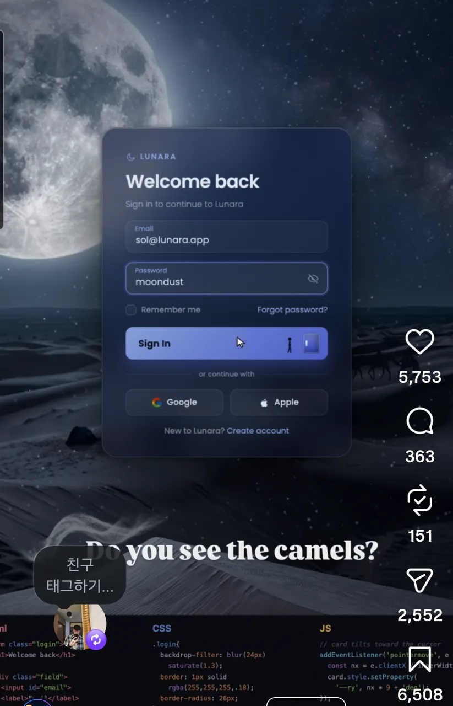 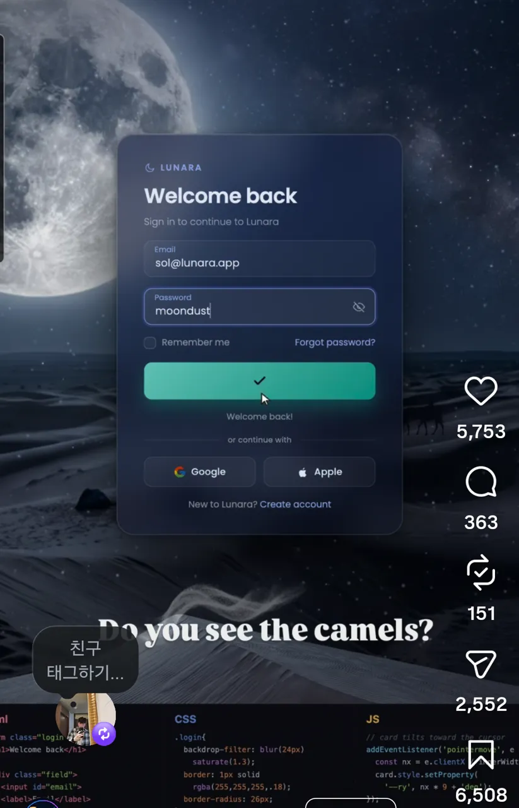

| 항목 | 내용 |
|---|---|
| 주소 | https://www.instagram.com/_code_and_chill_/ |
| 출처 | @_code_and_chill_ 릴스(리포스트) · 가져온 날 2026-10-01 |
| 노션 | `3ead12f2-3255-811f-8570-f6173deeb88d` |
| 확인 | ⏸ 2026-10-01 · 릴스 캡처 3장만 봄(원본 CodePen·사이트 못 찾음) |
| 패턴 | `scene-form`, `pointer-reactive` |
| 패밀리 | 새 패턴 |
| 기술 흔적 | (추정, 캡처 아래 코드 패널에서 읽음) HTML·CSS·JS 한 장. 카드에 `backdrop-filter: blur(24px) saturate(1.3)`, 달에 `mix-blend-mode: screen`과 숨 쉬듯 커졌다 작아지는 애니메이션, `pointermove`로 `--rx`·`--ry` CSS 변수를 바꿔 카드를 기울임, 로그인 때 버튼에 `dooropen` 클래스를 붙임 |
| 쓰인 작품 | — |

**무엇이 다른가** — 평범한 이메일·비밀번호 로그인 카드를 **한 장면 안에 넣었다**. 큰 달과 별이 뜬 사막 능선(캡션: 낙타 대상이 능선을 지난다)을 배경으로 반투명 유리 카드("Welcome back")가 떠 있고, Sign In 버튼 오른쪽 끝에 작은 사람과 문이 그려져 있다. 캡션은 "말 그대로 걸어서 통과하는 로그인 버튼"이라고 설명하고, 로그인하면 버튼이 청록색 체크로 바뀐다.

| 입력 | 바뀌는 상태 | 보이는 피드백 | 되돌리기 |
|---|---|---|---|
| 포인터 이동(코드로 추정) | 카드 기울기(`--rx`·`--ry`) | 카드가 포인터 쪽으로 기운다 | 포인터를 빼면 돌아오는지 확인 못 함 |
| Sign In 클릭 | 버튼 `dooropen` → 성공 상태 | 문이 열리고 사람이 들어가는 연출(캡션), 버튼이 청록 체크로 바뀜 | 보지 못함 |
| (입력 없음) | 달 크기 반복 | 달이 천천히 숨 쉬듯 움직임 | — |

**대체 경로** — 캡처로는 알 수 없다. 키보드로 버튼에 닿는지, 문 연출을 동작 줄이기에서 끄는지, 실패 상태(틀린 비밀번호)가 있는지 모두 확인 못 함.

**가져올 것** — 폼 자체는 그대로 두고 **배경 장면 + 버튼 상태 연출**로만 기억에 남게 하는 방식. 성공을 버튼 안 작은 이야기(사람이 문으로 들어감)로 보여 주는 피드백. 포인터 기울기를 CSS 변수 두 개로 처리하는 가벼운 구조

**안 가져올 것** — 입력란 대비가 낮은 어두운 유리 카드, 성공 연출만 있고 실패·로딩 상태가 안 보이는 구성, 동작 줄이기 끄는 경로가 보이지 않는 반복 애니메이션

**우리 레이어로 옮기면** — `배경 장면`(이미지·별 반짝임·달 호흡 주기와 크기) · `폼 카드`(유리 블러·채도·불투명도·기울기 최대 각도) · `버튼 연출`(대기·누름·성공·실패 상태별 그림과 문구, 연출 길이) · `안내 문구`. 기울기 최대 각도와 달 호흡은 동작 줄이기에서 0이 되는 파라미터로 둔다.

**확인 한계** — 영상 파일이 없어(노션 녹화 실패) 정지 캡처 3장과 캡션만 봤다. 문 통과 장면, 낙타 대상, 기울기 움직임은 직접 보지 못했다. 코드는 캡처 하단에 일부만 보인다.

### type-the-pass · TYPE THE PASS! — 비밀번호 입력이 첫 화면인 라임색 웹사이트 모션 콘셉트

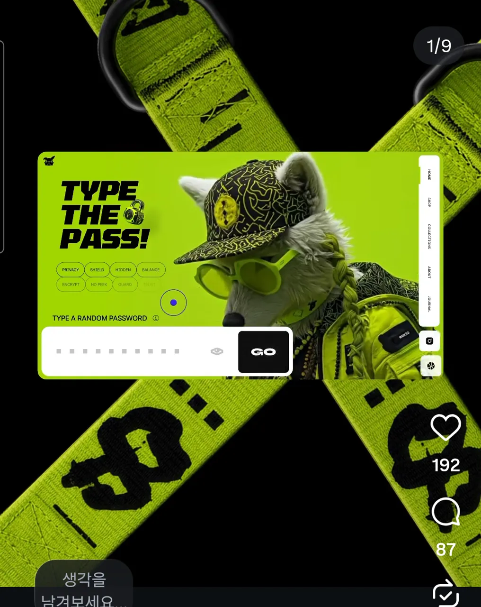 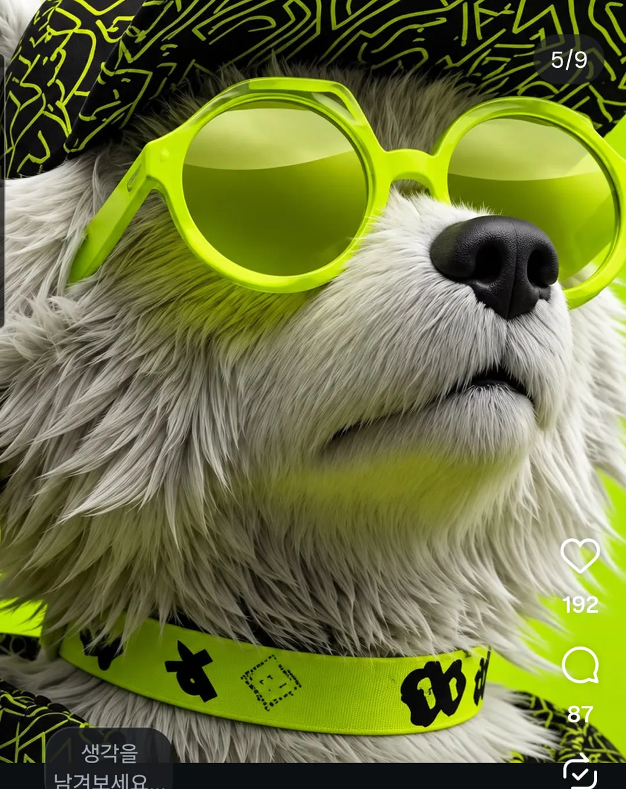

| 항목 | 내용 |
|---|---|
| 주소 | https://www.instagram.com/danielsnows/ |
| 출처 | @danielsnows 카루셀 9장(리포스트) · 가져온 날 2026-10-01 |
| 노션 | `3ebd12f2-3255-8140-88d5-ed4526d12339` |
| 확인 | ⏸ 2026-10-01 · 카루셀 이미지만 봄(라이브 페이지 없음, Dribbble 1쪽에도 없음) |
| 패턴 | `scene-form` |
| 패밀리 | 새 패턴 |
| 기술 흔적 | 캡션 기준: Figma(UI·애니메이션), Google Flow(영상 생성), CapCut(후반), 서체 TOMORROW·Asta Sans. 실제 웹 구현이 아니라 모션 시안이다 |
| 쓰인 작품 | — |

**무엇이 다른가** — 쇼핑몰 첫 화면의 중심을 상품이 아니라 **"아무 비밀번호나 입력하라"는 입력창 하나**로 잡은 콘셉트다. 라임 배경에 "TYPE THE PASS!" 큰 제목, 자물쇠, PRIVACY·SHIELD·HIDDEN 같은 키워드 알약, 점으로 가려지는 입력창과 검은 GO 버튼, 오른쪽 세로 메뉴(HOME·SHOP·COLLECTIONS·ABOUT·JOURNAL)가 있고, 선글라스와 모자를 쓴 늑대 캐릭터가 화면을 채운다. 6번 장은 캐릭터가 눈을 가리는 1440×810 영상 구간이다.

| 입력 | 바뀌는 상태 | 보이는 피드백 | 되돌리기 |
|---|---|---|---|
| 입력창에 글자 입력(시안으로 추정) | 점 마스킹, 눈 아이콘으로 보이기 | 캐릭터가 눈을 가리는 영상(6번 장) | 보지 못함 |
| GO | 보지 못함 | — | — |

**대체 경로** — 시안이라 확인할 것이 없다. 구현한다면 입력창 라벨, 캐릭터 영상의 동작 줄이기 대체, GO 뒤의 상태가 필요하다.

**가져올 것** — 입력 행위 하나를 첫 화면의 놀이로 만드는 구성(입력하면 캐릭터가 반응한다). 강한 단색 배경 + 검정 대비 + 키워드 알약으로 정보량을 줄이는 배치

**안 가져올 것** — 브랜드 캐릭터·라임 스트랩 외형, 유료 템플릿(Figma for Motion) 내용, 아무 의미 없는 비밀번호 입력을 진짜 보안 화면처럼 보이게 하는 문구

**우리 레이어로 옮기면** — `배경`(단색·장식 스트랩 이미지) · `제목`(문구·서체·크기) · `키워드 알약`(목록·배치) · `입력 카드`(라벨·마스킹·버튼 문구) · `반응 캐릭터`(입력 중·완료 상태별 영상이나 이미지, 동작 줄이기 정지 프레임) · `세로 메뉴`(항목).

**확인 한계** — 9장 중 1·5번 장을 크게 봤고 나머지는 노션 요약과 축소본으로만 봤다. 영상 구간 움직임은 보지 못했다. 같은 작업의 라이브 페이지나 Figma 파일은 찾지 못했다(유료 라이브러리 안에 있다고 캡션이 안내).

### codexr-dashboard · Dashboard V5 — 유리 카드와 라임 강조색의 금융 대시보드 UI

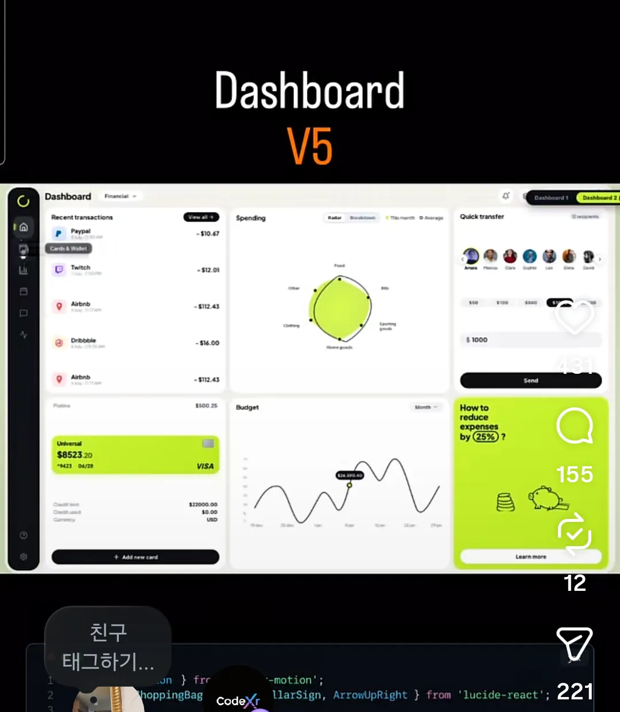 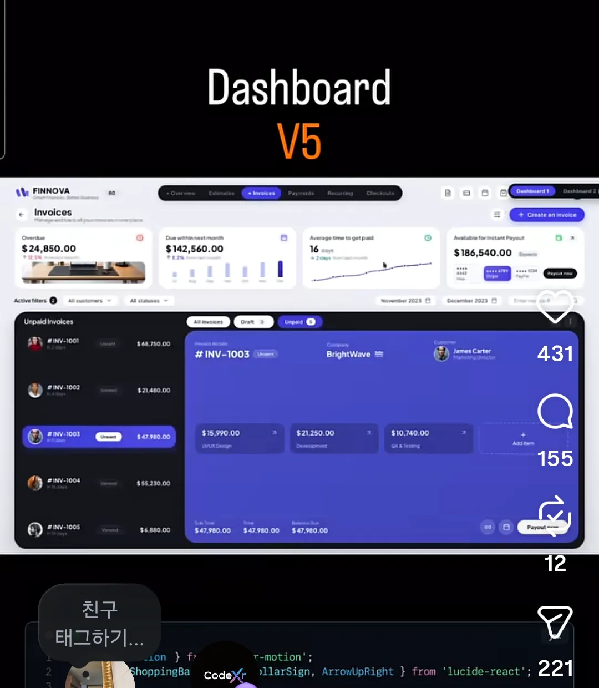

| 항목 | 내용 |
|---|---|
| 주소 | https://topmate.io/code_xr/2321150 |
| 출처 | @code.xr 릴스(리포스트) · 가져온 날 2026-10-01 |
| 노션 | `3ead12f2-3255-8189-902f-d6c2fe7734fb`, `3ead12f2-3255-8125-b1c8-d298948cd3e4`, `3ead12f2-3255-810b-88e3-cdce79b33a1d` |
| 확인 | ⏸ 2026-10-01 · 릴스 캡처만 봄. 주소는 소스코드 유료 판매 페이지(라이브 데모 없음, 사지 않음) |
| 패턴 | `card-dashboard` |
| 패밀리 | 새 패턴 |
| 기술 흔적 | 캡션·판매 페이지 기준 React + CSS + Framer Motion. 캡처 하단 코드에 `<motion.div whileHover={{ y: -5 }} className="glass-card …">`(카드가 호버 때 5px 떠오름) |
| 쓰인 작품 | — |

**무엇이 다른가** — 한 화면에 최근 거래 목록, 방사형 지출 차트, 빠른 이체(아바타·금액 칩·Send), 예산 곡선, 카드 잔액을 카드로 나눠 놓고 **라임색 카드 두 장에만 강조색**을 썼다. 같은 릴에 파란 상세 패널이 있는 인보이스 대시보드(FINNOVA)도 이어 나온다. 사이드바 아이콘에 호버하면 이름표("Cards & Wallet")가 뜬다.

| 입력 | 바뀌는 상태 | 보이는 피드백 | 되돌리기 |
|---|---|---|---|
| 카드 호버(코드로 추정) | 카드 위치 | 카드가 5px 떠오름 | 포인터를 빼면 돌아옴(Framer Motion 기본 동작, 추정) |
| 사이드바 아이콘 호버 | 툴팁 표시 | 이름표 | 포인터 빼기 |
| 인보이스 행 선택(캡처로 추정) | 오른쪽 파란 상세 패널 | 선택 행 강조 | 보지 못함 |

**대체 경로** — 캡처로는 알 수 없다. 캡션은 "완전 반응형"이라고 하나 확인 못 함.

**가져올 것** — 정보 카드 여러 장 중 **행동을 부르는 카드 한두 장에만 강조색**을 주는 위계, 카드 호버 리프트처럼 작은 마이크로 인터랙션을 한 곳(카드 공통)에서 관리하는 구조, 목록 선택 → 옆 상세 패널

**안 가져올 것** — 유료 소스 코드, 데이터 없는 화려한 차트(방사형 차트는 값 읽기가 어렵다), 호버 전용 정보

**우리 레이어로 옮기면** — `사이드바`(아이콘·이름표) · `카드 격자`(열 수·간격·모서리·유리 블러) · `카드 모션`(호버 리프트 거리·길이, 동작 줄이기에서 0) · `강조 카드`(강조색·어떤 카드에 줄지) · `상세 패널`(폭·열림 전환). 카드 안의 숫자·거래 목록은 레이어가 아니라 콘텐츠 데이터다.

**확인 한계** — 영상 녹화가 실패해 같은 릴의 캡처 9장(행 3개)만 봤다. 실제 전환·차트 움직임은 보지 못했다. 판매 페이지는 설명만 읽었다.

### lovart-interactive-assets · Lovart Interactive Assets 스킬 — 정지 이미지를 포인터에 반응하는 웹 에셋으로

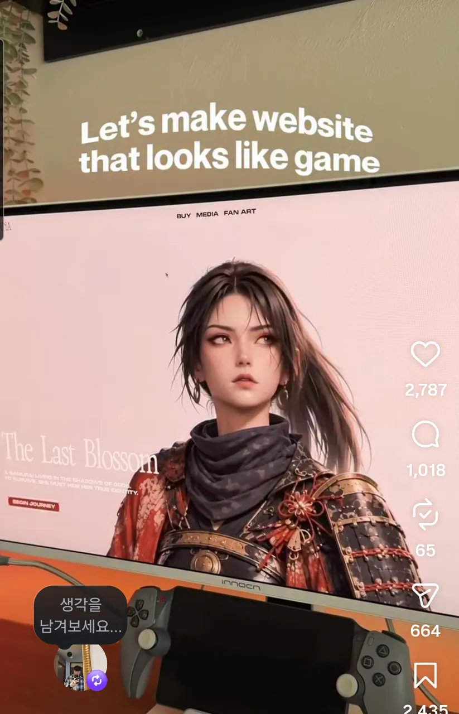 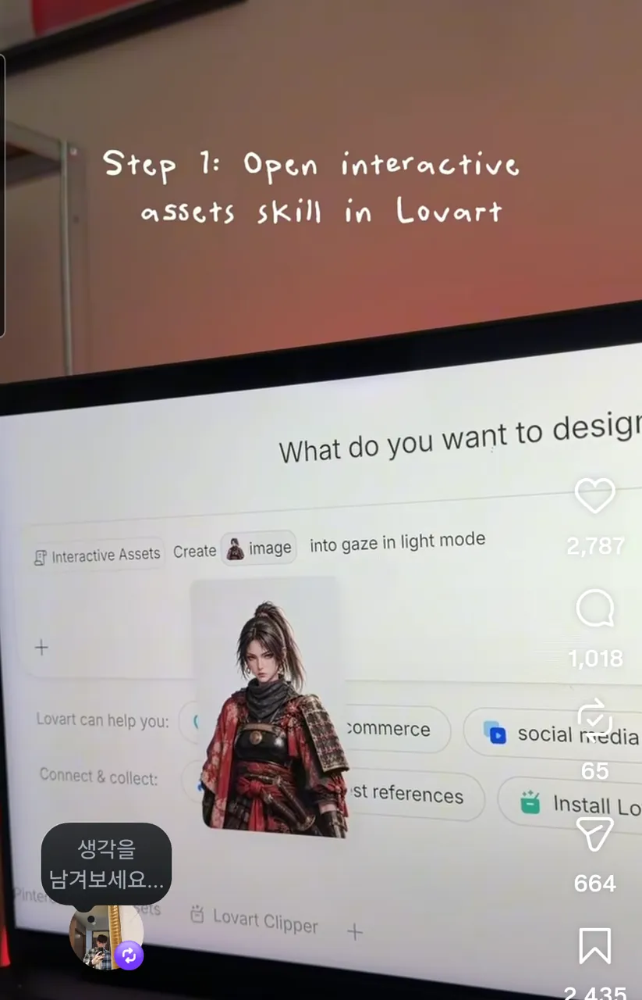

| 항목 | 내용 |
|---|---|
| 주소 | https://www.instagram.com/thedesignely/ |
| 출처 | @thedesignely 릴스(리포스트) · 가져온 날 2026-10-01 |
| 노션 | `3ebd12f2-3255-8193-9d31-cac9cfdc8299` |
| 확인 | ⏸ 2026-10-01 · 릴스 캡처 3장과 15초 녹화만 봄(스킬 공개 페이지 못 찾음, Lovart 공식 문서에 해당 스킬 없음) |
| 패턴 | `pointer-reactive` |
| 패밀리 | 새 패턴 |
| 기술 흔적 | 캡션 기준: AI 디자인 도구 Lovart의 사용자 스킬 "Interactive Assets"가 이미지 트레일·시선 따라오기·360° 회전 오브젝트를 만들고 자동 보정·배경 제거 후 HTML로 내보낸다. 그 HTML을 Framer에 붙인다 |
| 쓰인 작품 | 한복 히어로 (`projects/hanbok-hero`) — 방향 프레임 교체 방식만 가져옴; 2026-10-03 몸은 고정하고 얼굴 칸만 바꾸는 방식(13×2)으로 재작업 |

**무엇이 다른가** — 캐릭터 그림 한 장(배경을 오려 낸 사무라이 여성)을 넣고 "gaze" 효과를 요청하면, **포인터 쪽으로 고개·시선이 돌아가는 웹 에셋**이 만들어진다고 보여 준다. 데모는 "게임처럼 보이는 웹사이트"('The Last Blossom') 첫 화면이다. 같은 방식으로 포인터를 따라 이미지가 꼬리처럼 남는 트레일, 끌어서 돌리는 360° 물체를 만든다고 한다.

| 입력 | 바뀌는 상태 | 보이는 피드백 | 되돌리기 |
|---|---|---|---|
| 포인터 이동(캡션) | 캐릭터 시선 방향 | 고개·눈이 포인터 쪽으로 | 포인터를 빼면 정면으로(추정) |
| 포인터 이동(트레일, 캡션) | 이미지 꼬리 | 지나간 자리에 이미지가 남았다 사라짐 | 시간이 지나면 사라짐(추정) |
| 끌기(360°, 캡션) | 회전 각도 | 물체가 돈다 | 반대로 끌기(추정) |

**대체 경로** — 캡처로는 알 수 없다. 시선·트레일은 포인터 전용 효과라 터치·키보드에서는 정지 그림이 기본이어야 한다.

**가져올 것** — 정지 그림 한 장을 **방향별 프레임 몇 장**(시선 방향)으로 늘려 포인터 위치에 따라 바꾸는 방식. 배경 제거·자동 보정을 에셋 단계에서 끝내고 웹에는 결과만 붙이는 분업

**안 가져올 것** — 생성 도구가 만든 HTML을 검토 없이 붙이기, 캐릭터 외형, 포인터가 없으면 아무 일도 없는 첫 화면

**우리 레이어로 옮기면** — `반응 캐릭터`(방향 프레임 수·반응 범위·따라가는 속도·되돌아오는 시간) · `트레일`(이미지 목록·간격·사라지는 시간·최대 개수) · `회전 물체`(프레임 수·끌기 감도·관성) · `배경`. 모든 반응 강도는 동작 줄이기와 터치에서 0(정지 프레임)이 되도록 둔다.

**확인 한계** — 스킬 자체를 써 보지 않았다(댓글 키워드로 링크를 받는 방식이라 받지 않음). 시선이 실제로 몇 방향으로 바뀌는지, 내보낸 HTML 구조는 보지 못했다. 15초 녹화는 노션에 있으나 저장소에 옮기지 않았다.

### manara-hero · MANARA by Ariana — 풀블리드 건물 영상 위에 CTA 두 개와 수치 바를 올린 랜딩

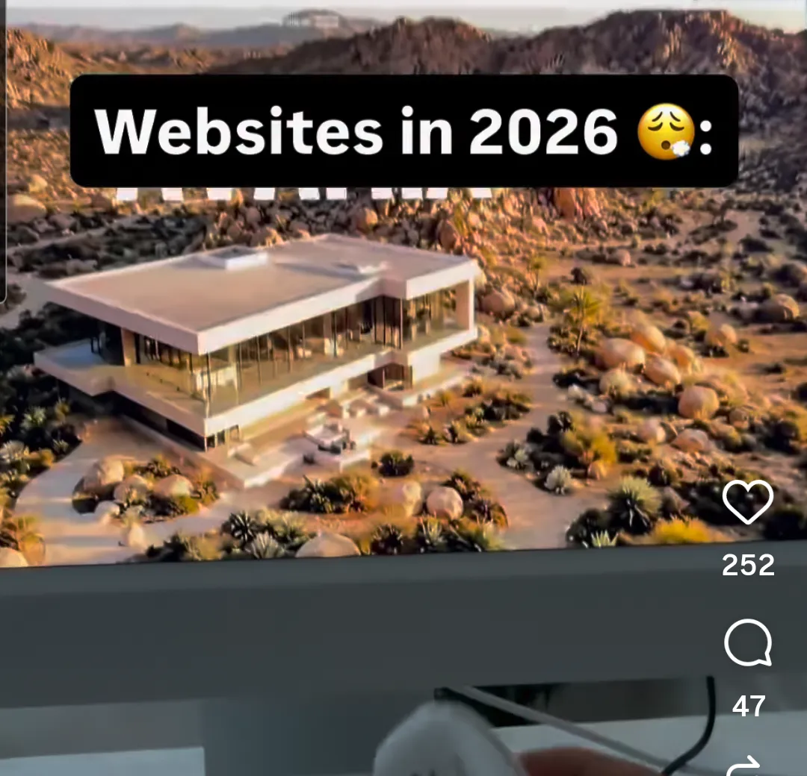 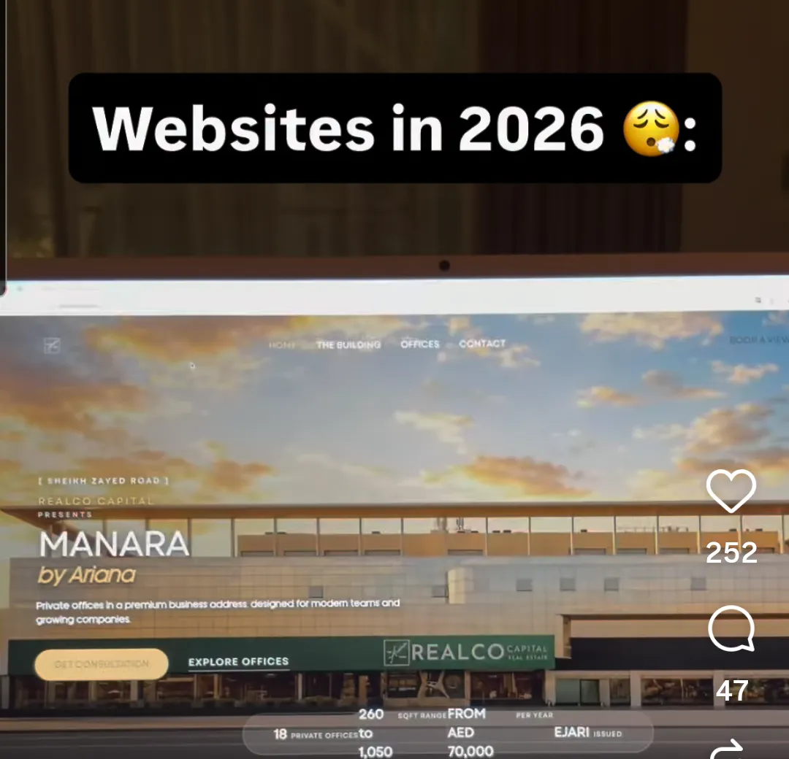

| 항목 | 내용 |
|---|---|
| 주소 | https://www.instagram.com/w.wearebrand/ |
| 출처 | @w.wearebrand 릴스 "Websites in 2026"(리포스트) · 가져온 날 2026-10-01 |
| 노션 | `3ebd12f2-3255-8162-ab51-fed722005d41` |
| 확인 | ⏸ 2026-10-01 · 릴스 캡처만 봄. 에이전시 사이트(wearebrand.io)와 REALCO Capital 사이트(realcocapital.ae)는 열리지만 이 랜딩은 어디에도 없었다 |
| 패턴 | `media-hero` |
| 패밀리 | D |
| 기술 흔적 | 확인 못 함 |
| 쓰인 작품 | — |

**무엇이 다른가** — 첫 장면은 사막 위 현대식 주택을 위에서 도는 항공 영상 히어로이고, 이어서 사무실 임대 랜딩 "MANARA by Ariana"(REALCO Capital presents)가 나온다. 건물 사진을 화면 가득 깔고 얇은 상단 메뉴(THE BUILDING·OFFICES·CONTACT·BOOK A VIEW), 버튼 두 개(GET CONSULTATION·EXPLORE OFFICES), 하단 반투명 **수치 바**(개인 사무실 18실, 260~1,050sqft, 연 AED 70,000부터, EJARI 발급)를 겹쳤다.

| 입력 | 바뀌는 상태 | 보이는 피드백 | 되돌리기 |
|---|---|---|---|
| (입력 없음) | 히어로 영상 재생 | 카메라가 건물 주위를 돈다 | — |
| 마우스 조작(릴스 속 손) | 보지 못함 | — | — |

**대체 경로** — 확인할 수 없다. 영상 히어로라면 포스터 이미지와 동작 줄이기 정지가 필요하다.

**가져올 것** — 결정에 필요한 숫자 네 개를 히어로 하단 바 한 줄에 모으는 배치, 주 버튼·보조 버튼 두 개만 두는 첫 화면

**안 가져올 것** — 부동산 문구·가격, 영상만 크고 읽을 글이 사진 위에 얹혀 대비가 흔들리는 구성

**우리 레이어로 옮기면** — `히어로 미디어`(영상·포스터·어둡게 덮는 정도·동작 줄이기 정지 프레임) · `상단 메뉴`(항목·두께) · `히어로 문구`(제목·부제·서체) · `버튼 쌍`(문구·주/보조 스타일) · `수치 바`(항목 수·배경 불투명도·위치). 수치 값은 콘텐츠 데이터다.

**확인 한계** — "Websites in 2026" 홍보 릴에 잠깐 나온 화면이라 실제 사이트인지 시안인지 모른다. 스크롤·호버 동작은 하나도 보지 못했다.
