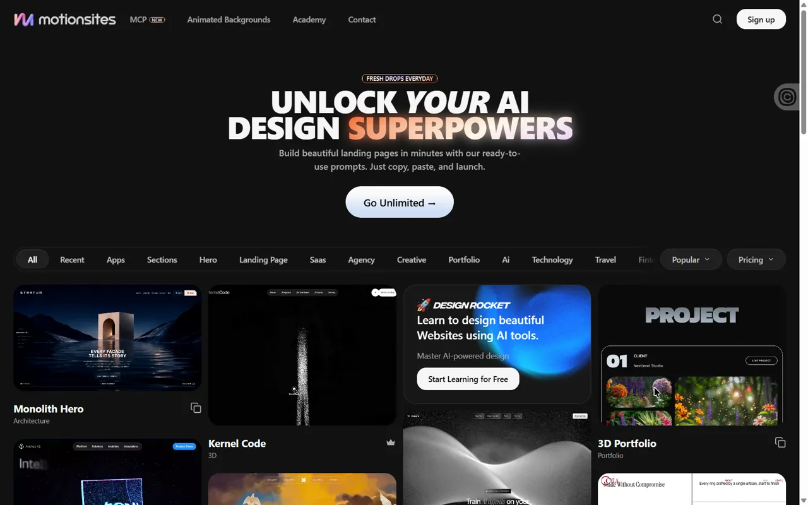
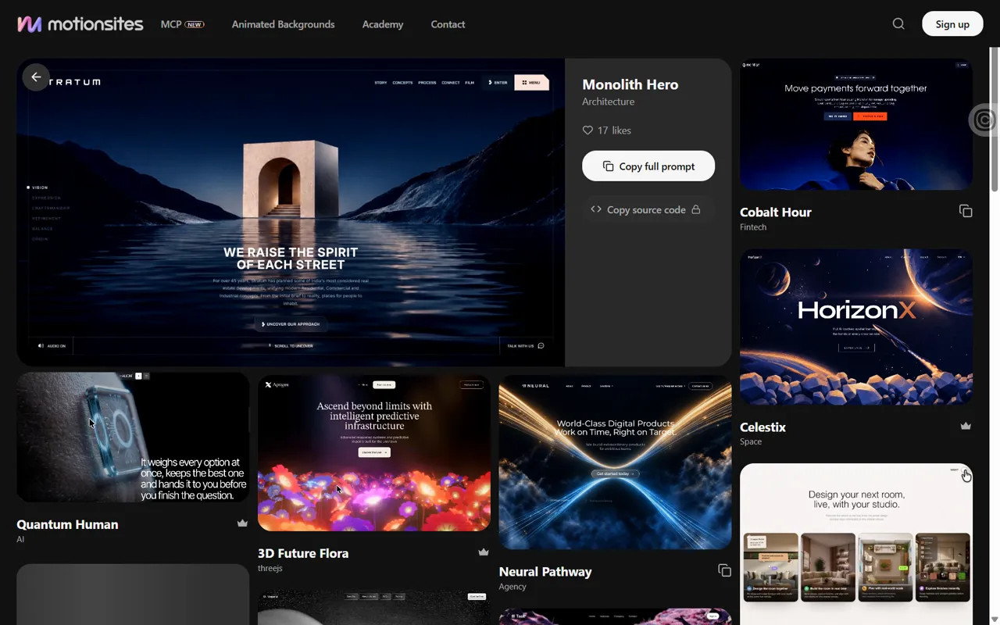

# MotionSites AI — AI 웹 디자인 프롬프트 모음

@viktoroddy가 인스타그램 DM으로 알려 준 [motionsites.ai](https://motionsites.ai/). 히어로·랜딩·SaaS·포트폴리오·3D 화면용 웹 디자인 프롬프트와 움직이는 배경을 판다. **공개 페이지만 본다.** 계정·MCP는 연결하지 않고, 유료 프롬프트 본문은 가져오지 않는다(사용자 결정 2026-09-30).

### motionsites · MotionSites AI — 움직이는 영상 미리보기로 고르는 웹 디자인 프롬프트 모음

 

| 항목 | 내용 |
|---|---|
| 주소 | https://motionsites.ai/ |
| 출처 | @viktoroddy DM · 가져온 날 2026-09-30 |
| 노션 | `3e9d12f2-3255-8115-b9a1-c0346ef28372`, `3e9d12f2-3255-811e-b650-c87820f02b71` |
| 확인 | ✅ 2026-09-30 · 1440px · Aside |
| 패턴 | `video-tile-catalog` |
| 패밀리 | D |
| 기술 흔적 | Vite 번들(`assets/index-*.js`)에 React·Radix UI·토스트(sonner)가 들어 있다(추정). 캔버스·WebGL·three·gsap 없음(`<canvas>` 0개). 미리보기는 전부 `<video autoplay loop muted>`(R2 저장소 mp4·blob). 뷰포트 안에 들어올 때 재생하는 구조(추정, IntersectionObserver 사용). 분석·광고 스크립트 다수 |
| 쓰인 작품 | — |

**무엇이 다른가** — 이 사이트 자체는 움직이는 배경 히어로가 아니라, 히어로·랜딩 화면 **수십 개를 영상 타일로 보여 주는 카탈로그**다. 어두운 배경에 큰 그라디언트 제목과 카테고리 알약(All·Hero·Landing Page·Saas·Agency·Portfolio·3D·Ecommerce 등 20여 개)이 있고, 그 아래 4열 벽돌 배치 타일이 각자 루프 영상으로 계속 움직인다. 타일을 누르면 같은 주소에 `?prompt=<이름>`만 붙고, 큰 영상 미리보기와 이름·분류·좋아요 수가 있는 상세 화면이 덮이며 아래에 비슷한 타일이 이어진다. 프롬프트 본문은 무료 일부만 복사할 수 있고 나머지는 잠겨 있다(복사·잠금 버튼은 누르지 않았다).

| 입력 | 바뀌는 상태 | 보이는 피드백 | 되돌리기 |
|---|---|---|---|
| 카테고리 알약 클릭(Hero) | 선택 알약이 강조되고 "Clear all" 버튼이 생긴다 | 알약 강조·목록 재배치(타일 수는 그대로여서 필터 효과는 확실히 못 봄) | "Clear all" 또는 All |
| 타일 클릭 | 주소에 `?prompt=monolith-hero`, 전체 화면 상세(`position: fixed`) | 큰 영상 미리보기, 좌상단 ← 버튼, 좋아요 수, 프롬프트·소스 코드 버튼(소스는 잠금) | Escape(실제로 닫힘, 주소 복귀) · 브라우저 뒤로 가기(닫힘) · ← 버튼 |
| 스크롤 | 화면에 들어온 타일 영상만 재생 | 나머지는 멈춘 포스터 | 스크롤 |

**대체 경로** — 키보드: Tab을 12번 눌러 보니 각 타일의 "복사/잠금"·좋아요 버튼만 잡히고 **타일 본체(미리보기 열기)에는 포커스가 가지 않는다**. 상세 화면은 Escape로 닫힌다. 터치: `(hover: none) and (pointer: coarse)`·`(max-width: 600px)` 규칙이 있다(스타일시트에서 읽음, 390px 실측 못 함). 동작 줄이기: 스타일시트에 `prefers-reduced-motion` 규칙 1곳이 있으나 영상 자동 재생을 멈추는지는 확인 못 함. 로딩: 첫 내용(FCP)까지 약 3.6초, load 이벤트 약 8.8초(연결·캐시에 따라 다름). 로딩 화면은 없다.

**가져올 것** — 공개 미리보기에서 보이는 첫 화면 구성·배경 모션·타이포 조합을 우리 요구로 다시 적는 방식. 결과물을 정지 이미지가 아니라 **짧은 루프 영상 타일**로 훑게 하는 고르기 화면(뷰포트에 들어올 때만 재생해 부담을 줄이는 방식 포함). 주소 파라미터로 상세를 여는 구조(뒤로 가기·공유가 된다)

**안 가져올 것** — 유료 프롬프트 본문, 데모 외형 그대로의 복제, 타일 본체가 키보드로 열리지 않는 구성, 전 타일 영상 동시 재생 같은 무거운 첫 화면

**우리 레이어로 옮기면** — `타일 격자`(열 수·간격·재생 조건) · `영상 타일`(포스터·루프·재생 시작 위치) · `분류 알약`(항목·선택 강조) · `상세 덮개`(닫기 키·주소 파라미터). 벽돌 배치의 열 수와 타일 종횡비는 구조상 고정일 수 있어 `/* layer-fixed: 영상 원본 비율 */`로 이유를 적는다.

**확인 한계** — 1440px만 봤다(Aside 창 크기 고정). 390px 배치·터치 동작은 스타일시트 규칙만 읽었고 동작 줄이기는 흉내 내지 못했다. 로그인·가입·Copy Prompt·MCP·잠금 버튼은 누르지 않아 프롬프트 본문과 유료 화면은 보지 못했다. 카테고리 필터가 목록을 실제로 줄이는지는 DOM 개수로는 구분되지 않았다. 배경 전용 공개 페이지(/backgrounds)는 열어 잠금 링크 목록과 영상 46개(처음 로딩 때 재생 0개)까지만 확인했다. 무료·유료 프롬프트 개수와 가격은 공개 페이지에서 확인하지 못했다(노션 카드의 2026-09 조사 당시 안내: 무료 계정 3개, 유료 500개 이상 — 쓸 때 다시 확인). 사이트의 데모 썸네일이 들어 있어 캡처는 내부 참고용이다.
