# 노트폴리오 — 인터랙티브 포트폴리오 6곳

노트폴리오(@notefolio)가 인스타그램 DM으로 보내 준 큐레이션 "포트폴리오 사이트 아이디어, 싹 다 모아왔어요"(stunningkr.notion.site)에서 가져왔다. 큐레이션은 사이트마다 한 줄 소개뿐이라 동작은 직접 열어 보고 적는다.

### bychudy · bychudy — 맥 데스크톱처럼 꾸민 음악 디자인 포트폴리오

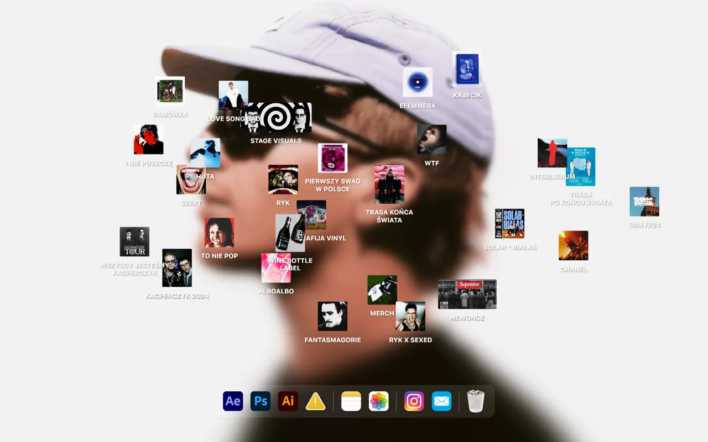 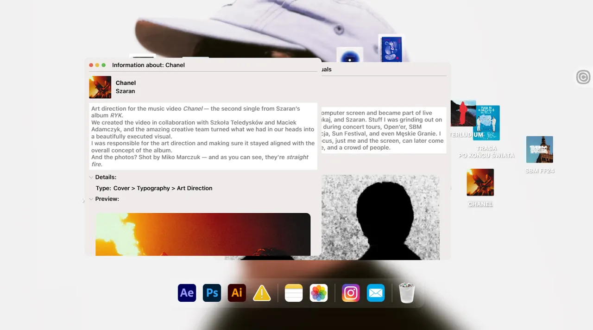

| 항목 | 내용 |
|---|---|
| 주소 | https://www.bychudy.com/ |
| 출처 | @notefolio 큐레이션 · 가져온 날 2026-09-30 |
| 노션 | `3ead12f2-3255-81b6-99ab-daa10d99e0a4`, `3ead12f2-3255-8141-848c-c93822c5554a` |
| 확인 | ✅ 2026-09-30 · 1440px · Aside |
| 패턴 | `desktop-os` |
| 패밀리 | 새 패턴 |
| 기술 흔적 | Framer로 만든 사이트(`<meta generator="Framer …">`, `framerusercontent.com` 스크립트). `<canvas>`·three 없음, 창·아이콘은 전부 DOM(`tabindex=0` 아이콘, `role=dialog` 툴팁). 반응형 구간은 Framer 기본 세 칸(≥1200 · 810~1199 · ≤809) |
| 쓰인 작품 | — |

**무엇이 다른가** — 흐린 인물 사진을 바탕화면으로 깔고, 작업물 27개를 **앨범 커버 크기의 파일 아이콘**으로 흩어 놓았다(이름표는 아이콘 아래 큰 글자). 하단에는 앱 독(After Effects·Photoshop·Illustrator·메모·사진·Instagram·Mail·휴지통)이 있다. 아이콘을 **한 번 누르면** 맥의 "정보 가져오기" 같은 창("Information about: …")이 열려 제목·아티스트·설명·분류·미리보기(이미지·영상)를 보여 준다. 창은 여러 개 동시에 열리고 제목 줄을 끌어 옮길 수 있으며, 창마다 위치가 다르게 열린다. 작업 설명은 이미지가 아니라 DOM 텍스트라 접근성 트리에 그대로 읽힌다.

| 입력 | 바뀌는 상태 | 보이는 피드백 | 되돌리기 |
|---|---|---|---|
| 아이콘 클릭(Stage Visuals, Chanel) | "Information about: …" 창이 열린다 | 창이 겹쳐 쌓이고 새 창이 앞에 온다 | 창 왼쪽 위 빨간 점 클릭(애니메이션 뒤 약 1.2초 만에 DOM에서 사라짐) |
| 창 제목 줄 끌기 | 창 위치만 바뀐다(200,60px 끌어 그대로 이동) | 창이 손을 따라 움직이고 창 안쪽은 스크롤된다 | 다시 끌기 |
| 뒤쪽 창 클릭 | 앞으로 오지 않았다(관찰 1회, 새로 연 창이 항상 앞으로 보임) | — | — |
| 아이콘 끌기 | 위치가 바뀌지 않는다(두 번 시도, 마우스를 놓아도 창이 열리지 않음) | 없음 | — |
| 독 아이콘 호버 | 툴팁("CV" 등)이 뜬다. Instagram·Mail은 새 탭 링크 | 라벨 | — |

**대체 경로** — 키보드: 아이콘이 `tabindex=0`이라 Tab으로 차례로 잡히고 **Enter로 창이 열린다**(Enter로 열림 확인). 그러나 **Escape는 창을 닫지 않았고**, 닫기는 마우스로 빨간 점을 눌러야 했다(점에 tabindex·role 없음). 터치/모바일: `(max-width: 809.98px)` 규칙이 있어 폰 전용 배치가 따로 있는 듯하나(추정) 390px은 실측하지 못했다. 동작 줄이기: 스타일시트 규칙 없음, 흉내 내지 못해 확인 못 함. 로딩: 이 세션에서 **처음 열 때 약 31초**(FCP 30.5초, 이미지 37장·리소스 51개, 약 2.3MB)였고, 캐시된 재로딩은 FCP 0.3초. 네트워크 상태에 따라 크게 다를 수 있다.

**가져올 것** — 작업물을 창·아이콘으로 여는 익숙한 조작. 아이콘 흩뿌리기 + 이름표를 크게 두는 배치, 여러 창을 동시에 열고 제목 줄로 옮기는 자유도, 창 내용을 텍스트로 두는 구조(읽기·검색 가능)

**안 가져올 것** — 데스크톱 화면을 그대로 흉내 낸 외형(맥 신호등 점·독 아이콘 모양), 모바일에서도 창을 겹치는 배치, 마우스로만 닫히는 창(Escape 없음), 처음 열 때 수십 초 걸리는 큰 이미지 묶음

**우리 레이어로 옮기면** — `배경화면`(이미지·블러·불투명도) · `아이콘 그리드`(개수·흩어짐 난수·아이콘 크기·이름표 크기) · `창 프레임`(폭·모서리·그림자·열리는 위치 규칙·닫기 키) · `창 내용`(텍스트 슬롯·미리보기 미디어) · `독`(항목·호버 라벨·링크). 창 열림 위치를 매번 다르게 하는 규칙은 `windowOffset` 파라미터로 둔다.

**확인 한계** — 1440px 창에서만 봤고(Aside 창 크기 고정, 조작 구간은 창 폭이 약 1330px로 바뀌어 있었음), 390px 배치·터치 대체는 스타일시트 규칙만 읽었다. 동작 줄이기는 흉내 내지 못했다. 독의 Ae·Ps·Ai·사진·메모 항목을 눌러도 창은 열리지 않았고(툴팁만) 그 의미는 확인 못 함. 창의 노란·초록 점, 뒤쪽 창 클릭 시 앞으로 오는지는 1회 시도만 했다. 빨간 점으로 닫은 횟수는 3회이며 Escape로는 닫히지 않았다. 사진·앨범 이미지는 저작물이라 캡처는 내부 참고용이다.

### bruno-simon · Bruno Simon — 운전 게임으로 둘러보는 포트폴리오

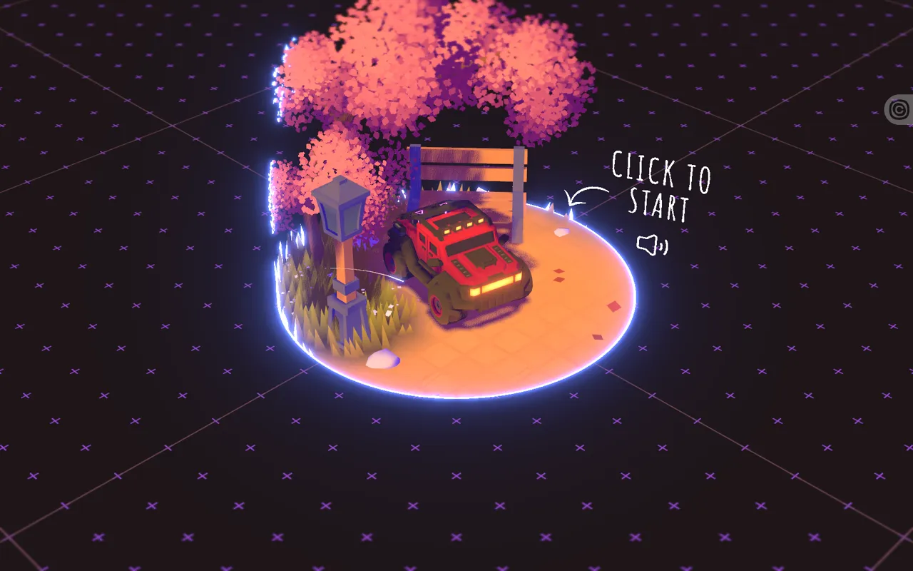 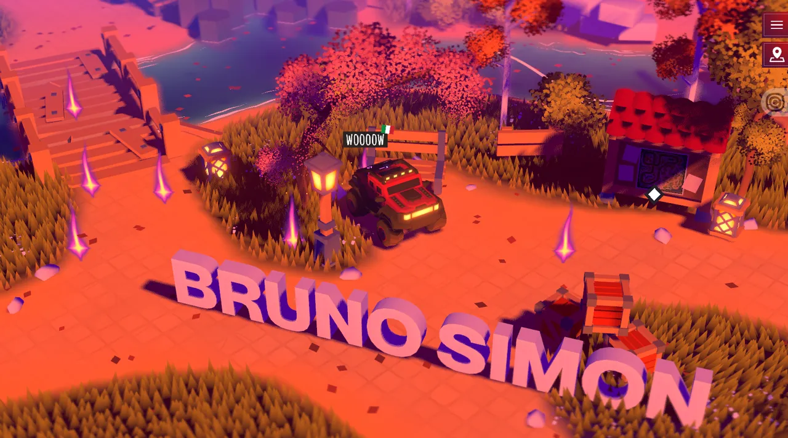

| 항목 | 내용 |
|---|---|
| 주소 | https://bruno-simon.com/ |
| 출처 | @notefolio 큐레이션 · 가져온 날 2026-09-30 |
| 노션 | `3ead12f2-3255-81b6-99ab-daa10d99e0a4`, `3ead12f2-3255-8141-848c-c93822c5554a` |
| 확인 | ✅ 2026-09-30 · 1440px · Aside |
| 패턴 | `drive-to-explore` |
| 패밀리 | A' |
| 기술 흔적 | `<canvas>` 1개가 화면 전체를 채우고 접근성 트리에는 canvas와 버튼 2개만 잡힌다. 스크립트는 번들 1개(약 4.9MB)와 분석 태그뿐. 번들에 three.js WebGPU 렌더러 코드(옵션 창에 "Renderer WebGPU" 표시), Rapier 물리, GSAP, Howler(소리)가 들어 있다. 다른 방문자 차가 보이고 말풍선(whisper)을 남기는 온라인 서버가 있다("Server connected") |
| 쓰인 작품 | JOOHO LAB 공간 갤러리 · 2026-10-01 · 초기화와 DOM 작품 목록 대체 경로; 2026-10-02 건물 정교화에서도 복귀·목록 경로 유지; 2026-10-03 별도 작업 동네 복원: 초기화/목록 대체/공간 탐색, 운전·이미지·브랜드는 옮기지 않음; 2026-10-05 전체 작품 공간 연결: 기존 복귀·DOM 목록·키보드 대체 재사용; 같은 날 동네 이동 보완: 거리 기반 탐색·처음으로 복귀·목록 대체 유지; 같은 날 전시관 자연화: 거리 비례 이동과 전환 취소/복귀·목록 대체를 stage/controls로 재설계 |

**무엇이 다른가** — 첫 화면은 빛나는 원 링 로더 → 나무 아래 놓인 빨간 차와 "CLICK TO START" 손글씨 안내다. 누르면 카메라가 날아가 섬 전체가 열리고, **차를 몰아 구역을 돌며** 소개·작업을 만난다. 바닥에 놓인 큰 입체 글자는 물리 오브젝트라 차로 부딪치면 흩어지고, 차가 뒤집히면 노란 불꽃 덩어리 효과가 터진다. 내용은 대부분 3D 월드(canvas) 안에 있어 DOM 텍스트로는 읽히지 않는다. 메뉴·지도·옵션만 DOM이다.

| 입력 | 바뀌는 상태 | 보이는 피드백 | 되돌리기 |
|---|---|---|---|
| 화면 클릭("Click to start") | 게임 시작, 카메라가 차 쪽으로 이동 | 입체 글자가 나타나고 "Server connected" 알림이 뜬다 | 없음(새로고침) |
| 방향키·WASD(↑ 2초, W 1.5초 + D 0.8초) | 차가 앞으로 가고 방향이 바뀐다 | 차가 글자에 부딪혀 글자가 흩어지고 차가 뒤집힘, 이후 물가를 지나 업적 알림("I'M GOING ON AN ADVENTURE!" 1/1) | R 키(Respawn, 눌러서 차가 제자리로 돌아옴) 또는 메뉴의 "I'm stuck! Respawn" |
| 메뉴(햄버거) 열기 | 홈·옵션·조작·업적·서킷·속삭임·제작 뒷이야기 탭 | 소개 글과 그림이 든 패널 | Escape(열고 닫는 토글) 또는 X 버튼. 열린 상태에서 Tab을 누르면 닫힌다 |
| 지도(M 키·지도 버튼) | 섬 전체 위에서 본 지도와 흰 마름모 표시 + 내 차 위치 | 지도 패널 | Escape. 마름모를 눌러도 이동하지 않았다 |

**대체 경로** — 키보드: 이동은 WASD·방향키·Shift(부스트)·Space(점프)·Enter(상호작용)·M(지도)·R(리스폰)·L(음소거)·H(경적)으로 다 키보드로 된다. 다만 **일반 Tab 탐색은 성립하지 않는다** — 게임 중 Tab을 누르면 메뉴가 닫힌 채로 포커스가 메뉴 버튼 하나에만 머물렀고, 메뉴를 연 뒤에야 탭 버튼으로 이동했다. 작업 목록으로 바로 가는 경로: **못 찾았다** — 메뉴에 작업 목록이 없고 지도도 위치 표시만 한다. 터치/모바일: 조작 탭에 "한 손가락 = 차 이동, 두 손가락 = 카메라·줌, 차를 탭 = 점프" 안내가 있고 패드 조작도 있다. 390px은 실측 못 했고, 스타일시트에 `max-width: 520px·440px·360px`·`orientation: portrait` 규칙이 있다(추정: 폰 화면 대응). 동작 줄이기: `prefers-reduced-motion` 규칙·코드 모두 못 찾았다(스타일시트 1개는 열람이 막혀 확인 못 함). 로딩: 이 세션 첫 열기에서 약 5초에 링 로더가 떴고 약 20초 안에 "Click to start"가 나왔다(대략, 번들 4.9MB·캐시 없음).

**가져올 것** — 공간을 돌아다니며 작업을 발견하는 탐색. "Click to start" 한 번으로 소리·시작을 묶고 카메라를 날려 주는 입장 연출, 메뉴에 조작 안내(키보드·터치·패드 탭)를 미리 두는 것, 길을 잃었을 때 쓰는 "I'm stuck! Respawn"·리셋·품질 설정, 지도로 위치를 보여 주는 보조 화면

**안 가져올 것** — 작업 목록이 월드 안에만 있어 운전하지 않으면 못 보는 구조(DOM에 텍스트가 없어 읽기·검색도 어렵다), 차가 뒤집혀 길이 막히는 물리 조작을 필수로 두는 것, 약 5MB 번들과 WebGPU에 기대는 로딩, 방문자 차가 다 보이는 온라인 서버

**우리 레이어로 옮기면** — `월드`(지형·오브젝트 배치·시간대 색) · `플레이어`(차 모델·속도·부스트·점프 힘) · `카메라`(거리·각도·입장 연출 길이) · `안내 표지`(문구·아이콘·위치) · `HUD`(메뉴·지도 버튼·알림 위치) · `목록 대체 화면`(작업을 DOM 목록으로 보여 주고 차 위치로 이동). 마지막 항목은 이 사이트에 없으므로 우리가 새로 채워 넣는다. 조작 키와 터치 안내 문구는 `controls` 파라미터로 둔다.

**확인 한계** — 섬 안의 실제 작업 구역(프로젝트 전시)까지는 가지 않았다. 첫 화면·시작·운전·메뉴·지도까지만 봤다. 조작 중 창 크기가 1440px과 1330px 사이에서 바뀌었고(캡처 `desktop`은 1440px, `state`는 1330px 폭), 390px 배치·터치 조작은 스타일시트·조작 탭 글만 읽었다. 동작 줄이기는 흉내 내지 못했다. 지도의 마름모 표시는 1곳만 눌러 봤다. 사이트 내용은 저작물이라 캡처는 내부 참고용이다.

### annamills · Anna Mills — 엽서처럼 꾸민 디자이너·일러스트레이터 포트폴리오

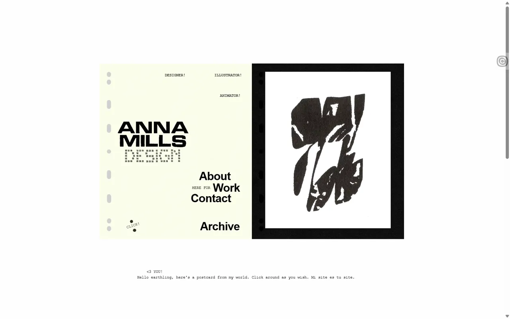 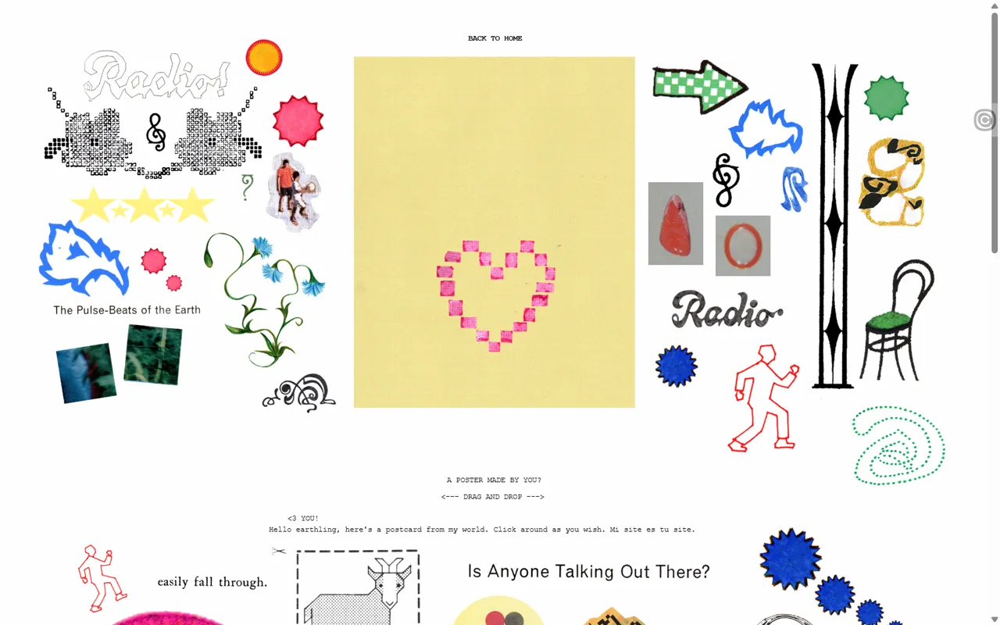

| 항목 | 내용 |
|---|---|
| 주소 | https://annamills.xyz/ |
| 출처 | @notefolio 큐레이션 · 가져온 날 2026-09-30 |
| 노션 | `3ead12f2-3255-81b6-99ab-daa10d99e0a4`, `3ead12f2-3255-8141-848c-c93822c5554a` |
| 확인 | ✅ 2026-09-30 · 1440px · Aside |
| 패턴 | `moodboard-canvas` |
| 패밀리 | 새 패턴 |
| 기술 흔적 | Readymag로 만든 사이트(`<meta generator="Readymag">`, `st-p.rmcdn1.net/…/viewer.js`, hls.js). 주소가 `/1/`~`/5/` 페이지로 나뉜다. 화면은 `.content-scroll-wrapper` 안에서 스크롤되고(문서 자체는 스크롤되지 않음) 스티커는 ``(`rmwidget widget-picture … drag`)다. `<canvas>` 1개(로고 글자 모핑용으로 추정), 오른쪽 필름 칸은 `<video>` |
| 쓰인 작품 | JOOHO LAB · 2026-10-03 전시 대표 이미지: 그림 중심의 소개와 원본 종횡비 유지만 참고; 사이트 이미지·브랜드·격자 동작은 옮기지 않음; 2026-10-05 전체 작품 공간 연결: 필름 스트립과 텍스트 작품 선택을 기존 rail/shell로 재사용; 같은 날 전시관 자연화: 작품을 강조하는 얇은 받침/액자와 원본 비율 보존을 stage로 적용, 무드보드 편집/원작 시각물은 가져오지 않음 |

**무엇이 다른가** — 큐레이션 소개("무드보드")와 달리 **첫 화면은 무드보드가 아니라 엽서 한 장**이다. 왼쪽 종이 카드(로고·About·Work·Contact·Archive 글자 메뉴)와 오른쪽 **필름 스트립 영상**(작업 사진이 자동으로 이어진다)이 놓이고, 스크롤하면 로고 글자가 일그러지듯 모양이 바뀌고 "<3 YOU!" 문구가 옆으로 흐른다. 무드보드 조작은 첫 화면 **"CLICK!" 링크 → `/5/` "A POSTER MADE BY YOU?"** 에 있다. 노란 빈 포스터 둘레에 스티커·손그림·글자 조각 수십 개가 흩어져 있고, **끌어다 포스터 위에 놓아** 나만의 포스터를 만든다. Archive(`/4/`)는 포스터·영상을 타일로 깐 벽, About(`/2/`)은 고객사·강연 목록이 DOM 텍스트로 있다.

| 입력 | 바뀌는 상태 | 보이는 피드백 | 되돌리기 |
|---|---|---|---|
| "CLICK!" 누르기 | `/5/`로 이동, 포스터 놀이 화면 | 스티커 흩어진 흰 배경과 빈 포스터, 안내 "DRAG AND DROP" | "BACK TO HOME" 링크 |
| 스티커(분홍 하트) 끌어 포스터 위에 놓기 | 스티커가 원래 자리에서 포스터 위로 옮겨진다(복제 아님) | 손을 따라 움직이고 놓은 자리에 남는다 | 다시 끌면 제자리 근처로 돌릴 수 있고 다른 스티커 위에 겹쳐 놓였다. 전체 초기화 버튼은 못 찾았다 |
| 스크롤(휠, 홈 화면) | 로고 글자 모양이 바뀌고 문구가 이동한다 | 글자 모핑·문구 이동 | 반대로 스크롤 |
| 글자 메뉴 호버 | 글자가 노란색으로 바뀐다 | 색 변화 | 마우스를 뗀다 |
| About·Archive 누르기 | `/2/`·`/4/`로 이동 | About은 글 목록, Archive는 타일 벽 | 주소가 바뀌므로 브라우저 뒤로 가기 |

**대체 경로** — 키보드: Tab을 10번 눌러도 포커스가 문서 body에 머물러 메뉴 글자·스티커에 닿지 않았다(Readymag 기본 구조, 스티커 끌기는 마우스 전용으로 보인다). Escape 관련 조작은 없다. 터치/모바일: 뷰포트 메타와 `isphone` 같은 기기 구분 클래스, 이미지에 `fixMobileImageStretch` 클래스가 있어 Readymag가 폰용 배치를 따로 제공하는 것으로 보이나(추정) 390px은 실측하지 못했다. 동작 줄이기: 스타일시트·뷰어 스크립트 모두 `prefers-reduced-motion` 흔적이 없고(읽을 수 있는 범위), 자동 재생 영상과 글자 모핑을 끄는 경로도 못 찾았다. 접근성: 스티커 이미지 104장 모두 `alt`가 비어 있다. 로딩: 첫 열기 후 약 3.5초에 첫 화면이 보였다.

**가져올 것** — 스티커를 끌어 포스터를 만드는 **참여형 무드보드**(흩어 놓은 조각을 끌어 빈 판 위에 올리는 조작과 "DRAG AND DROP" 한 줄 안내), 첫 화면에서 글자만으로 메뉴를 세우는 간결함, 작업을 필름 스트립 영상으로 보여 주는 칸, 스크롤에 따라 로고 글자가 변하는 작은 모션

**안 가져올 것** — 키보드·스크린리더로는 스티커에 닿지 않고 alt가 없는 구조, 초기화·완성본 저장 없이 끌기만 있는 놀이, 메뉴 글자가 이미지처럼 떠서 클릭 영역이 작은 배치, 끌 수 없는 사람을 위한 대체 경로(목록형)가 없는 무드보드

**우리 레이어로 옮기면** — `캔버스 배경`(빈 포스터 크기·색·종이 질감) · `스티커 풀`(스티커 이미지 목록·시작 위치·회전·크기) · `끌기 동작`(드롭 허용 범위·겹침 순서·놓을 때 효과) · `안내 문구`(DRAG AND DROP 문구·위치) · `홈 카드`(로고·글자 메뉴·필름 영상) · `로고 모션`(스크롤 반응 강도). 드롭 결과 저장은 이 사이트에 없으므로 별도 기능으로 본다. 스티커마다 `alt` 슬롯을 둔다.

**확인 한계** — 작업 하나를 열고 닫는 조작은 확인하지 못했다. Archive 타일 한 곳을 눌렀더니 홈으로 돌아갔고(가운데 카드의 링크를 누른 것으로 추정), 작업 상세 창은 찾지 못했다. 첫 화면의 Work 글자는 눌러도 주소가 바뀌지 않았다(`/1/`이 홈 자체로 보임, 확인 못 함). 처음 메뉴 클릭 몇 번은 반응이 없다가 다시 누르니 이동했다(원인 미확인). 스티커는 하트 하나만 끌어 봤고 나머지와 겹침 순서는 확인하지 못했다. Contact(`/3/`)는 열지 않았다. 스크롤을 세게 하면 스크린샷이 시간 초과로 실패해 다시 찍었다. 390px 배치·터치 조작은 실측하지 못했고 동작 줄이기도 흉내 내지 못했다. 사이트 이미지는 저작물이라 캡처는 내부 참고용이다. 사이트에는 Readymag 템플릿 판매 링크(유료)가 있으나 누르지 않았다.

### clarakirkpatrick · Clara Kirkpatrick — 낙서풍 일러스트 포트폴리오

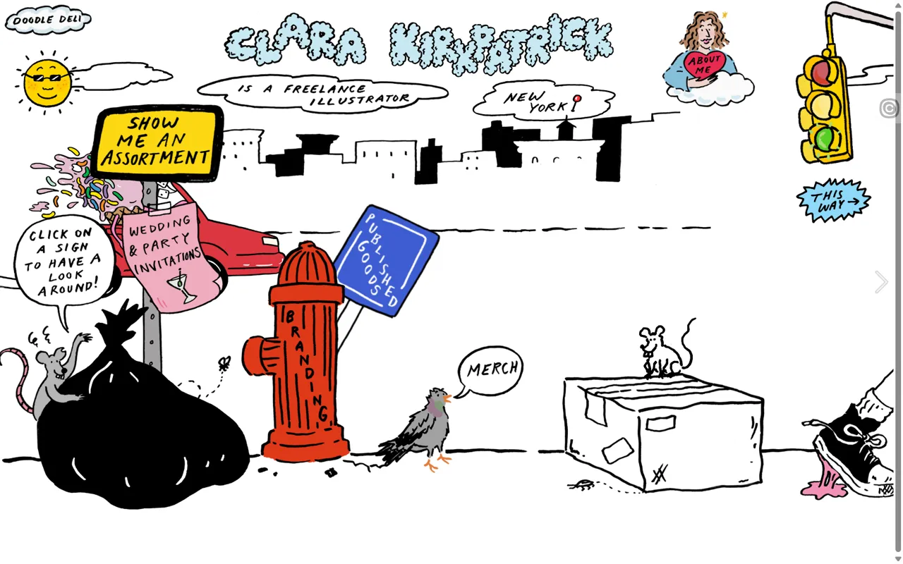 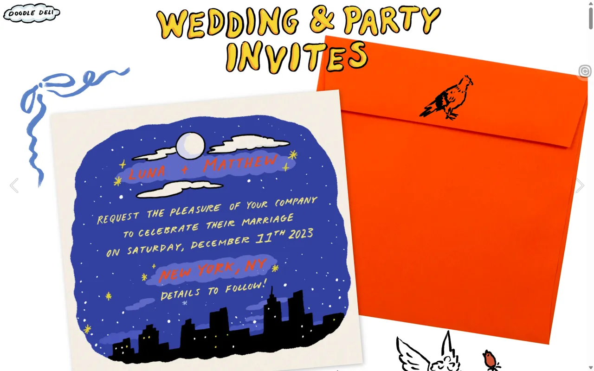

| 항목 | 내용 |
|---|---|
| 주소 | https://clarakirkpatrick.com/ |
| 출처 | @notefolio 큐레이션 · 가져온 날 2026-09-30 |
| 노션 | `3ead12f2-3255-81b6-99ab-daa10d99e0a4`, `3ead12f2-3255-8141-848c-c93822c5554a` |
| 확인 | ✅ 2026-09-30 · 1440px · Aside |
| 패턴 | `hand-drawn` |
| 패밀리 | 새 패턴 |
| 기술 흔적 | Readymag로 만든 사이트(`<meta generator="Readymag">`, `st-p.rmcdn1.net/…/viewer.js` 하나). `<canvas>` 0개. 화면 요소는 전부 `rmwidget widget-picture` 그림 조각(``)이고 호버 애니메이션 표시(`has-onhover-animation`)가 붙은 조각은 홈에서 1개다. 주소는 `/1/`~`/7/` 페이지로 나뉘며 페이지는 가로로 이어져 옆으로 넘어간다(추정) |
| 쓰인 작품 | JOOHO LAB 작업 동네 · 2026-10-03 · 기존 집 그림에 이름 있는 DOM 링크를 대응하고 키보드·취소·목록 대체 제공; 원작 그림·폰트·소품 모션은 옮기지 않음; 2026-10-05 선비 한옥에도 독립 그림 링크·DOM 이름표·키보드 대체 적용 |

**무엇이 다른가** — 첫 화면이 **길거리 한 장면을 통째로 그린 낙서**다. 제목(이름)·말풍선·표지판·소화전에 새긴 "BRANDING"·비둘기의 "MERCH" 말풍선이 모두 그림이고, 카테고리 메뉴는 따로 없이 **그림 속 물건이 곧 링크**다. 쥐가 든 말풍선 "CLICK ON A SIGN TO HAVE A LOOK AROUND!"가 사용법을 알려 준다. 핑크 청첩장 표지판은 `/4/`(청첩장 작업), 소화전·파란 표지판은 `/5/`, 비둘기는 `/6/`, 하트 "ABOUT ME"는 `/7/`, 나머지 그림 일부(아이스크림·신호등·쥐·"THIS WAY")는 `/2/`로 간다. **문구는 텍스트가 아니라 그림이다**: 본문 텍스트 위젯이 0개이고, 화면 글자 대부분이 `alt` 없는 이미지다(이미지 499장 중 `alt`가 있는 것은 1장). 작품 페이지(`/4/`)도 제목 "WEDDING & PARTY INVITES"가 그림이며 본문 텍스트는 비어 있고, 작품 사진을 넘기는 "Previous/Next slide" 버튼만 접근성 트리에 잡힌다.

| 입력 | 바뀌는 상태 | 보이는 피드백 | 되돌리기 |
|---|---|---|---|
| 핑크 청첩장 표지판 위에 마우스 올리기 | 뒤의 빨간 차가 왼쪽으로 빠져나간다(`has-onhover-animation`) | 그림이 움직이는 작은 장난 | 마우스를 2.5초 이상 뗐는데도 차는 돌아오지 않았다(1회 관찰, 새로 고침·페이지 이동 후 복귀는 못 봄) |
| 같은 표지판 클릭 | `/4/`(주소 변경, 약 2초), 주황 봉투와 청첩장 그림이 나오는 작품 페이지 | 화면이 통째로 바뀌고 큰 제목이 손글씨 그림으로 뜬다 | 브라우저 뒤로 가기(성공), 좌상단 "DOODLE DELI" 로고 링크(`/1/`). Escape는 반응 없음 |
| 오른쪽 가장자리 화살표·"Next page" | 다음 페이지로 넘어감(페이지 주소 `/7/` 등으로 바뀜) | 가로 넘김 | 이전 페이지 버튼 |

**대체 경로** — 키보드: Tab을 10번 눌러도 포커스가 문서 body에 머물러 그림 링크에 닿지 않았고, 포커스 대상은 슬라이드 이전·다음 버튼과 페이지 버튼뿐이다. Escape로 닫는 조작은 없다. 터치/모바일: 뷰포트 메타(`maximum-scale=10`)와 `fixMobileImageStretch` 클래스가 있어 Readymag가 폰용 배치를 따로 주는 것으로 보이나(추정) 390px은 실측하지 못했다. 동작 줄이기: 스타일시트가 교차 출처라 읽지 못했고 `viewer.js`는 로더 12KB라 `prefers-reduced-motion`·`matchMedia` 흔적이 없었다(확인 못 함, 차 빠지기 같은 호버 모션을 끌 경로는 못 찾음). 로딩: 열고 4초 안에 첫 장면이 보였고 첫 내용(FCP)은 약 1.8초. 로딩 화면은 없다.

**가져올 것** — 손그림 요소를 **링크이자 메뉴**로 쓰는 탐색(그림 속 물건을 눌러 작업으로 간다)과, 말풍선으로 사용법을 알려 주는 한 줄 안내, 호버 때 그림 한 조각만 움직이는 작은 장난(표지판 → 차가 빠진다)

**안 가져올 것** — 제목·메뉴·말풍선 문구를 이미지에 굽는 것(우리 규칙: 문구는 레이어 파라미터, 이 사이트는 `alt`도 거의 없다), Tab으로 닿지 않고 키보드 대체 경로가 없는 그림 링크, 한 번 지나간 호버 모션이 돌아오지 않는 구조(되돌리기 없음), 문구 없는 그림만으로 메뉴를 알리는 것

**우리 레이어로 옮기면** — `거리 배경`(장면 그림·색 종이 질감) · `그림 링크`(조각 이미지·위치·크기·회전·이동할 작업 주소·`alt` 슬롯) · `손글씨 문구`(제목·말풍선·표지판 글자는 이미지가 아니라 폰트·문구 파라미터, 손글씨 폰트 교체) · `호버 모션`(움직일 조각·방향·길이·곡선·돌아올지 여부) · `안내 말풍선`(문구·위치). 작업 페이지는 `작품 제목`·`작품 사진 슬라이드` 레이어로 나눈다.

**확인 한계** — 홈과 청첩장 작품 페이지(`/4/`)만 열었다. `/2/`·`/5/`·`/6/`·`/7/`의 내용과 다른 그림의 호버 반응은 보지 않았다(호버 애니메이션 표시는 홈에 조각 1개뿐이라 대부분은 호버 모션이 없을 것으로 추정). 차가 돌아오는지 확인하지 못했다. Tab 포커스가 body에 머문 이유(tabindex 없음 vs 뷰어 제어)는 구분하지 못했다. 390px 배치·터치·동작 줄이기는 실측하지 못했다. 전체 로딩 완료 시간은 페이지별 이미지 지연 로드 때문에 잴 수 없었다(load 이벤트 약 97초). 사이트 이미지는 저작물이라 캡처는 내부 참고용이다.

### loonamessal · Loona Messal — 큰 애니메이션 일러스트 포트폴리오

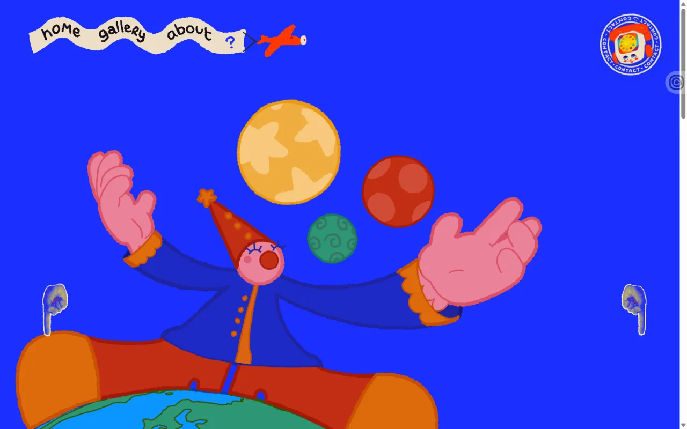 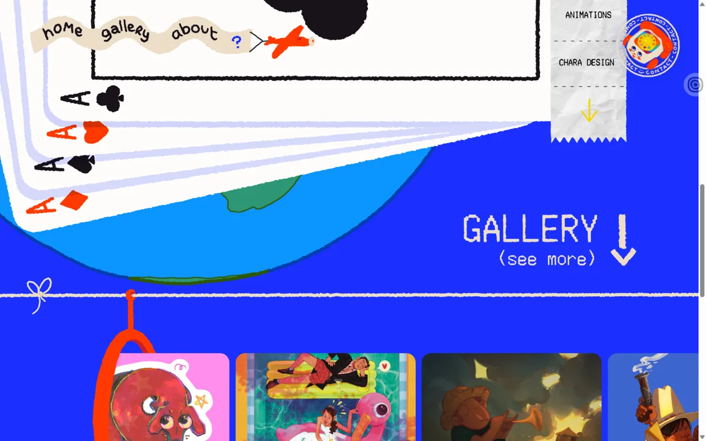

| 항목 | 내용 |
|---|---|
| 주소 | https://loonamessal-art.com/ |
| 출처 | @notefolio 큐레이션 · 가져온 날 2026-09-30 |
| 노션 | `3ead12f2-3255-81b6-99ab-daa10d99e0a4`, `3ead12f2-3255-8141-848c-c93822c5554a` |
| 확인 | ✅ 2026-09-30 · 1440px · Aside |
| 패턴 | `illustration-hero` |
| 패밀리 | 새 패턴 |
| 기술 흔적 | Readymag로 만든 사이트(`<meta generator="Readymag">`, `viewer.js`·`viewer.css` 하나씩, 글꼴은 Google Fonts Poppins). `<canvas>`·`<video>` 없음(홈). 화면은 `.content-scroll-wrapper` 안에서 스크롤되고(문서 자체는 스크롤되지 않음) 홈에서 그림 조각(`rmwidget widget-picture`)이 약 100개다. 주소는 `/home/`·`/portfolio/`·`/about-me/`·`/contact-me/`와 작품마다 `/<작품이름>/`로 나뉜다 |
| 쓰인 작품 | — |

**무엇이 다른가** — 첫 화면이 **공 세 개를 저글링하는 광대 한 명**으로 꽉 차 있다. 파란 바탕에 큰 일러스트(양손·공·지구 위에 앉은 광대)가 놓이고, 왼쪽 위에는 "home gallery about ?" 글자가 적힌 **현수막을 단 비행기**(메뉴), 오른쪽 위에는 전화기 모양 **CONTACT 원형 배지**가 있다. 별도 인트로 연출은 없고 첫 내용이 뜨기까지 약 3초가 걸린 뒤 그림이 그대로 나타난다. 가만히 있어도 그림 조각 100개 중 34개가 계속 조금씩 흔들린다(현수막·배지·공·손). 스크롤하면 **그림 층마다 이동 속도가 달라지고**(400px 스크롤에 광대 그림은 약 320px, 갤러리 타일은 약 290px 이동, 메뉴·연락처 배지는 제자리) 배경이 파랑에서 "A" 카드 그림이 든 흰 장면으로 바뀌며, 아래로 "GALLERY (see more) ↓" 안내와 **가로로 계속 흘러가는 작품 타일 줄**이 나온다. 타일 하나를 누르면 작품 페이지(`/character-design-biisan/`)로 가고 파란 화면 가운데 흰 막대 로딩 바가 잠깐 뜬 뒤(약 2~3초) 구름 머리 그림 아래에 작품 이미지와 제목·분류·설명이 놓인다. 메뉴·제목 글자는 그림이고, 작품 제목·설명은 진짜 텍스트(`widget-text-v3`)다.

| 입력 | 바뀌는 상태 | 보이는 피드백 | 되돌리기 |
|---|---|---|---|
| 가만히 보기 | 광대·현수막·배지·공이 계속 조금씩 흔들린다 | 살아 있는 듯한 첫인상 | 끌 방법이 없다(전체 정지 스위치 없음) |
| 휠 스크롤(400px씩) | 안쪽 스크롤 영역이 움직이고 그림 층이 서로 다른 속도로 이동, 배경이 흰 카드 장면으로 | 광대가 위로 사라지고 "GALLERY (see more)"가 나온다. 메뉴 비행기·CONTACT 배지는 화면에 고정 | 반대로 스크롤 |
| 갤러리 타일 호버 | 커서가 포인터로 바뀐다(타일이 계속 흘러서 호버 전후 변화는 못 봄) | 커서 | 마우스를 뗀다 |
| 타일 클릭 | `/character-design-biisan/`로 이동, 작품 이미지·제목·설명 | 로딩 바 → 작품 페이지 | 브라우저 뒤로 가기(홈으로 복귀), 작품 위 "← GALLERY" 링크(화면상 확인, 눌러 보지 않음). Escape는 반응 없음 |

**대체 경로** — 키보드: Tab을 10번 눌러도 포커스가 문서 body에 머물러 메뉴·타일에 닿지 않았다(Readymag 기본 구조로 보임). Escape로 닫는 조작은 없다. 터치/모바일: `viewer.css`에 `@media (max-width: 768px)`·`(max-width: 1024px)` 규칙이 있고 뷰포트 메타가 있으나 390px은 실측하지 못했다. 동작 줄이기: `viewer.css`와 `viewer.js` 모두 `prefers-reduced-motion` 흔적이 없어(읽을 수 있는 범위) 흔들림·스크롤 타일 줄을 끄는 경로는 없어 보인다(추정, 흉내 내지 못함). 로딩: 첫 그림이 뜨기까지 약 3초. 작품 페이지는 로딩 바가 2~3초 보인다.

**가져올 것** — 첫 화면을 큰 일러스트 하나로 채우고 **가만히 있어도 조금씩 움직이게** 하는 인상, 메뉴를 그림 소품(현수막을 끄는 비행기)에 얹어 일러스트 세계관 안에 넣는 방식, 스크롤에 따라 층마다 속도를 달리해 깊이를 주는 연출, 흘러가는 작품 타일 줄, 페이지 사이 로딩 바

**안 가져올 것** — 멈출 수 없는 첫 화면 움직임(동작 줄이기 대응 없이), 메뉴·안내 글자를 그림에 굽는 것(문구는 레이어 파라미터), Tab으로 닿지 않는 메뉴·타일, 계속 흘러 눌러야 할 타일이 도망가는 줄(누르기 어렵다), 일러스트 용량을 줄이지 않은 채 이미지 100개를 한 화면에 싣는 구성(첫 내용 3초)

**우리 레이어로 옮기면** — `히어로 일러스트`(부위별 분리: 광대 몸·양손·공 3개·지구, 부위마다 흔들림 강도·주기) · `배경`(색·스크롤에 따라 바뀌는 장면) · `메뉴 소품`(현수막 문구·비행기 위치·링크, 문구는 이미지 아님) · `연락처 배지`(크기·회전·주소) · `갤러리 타일 줄`(흐르는 속도·방향·타일 이미지·작품 주소, 멈춤 가능) · `스크롤 층 속도`(층마다 속도 비율) · `작품 페이지 머리`(구름 그림·제목·설명). 흔들림을 끄는 전체 스위치를 둔다.

**확인 한계** — 홈과 작품 페이지 하나만 열었다. About·Contact·Portfolio 페이지는 보지 않았다. 가만히 있을 때의 흔들림은 위치 값 변화로 확인했고(34/100 조각) 어느 조각이 얼마나 흔들리는지 영상으로는 보지 못했다. 스크롤 층 속도 비율은 한 번의 측정이다. 흰 카드 장면으로 배경이 바뀌는 정확한 시점은 보지 않았다. 갤러리 타일 호버 효과와 작품 페이지 "← GALLERY" 링크는 눌러 보지 않았다. 390px 배치·터치·동작 줄이기는 실측하지 못했다. 첫 화면에 별도 인트로 애니메이션이 없다는 판단은 재로딩 때 위젯이 생기는 순간을 4번 샘플링한 결과다(빠른 연출을 놓쳤을 수 있다). 사이트 이미지는 저작물이라 캡처는 내부 참고용이다.

### julesesick · Jules Esick — 클릭하면 사진이 펼쳐지는 포트폴리오

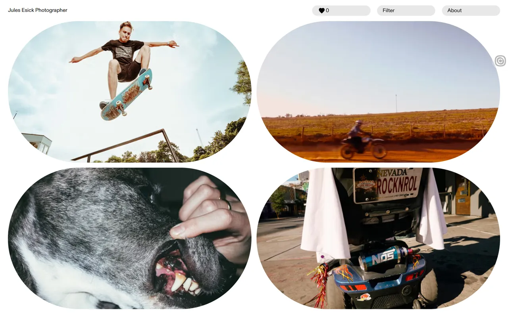 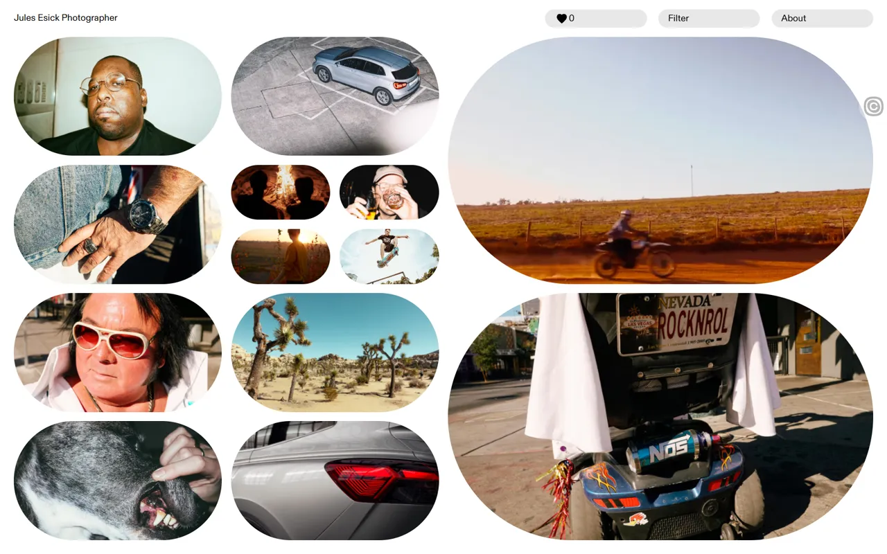

| 항목 | 내용 |
|---|---|
| 주소 | https://www.julesesick.com/ |
| 출처 | @notefolio 큐레이션 · 가져온 날 2026-09-30 |
| 노션 | `3ead12f2-3255-81b6-99ab-daa10d99e0a4`, `3ead12f2-3255-8141-848c-c93822c5554a` |
| 확인 | ✅ 2026-09-30 · 1440px · Aside |
| 패턴 | `expand-gallery` |
| 패밀리 | 새 패턴 |
| 기술 흔적 | Next.js 앱 라우터(`/_next/static/chunks/app/(frontend)/page-….js`)에 Tailwind 식 클래스(`fixed inset-0 z-10` 등)로 보인다(추정). 사진은 `cdn.sanity.io` 이미지 CDN(`?w=960&h=640&fit=min&auto=format`, 라이트박스는 `w=1920`). `<canvas>`·`<video>` 없음, 분석 스크립트 plausible.io. 처음 한 화면이 문서 스크롤 없이 4장(타일 8개 안팎)으로 끝난다 |
| 쓰인 작품 | JOOHO LAB · 2026-10-03 전시 대표 이미지: 그림 중심의 소개와 원본 종횡비 유지만 참고; 사이트 이미지·브랜드·격자 동작은 옮기지 않음 |

**무엇이 다른가** — 첫 화면은 **알약(캡슐) 모양으로 잘라 낸 큰 사진 4장**뿐이고, 위에 이름·하트 수("0")·Filter·About 알약 버튼이 있다(글씨는 진짜 텍스트). 사진 본문을 누르면 **그 자리에서 사진이 4장으로 갈라져** 펼쳐지고, 갈라진 사진을 또 누르면 더 작은 4장으로 갈라진다(주변 타일이 자리를 내준다). 주소는 바뀌지 않는다. 사진에 마우스를 올리면 오른쪽 위에 **↗ 크게 보기**와 **♡ 좋아요** 동그란 버튼이 나오고, ↗를 누르면 **전체 화면 라이트박스**가 열려 사진이 크게 뜨고(뒤는 그 사진을 흐리게 깐 색 배경) 오른쪽에 닫기·좋아요·다음·이전 버튼이 놓인다. 새로고침할 때마다 사진 구성이 달랐다(무작위로 보인다).

| 입력 | 바뀌는 상태 | 보이는 피드백 | 되돌리기 |
|---|---|---|---|
| 사진 본문 클릭 | 그 사진이 4장으로 갈라지며 격자 재배치 | 캡슐 모양 작은 사진들이 그 자리에 생긴다. 호버 때는 사진이 살짝 커진다(추정) | **못 찾았다**: Escape·다시 클릭·주소 모두 무반응. 새로고침하면 처음 4장으로(사진은 다름) |
| 사진에 호버 | ↗·♡ 원형 버튼이 나온다 | 버튼 등장 | 마우스를 뗀다 |
| ↗ 누르기 | 라이트박스(고정 오버레이 3겹, `Close lightbox`·`Next image`·`Previous image`) | 큰 사진과 흐린 배경, ↗가 ↙ 모양(닫기)으로 바뀐다 | **Escape로 닫힘**(확인), 닫기 버튼, 닫은 뒤 포커스가 열었던 ↗ 버튼으로 돌아온다 |
| 라이트박스에서 ←·→ | 사진이 이전·다음으로 바뀐다 | 다른 사진(크기 1280→1273 등 이미지 주소 변화로 확인) | 반대 방향 키 |
| 0(하트) 버튼 | "You can download your liked photos here." 안내 | 작은 안내창, 닫기 버튼 | Close 버튼(Escape는 확인 못 함) |
| Filter 버튼 | Animals·Cars·Day·Fun·Love·Night·People·Things 분류 버튼과 Reset·Confirm | 분류 패널(Reset·Confirm은 처음엔 비활성) | Close, Reset |

**대체 경로** — 키보드: Tab 10번에 Like·Open lightbox 버튼이 차례로 잡히고(사진 본문 타일도 `Open lightbox`라는 이름의 버튼), 라이트박스는 ←·→·Escape가 된다. 본문 클릭이 갈라지기인지 라이트박스인지는 이름만으로 구분되지 않는다(접근성 트리에서 둘 다 "Open lightbox"). 사진 `alt`는 비어 있다(4장 모두). 뒤로 가기: 주소가 바뀌지 않아 라이트박스에서 뒤로 가면 사이트를 떠날 것이다(히스토리 길이가 1인 것만 확인, 눌러 보지는 않음, 닫는 용도로 쓸 수 없다). 터치/모바일: 스타일시트에 `(min-width: 768px) and (pointer: fine)` 조건이 있어 호버 버튼은 데스크톱 마우스 전용이고 터치 배치는 다를 것이다(추정, 390px 실측 못 함). 동작 줄이기: 읽을 수 있는 스타일시트(차단 0건)에 `prefers-reduced-motion` 규칙도 `motion-reduce:` 클래스도 없다(추정, 흉내 내지 못함). 로딩: 첫 열기 FCP 약 4.4초, 재로드 때 약 2.2초, 사진 이미지 4장.

**가져올 것** — 사진을 누르면 **그 자리에서 더 작은 여러 장으로 갈라지는** 펼침(상세 화면으로 이동하지 않고 탐색이 이어진다), 호버 때만 나오는 크게 보기·좋아요 버튼, 라이트박스의 ←·→·Escape 키보드 조작과 닫은 뒤 포커스 복귀, 크게 볼 때 뒤를 그 사진 색으로 흐리게 까는 배경, 분류(Filter)·좋아요 묶음 내려받기 같은 작은 기능

**안 가져올 것** — 갈라진 사진을 **되돌릴 방법이 없는 것**(접기·초기화 필요), 주소·히스토리가 바뀌지 않아 뒤로 가기가 사이트 이탈이 되는 구조, 같은 이름(`Open lightbox`)의 버튼 둘, `alt` 없는 사진, 호버에만 나오는 버튼이 터치에서는 닿지 않을 수 있는 구성, 새로고침마다 바뀌어 같은 사진을 다시 찾기 어려운 무작위 구성

**우리 레이어로 옮기면** — `사진 격자`(캡슐 마스크 모양·간격·한 화면 사진 수·무작위 여부) · `갈라지기`(몇 장으로 갈라질지·최대 깊이·전환 길이·곡선·접기 버튼 여부) · `호버 버튼`(↗·♡ 아이콘·위치·나타나는 조건) · `라이트박스`(배경 흐림 정도·버튼 위치·이전/다음 키·Escape·포커스 복귀) · `머리글 알약`(이름·하트 수·Filter·About 문구는 텍스트 파라미터) · `분류 패널`(분류 이름 목록). 사진 목록 자체는 레이어가 아니라 콘텐츠다(docs/11의 목록형 데이터 규칙).

**확인 한계** — 홈 한 화면만 봤다(About 창·Filter 분류 실제 동작·좋아요 누르기·내려받기는 열어 보거나 눌러 보지 않았다). 갈라지기의 최대 깊이와 갈라질 때 나오는 사진이 같은 묶음인지(같은 장면·분류인지)는 확인하지 못했다. 호버 때 사진이 커진다는 것은 캡처 비교(추정)다. 갈라지기를 되돌리는 방법이 없다는 결론은 Escape·재클릭·하트 수 버튼만 시도한 결과다(Filter의 Reset이 갈라진 상태를 되돌리는지는 확인하지 못했다). 390px 배치·터치·동작 줄이기는 실측하지 못했다. 사이트 이미지는 저작물이라 캡처는 내부 참고용이다. 캡처가 두 번 시간 초과로 실패해 기다린 뒤 다시 찍었다.

